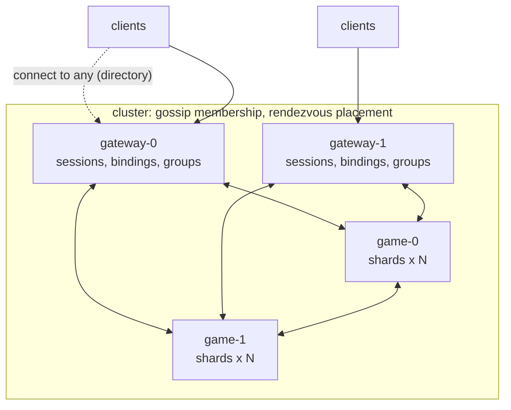
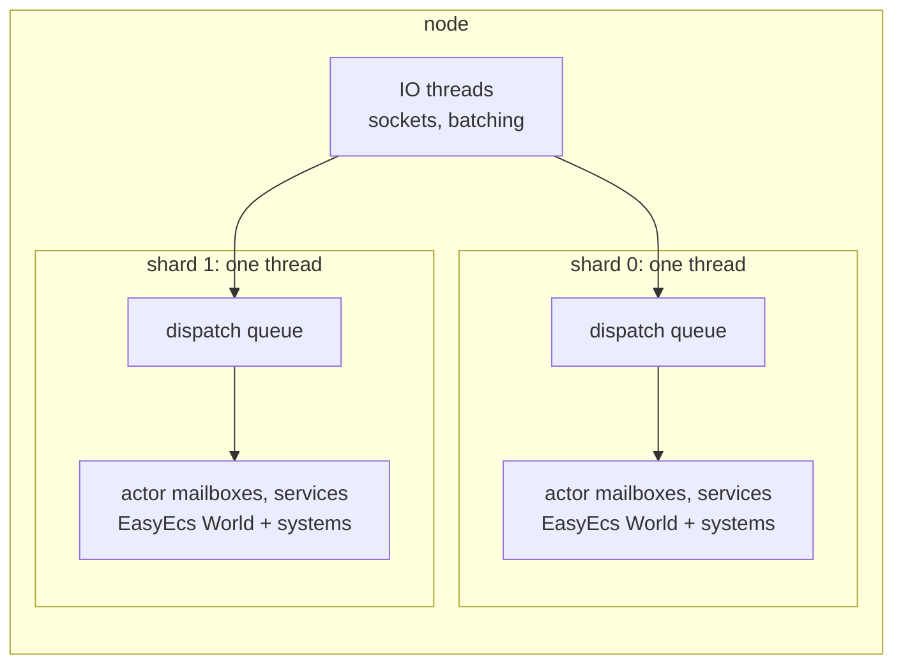

# DaServer

A general-purpose ECS distributed server framework for .NET 10, built for high performance and high concurrency: any
backend made of stateful entities (actors) and stateless services, spread over many nodes. The core knows no
application scenario; an MMO cluster (login, gateways, game server, map servers) is one sample built on it
([samples/mmo](samples/mmo)).

You write **messages** (`[NinoType, Message]` structs), **actors** and **services** with `[Handle]` methods, and **ECS
systems**. Source generators write dispatchers, typed `Ask` overloads, wire ids, registration and the node's entry
point. The runtime handles shards, mailboxes, placement, discovery, gateways and serialization. Aspire runs the cluster
locally and publishes it.

- **Zero GC on hot paths.** Messages serialize straight into pooled buffers. Dispatchers deserialize straight from
  the received bytes. Awaitables are pooled, and broadcasts are serialized once.
- **No locks in business code.** Every actor, service and system runs on its shard's single thread.
- **Stateful and stateless.** Actors have typed ids (`PlayerId`, `MapId`) and are placed on one node by rendezvous hashing. Services are
  load-balanced and prefer the local node. Nodes discover each other through gossip.
- **ECS inside.** Actor state is an [EasyEcs](https://github.com/JasonXuDeveloper/EasyEcs) component on the
  actor's entity, so systems can process every actor of a shard in one cache-friendly pass.
- **Messages, not interfaces.** A message is routed to whoever handles it: `Ask` for a reply, `Send` one-way,
  `Publish` to every service handling it. The sender never names the receiver's type; per-tick logic lives in EasyEcs
  systems.
- **No hard-coded topology.** A node hosts what its project compiles. The AppHost lists projects and replica counts.
- **Reliable links, bounded work.** One ordered stream per node pair resumes after a dropped connection (no loss, no
  duplicate). Requests carry their caller's deadline, and work nobody waits for is dropped. Full dispatch queues and mailboxes answer
  `Overloaded` instead of growing; a client that cannot keep up is disconnected and resynchronizes on reconnect.
- **Misuse is a build error.** Analyzers DAS001–DAS008 cover handlers, messages, wire types, id collisions, message
  flow and stateless actors and services, and EECS001–EECS008 cover ECS, including the ECS principles.

## Architecture





A message is serialized once into a pooled frame. A message for the same node goes straight to the target shard's
dispatch queue; a message for another node is batched onto its TCP link. The target shard's thread sorts it into the
actor's mailbox (or hands it to a service) and runs the generated dispatcher; a reply returns the same way and resumes
the caller on its own shard.

## Vocabulary

Everything a developer declares is one of these. The message type alone decides who handles it.

| Declaration | Meaning |
|---|---|
| `[NinoType, Message] partial record struct M` | A message between servers (actors and services on any node). |
| `[Message(Flow.FromClient)]` | Game clients may send it too. To an actor, it goes to the actor bound to the session. |
| `[Message(Flow.FromClient, AnyId = true)]` | To an actor, the client chooses the id (public rooms). |
| `[Message(Flow.ToClient)]` | Servers push it to client sessions and groups; clients handle it. |
| `[NinoType] partial record struct D` | Data inside messages (fields, replies), never sent on its own. Anything crossing the wire is `[NinoType]`. |
| `... : IRequest<TReply>` | A request: answered with one `TReply`. |
| `[Handle] R On(M m)` | A handler in an actor or service: `void`/`ValueTask`, or the reply/`ValueTask<TReply>` of a request. |
| `partial class S : EcsSystem` with `[ForEach]` | Per-tick logic over every matching entity of the shard. |

| Call | Target |
|---|---|
| `Cluster.Ask(id, new M())` / `Send(id, ...)` | The actor `id` (`MapId`, `PlayerId`: the id type names the actor type; one per cluster, on demand, turn-based). |
| `Cluster.Ask(new M())` / `Send(...)` | The one service handling `M` (load-balanced, local first). |
| `Cluster.Publish(e)` | Every service type handling `e`, once each. |
| `Cluster.Send(session, m)` / `Send(group, m)` | A client session / a client group (`Flow.ToClient` messages; clients handle them with `[Handle]` too). `JoinGroup`, `LeaveGroup` and `Disconnect` sent there are applied by the session's gateway. |

| Element | Responsibility | Never |
|---|---|---|
| **Actor** | The network boundary of one entity with an id: validate a message, then write input as components. Lifecycle and persistence (`OnLoad`, `OnUnload`). | Per-tick logic (that belongs to systems). |
| **Service** | Stateless request and event handling (login, matchmaking, routing). | Keep state between messages. |
| **Component / singleton** | Data of one entity (actor state is `Actor<TId, TState>`) / of one shard world. | Logic. |
| **System** | One per-tick responsibility over all matching entities of a shard. Stateless. | Reference other systems, perform IO. |

Business code reaches the cluster through `ICluster`: `Cluster` in actors and services, `world.Cluster()` in systems.
`Caller` is who sent the running turn's message from outside the cluster, a client session (valid across its awaits;
`Cluster.Send(Caller, m)` answers it, `BindSession(Caller)` binds it).

The runtime owns client sessions: an actor's `await BindSession(session)` routes the client's messages for that actor
type to its id and puts the session in the actor's `Group`; when the session closes (or its gateway crashes),
every actor it was bound to receives `SessionClosed`. A client that loses its connection reconnects on its own and
resumes the session with a signed ticket: its actors receive `SessionResync` (send the full state again) instead, and
`SessionClosed` only if it does not come back within 30 s.

## Example

From the MMO sample [samples/mmo/](samples/mmo) (who runs where and who talks to whom: [samples/mmo/README.md](samples/mmo/README.md)): a login
server, a game server (players, the realm), a map server (maps, movement, area of interest) and gateways that host no
business code.

```csharp
// Ids (one type per actor type: the id type names the actor, so a player id never reaches a map).
public readonly record struct PlayerId(long Value) : IActorId;
public readonly record struct MapId(long Value) : IActorId;

// Messages (shared with clients).
[NinoType, Message(Flow.FromClient)] public partial record struct Login(string Name) : IRequest<LoginResult>;
[NinoType, Message(Flow.FromClient)] public partial record struct EnterMap(MapId Map) : IRequest<bool>;
[NinoType, Message(Flow.FromClient)] public partial record struct Move(float VelocityX, float VelocityY); // input
[NinoType, Message(Flow.FromClient)] public partial record struct Say(string Text);
[NinoType, Message] public partial record struct Attach(SessionRef Session) : IRequest<bool>;  // servers only
[NinoType, Message] public partial record struct Enter(PlayerId Player, SessionRef Session) : IRequest<bool>;
[NinoType, Message(Flow.ToClient)] public partial record struct Chat(PlayerId Player, string Text); // pushed

// Login project: a stateless service.
public sealed class Account : Service
{
    [Handle]
    public async ValueTask<LoginResult> On(Login m)
    {
        var player = Accounts.IdOf(m.Name);                                    // a PlayerId
        bool attached = await Cluster.Ask(player, new Attach(Caller)); // the Player actor of that id
        return new LoginResult(attached, player);
    }
}

// Game project: actors turn messages into data...
public sealed class Player : Actor<PlayerId, PlayerState>
{
    [Handle]
    public async ValueTask<bool> On(Attach m)
    {
        await BindSession(m.Session);               // the client's Player messages reach this player from now on
        State.Logins++;                             // re-read after awaiting
        return true;
    }

    [Handle]
    public async ValueTask<bool> On(EnterMap m)
    {
        await Cluster.Ask(m.Map, new Enter(Id, Caller)); // zero allocation
        State.Map = m.Map;
        return true;
    }

    [Handle] public void On(SessionClosed _) => State.Map = default;
}

// Actor state is a component; field initializers run when the actor loads (no OnLoad boilerplate).
public struct MapState() : IComponent
{
    public readonly Dictionary<SessionRef, Entity> Avatars = new();
}

public sealed class Map : Actor<MapId, MapState>
{
    [Handle]
    public async ValueTask<bool> On(Enter m)
    {
        State.Avatars[m.Session] = World.CreateEntity(new Position(), new Velocity(), new Avatar(m.Player, Entity, m.Session));
        await BindSession(m.Session);               // its input reaches this map, it sees Group broadcasts
        return true;
    }

    [Handle]
    public void On(Move m) =>                      // input is data: systems integrate it
        State.Avatars[Caller].Get<Velocity>() = new(m.VelocityX, m.VelocityY);

    [Handle]
    public void On(Say m) =>
        Cluster.Send(Group, new Chat(State.Avatars[Caller].Get<Avatar>().Player, m.Text));
}

// ...and systems do the per-tick work, one responsibility each.
public sealed partial class MovementSystem : EcsSystem
{
    [ForEach] static void Move(ref Position p, in Velocity v) => p = new(p.X + v.X, p.Y + v.Y);
}

public sealed partial class RealmBroadcastSystem : EcsSystem        // every 5 ticks, to every session of the cluster
{
    public override int UpdateInterval => 5;

    [ForEach]
    static void Broadcast(in RealmState realm, World world) =>
        world.Cluster().Send(ClientGroup.All, new RealmStatus(world.Tick(), realm.Online.Count, DateTime.UtcNow.Ticks));
}

// Client (bot, game): the same messages, one well-known address.
class Bot
{
    [Handle] public void On(Chat m) => Console.WriteLine(m.Text);   // pushes are handled like any message
}

var client = new ClusterClient();
client.Register(new Bot());
await client.ConnectAsync("play.example.com", 7100);          // directed to the least loaded gateway
await client.Ask(new Login("alice"));
await client.Ask(new EnterMap(new MapId(1)));               // to the bound player (session binding)
client.Send(new Move(1, 0));
```

A node project needs no `Program.cs`: the generator emits the entry point (Generic Host, configuration, OpenTelemetry,
a periodic stats line, graceful shutdown). Write one to customize the host.

## Orchestration with Aspire

```csharp
var builder = DistributedApplication.CreateBuilder(args);
builder.AddDockerComposeEnvironment("compose");            // `aspire publish` writes docker-compose files

var cluster = builder.AddDaServerCluster("sample");
cluster.AddNodes<Projects.Sample_LoginServer>("login");                     // Account service
cluster.AddNodes<Projects.Sample_GameServer>("game");                       // Player, Realm actors
cluster.AddNodes<Projects.Sample_MapServer>("map");                         // Map actors, movement/AOI systems
var gateways = cluster.AddGateways<Projects.Sample_Gateway>("gateway", replicas: 3); // client sockets, no business code

builder.AddProject<Projects.Sample_Bot>("bots").WithGateways(gateways).WithArgs("10000", "60", "1", "1", "0");
builder.Build().Run();
```

`AddDaServerCluster` gives every node a name, a cluster endpoint and seeds; `AddGateways` adds a client endpoint (the
`DaServer:Clients` section). A client connects to any gateway (in production: the platform's load balancer or DNS name)
and is directed to the less loaded of two (power of two choices over the gossiped session counts). There
are no roles and no configuration files: what a node hosts is what its project compiles. Nodes export logs and
metrics over OpenTelemetry, which feeds the Aspire dashboard. The same model runs with
`dotnet run --project samples/mmo/Sample.AppHost` and publishes with `aspire publish` (`AddKubernetesEnvironment` for
Kubernetes).

## Performance

Measured on one 4-core VM (servers, bots and the kernel share it), Release builds.

**10k-player scenario** ([Sample.AppHost](samples/mmo/Sample.AppHost), [Sample.Bot](samples/mmo/Sample.Bot)): a login
node, a game node, a map node and 3 gateways (the AppHost's topology, here as plain processes without telemetry; these
numbers were taken with a fourth gateway that only directed clients, re-measured at the G release check). 10,000 bots
connect through a gateway's address and are directed to the less loaded gateway, log in and enter a map; the realm broadcasts its status to every session
every 5 ticks (20 ticks/s). Two loads, 60 s measured window each:

- **One map** (the AppHost default): all 10,000 players in one map on one map node, each changing direction once a
  second. Area of interest (the sample's `Interest.cs`): a 20x20 grid, each cell a client group, each player sees the
  3x3 cells around it; updates carry velocity and go out when it changes (dead reckoning), every other tick.
- **Chatting**: 100 maps of 100 players, one chat line every 10 s per bot, sent to the map.

| | One map (AOI) | Chatting |
|---|---|---|
| Realm broadcasts delivered (every bot every one, in order) | 2,400,000 | 2,400,000 |
| Map traffic delivered to clients | ~2,500,000 positions/s | ~100,000 lines/s |
| Broadcast latency (game system to bot callback) | p50 46 ms, p99 106 ms | p50 35 ms, p99 57 ms |
| Game node | 3% CPU, 0–5 KB/s allocated | 2% CPU, ~32 KB/s (chat strings) |
| Each gateway (~3,300 sessions) | 11–12% CPU, 0 KB/s | 5–6% CPU, 0–7 KB/s |
| GCs on servers, disconnects, gaps | 0 | 0 |

(CPU is the share of all 4 cores; the login node stays at 1% and 0 KB/s; with Aspire's OTLP telemetry on, the
exporter adds ~55 KB/s per node.) The bot process and the kernel's loopback use most of the machine, so latency is
mostly theirs. Without area of interest, 10,000 players in one map is a bandwidth problem, not a CPU one: every
position to everyone each tick is 10,000 x 10,000 x 20 = 2 billion entries a second (~40 GB/s); even with dead
reckoning, every turn to everyone is 100 million entries (~2.4 GB/s) a second. On this machine both overflow the
clients (the per-session send bound then disconnects them or, below it, memory grows to the bound) while the game
node stays under 10% CPU.

**Scale-out**: start 3,000 bots on 2 gateways (1,508 / 1,492 sessions), start a third gateway process with only a seed
address, then 3,000 more bots: the directory learns of it through gossip and sends it 1,961 of them (2,017 / 2,022 /
1,961). Both waves pass (no gap, no disconnect). Cluster test: `ANodeStartedLaterIsDiscoveredAndReceivesTheNewClients`.

**BenchmarkDotNet** ([benchmarks/](benchmarks/DaServer.Benchmark), short job; Allocated includes the clients):

| Benchmark | Case | Mean | Allocated |
|---|---|---:|---:|
| Broadcast to every session, game node through 3 gateways | 3,000 clients | 12.7 ms | 4.2 KB |
| | 9,000 clients | 38.8 ms | 16.6 KB |
| Group broadcast through 1 gateway | 1,000 clients | 5.0 ms | 456 B |
| | 5,000 clients | 21.5 ms | 895 B |
| One-way messages to 64 actors, bursts of 1,024 (per message) | same node / other node | 4.2 µs / 2.5 µs | 0 |
| 1,024 concurrent actor calls, all completed | same node / other node | 3.4 ms / 2.1 ms | 252 B |
| 1 actor call, round trip | same node / other node | 34 µs / 128 µs | 104 B / 167 B |

## Build, test, benchmark

```bash
dotnet build DaServer.slnx
dotnet test DaServer.slnx
dotnet run -c Release --project benchmarks/DaServer.Benchmark -- --filter '*'
```

EasyEcs comes from NuGet (`EasyEcsVersion` in `Directory.Build.props`).

## Documentation

- [doc/requirements.md](doc/requirements.md): requirements, acceptance criteria and the release checklist.
- [doc/design.md](doc/design.md): architecture, wire protocol, performance, latency, reliability, membership,
  reference architectures, ECS usage, generated code.
- [doc/decisions.md](doc/decisions.md): architecture decision records.
- [doc/roadmap.md](doc/roadmap.md): status and next steps.

## License

MIT
