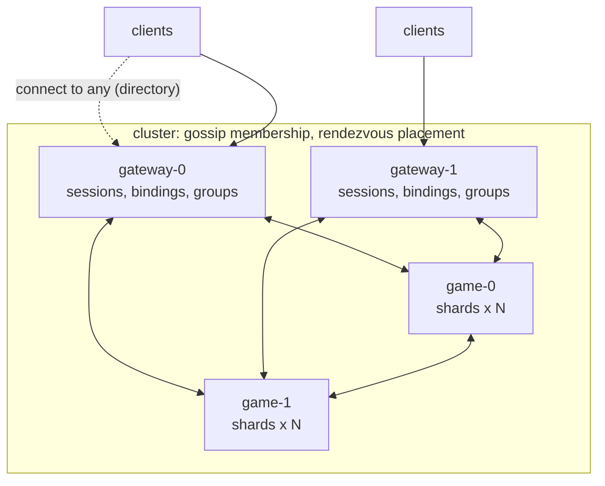
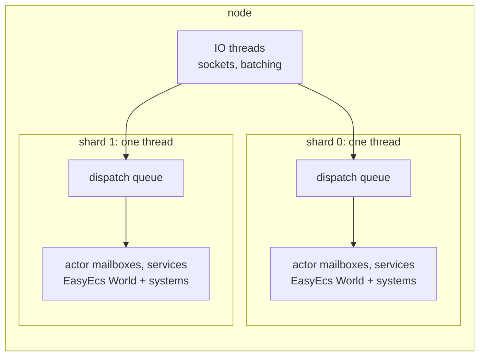

# DaServer

A general-purpose ECS distributed server framework for .NET 11, built for high performance and high concurrency: any
backend made of stateful entities (actors) and stateless services, spread over many nodes. The core knows no
application scenario; an MMO cluster (login, gateways, game server, map servers) is one sample built on it
([samples/mmo](samples/mmo)).

You write **messages** (`[NinoType, Message]` structs), **actors** and **services** with `[Handle]` methods, and **ECS
systems**. Source generators write dispatchers, typed `Ask` overloads, and registration; type
ids are FNV-1a hashes of the type names. The runtime handles shards, mailboxes, placement, discovery, client connections and serialization. Aspire runs the cluster
locally and publishes it.

- **Zero GC on hot paths.** Messages serialize straight into pooled buffers. Dispatchers deserialize straight from
  the received bytes. Awaitables are pooled, and broadcasts are serialized once.
- **No locks in business code.** Every actor, service and system runs on its shard's single thread.
- **Stateful and stateless.** Actors have typed ids (`PlayerId`, `MapId`) and are placed on one node by rendezvous hashing. Services are
  load-balanced and prefer the local node. Nodes discover each other through gossip.
- **ECS inside.** Actor state is an [EasyEcs](https://github.com/JasonXuDeveloper/EasyEcs) component on the
  actor's entity, so systems can process every actor of a shard in one cache-friendly pass.
- **Messages, not interfaces.** A message is routed to whoever handles it: `Ask` for a reply, `Send` one-way,
  `Publish` to every service handling it. The sender never names the receiver's type; per-tick logic lives in EasyEcs
  systems.
- **No hard-coded topology.** A node hosts what its project compiles. The AppHost lists projects and replica counts.
- **Reliable links, bounded work.** One ordered stream per node pair resumes after a dropped connection (no loss, no
  duplicate). Requests carry their caller's deadline, and work nobody waits for is dropped. Full dispatch queues and mailboxes answer
  `Overloaded` instead of growing; a client that cannot keep up is disconnected and resynchronizes when it resumes.
- **Misuse is a build error.** Analyzers DAS001–DAS016 cover handlers, messages, wire types, id collisions, message
  flow, stateless actors and services, shared logic, replies sent later, waits and threads on shards, components apart
  from logic, persisted and handed-off components and placement, and EECS001–EECS008 cover ECS, including the ECS
  principles.

## Architecture





A message is serialized once into a pooled frame. A message for the same node goes straight to the target shard's
dispatch queue; a message for another node is batched onto its TCP link. The target shard's thread sorts it into the
actor's mailbox (or hands it to a service) and runs the generated dispatcher; a reply returns the same way and resumes
the caller on its own shard.

## Vocabulary

Everything a developer declares is one of these. The message type alone decides who handles it.

| Declaration | Meaning |
|---|---|
| `[NinoType, Message] partial record struct M` | A message between servers (actors and services on any node). |
| `[Message, FromClient]` | Game clients may send it too. To an actor, it goes to the actor bound to the session, or to the actor the client names if that actor granted the session (`GrantSession`). |
| `[Message, ToClient]` | Servers push it to client sessions and groups; clients handle it. |
| `[NinoType] partial record struct D` | Data inside messages (fields, replies), never sent on its own. Anything crossing the wire is `[NinoType]`. |
| `... : IRequest<TReply>` | A request: answered with one `TReply`. |
| `[Handle] R On(M m)` | A handler in an actor or service: `void`/`Reply`, or the reply/`Reply<TReply>` of a request (`async Reply<T>` handlers allocate nothing when they await). |
| `partial class S : EcsSystem` with `[ForEach]` | Per-tick logic over every matching entity of the shard. |

| Call | Target |
|---|---|
| `Cluster.Ask(id, new M())` / `Send(id, ...)` | The actor `id` (`MapId`, `PlayerId`: the id type names the actor type; one per cluster, on demand, turn-based). |
| `Cluster.Ask(seatId, ...)` with `SeatId : IActorId, IPlaced` | The actor, placed by its id's `Placement`: actors of any type with the same placement share a node and a shard (a room and its seats), so their messages stay local. |
| `Cluster.Ask(new M())` / `Send(...)` | The one service handling `M` (load-balanced, local first). |
| `Cluster.Publish(e)` | Every service type handling `e`, once each. |
| `Cluster.Send(session, m)` / `Send(group, m)` | A client session / a client group (`[ToClient]` messages; clients handle them with `[Handle]` too). `JoinGroup`, `LeaveGroup` and `Disconnect` sent there are applied by the node holding the session. |

| Element | Responsibility | Never |
|---|---|---|
| **Actor** | The network boundary of one entity with an id: validate a message, then write input as components. Lifecycle and persistence (`OnLoad`, `OnUnload`). | Per-tick logic (that belongs to systems). |
| **Service** | Stateless request and event handling (login, matchmaking, routing). | Keep state between messages. |
| **Component / singleton** | Data of one entity (actor state is `Actor<TId, TState>`) / of one shard world. | Logic. |
| **System** | One per-tick responsibility over all matching entities of a shard. Stateless. | Reference other systems, perform IO. |

Business code reaches the cluster through `ICluster`: `Cluster` in actors and services, `world.Cluster()` in systems.
`Caller` is who sent the running turn's message from outside the cluster, a client session (in actors valid across the
turn's awaits, in services until the first await;
`Cluster.Send(Caller, m)` answers it, `BindSession(Caller)` binds it, `GrantSession(Caller)` admits it). A handler that
only waits for an acknowledgement returns `ReplyWhen(BindSession(m.Session), true)`: its actor takes the next message
at once and the reply follows the binding (ADR-057).

The runtime owns client sessions: an actor's `await BindSession(session)` routes the client's messages for that actor
type to its id and puts the session in the actor's `Group`; `await GrantSession(session)` lets the client name the
actor (`client.Send(roomId, new Say(..))`: a room admitting a player) and puts it in the `Group` too. A client can
name no other actor: anything else is refused at the edge. When the session closes (or its node crashes), every
actor it was bound or granted to receives `SessionClosed`. A client that loses its connection reconnects on its own and
resumes the session with a signed ticket: its actors receive `SessionResumed` (send the full state again) instead, and
`SessionClosed` only if it does not come back within 30 s.

## Example

From the MMO sample [samples/mmo/](samples/mmo) (who runs where and who talks to whom: [samples/mmo/README.md](samples/mmo/README.md)): a login
server, a game server (players, the realm), a map server (maps, movement, area of interest) and gateways that host no
business code.

```csharp
// Ids (one type per actor type: the id type names the actor, so a player id never reaches a map).
public readonly record struct PlayerId(long Value) : IActorId;
public readonly record struct MapId(long Value) : IActorId;

// Messages (shared with clients).
[NinoType, Message, FromClient] public partial record struct Login(string Name) : IRequest<LoginResult>;
[NinoType, Message, FromClient] public partial record struct EnterMap(MapId Map) : IRequest<bool>;
[NinoType, Message, FromClient] public partial record struct Move(float VelocityX, float VelocityY); // input
[NinoType, Message, FromClient] public partial record struct Say(string Text);
[NinoType, Message] public partial record struct Attach(ClientSession Session) : IRequest<bool>;  // servers only
[NinoType, Message] public partial record struct Enter(PlayerId Player, ClientSession Session) : IRequest<bool>;
[NinoType, Message, ToClient] public partial record struct Chat(PlayerId Player, string Text); // pushed

// Login project: a stateless service.
public sealed class Account : Service
{
    [Handle]
    public async Reply<LoginResult> On(Login m)
    {
        var player = new PlayerId(Hash(m.Name));                               // a real game looks the account up
        bool attached = await Cluster.Ask(player, new Attach(Caller)); // the Player actor of that id
        return new LoginResult(attached, player);
    }
}

// Game project: actors turn messages into data...
public sealed class Player : Actor<PlayerId, PlayerState>
{
    [Handle]
    public async Reply<bool> On(Attach m)
    {
        await BindSession(m.Session);               // the client's Player messages reach this player from now on
        State.Logins++;                             // re-read after awaiting
        return true;
    }

    [Handle]
    public async Reply<bool> On(EnterMap m)
    {
        await Cluster.Ask(m.Map, new Enter(Id, Caller)); // the call allocates nothing
        State.Map = m.Map;
        return true;
    }

    [Handle] public void On(SessionClosed _) => State.Map = default;
}

// Actor state is a component; field initializers run when the actor loads (no OnLoad boilerplate).
public struct MapState() : IComponent
{
    public readonly Dictionary<ClientSession, Entity> Avatars = new();
}

public sealed class Map : Actor<MapId, MapState>
{
    [Handle]
    public async Reply<bool> On(Enter m)
    {
        State.Avatars[m.Session] = World.CreateEntity(new Position(), new Velocity(), new Avatar(m.Player, Entity, m.Session));
        await BindSession(m.Session);               // its input reaches this map, it sees Group broadcasts
        return true;
    }

    [Handle]
    public void On(Move m) =>                      // input is data: systems integrate it
        State.Avatars[Caller].Get<Velocity>() = new(m.VelocityX, m.VelocityY);

    [Handle]
    public void On(Say m) =>
        Cluster.Send(Group, new Chat(State.Avatars[Caller].Get<Avatar>().Player, m.Text));
}

// ...and systems do the per-tick work, one responsibility each.
public sealed partial class MovementSystem : EcsSystem
{
    [ForEach] static void Move(ref Position p, in Velocity v) => p = new(p.X + v.X, p.Y + v.Y);
}

public sealed partial class RealmBroadcastSystem : EcsSystem        // every 5 ticks, to every session of the cluster
{
    public override int UpdateInterval => 5;

    [ForEach]
    static void Broadcast(in RealmState realm, World world) =>
        world.Cluster().Send(ClientGroup.All, new RealmStatus(world.Tick(), realm.Online.Count, DateTime.UtcNow.Ticks));
}

// Client (bot, game): the same messages, one well-known address.
var client = new ClusterClient();
client.Register(new ChatLog());                             // what servers push to this client
await client.ConnectAsync("play.example.com", 7100);        // the platform's load balancer or DNS name: the node reached
                                                            // there may answer "connect to node X instead" (the less
                                                            // loaded of two), and the client reconnects to X directly
await client.Ask(new Login("alice"));
await client.Ask(new EnterMap(new MapId(1)));               // to the bound player (session binding)
client.Send(new Move(1, 0));

class ChatLog
{
    [Handle] public void On(Chat m) => Console.WriteLine(m.Text);   // pushes are handled like any message
}
```

A node's `Program.cs` is five lines; `AddDaServer` brings the node, configuration, health checks, OpenTelemetry, a
periodic stats line and graceful shutdown, and each capability is one more line:

```csharp
var builder = WebApplication.CreateBuilder(args);
builder.AddDaServer();
var app = builder.Build();
app.MapDaServer();   // /health, /alive; map your own endpoints next to it
app.Run();
```

Packages (ADR-052): contract projects reference `DaServer.Abstractions`; clients (Unity through netstandard2.1, bots,
tools) reference `DaServer.Client`; node projects reference `DaServer.Hosting` (server runtime `DaServer`), and
`DaServer.Persistence.PostgreSql` when they keep actor records. The wire
and transport both sides share are `DaServer.Core`. The generator ships with Abstractions. `DaServer.Simulation`
(client side, ADR-056) runs thousands of simulated users against a cluster for end-to-end and load tests: client
worlds on their own threads, behavior as HTN planning over ECS data, swarms that measure and judge
([samples/mmo](samples/mmo#bots) drives its real game client with it).

## Persistence

Components marked `[Persist]` (Nino structs in a components project) are an actor's stored state (ADR-068). The
runtime restores them before `OnLoad` when the actor loads, on any node, writes them when it unloads and every
`SaveEvery` (30 s) while they changed, and at once for an entity tagged `SaveNow`. Writes are versioned: a node that
lost ownership cannot overwrite the new owner's state. Components without `[Persist]` (sessions, caches) are rebuilt.

```csharp
[NinoType, Persist] public partial record struct PlayerProfile(string Name, int Logins) : IComponent;
```

When an actor changes node (scaling out or in, a node stopping), its record goes straight to the new owner on the
link its mail follows, so moves neither read nor write the store; components marked `[Handoff]` move too without
being stored (a fight in progress, cooldowns). Without a store, `[Persist]` and `[Handoff]` state still moves.

A node keeps records in PostgreSQL with one line in its Program.cs, `builder.AddPostgreSqlActorStore()`, and the
AppHost passes the database: `cluster.AddNodes<Projects.Sample_GameServer>("game").WithActorStore(actors)`.
Relational, queried data (accounts, payments, rankings) belongs in services with your own data access.

## Testing

`DaServer.Testing` starts real nodes in the test process (loopback, the production runtime and wire). With a manual
clock the test decides when ticks happen: each `TickAsync` runs one tick on every shard and fires what fell due
(`SendAfter`, idle unloads, checkpoints), so per-tick logic is counted exactly
([Sample.Tests/ServerTests.cs](samples/mmo/Sample.Tests/ServerTests.cs)).

```csharp
await using var cluster = await TestCluster.StartAsync(o => { o.ManualTime = true; o.ClientConnections = true; });
var client = await cluster.ConnectAsync(heard);           // an object with [Handle] methods for the pushes
await client.Ask(new Login("ann"));
await cluster.TickAsync(15);                              // exactly 15 ticks on every shard
```

Actors, services and systems read time from `Time` (`world.Time()` in systems), the clock tests move.

## Rolling upgrades

Old and new nodes run side by side while a deployment rolls. A new field goes into a new message or a new persisted
component; the one exception is a message, reply or persisted component made only of value fields, which may append
fields (an older payload reads with zeros for them). Each project commits a `wire.manifest`: the build fails (DAS017)
when a change would break the other build and asks to record compatible ones (DAS018) with
`dotnet build -p:UpdateWireManifest=true`. While builds differ, a message goes only to nodes whose build handles it
(ADR-076, ADR-077).

## Samples

- [`samples/mmo`](samples/mmo): an MMO (login, game, maps, gateways) with 10,000 bots that run the real client.
- [`samples/flashsale`](samples/flashsale): a million buyers for 100 units over the client protocol: waiting room,
  sharded stock, idempotent orders.

## Orchestration with Aspire

```csharp
var builder = DistributedApplication.CreateBuilder(args);
builder.AddDockerComposeEnvironment("compose");            // `aspire publish` writes docker-compose files

var cluster = builder.AddDaServerCluster("sample");
cluster.AddNodes<Projects.Sample_LoginServer>("login");                     // Account service
var actors = builder.AddPostgres("postgres").WithDataVolume().AddDatabase("actors");
cluster.AddNodes<Projects.Sample_GameServer>("game").WithActorStore(actors); // Player, Realm actors
cluster.AddNodes<Projects.Sample_MapServer>("map");                         // Map actors, movement/AOI systems
var gateways = cluster.AddNodes<Projects.Sample_GatewayServer>("gateway", replicas: 3).WithClientConnections(); // clients, no business code

builder.AddProject<Projects.Sample_Bot>("bots").WithClientEndpoints(gateways).WithArgs("--bots", "10000", "--seconds", "60"); // simulated players
builder.Build().Run();
```

`AddDaServerCluster` gives every node a name, a cluster endpoint and seeds; `WithClientConnections` adds a client endpoint (the
`DaServer:Clients` section). A client connects to any client-facing node (in production: the platform's load balancer or DNS name);
that node picks the less loaded of two client-facing nodes from the gossiped session counts (power of two choices)
and, if it is another one, answers with its address, and the client connects there directly (`Redirect`, ADR-026):
the balancer only spreads first connections, no traffic is forwarded through it or between nodes. There
are no roles and no configuration files: what a node hosts is what its project compiles. Nodes export logs and
metrics over OpenTelemetry, which feeds the Aspire dashboard. The same model runs with
`dotnet run --project samples/mmo/Sample.AppHost` and publishes with `aspire publish` (`AddKubernetesEnvironment` for
Kubernetes).

## Performance

Measured on one 4-core VM (servers, bots and the kernel share it), Release builds.

**10k-player scenario** ([Sample.AppHost](samples/mmo/Sample.AppHost), [Sample.Bot](samples/mmo/Sample.Bot)): a login
node, a game node, a map node and 3 gateways writing to clients on a 2 ms beat (ADR-070; the AppHost's topology, the
one-map column through Aspire with `tests/DaServer.E2E`, the chatting column as plain processes). 10,000 bots
connect through a gateway's address and are directed to the less loaded gateway, log in and enter a map; the realm broadcasts its status to every session
every 5 ticks (20 ticks/s). Two loads, 60 s measured window each:

- **One map** (the AppHost default): all 10,000 players in one map on one map node, each changing direction once a
  second. Area of interest (the sample's `Interest.cs`): a 20x20 grid, each cell a client group, each player sees the
  3x3 cells around it; updates carry velocity and go out when it changes (dead reckoning), every other tick.
- **Chatting**: 100 maps of 100 players, one chat line every 10 s per bot, sent to the map.

| | One map (AOI) | Chatting |
|---|---|---|
| Realm broadcasts delivered (every bot every one, in order) | 2,400,000 | 2,400,000 |
| Map traffic delivered to clients | ~2,500,000 positions/s | ~100,000 lines/s |
| Broadcast latency (game system to bot callback) | p50 75 ms, p99 199 ms, p99.9 250 ms | p50 35 ms, p99 57 ms |
| Game node | 3% CPU, 0–5 KB/s allocated | 2% CPU, ~32 KB/s (chat strings) |
| Each gateway (~3,300 sessions) | 11–12% CPU, 0 KB/s | 5–6% CPU, 0–7 KB/s |
| GCs on servers, disconnects, gaps | 0 | 0 |

(CPU is the share of all 4 cores; the login node stays at 1% and 0 KB/s; with Aspire's OTLP telemetry on, the
exporter adds ~55 KB/s per node.) The bot process and the kernel's loopback use most of the machine, so latency is
mostly theirs. Without area of interest, 10,000 players in one map is a bandwidth problem, not a CPU one: every
position to everyone each tick is 10,000 x 10,000 x 20 = 2 billion entries a second (~40 GB/s); even with dead
reckoning, every turn to everyone is 100 million entries (~2.4 GB/s) a second. On this machine both overflow the
clients (the per-session send bound then disconnects them or, below it, memory grows to the bound) while the game
node stays under 10% CPU.

**Scale-out**: start 3,000 bots on 2 gateways (1,508 / 1,492 sessions), start a third gateway process with only a seed
address, then 3,000 more bots: the directory learns of it through gossip and sends it 1,961 of them (2,017 / 2,022 /
1,961). Both waves pass (no gap, no disconnect). Cluster test: `ANodeStartedLaterIsDiscoveredAndReceivesTheNewClients`.

**BenchmarkDotNet** ([benchmarks/](benchmarks/DaServer.Benchmark), default job, one 4-core VM, .NET 11 RC2; Allocated
is per operation and includes the benchmark's clients):

| Benchmark | Case | Mean | Allocated |
|---|---|---:|---:|
| Broadcast to every session, game node through 3 client-facing nodes | 3,000 clients | 13.2 ms | 96 B |
| | 9,000 clients | 47.2 ms | 129 B |
| Group broadcast through 1 client-facing node (1 / 9 groups) | 1,000 clients | 5.4 / 5.9 ms | 220 B |
| | 5,000 clients | 26.2 / 28.9 ms | 232 B |
| One-way messages to 64 actors, bursts of 1,024 (per message) | same node / other node | 620 ns / 981 ns | 0 |
| 64 / 1,024 concurrent actor calls, all completed | same node | 218 µs / 1.88 ms | 112 B |
| | other node | 335 µs / 1.67 ms | 112 B |
| 1 actor call, round trip | same node / other node | 20 µs / 101 µs | 112 B |

Against the agreed baseline (d676d2a on .NET 10, same machine, run back to back): calls 11-55% faster, one-way
messages 45-88% faster, broadcasts 0 to +5% and the 3k / 9k scenario -12% / +7% (within noise), allocations no higher. How much
comes from .NET 11 alone: ADR-054.

## Build, test, benchmark

```bash
dotnet build DaServer.slnx
dotnet test DaServer.slnx
dotnet run -c Release --project benchmarks/DaServer.Benchmark -- --filter '*'
```

EasyEcs comes from NuGet (`EasyEcsVersion` in `Directory.Build.props`).

## Documentation

- [doc/requirements.md](doc/requirements.md): requirements, acceptance criteria and the release checklist.
- [doc/design.md](doc/design.md): architecture, wire protocol, performance, latency, reliability, membership,
  reference architectures, ECS usage, generated code.
- [doc/decisions.md](doc/decisions.md): architecture decision records.
- [doc/roadmap.md](doc/roadmap.md): status and next steps.

## License

MIT
