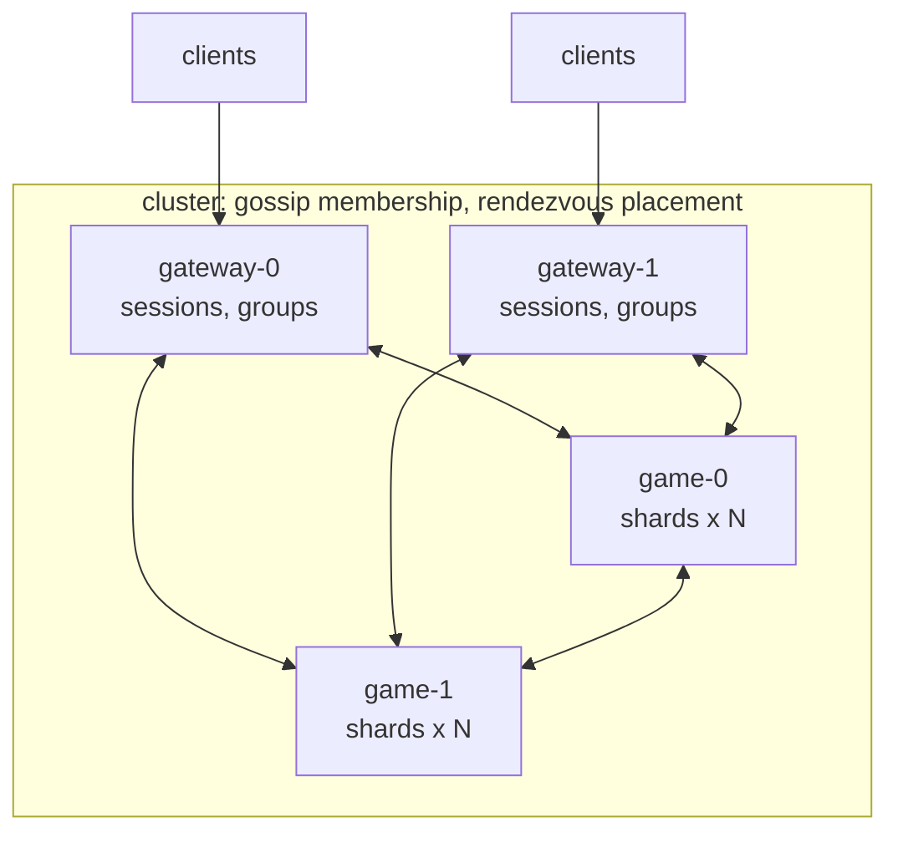
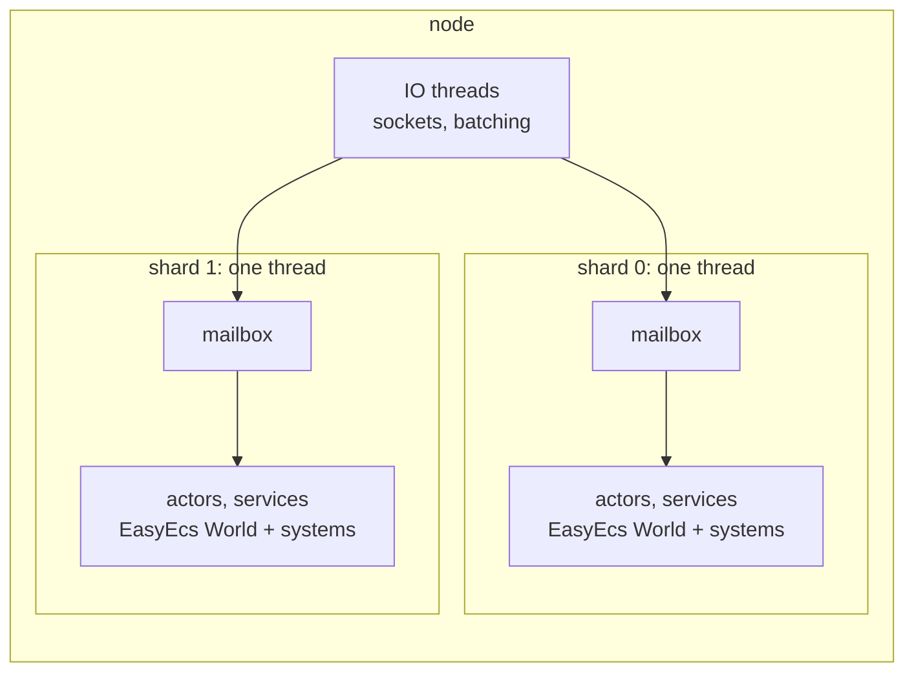

# DaServer

A .NET 10 framework for low-latency, high-concurrency clusters: game servers with many gateways and many map/logic
nodes, and any backend made of stateful entities and stateless services.

You write **contracts** (interfaces), **actors** and **services** that implement them, and **ECS systems**. Source
generators write proxies, dispatchers, wire ids and registration. The runtime handles shards, mailboxes, placement,
discovery, gateways and serialization. Aspire runs the cluster locally and publishes it.

- **Zero GC on hot paths.** Struct proxies serialize arguments straight into pooled buffers. Dispatchers deserialize
  straight from the received bytes. Awaitables are pooled, and broadcasts are serialized once.
- **No locks in business code.** Every actor, service and system runs on its shard's single thread.
- **Stateful and stateless.** Actors are keyed and placed on one node by rendezvous hashing. Services are
  load-balanced and prefer the local node. Nodes discover each other through gossip.
- **ECS inside.** Actor state is an [EasyEcs](https://github.com/JasonXuDeveloper/EasyEcs) component on the
  actor's entity, so systems can process every actor of a shard in one cache-friendly pass.
- **Misuse is a build error.** Analyzers DAS001–DAS008 cover DaServer contracts, and EECS001–EECS008 cover ECS,
  including the ECS principles.

## Architecture





A call goes from the generated proxy into a pooled frame. A call to the same node goes straight to the target
shard's mailbox; a call to another node is batched onto its TCP link. The target shard's thread runs the generated
dispatcher, then the reply returns the same way and resumes the caller on its own shard.

## Responsibilities

| Element | Responsibility | Never |
|---|---|---|
| Contract (`IActor`, `IService`, `IClientCallback`) | The messages a component of the cluster accepts. | Implementation details, properties, `Task`. |
| **Actor** | The network boundary of one keyed entity: validate a call, then write input as components or events. Lifecycle and persistence (`OnActivateAsync`, `OnDeactivateAsync`). | Per-tick logic (that belongs to systems). |
| **Service** | Stateless request handling (login, matchmaking, routing). | Keep state between calls. |
| **Component** | Data of one entity, including actor state (`Actor<TState>`). | Logic. |
| **System** | One per-tick responsibility over all matching entities of a shard. Stateless. | Reference other systems, perform IO. |
| **Event** | One-way, in-shard notification between systems and actors. | Commands to a specific receiver. |

These rules are enforced where they can be checked (see [doc/design.md](doc/design.md#8-ecs-in-daserver)).

## Example

```csharp
// Contracts (shared with clients)
[ClientAccessible]
public interface IPlayer : IActor
{
    ValueTask<PlayerInfo> GetInfo();
    ValueTask EnterMap(long mapId);
    void Move(float dx, float dy);                         // one-way
}

public interface IMap : IActor
{
    ValueTask Enter(long playerId, SessionRef session);
    void SetVelocity(long playerId, float vx, float vy);
}

public interface IGameClient : IClientCallback
{
    void OnMoved(long playerId, float x, float y);
}

// Server: actors turn calls into data...
[Role("game")]
public sealed class Player : Actor<PlayerState>, IPlayer
{
    public ValueTask<PlayerInfo> GetInfo() => new(new PlayerInfo(Key, State.Name, State.MapId, State.Gold));

    public async ValueTask EnterMap(long mapId)
    {
        var session = Caller;                              // valid until the first await
        await Cluster.Map(mapId).Enter(Key, session);      // generated proxy, zero allocation
        State.MapId = mapId;                               // re-read after awaiting
    }

    public void Move(float dx, float dy) => Cluster.Map(State.MapId).SetVelocity(Key, dx, dy);
}

// ...and systems do the per-tick work, one responsibility each.
[Role("game")]
public sealed partial class MovementSystem : EcsSystem
{
    [ForEach]
    static void Move(ref Position p, in Velocity v) => p = new(p.X + v.X, p.Y + v.Y);
}

[Role("game")]
public sealed partial class PositionSyncSystem : EcsSystem
{
    public override int Priority => 10;

    [ForEach]
    static void Sync(in Position p, ref NetSync sent, in Avatar avatar, World world)
    {
        if (p.X == sent.X && p.Y == sent.Y) return;        // change detection by comparison
        sent = new(p.X, p.Y);
        world.Cluster().GameClient(avatar.Map).OnMoved(avatar.PlayerId, p.X, p.Y);   // broadcast to a group
    }
}
```

`Program.cs` of a node is three lines:

```csharp
var builder = Host.CreateApplicationBuilder(args);
builder.AddDaServer();                                     // roles, ports, seeds from configuration
await builder.Build().RunAsync();
```

The full sample is in [samples/](samples): contracts, a server with login, players and maps, a load-generating bot,
and an AppHost.

## Orchestration with Aspire

```csharp
var builder = DistributedApplication.CreateBuilder(args);
builder.AddDockerComposeEnvironment("compose");            // `aspire publish` writes docker-compose files

var cluster = builder.AddDaServerCluster("sample");
cluster.AddNodes<Projects.Sample_Server>("game", replicas: 2, roles: ["game"]);
var gateways = cluster.AddNodes<Projects.Sample_Server>("gateway", replicas: 2, roles: ["gateway"], gateway: true);

builder.AddProject<Projects.Sample_Bot>("bots").WithGateways(gateways);
builder.Build().Run();
```

`AddDaServerCluster` gives every node a cluster endpoint, its roles and seeds (every other node), and a client
endpoint for gateways. Nodes export logs and metrics over OpenTelemetry, which feeds the Aspire dashboard. The same
model runs with `dotnet run --project samples/Sample.AppHost` and publishes with `aspire publish`
(`AddKubernetesEnvironment` for Kubernetes).

## Build, test, benchmark

```bash
dotnet build DaServer.slnx
dotnet test DaServer.slnx
dotnet run -c Release --project benchmarks/DaServer.Benchmark -- --filter '*'
```

EasyEcs is taken from the sibling checkout `../EasyEcs` when it exists, otherwise from NuGet.

## Documentation

- [doc/design.md](doc/design.md): architecture, wire protocol, performance model, reliability, membership, ECS usage.
- [doc/decisions.md](doc/decisions.md): architecture decision records.
- [doc/roadmap.md](doc/roadmap.md): status and next steps.

## License

MIT
