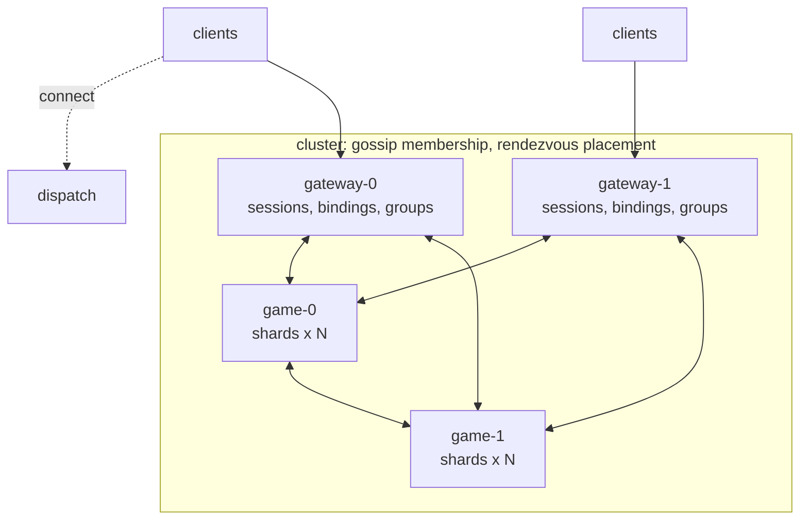
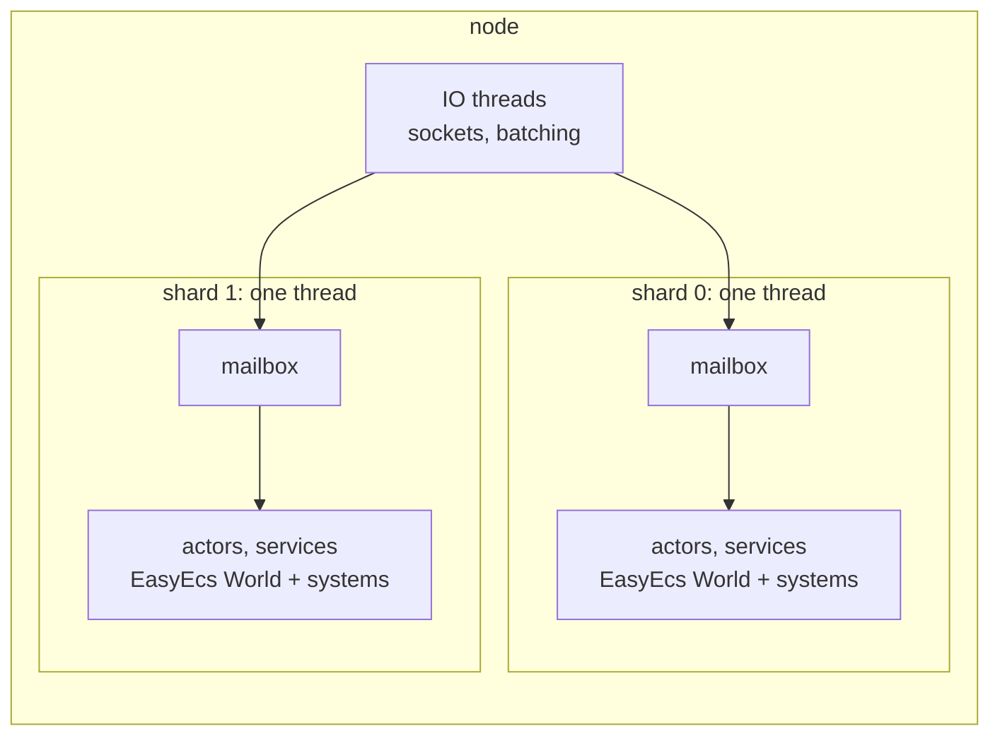

# DaServer

A .NET 10 framework for low-latency, high-concurrency clusters: game servers with many gateways and many map/logic
nodes, and any backend made of stateful entities and stateless services.

You write **contracts** (interfaces), **actors** and **services** that implement them, **event handlers** and **ECS
systems**. Source generators write proxies, dispatchers, wire ids, registration and the node's entry point. The runtime handles shards, mailboxes, placement,
discovery, gateways and serialization. Aspire runs the cluster locally and publishes it.

- **Zero GC on hot paths.** Struct proxies serialize arguments straight into pooled buffers. Dispatchers deserialize
  straight from the received bytes. Awaitables are pooled, and broadcasts are serialized once.
- **No locks in business code.** Every actor, service and system runs on its shard's single thread.
- **Stateful and stateless.** Actors are keyed and placed on one node by rendezvous hashing. Services are
  load-balanced and prefer the local node. Nodes discover each other through gossip.
- **ECS inside.** Actor state is an [EasyEcs](https://github.com/JasonXuDeveloper/EasyEcs) component on the
  actor's entity, so systems can process every actor of a shard in one cache-friendly pass.
- **RPC, events and ECS.** Request/response and one-way calls through generated proxies; cluster events published
  without knowing the handlers, delivered to actor mailboxes by key; per-tick logic in EasyEcs systems.
- **No hard-coded topology.** A node hosts what its project compiles. The AppHost lists projects and replica counts.
- **Reliable links, bounded work.** One ordered stream per node pair resumes after a dropped connection (no loss, no
  duplicate). Requests carry their caller's deadline, and work nobody waits for is dropped. Full inboxes answer
  `Overloaded` instead of growing.
- **Misuse is a build error.** Analyzers DAS001–DAS014 cover DaServer contracts, handlers, event keys and wire types, and EECS001–EECS008
  cover ECS, including the ECS principles.

## Architecture





A call goes from the generated proxy into a pooled frame. A call to the same node goes straight to the target
shard's mailbox; a call to another node is batched onto its TCP link. The target shard's thread runs the generated
dispatcher, then the reply returns the same way and resumes the caller on its own shard.

## Vocabulary

Everything a developer declares is one of these. Attributes on the contract say how the target is chosen and what
game clients may call.

| Declaration | Callers | Target |
|---|---|---|
| `[Service] interface IX` | servers | any node hosting it (load-balanced, local first) |
| `[Actor] interface IX` | servers | the activation of a key (one per cluster, on demand, turn-based) |
| `[Client]` on a method or a contract | also game clients | services: any; actors: the key bound to the session (`Cluster.Bind<IX>`) |
| `[Client(AnyKey = true)]` | also game clients | actors: the client chooses the key |
| `[Push] interface IX` | servers | one session or a client group (implemented by clients) |
| `[NinoType]` struct, `[Key]` on one member | `Cluster.Publish(e)` | each `[Handle]` service once; keyed: the actor activation of the key |
| `[Handle] ValueTask On(E e)` | the event router | a method of an actor or service handling event `E` |
| `partial class S : EcsSystem` with `[ForEach]` | the shard loop | every matching entity of the shard |
| `[NinoType]` | | wire data; anything else crossing the wire is a build error |

| Element | Responsibility | Never |
|---|---|---|
| **Actor** | The network boundary of one keyed entity: validate a call or event, then write input as components. Lifecycle and persistence (`OnActivateAsync`, `OnDeactivateAsync`). | Per-tick logic (that belongs to systems). |
| **Service** | Stateless request and event handling (login, matchmaking, routing). | Keep state between calls. |
| **Component / singleton** | Data of one entity (actor state is `Actor<TState>`) / of one shard world. | Logic. |
| **System** | One per-tick responsibility over all matching entities of a shard. Stateless. | Reference other systems, perform IO. |
| **Event** | A fact published to the cluster; the publisher does not know the handlers. | Commands to a specific receiver (that is a call). |

Business code reaches the cluster through `ICluster`: `Cluster` in actors and services, `world.Cluster()` in systems.
`Caller` is the client session of the running turn (valid across its awaits).

The runtime owns client sessions: `Cluster.Bind<IX>(session, key)` routes the client's `IX` calls to that key and
puts the session in the activation's `Group`; when the session closes (or its gateway crashes), every actor it was
bound to receives `SessionClosed`.

## Example

From [samples/](samples): login on a login node, players, maps and the realm on a game node, gateways that host
nothing.

```csharp
// Contracts (shared with clients).
[Service, Client] public interface IAccount { ValueTask<LoginResult> Login(string name); }
[Actor, Client]   public interface IPlayer { ValueTask EnterMap(long mapId); }
[Actor] public interface IMap
{
    ValueTask Enter(long playerId, SessionRef session);
    [Client] void Move(float vx, float vy);                       // one-way input from the bound client
    [Client] void Chat(string text);
}
[Push] public interface IPlayerClient { void OnMoves(List<Moved> moves); void OnChat(long playerId, string text); void OnRealm(RealmStatus s); }

[NinoType] public readonly partial record struct PlayerLoggedIn([property: Key] long Player, SessionRef Session);

// Login project: binds the session and announces the login.
public sealed class Account : Service, IAccount
{
    public ValueTask<LoginResult> Login(string name)
    {
        long playerId = Accounts.IdOf(name);
        Cluster.Bind<IPlayer>(Caller, playerId);                   // the client's IPlayer calls now reach this key
        Cluster.Publish(new PlayerLoggedIn(playerId, Caller));     // whoever cares handles it
        return new(new LoginResult(true, playerId));
    }
}

// Game project: actors turn calls and events into data...
public sealed class Player : Actor<PlayerState>, IPlayer
{
    [Handle] public ValueTask On(PlayerLoggedIn e) { State.Logins++; return default; }
    [Handle] public ValueTask On(SessionClosed e) { State.MapId = 0; return default; }

    public async ValueTask EnterMap(long mapId)
    {
        await Cluster.Map(mapId).Enter(Key, Caller);               // generated proxy, zero allocation
        State.MapId = mapId;                                       // re-read after awaiting
    }
}

public sealed class Map : Actor<MapState>, IMap
{
    public ValueTask Enter(long playerId, SessionRef session)
    {
        State.Avatars[session] = World.CreateEntity(new Position(), new Velocity(), new Avatar(playerId, Entity), new NetSync());
        Cluster.Bind<IMap>(session, Key);                          // its input reaches this map, it sees Group broadcasts
        return default;
    }

    public void Move(float vx, float vy) =>                        // input is data: systems integrate it
        State.Avatars[Caller].Get<Velocity>() = new(vx, vy);

    public void Chat(string text) => Cluster.PlayerClient(Group).OnChat(PlayerOf(Caller), text);
}

// ...and systems do the per-tick work, one responsibility each.
public sealed partial class MovementSystem : EcsSystem
{
    [ForEach] static void Move(ref Position p, in Velocity v) => p = new(p.X + v.X, p.Y + v.Y);
}

public sealed partial class SnapshotSystem : EcsSystem              // one message per map per tick
{
    public override int Priority => 20;

    [ForEach]
    static void Send(ref MapState map, World world)
    {
        if (map.Moves.Count == 0) return;
        world.Cluster().PlayerClient(map.Group).OnMoves(map.Moves); // serialized once, one frame per gateway
        map.Moves.Clear();
    }
}

public sealed partial class RealmBroadcastSystem : EcsSystem        // every 5 ticks, to every session of the cluster
{
    [ForEach]
    static void Broadcast(ref RealmState realm, World world)
    {
        if (++realm.Tick % 5 == 0)
            world.Cluster().PlayerClient(ClientGroup.All).OnRealm(new(realm.Tick, realm.Online.Count, DateTime.UtcNow.Ticks));
    }
}

// Client (bot, game): the same generated proxies, one well-known address.
var client = new ClusterClient();
await client.ConnectAsync("dispatch.example.com", 7100);          // directed to the least loaded gateway
await client.Account().Login("alice");
await client.Player().EnterMap(1);                                 // no key: the gateway uses the binding
client.Map().Move(1, 0);
```

A node project needs no `Program.cs`: the generator emits the entry point (Generic Host, configuration, OpenTelemetry,
a periodic stats line, graceful shutdown). Write one to customize the host.

## Orchestration with Aspire

```csharp
var builder = DistributedApplication.CreateBuilder(args);
builder.AddDockerComposeEnvironment("compose");            // `aspire publish` writes docker-compose files

var cluster = builder.AddDaServerCluster("sample");
cluster.AddNodes<Projects.Sample_Login>("login");                           // Account
cluster.AddNodes<Projects.Sample_Game>("game");                             // Player, Map, Realm, systems
cluster.AddGateways<Projects.Sample_Gateway>("gateway", replicas: 3);       // client sockets, no business code
var dispatch = cluster.AddDispatch<Projects.Sample_Gateway>("dispatch");    // the one address clients know

builder.AddProject<Projects.Sample_Bot>("bots").WithGateways(dispatch).WithArgs("10000", "60", "100", "0", "10");
builder.Build().Run();
```

`AddDaServerCluster` gives every node a name, a cluster endpoint and seeds; `AddGateways` adds a client endpoint;
`AddDispatch` adds gateways that only direct clients (power of two choices over the gossiped session counts). There
are no roles and no configuration files: what a node hosts is what its project compiles. Nodes export logs and
metrics over OpenTelemetry, which feeds the Aspire dashboard. The same model runs with
`dotnet run --project samples/Sample.AppHost` and publishes with `aspire publish` (`AddKubernetesEnvironment` for
Kubernetes).

## Performance

Measured on one 4-core VM (servers, bots and the kernel share it), Release builds.

**10k-player scenario** ([Sample.AppHost](samples/Sample.AppHost), [Sample.Bot](samples/Sample.Bot)): a login
node, a game node, 3 gateways and a dispatch (the AppHost's topology, here as plain processes without telemetry). 10,000 bots connect through the dispatch, log in, enter
100 maps and chat (one message every 10 s each, sent to the map's 100 players); the realm broadcasts its status to
every session every 5 ticks (20 ticks/s). 60 s measured window:

| | |
|---|---|
| Realm broadcasts delivered | 2,400,000 (every bot received every one, in order) |
| Broadcast latency (game system to bot callback) | p50 35.1 ms, p99 57.2 ms, max 73.1 ms |
| Chat deliveries | ~100,000/s |
| Game node | 2% CPU, ~32 KB/s allocated (the 1,000 chat strings/s it receives), no GC |
| Each gateway (~3,300 sessions) | 5–6% CPU, 0–7 KB/s allocated (under 0.5 B per message pushed), no GC |
| Login, dispatch | 1–2% CPU, 0 KB/s allocated |
| Disconnects, gaps | 0 |

(CPU is the share of all 4 cores. Without chat the game node allocates 0 KB/s. With Aspire's OTLP telemetry on, the
exporter adds ~55 KB/s per node.) The latency is dominated by the single bot process receiving 10k sockets on the same machine. Adding
per-tick position sync for every player (`moves/s` > 0: 20M position entries/s to clients) saturates this machine
in the bots and the kernel first; the servers stay under 20% CPU each.

**BenchmarkDotNet** ([benchmarks/](benchmarks/DaServer.Benchmark), short job; Allocated includes the clients):

| Benchmark | Case | Mean | Allocated |
|---|---|---:|---:|
| Broadcast to every session, game node through 3 gateways | 3,000 clients | 12.7 ms | 4.2 KB |
| | 9,000 clients | 38.8 ms | 16.6 KB |
| Group broadcast through 1 gateway | 1,000 clients | 5.0 ms | 456 B |
| | 5,000 clients | 21.5 ms | 895 B |
| Keyed events to 64 actors, bursts of 1,024 (per event) | same node / other node | 4.2 µs / 2.5 µs | 0 |
| 1,024 concurrent actor calls, all completed | same node / other node | 3.4 ms / 2.1 ms | 252 B |
| 1 actor call, round trip | same node / other node | 34 µs / 128 µs | 104 B / 167 B |

## Build, test, benchmark

```bash
dotnet build DaServer.slnx
dotnet test DaServer.slnx
dotnet run -c Release --project benchmarks/DaServer.Benchmark -- --filter '*'
```

EasyEcs is taken from the sibling checkout `../EasyEcs` when it exists, otherwise from NuGet.

## Documentation

- [doc/requirements.md](doc/requirements.md): requirements, acceptance criteria and the release checklist.
- [doc/design.md](doc/design.md): architecture, wire protocol, performance, latency, reliability, membership,
  reference architectures, ECS usage, generated code.
- [doc/decisions.md](doc/decisions.md): architecture decision records.
- [doc/roadmap.md](doc/roadmap.md): status and next steps.

## License

MIT
