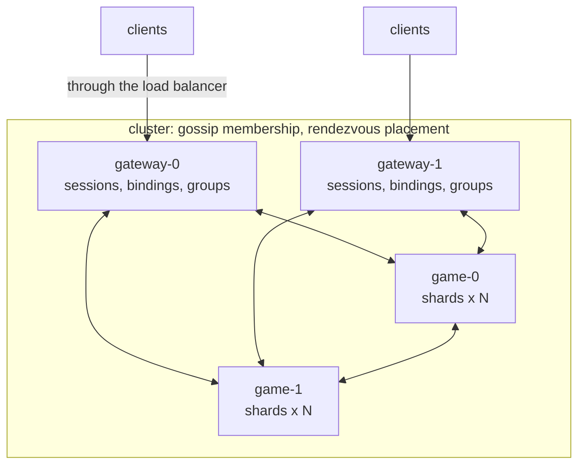
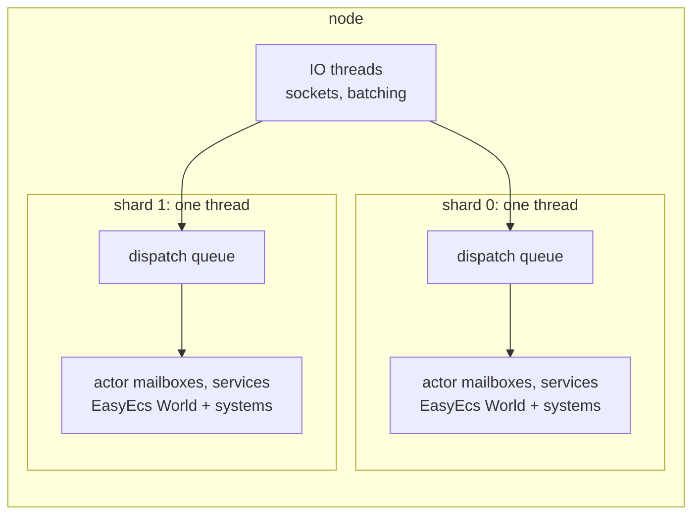

# DaServer

A general-purpose ECS distributed server framework for .NET 11, built for high performance and high concurrency: any
backend made of stateful entities (actors) and stateless services, spread over many nodes. The core knows no
application scenario; an MMO cluster (login, gateways, game server, map servers) is one sample built on it
([samples/mmo](samples/mmo)).

You write **messages** (`[NinoType, Message]` structs), **actors** and **services** as static classes of `[Handle]`
methods over components, and **ECS systems**. Source generators write dispatchers, typed `Ask` overloads, and
registration; type ids are FNV-1a hashes of the type names. The runtime handles shards, mailboxes, placement, discovery, client connections and serialization. Aspire runs the cluster
locally and publishes it.

- **Zero GC on hot paths.** Messages serialize straight into pooled buffers. Dispatchers deserialize straight from
  the received bytes. Handlers never await: an ask's answer comes back as a message, so nothing is suspended or
  boxed, and broadcasts are serialized once.
- **No locks in business code.** Every actor, service and system runs on its shard's single thread, one message at a
  time, each to completion.
- **Stateful and stateless.** Actors have typed ids (`PlayerId`, `MapId`) and are placed on one node by rendezvous hashing. Services are
  load-balanced and prefer the local node. Nodes discover each other through gossip.
- **ECS all the way down.** An actor is an [EasyEcs](https://github.com/JasonXuDeveloper/EasyEcs) entity: its state
  is components, its handlers are stateless functions that receive them as parameters, so systems process every actor
  of a shard in one cache-friendly pass. The runtime keeps its own per-actor state (lifecycle, mailbox, known
  sessions) as components and tags too.
- **Messages, not interfaces.** A message is routed to whoever handles it: `Ask` for a reply, `Send` one-way,
  `Publish` to every service handling it. The sender never names the receiver's type; per-tick logic lives in EasyEcs
  systems.
- **No hard-coded topology.** A node hosts what its project compiles. The AppHost lists projects and replica counts.
- **Reliable links, bounded work.** One ordered stream per node pair resumes after a dropped connection (no loss, no
  duplicate). Requests carry their caller's deadline, and work nobody waits for is dropped. Full dispatch queues and mailboxes answer
  `Overloaded` instead of growing; a client that cannot keep up is disconnected and resynchronizes when it resumes.
- **Misuse is a build error.** Analyzers DAS001–DAS022 cover handler shapes (static, never `async`), messages, wire
  types, id collisions, message flow, actors and services without fields, shared logic, waits and threads on shards,
  systems that ask, components apart from logic, persisted and handed-off components, placement, wire layouts (the
  committed `wire.manifest`), filters and a component parameter used after a structural change of its entity;
  EasyEcs's own analyzer (the EECS rules) covers ECS, including the ECS principles.

## Architecture





A message is serialized once into a pooled frame. A message for the same node goes straight to the target shard's
dispatch queue; a message for another node is batched onto its TCP link. The target shard's thread sorts it into the
actor (or a service) and runs the generated dispatcher; a live actor with no mail waiting runs it at once, otherwise
it waits in the actor's mailbox. A reply returns the same way: to a handler's ask as an `Answered` message to the
asking actor, to code outside the cluster (HTTP, tests, clients) as the completion of its awaited `Ask`.

## Vocabulary

Everything a developer declares is one of these. The message type alone decides who handles it.

| Declaration | Meaning |
|---|---|
| `[NinoType, Message] partial record struct M` | A message between servers (actors and services on any node). |
| `[Message, FromClient]` | Game clients may send it too. To an actor, it goes to the actor bound to the session, or to the actor the client names if that actor granted the session (`GrantSession`). |
| `[Message, ToClient]` | Servers push it to client sessions and groups; clients handle it. |
| `[NinoType] partial record struct D` | Data inside messages (fields, replies), never sent on its own. Anything crossing the wire is `[NinoType]` or an unmanaged struct (an id). A list in a message goes in a `[NinoPooled]` class the handler returns (`ReturnToPool()`). |
| `... : IRequest<TReply>` | A request: answered with one `TReply`. |
| `[Actor<TId>] static class A` / `[Service] static class S` | An actor type (addressed by its id type `TId`) / a service. Settings are attribute constants: `UnloadAfterIdleSeconds`, `SaveEverySeconds`, `MailboxCapacity`, `OnError`. |
| `[Handle] static R On(in M m, ref C c, ..., in Context ctx)` | A handler: the message first, then any of the actor's components (`ref` to write, `in` to read; a missing one is added with its default), singletons, `Entity`, `World`, `in Context`. Returns `void`, the request's reply `T`, or `Answer<T>` (`Answer<T>.Later` when the reply is given later). Never `async`. |
| `[Handle] static void On(in Answered<TRequest, TReply> a, ...)` | The answer to `ctx.Ask`: the reply (`a.Value`) or why there is none (`a.Status`), and the reply token the asker passed along (`a.ReplyTo`). |
| `[Handle] static void On(in Created _, ...)` / `Loaded` / `Unloading` | Lifecycle as mail: a new actor (no stored record) gets `Created`, a restored or moved one `Loaded`, a leaving one `Unloading` before its record is written. |
| `[Filter] static RpcStatus F(in Context ctx, in M m)` | Policy before handlers (rate limits, authorization): `Ok` lets `M` through, another status refuses it. On an `IMessageFilter` class: every message. Registered by the generated code. |
| `partial class S : EcsSystem` with `[ForEach]` | Per-tick logic over every matching entity of the shard. |

| Call | Target |
|---|---|
| `ctx.Ask(id, new M())` / `ctx.Send(id, ...)` | The actor `id` (`MapId`, `PlayerId`: the id type names the actor type; one per cluster, on demand, one message at a time). `Ask` returns a call number; the answer arrives as `Answered<M, R>` mail. |
| `ctx.Ask(seatId, ...)` with `SeatId : IActorId, IPlaced` | The actor, placed by its id's `Placement`: actors of any type with the same placement share a node and a shard (a room and its seats), so their messages stay local. |
| `ctx.Ask(new M())` / `ctx.Send(...)` | The one service handling `M` (local first, else the less loaded of two nodes hosting it). |
| `ctx.Publish(e)` | Every service type handling `e`, once each. |
| `ctx.SendAfter(delay, address, m)` | A message sent later (timers as mail, ADR-058); `ctx.CancelSend(handle)` cancels it. |
| `ctx.Send(session, m)` / `ctx.Send(group, m)` | A client session / a client group (`[ToClient]` messages; clients handle them with `[Handle]` too). `JoinGroup`, `LeaveGroup` and `Disconnect` sent there are applied by the node holding the session (from an actor, kick a session with `ctx.DisconnectSession`, DAS020). |
| `await cluster.Ask(id, new M(), new CallOptions(timeout))` | Code outside the cluster's worlds (HTTP endpoints, tests, hosted services) awaits replies through `ICluster`; a timeout of its own replaces the sender's `CallTimeout`, and what is left of it travels with the request. |

| Element | Responsibility | Never |
|---|---|---|
| **Actor** | The network boundary of one entity with an id: validate a message, then write input as components. Lifecycle as mail (`Created`, `Loaded`, `Unloading`); stored state is `[Persist]` components. | Per-tick logic (that belongs to systems); fields (DAS007). |
| **Service** | Stateless request and event handling (login, matchmaking, routing); its state, if any, is singletons. | Keep state in fields. |
| **Component / singleton** | Data of one entity (an actor's state is the components its handlers take) / of one shard world. | Logic. |
| **System** | One per-tick responsibility over all matching entities of a shard. Stateless. | Reference other systems, perform IO. |

Handlers reach the cluster through their `Context` (`ctx.Send`, `ctx.Ask`, `ctx.Publish`; `ctx.Cluster` is the
`ICluster`), systems through `world.Cluster`. `ctx.Caller` is who sent the current message from outside the cluster, a
client session (`ctx.Send(ctx.Caller, m)` answers it, `ctx.BindSession(ctx.Caller)` binds it, `ctx.GrantSession(..)`
admits it). Handlers never wait. A request whose reply depends on another call either passes its reply token along
(`ctx.Ask(target, request, ctx.ReplyLater())`, then `ctx.Reply(a.ReplyTo, value)` in the `Answered` handler) or
replies when an operation completes (`return ctx.ReplyAfter(ctx.BindSession(m.Session), true);`). Meanwhile the actor
takes its next message; what a later step must remember is a component.

The runtime owns client sessions: an actor's `ctx.BindSession(session)` routes the client's messages for that actor
type to its id and puts the session in the actor's `Group`; `ctx.GrantSession(session)` lets the client name the
actor (`client.Send(roomId, new Say(..))`: a room admitting a player) and puts it in the `Group` too. Both are applied
on the session's node and answered (`Answered<SessionChange, Done>`, or through `ReplyAfter`), so a reply that
follows them finds the binding in place. A client can
name no other actor: anything else is refused at the edge. When the session closes (or its node crashes), every
actor it was bound or granted to forgets it, and one that handles `SessionClosed` receives it. A client that loses its connection reconnects on its own and
resumes the session with a signed ticket: its actors receive `SessionResumed` (send the full state again) instead, and
`SessionClosed` only if it does not come back within 30 s.

## Example

Abridged from the MMO sample [samples/mmo/](samples/mmo) (who runs where and who talks to whom: [samples/mmo/README.md](samples/mmo/README.md)): a login
server, a game server (players, the realm), a map server (maps, movement, area of interest) and gateways that host no
business code.

```csharp
// Ids (one type per actor type: the id type names the actor, so a player id never reaches a map).
public readonly record struct PlayerId(long Value) : IActorId;
public readonly record struct MapId(long Value) : IActorId;

// Messages (shared with clients).
[NinoType, Message, FromClient] public partial record struct Login(string Name) : IRequest<LoginResult>;
[NinoType, Message, FromClient] public partial record struct EnterMap(MapId Map) : IRequest<bool>;
[NinoType, Message, FromClient] public partial record struct Move(float VelocityX, float VelocityY); // input
[NinoType, Message, FromClient] public partial record struct Say([property: NinoUtf8] string Text);
[NinoType, Message] public partial record struct Attach(ClientSession Session) : IRequest<bool>;  // servers only
[NinoType, Message] public partial record struct Enter(PlayerId Player, ClientSession Session) : IRequest<bool>;
[NinoType, Message, ToClient] public partial record struct Chat(PlayerId Player, [property: NinoUtf8] string Text); // pushed
[NinoType, Message, ToClient] public partial record struct RealmStatus(long Tick, int Online, long ServerTimeTicks);
[NinoType] public partial record struct LoginResult(bool Ok, PlayerId Player);                     // data in a reply

// Components live in a components project (DAS013): data that outlives a reload of the logic.
[NinoType(format: NinoFormat.VersionTolerant), Persist] public partial record struct PlayerProfile(string Name, int Logins) : IComponent;
[NinoType(format: NinoFormat.VersionTolerant), Handoff] public partial record struct PlayerState(MapId Map) : IComponent;
public record struct Entering(MapId Map) : IComponent;            // a map change waiting for its answer
[NinoType(format: NinoFormat.VersionTolerant), Handoff]
public partial struct RealmState() : IComponent { public HashSet<PlayerId> Online = new(); public long Ticks; }
public record struct Position(float X, float Y) : IComponent;
public record struct Velocity(float X, float Y) : IComponent;
public readonly record struct Avatar(PlayerId Player, ClientSession Session) : IComponent, IIndexed<ClientSession>
{
    ClientSession IIndexed<ClientSession>.Key => Session;         // EasyEcs indexes avatars by session
}

// Login project: a stateless service. It asks the player to attach the session and replies once the player
// answered; nothing waits in between.
[Service]
public static class Account
{
    [Handle]
    internal static Answer<LoginResult> On(in Login m, in Context ctx)
    {
        long id = 17;
        foreach (char c in m.Name) id = (id * 31 + c) & 0x7FFF_FFFF;  // a real game looks the account up
        var player = new PlayerId(id + 1);
        return ctx.ReplyAfter(ctx.Ask(player, new Attach(ctx.Caller)), new LoginResult(true, player));
    }
}

// Game project: actors turn messages into data...
[Actor<PlayerId>(UnloadAfterIdleSeconds = 600)]
public static class Player
{
    [Handle] internal static void On(in Created _, ref PlayerProfile p, in Context ctx) => p = new PlayerProfile("player-" + ctx.Id<PlayerId>().Value, 0);

    [Handle]
    internal static Answer<bool> On(in Attach m, ref PlayerProfile p, in Context ctx)
    {
        p.Logins++;
        return ctx.ReplyAfter(ctx.BindSession(m.Session), true); // replied once bound: the client's next message finds it
    }

    [Handle]
    internal static Answer<bool> On(in EnterMap m, Entity self, in Context ctx)
    {
        if (self.Has<Entering>()) return false;                   // one map change at a time
        self.Set(new Entering(m.Map));
        ctx.Ask(m.Map, new Enter(ctx.Id<PlayerId>(), ctx.Caller), ctx.ReplyLater()); // the caller's reply token travels along
        return Answer<bool>.Later;
    }

    [Handle]                                                      // ...and comes back with the answer, as mail
    internal static void On(in Answered<Enter, bool> a, ref PlayerState state, Entity self, in Context ctx)
    {
        if (!self.TryGet<Entering>(out var entering)) return;
        if (a.Ok) state.Map = entering.Map;
        self.Remove<Entering>();                                  // `state` is invalid from here on (DAS022)
        if (a.Ok) ctx.Reply(a.ReplyTo, a.Value);
        else ctx.Fail(a.ReplyTo, a.Status);
    }

    [Handle] internal static void On(in SessionClosed _, ref PlayerState state) => state = default;
}

[Sticky]                                                          // a loaded map stays where it is when nodes join
[Actor<MapId>]
public static class Map
{
    [Handle]
    internal static Answer<bool> On(in Enter m, in Context ctx)
    {
        // The avatar is an entity of the map's shard, a child of the map: it goes when the map unloads.
        ctx.World.CreateEntity(new Position(), new Velocity(), new Avatar(m.Player, m.Session), new ChildOf(ctx.Entity.Id));
        return ctx.ReplyAfter(ctx.BindSession(m.Session), true);  // its input reaches this map, it hears the map's Group
    }

    [Handle]
    internal static void On(in Move m, in Context ctx)            // input is data: systems integrate it
    {
        if (TryFind(in ctx, ctx.Caller, out var avatar)) avatar.Set(new Velocity(m.VelocityX, m.VelocityY));
    }

    [Handle]
    internal static void On(in Say m, in Context ctx)
    {
        if (TryFind(in ctx, ctx.Caller, out var avatar)) ctx.Send(ctx.Group, new Chat(avatar.Read<Avatar>().Player, m.Text));
    }

    [Handle]
    internal static void On(in SessionClosed e, in Context ctx)
    {
        if (TryFind(in ctx, e.Session, out var avatar)) avatar.Destroy();
    }

    private static bool TryFind(in Context ctx, ClientSession session, out Entity avatar)
    {
        foreach (var e in ctx.World.AvatarIndex.Find(session))   // one index lookup, no dictionary in the actor
            if (e.Read<ChildOf>().Parent == ctx.Entity.Id) { avatar = e; return true; }
        avatar = default;
        return false;
    }
}

// ...and systems do the per-tick work, one responsibility each.
public sealed partial class MovementSystem : EcsSystem
{
    [ForEach] static void Move(ref Position p, in Velocity v) => p = new(p.X + v.X, p.Y + v.Y);
}

public sealed partial class RealmBroadcastSystem : EcsSystem        // every 5 ticks, to every session of the cluster
{
    public override int UpdateInterval => 5;

    [ForEach]
    static void Broadcast(ref RealmState realm, World world)
    {
        realm.Ticks += 5; // the realm's own sequence: it moves with the realm, whichever node runs it
        world.Cluster.Send(ClientGroup.All, new RealmStatus(realm.Ticks, realm.Online.Count, world.Time.GetUtcNow().UtcTicks));
    }
}

// Client (bot, game): the same messages, one well-known address.
var client = new ClusterClient();
client.Register(new ChatLog());                             // what servers push to this client
await client.ConnectAsync("play.example.com", 7100);        // the platform's load balancer or DNS name: the client stays
                                                            // on the node it reaches (moved without loss when asked)
await client.Ask(new Login("alice"));
await client.Ask(new EnterMap(new MapId(1)));               // to the bound player (session binding)
client.Send(new Move(1, 0));

class ChatLog
{
    [Handle] public void On(Chat m) => Console.WriteLine(m.Text);   // pushes are handled like any message
}
```

A node's `Program.cs` is five lines; `AddDaServer` brings the node, configuration, health checks, OpenTelemetry, a
periodic stats line and graceful shutdown, and each capability is one more line:

```csharp
var builder = WebApplication.CreateBuilder(args);
builder.AddDaServer();
var app = builder.Build();
app.MapDaServer();   // /health, /alive; map your own endpoints next to it
app.Run();
```

Packages (ADR-052): contract projects reference `DaServer.Abstractions`; clients (Unity through netstandard2.1, bots,
tools) reference `DaServer.Client`; node projects reference `DaServer.Hosting` (server runtime `DaServer`), and
`DaServer.Persistence.PostgreSql` when they keep actor records. The wire
and transport both sides share are `DaServer.Core`. The generator ships with Abstractions. `DaServer.Simulation`
(client side, ADR-056) runs thousands of simulated users against a cluster for end-to-end and load tests: client
worlds on their own threads, behavior as HTN planning over ECS data, swarms that measure and judge
([samples/mmo](samples/mmo#bots) drives its real game client with it).

## Persistence

Components marked `[Persist]` (version-tolerant or keyed Nino structs in a components project, DAS014) are an actor's stored
state (ADR-068). The runtime restores them when the actor loads, on any node, before its `Loaded` mail (an actor
with no record gets `Created` instead), writes them after its `Unloading` mail, and every `SaveEverySeconds` (30 s by
default) when they changed, and at once for an entity tagged `SaveNow` (`self.SetSaveNow()`). They are change-tracked:
the generator declares EasyEcs's `ITrackChanges` for them, so a checkpoint visits only the actors whose stored
components were written since the last one. Writes are versioned: a node that lost ownership cannot overwrite the new
owner's state. Components without `[Persist]` (caches, grids) are rebuilt.

```csharp
[NinoType(format: NinoFormat.VersionTolerant), Persist] public partial record struct PlayerProfile(string Name, int Logins) : IComponent;
```

When an actor changes node (scaling out or in, a node stopping), its record goes straight to the new owner on the
link its mail follows, so moves neither read nor write the store; components marked `[Handoff]` move too without
being stored (a fight in progress, cooldowns). Without a store, `[Persist]` and `[Handoff]` state still moves.

A node keeps records in PostgreSQL with one line in its Program.cs, `builder.AddPostgreSqlActorStore()`, and the
AppHost passes the database: `cluster.AddNodes<Projects.Sample_GameServer>("game").WithActorStore(actors)`.
Relational, queried data (accounts, payments, rankings) belongs in services with your own data access.

## Testing

`DaServer.Testing` starts real nodes in the test process (loopback, the production runtime and wire). With a manual
clock the test decides when ticks happen: each `TickAsync` runs one tick on every shard and fires what fell due
(`SendAfter`, idle unloads, checkpoints), so per-tick logic is counted exactly
([Sample.Tests/ServerTests.cs](samples/mmo/Sample.Tests/ServerTests.cs)).

```csharp
await using var cluster = await TestCluster.StartAsync(o => { o.ManualTime = true; o.ClientConnections = true; });
var client = await cluster.ConnectAsync(heard);           // an object with [Handle] methods for the pushes
await client.Ask(new Login("ann"));
await cluster.TickAsync(15);                              // exactly 15 ticks on every shard
```

Handlers and systems read time from `world.Time` (`ctx.World.Time` in a handler), the clock tests move.

## Rolling upgrades

Old and new nodes run side by side while a deployment rolls. Message layouts are frozen: a new field goes into a new
message. Persisted components are version tolerant (new fields at their end) or keyed (DAS014). Each project commits a
`wire.manifest`; the build fails (DAS017) when a change would break the other build and asks to record the rest
(DAS018) with `dotnet build -p:UpdateWireManifest=true`. While builds differ, a message goes only to nodes whose build handles it
(ADR-076, ADR-077).

## Samples

- [`samples/mmo`](samples/mmo): an MMO (login, game, maps, gateways) with 10,000 bots that run the real client.
- [`samples/flashsale`](samples/flashsale): a million buyers for 100 units over the client protocol: waiting room,
  sharded stock, idempotent orders.

## Orchestration with Aspire

```csharp
var builder = DistributedApplication.CreateBuilder(args);
if (builder.Configuration["Publish"] == "k8s") builder.AddKubernetesEnvironment("k8s"); // `aspire publish -- Publish=k8s`: a Helm chart
else builder.AddDockerComposeEnvironment("compose");                                     // `aspire publish`: Docker Compose files

var cluster = builder.AddDaServerCluster("sample");
cluster.AddNodes<Projects.Sample_LoginServer>("login");                     // Account service
var actors = builder.AddPostgres("postgres").WithDataVolume().AddDatabase("actors");
cluster.AddNodes<Projects.Sample_GameServer>("game").WithActorStore(actors); // Player, Realm actors
cluster.AddNodes<Projects.Sample_MapServer>("map");                         // Map actors, movement/AOI systems
var gateways = cluster.AddNodes<Projects.Sample_GatewayServer>("gateway", replicas: 3).WithClientConnections(); // clients, no business code

builder.AddProject<Projects.Sample_Bot>("bots").WithClientEndpoints(gateways).WithArgs("--bots", "10000", "--seconds", "60"); // simulated players
builder.Build().Run();
```

`AddDaServerCluster` gives every node a name, a cluster endpoint and seeds; `WithClientConnections` adds a client endpoint (the
`DaServer:Clients` section). A client connects through the entry addresses it is given (in production: the platform's
load balancer or DNS name) and stays on the node it reached; any client-facing node reaches every actor.
`MaxConnectionAge` retires old connections so that, after a scale-out, their clients move to the new nodes too (make
before break: nothing is lost, ADR-026). There
are no roles and no configuration files: what a node hosts is what its project compiles. Nodes export logs and
metrics over OpenTelemetry, which feeds the Aspire dashboard. The same model runs with
`dotnet run --project samples/mmo/Sample.AppHost` and publishes with `aspire publish`: run locally a node per replica,
published a workload per group whose replicas the platform scales (ADR-030); scaling policy (HPA, VPA, PDB, the load
balancer) is the application's, added in its AppHost (the samples' `Platform.cs`). In the dashboard the cluster is a resource of its own ("6/6
joined"), and every node has the commands Membership, Stats, Drain and Unload actors ([doc/operations.md](doc/operations.md)).

## Performance

Measured on one 4-core VM (servers, bots and the kernel share it), Release builds.

**10k-player scenario** ([Sample.AppHost](samples/mmo/Sample.AppHost), [Sample.Bot](samples/mmo/Sample.Bot)): a login
node, a game node, a map node and 3 gateways writing to clients on a 2 ms beat (ADR-070; the AppHost's topology, the
one-map column through Aspire with `tests/DaServer.E2E`, the chatting column as plain processes). 10,000 bots
connect through the gateways' addresses (one picked at random each), log in and enter a map; the realm broadcasts its status to every session
every 5 ticks (20 ticks/s). Two loads, 60 s measured window each:

- **One map** (the AppHost default): all 10,000 players in one map on one map node, each changing direction once a
  second. Area of interest (the sample's `Interest.cs`): a 20x20 grid, each cell a client group, each player sees the
  3x3 cells around it; updates carry velocity and go out when it changes (dead reckoning), every other tick.
- **Chatting**: 100 maps of 100 players, one chat line every 10 s per bot, sent to the map.

| | One map (AOI) | Chatting |
|---|---|---|
| Realm broadcasts delivered (every bot every one, in order) | 2,400,000 | 2,400,000 |
| Map traffic delivered to clients | ~2,500,000 positions/s | ~100,000 lines/s |
| Broadcast latency (game system to bot callback) | p50 76 ms, p99 209 ms, p99.9 279 ms | p50 35 ms, p99 57 ms |
| Game node | 3% CPU, 0–5 KB/s allocated | 2% CPU, ~32 KB/s (chat strings) |
| Each gateway (~3,300 sessions) | 11–12% CPU, 0 KB/s | 5–6% CPU, 0–7 KB/s |
| GCs on servers, disconnects, gaps | 0 | 0 |

(Latencies of the one-map load: the release checklist's run, roadmap; CPU and allocation: ADR-070's runs. CPU is
the share of all 4 cores; the login node stays at 1% and 0 KB/s; with Aspire's OTLP telemetry on, the
exporter adds ~55 KB/s per node.) The bot process and the kernel's loopback use most of the machine, so latency is
mostly theirs. Without area of interest, 10,000 players in one map is a bandwidth problem, not a CPU one: every
position to everyone each tick is 10,000 x 10,000 x 20 = 2 billion entries a second (~40 GB/s); even with dead
reckoning, every change of direction to everyone is 100 million entries (~2.4 GB/s) a second. On this machine both overflow the
clients (the per-session send bound then disconnects them or, below it, memory grows to the bound) while the game
node stays under 10% CPU.

**Scale-out**: connections older than `MaxConnectionAge` close and their clients resume on the node the entry
addresses lead them to, so a gateway started later takes old clients too (cluster test:
`OldConnectionsMoveToANodeStartedLater`).

**BenchmarkDotNet** ([benchmarks/](benchmarks/DaServer.Benchmark), default job, one 4-core VM, .NET 11 RC2, the
release checklist's run in the roadmap; Allocated is per operation and includes the benchmark's clients):

| Benchmark | Case | Mean | Allocated |
|---|---|---:|---:|
| Broadcast to every session, game node through 3 client-facing nodes | 3,000 clients | 15.5 ms | 16 B |
| | 9,000 clients | 52.0 ms | 50 B |
| Group broadcast through 1 client-facing node (1 / 9 groups) | 1,000 clients | 5.2 / 5.8 ms | 7 B |
| | 5,000 clients | 26.5 / 32.5 ms | 46-50 B |
| One-way messages to 64 actors, bursts of 1,024 (per message) | same node / other node | 454 ns / 730 ns | 0 |
| 64 / 1,024 concurrent actor calls, all completed | same node | 169 µs / 776 µs | 0-1 B |
| | other node | 315 µs / 1.05 ms | 0-1 B |
| 1 actor call, round trip | same node / other node | 5.2 µs / 86 µs | 0-1 B |

Against the agreed baseline (d676d2a on .NET 10, same machine, run back to back): calls 12-83% faster, one-way
messages 54-90% faster, broadcasts -9% to +8% and the 3k / 9k scenario +2% / +8% (each within one standard deviation),
allocations lower everywhere. How much comes from .NET 11 alone: ADR-054.

## Build, test, benchmark

```bash
dotnet build DaServer.slnx
dotnet test DaServer.slnx
dotnet run -c Release --project benchmarks/DaServer.Benchmark -- --filter '*'
```

EasyEcs comes from NuGet (`EasyEcsVersion` in `Directory.Build.props`).

## Documentation

- [doc/requirements.md](doc/requirements.md): requirements, acceptance criteria and the release checklist.
- [doc/design.md](doc/design.md): architecture, wire protocol, performance, latency, reliability, membership,
  reference architectures, ECS usage, generated code.
- [doc/decisions.md](doc/decisions.md): architecture decision records.
- [doc/roadmap.md](doc/roadmap.md): status and next steps.
- [doc/operations.md](doc/operations.md): running, watching and changing a cluster (Aspire CLI, dashboard commands,
  admin endpoints, MCP), the Grafana dashboard and alert rules in [observability/](observability).

## License

MIT
