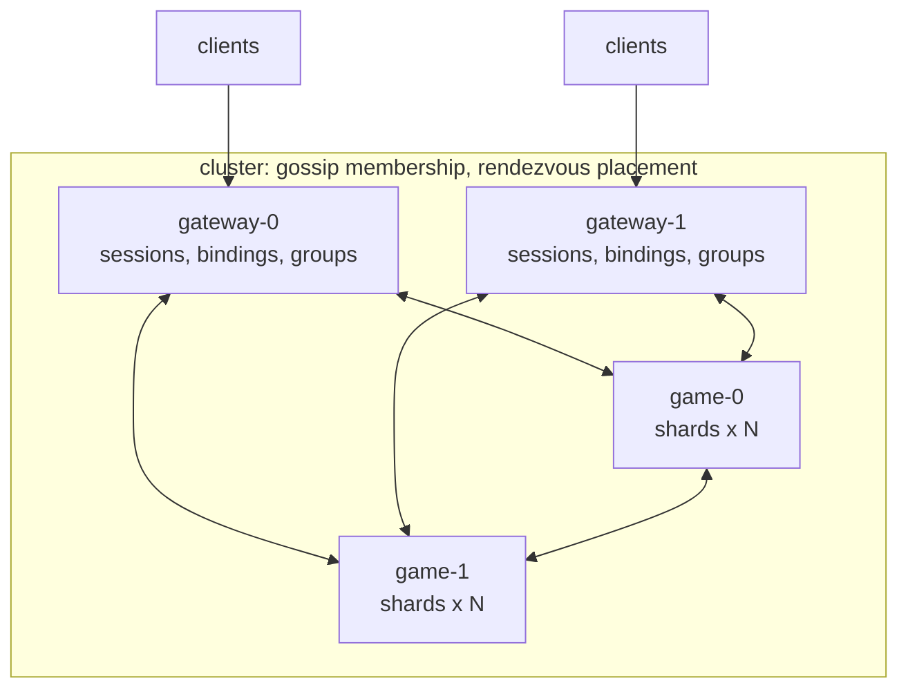
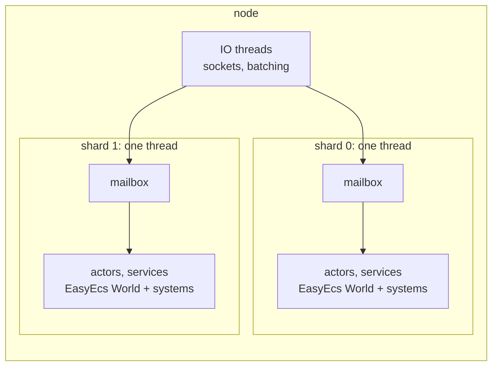

# DaServer

A .NET 10 framework for low-latency, high-concurrency clusters: game servers with many gateways and many map/logic
nodes, and any backend made of stateful entities and stateless services.

You write **contracts** (interfaces), **actors** and **services** that implement them, **event handlers** and **ECS
systems**. Source generators write proxies, dispatchers, wire ids, registration and the node's entry point. The runtime handles shards, mailboxes, placement,
discovery, gateways and serialization. Aspire runs the cluster locally and publishes it.

- **Zero GC on hot paths.** Struct proxies serialize arguments straight into pooled buffers. Dispatchers deserialize
  straight from the received bytes. Awaitables are pooled, and broadcasts are serialized once.
- **No locks in business code.** Every actor, service and system runs on its shard's single thread.
- **Stateful and stateless.** Actors are keyed and placed on one node by rendezvous hashing. Services are
  load-balanced and prefer the local node. Nodes discover each other through gossip.
- **ECS inside.** Actor state is an [EasyEcs](https://github.com/JasonXuDeveloper/EasyEcs) component on the
  actor's entity, so systems can process every actor of a shard in one cache-friendly pass.
- **RPC, events and ECS.** Request/response and one-way calls through generated proxies; cluster events published
  without knowing the handlers, delivered to actor mailboxes by key; per-tick logic in EasyEcs systems.
- **No hard-coded topology.** A node hosts what its project compiles. The AppHost lists projects and replica counts.
- **Misuse is a build error.** Analyzers DAS001–DAS012 cover DaServer contracts and wire types, and EECS001–EECS008
  cover ECS, including the ECS principles.

## Architecture





A call goes from the generated proxy into a pooled frame. A call to the same node goes straight to the target
shard's mailbox; a call to another node is batched onto its TCP link. The target shard's thread runs the generated
dispatcher, then the reply returns the same way and resumes the caller on its own shard.

## Vocabulary

Everything a developer declares is one of these; the contract's base interface says who may call it and how the
target is chosen.

| Declaration | Callers | Target |
|---|---|---|
| `interface IX : IService` | servers | any node hosting it (load-balanced, local first) |
| `interface IX : IPublicService` | servers and clients | same |
| `interface IX : IActor` | servers | the activation of a key (one per cluster, on demand, turn-based) |
| `interface IX : ISessionActor` | servers and clients | clients reach the key bound to their session (`Cluster.Bind<IX>`) |
| `interface IX : IPublicActor` | servers and clients | clients choose the key |
| `interface IX : IClientCallback` | servers | one session or a client group |
| `[NinoType] struct E : IEvent` / `IKeyedEvent` | `Cluster.Publish(e)` | each `IHandle<E>` service once; the actor activation of `e.Key` |
| `partial class S : EcsSystem` with `[ForEach]` | the shard loop | every matching entity of the shard |
| `[NinoType]` | | wire data; anything else crossing the wire is a build error |

| Element | Responsibility | Never |
|---|---|---|
| **Actor** | The network boundary of one keyed entity: validate a call or event, then write input as components. Lifecycle and persistence (`OnActivateAsync`, `OnDeactivateAsync`). | Per-tick logic (that belongs to systems). |
| **Service** | Stateless request and event handling (login, matchmaking, routing). | Keep state between calls. |
| **Component / singleton** | Data of one entity (actor state is `Actor<TState>`) / of one shard world. | Logic. |
| **System** | One per-tick responsibility over all matching entities of a shard. Stateless. | Reference other systems, perform IO. |
| **Event** | A fact published to the cluster; the publisher does not know the handlers. | Commands to a specific receiver (that is a call). |

Business code reaches the cluster through `ICluster`: `Cluster` in actors and services, `world.Cluster()` in systems.

## Example

From [samples/](samples): login on the gateway, players and maps on game nodes.

```csharp
// Contracts (shared with clients). One actor may serve a server contract and a client contract.
public interface IAccount : IPublicService { ValueTask<LoginResult> Login(string name); }
public interface IPlayer : ISessionActor { ValueTask EnterMap(long mapId); }
public interface IMap : IActor { ValueTask Enter(long playerId, SessionRef session); ValueTask Leave(SessionRef session); }
public interface IMapInput : ISessionActor { void Move(float vx, float vy); }      // one-way input stream
public interface IPlayerClient : IClientCallback { void OnMoved(long playerId, float x, float y); }

[NinoType] public readonly partial record struct PlayerLoggedIn(long Key, SessionRef Session) : IKeyedEvent;

// Gateway project: login binds the session and announces it.
public sealed class Account : Service, IAccount
{
    public ValueTask<LoginResult> Login(string name)
    {
        long playerId = Accounts.IdOf(name);
        Cluster.Bind<IPlayer>(Caller, playerId);                    // the client's IPlayer calls now reach this key
        Cluster.Publish(new PlayerLoggedIn(playerId, Caller));     // whoever cares handles it
        return new(new LoginResult(true, playerId));
    }
}

// Game project: actors turn calls and events into data...
public sealed class Player : Actor<PlayerState>, IPlayer, IHandle<PlayerLoggedIn>, IHandle<SessionClosed>
{
    public ValueTask Handle(PlayerLoggedIn e) { State.Logins++; return default; }
    public ValueTask Handle(SessionClosed e) { State.MapId = 0; return default; }

    public async ValueTask EnterMap(long mapId)
    {
        var session = Caller;                                      // valid until the first await
        await Cluster.Map(mapId).Enter(Key, session);              // generated proxy, zero allocation
        State.MapId = mapId;                                       // re-read after awaiting
    }
}

public sealed class Map : Actor<MapState>, IMap, IMapInput, IHandle<SessionClosed>
{
    public ValueTask Enter(long playerId, SessionRef session)
    {
        State.Avatars[session] = World.CreateEntity(new Position(), new Velocity(), new Avatar(playerId, Group), new NetSync());
        Cluster.Bind<IMapInput>(session, Key);                     // the client's input now reaches this map
        Cluster.JoinGroup(session, Group);                         // and it sees this map's broadcasts
        return default;
    }

    public void Move(float vx, float vy) =>                        // input is data: systems integrate it
        State.Avatars[Caller].Get<Velocity>() = new(vx, vy);
    // Leave, Handle(SessionClosed): remove the avatar
}

// ...and systems do the per-tick work, one responsibility each.
public sealed partial class MovementSystem : EcsSystem
{
    [ForEach]
    static void Move(ref Position p, in Velocity v) => p = new(p.X + v.X, p.Y + v.Y);
}

public sealed partial class PositionSyncSystem : EcsSystem
{
    public override int Priority => 10;

    [ForEach]
    static void Sync(in Position p, ref NetSync sent, in Avatar avatar, World world)
    {
        if (p.X == sent.X && p.Y == sent.Y) return;                // change detection by comparison
        sent = new(p.X, p.Y);
        world.Cluster().PlayerClient(avatar.Map).OnMoved(avatar.PlayerId, p.X, p.Y);   // one frame per gateway
    }
}

// Client (bot, game): the same generated proxies.
var client = new ClusterClient();
await client.ConnectAsync("gateway-0", 7100);
await client.Account().Login("alice");
await client.Player().EnterMap(1);                                 // no key: the gateway uses the binding
client.MapInput().Move(1, 0);
```

A node project needs no `Program.cs`: the generator emits the entry point (Generic Host, configuration, OpenTelemetry,
graceful shutdown). Write one to customize the host.

## Orchestration with Aspire

```csharp
var builder = DistributedApplication.CreateBuilder(args);
builder.AddDockerComposeEnvironment("compose");            // `aspire publish` writes docker-compose files

var cluster = builder.AddDaServerCluster("sample");
cluster.AddNodes<Projects.Sample_Game>("game", replicas: 2);              // Player, Map, systems
var gateways = cluster.AddGateways<Projects.Sample_Gateway>("gateway", replicas: 2);   // client sockets, Account

builder.AddProject<Projects.Sample_Bot>("bots").WithGateways(gateways);
builder.Build().Run();
```

`AddDaServerCluster` gives every node a cluster endpoint and seeds (every other node); `AddGateways` adds a client
endpoint. There are no roles: what a node hosts is what its project compiles. Nodes export logs and metrics over
OpenTelemetry, which feeds the Aspire dashboard. The same
model runs with `dotnet run --project samples/Sample.AppHost` and publishes with `aspire publish`
(`AddKubernetesEnvironment` for Kubernetes).

## Build, test, benchmark

```bash
dotnet build DaServer.slnx
dotnet test DaServer.slnx
dotnet run -c Release --project benchmarks/DaServer.Benchmark -- --filter '*'
```

EasyEcs is taken from the sibling checkout `../EasyEcs` when it exists, otherwise from NuGet.

## Documentation

- [doc/requirements.md](doc/requirements.md): requirements, acceptance criteria and the release checklist.
- [doc/design.md](doc/design.md): architecture, wire protocol, performance, latency, reliability, membership,
  reference architectures, ECS usage, generated code.
- [doc/decisions.md](doc/decisions.md): architecture decision records.
- [doc/roadmap.md](doc/roadmap.md): status and next steps.

## License

MIT
