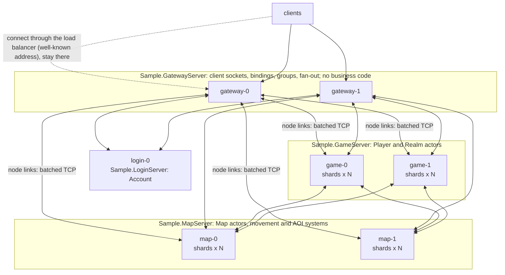
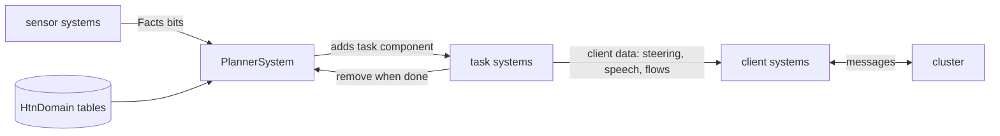
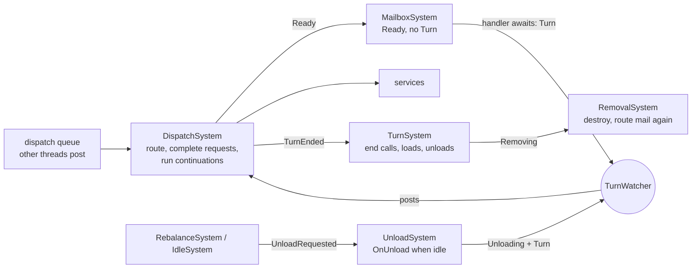

# DaServer design

DaServer is a .NET 11 framework for building **clusters**: game servers (many client-facing nodes, many map/logic nodes) and
other low-latency, high-concurrency backends (matchmaking, chat, trading, IoT fan-in). Developers write messages
(`[NinoType, Message]` structs), actors and services with `[Handle]` methods, and ECS systems. Source generators write the
rest: dispatchers, typed `Ask` overloads, registration, entry points and query jobs.

Priorities, in order:

1. Latency and throughput, with zero GC on hot paths.
2. Correctness under concurrency and failures.
3. Code a person or an AI can extend without touching plumbing.

Acceptance criteria and metrics are in [requirements.md](requirements.md); the reasons behind each choice are in
[decisions.md](decisions.md).

## 1. Building blocks

| Concept | What it is | Threading |
|---|---|---|
| **Node** | One process: a random `NodeId`, a cluster endpoint, optionally a client endpoint (it accepts clients). It hosts every actor, service and system compiled into its project; there are no roles. | IO threads plus the shards it owns. |
| **Shard** | A single-threaded executor: one thread, a lock-free dispatch queue and an EasyEcs `World` holding everything else ([§9](#9-ecs-in-daserver)). A node runs N shards (default: one per core). | One dedicated thread. Every handler and system of the shard runs on it, so user code needs no locks. |
| **Actor** | Keyed and stateful (player, map instance, room, guild): one loaded actor per id in the cluster, loaded on demand, turn-based. The loaded actor is an entity; its state is components (`Actor<TId, TState>`). | Its shard's thread. |
| **Service** | Stateless (login, matchmaking, chat routing). One instance per shard; calls are load-balanced (local node first) and may overlap. | The shard thread that received the call. |
| **Message** | A `[NinoType, Message]` struct; `[FromClient]`/`[ToClient]` say whether clients send it or receive it. A request (`IRequest<TReply>`) is answered; anything else is one-way. Routed by its type to the handler: the sender never names the receiver's type. | Delivered to the handler's mailbox (actors) or shard (services). |
| **Push** | A message to one client session or a `ClientGroup`; clients handle it with `[Handle]` methods. | Fire-and-forget. |
| **System** | EasyEcs `EcsSystem` with `[ForEach]` methods: one per-tick responsibility over every matching entity of a shard. | The shard thread, at the tick rate. |

### Vocabulary

Everything a developer declares is one of these (ADR-035). The message type alone decides who handles it.

| Declaration | Meaning |
|---|---|
| `[NinoType, Message] partial record struct M` | a message between servers only |
| `[Message, FromClient]` | game clients may send it; to an actor it goes to the actor bound to the session (`BindSession`), or to the actor the client names when that actor granted the session (`GrantSession`) |
| `[Message, ToClient]` | servers push it to sessions and groups; only clients handle it |
| `[NinoType]` alone | data inside messages; an unmanaged struct (an id) crosses as its memory without `[NinoType]`; anything else crossing the wire is a build error (DAS003) |
| `M : IRequest<TReply>` | a request, answered with one `TReply` |
| `[Handle]` method of an `Actor`/`Service` | handles one message type; returns `void`/`Reply`, or a request's reply/`Reply<TReply>` (`Ask` returns `Reply<TReply>` too) |
| `[Handle]` method of any other class | client-side handler of pushes (`client.Register(obj)`) |
| `class S : EcsSystem` with `[ForEach]` | per-tick logic over every matching entity of the shard |

| Call (`ICluster`, `ClusterClient`) | Target |
|---|---|
| `Ask(id, m)` / `Send(id, m)` | the actor `id` (`MapId`, `PlayerId`, ...: the id type names the actor type; rendezvous placement) |
| `Ask(m)` / `Send(m)` | the one service handling `M` (local first, else the less loaded of two hosting nodes); from a client: also the actor bound to the session |
| `Publish(e)` | every service type handling `E`, once each |
| `Send(session, m)` / `Send(group, m)` | one client session / a client group (`[ToClient]` messages; servers only) |

Access is per message type. The sample's map lets servers send `Enter` and `Leave` and lets the bound client send only
`[FromClient]` messages `Move` and `Say`, so a client can never enter someone else's player. The flow is checked at
build time (DAS006): pushing an internal message to a client, sending it from a client, or handling a push on a server
fails the build; at run time client-facing nodes accept only `[FromClient]` messages.

Client-facing nodes and other nodes talk through framework frames (relayed client messages with their session,
grants, group membership, resumed sessions), never through business messages, so there is no fourth flow: a service
hosted on a client-facing node exchanges ordinary `[Message]`s with the rest of the cluster.

Business code reaches the cluster only through `ICluster` (`Cluster` in actors and services, `world.Cluster` in
systems): messages, session binding, client groups. `Node` (lifecycle, membership, links) is not visible to it.

### Data flow of a call

```mermaid
sequenceDiagram
    participant C as caller (shard thread or client)
    participant L as node link (TCP, batched)
    participant T as target shard
    C->>C: the message is serialized once into a pooled frame
    alt same node
        C->>T: frame into the target shard's dispatch queue (zero copy)
    else other node
        C->>L: frame copied into the link's batch buffer
        L->>T: peer IO thread posts it to the target shard's dispatch queue
    end
    T->>T: DispatchSystem routes it to the actor's mailbox (or a service)
    T->>T: MailboxSystem runs the generated dispatcher, then the handler
    T-->>C: reply on the same path; the caller resumes on its own shard
```

Every message takes this path. The route comes from the handlers every node gossips: `(message id, handler type id,
actor)`. To an actor, the id type names the handler type; without an id, exactly one service type may handle the
message; `Publish` serializes once and sends one `Message` frame per service type handling it. A message to an actor
is routed to the owner of its id and enters the actor's mailbox, so it is turn-based: an actor awaiting inside a
handler takes no other message until it returns, while its shard runs other actors. A handler that only waits for an
acknowledgement before replying (a binding, a call, a save) returns `ReplyWhen(task, reply)` instead (ADR-057): the
turn ends at once and the reply follows the task, so a hot actor serves callers at CPU speed rather than one per round
trip. A delay is a message sent later, not an await: `Cluster.SendAfter(delay, address, message)` serializes it now
and the shard's timer wheel (a singleton) sends it when due, as ordinary mail (ADR-058). A turn waiting for a request
that comes back to its own actor (A asks B, B asks A) would wait until the timeout: every request carries the call chain
of the turn that made it, kept through the actors and services it passes, and one that reaches an actor whose running
turn has that chain fails at once with `CallCycle` (ADR-059). A service handler runs on the local node when it hosts one.

## 2. Wire protocol

- Frames carry a fixed 24-byte header: `length`, `kind`, `status`, `hops`, `flags`, `target`, `messageId`, `key`,
  then the Nino-serialized message, then the trailers its flags name (ADR-005).
- `messageId` is FNV-1a of the message type's full name (or its `[NinoFormerName]`: Nino's `NinoTypeId`), computed once per type at run time (the analyzer computes the same value at build time). Collisions are
  build errors (DAS004) and registration errors at runtime. Handler type ids are FNV-1a of the actor's id type or of the
  service type's full name (ADR-043).
- Frame kinds:
  - `Message`: to `target` (an actor or service handler type id, `key` the actor id; or an address scope: a session
    or a client group, `key` its id). With a call id trailer (flag `HasCall`) it is a request; the status byte then
    carries the caller's time budget (ADR-028).
  - `Reply`: the call id trailer, the status, the reply (or a handler's error message).
  - `Control`: link handshake and resume, gossip, client hello, tickets, resume, retire and keep-alive; a call id makes
    it a call.
- A receiving node routes a message by its target alone: a hosted handler type goes to its shard, a session or group
  to the client connections, anything else on to the node hosting it.
- A client leaves the target 0 to let its node pick the actor bound to its session or the service; it names an
  actor only if that actor granted its session (ADR-051): the node checks the session's grants (at most 64, a
  lock-free scan) and refuses anything else with `Forbidden`, before any actor is reached. Client-facing nodes copy the client's payload as is, add the session as the origin trailer
  (flag `HasOrigin`, 16 bytes before the call id; handlers read it as `Caller`) and route it. They never deserialize
  payloads.
- Versions side by side (ADR-076, ADR-077): each project's committed `wire.manifest` keeps layouts compatible
  (DAS017): messages are positional and frozen (a new field goes into a new message), persisted components version
  tolerant or keyed. A node link opens with a hello carrying the link protocol version, a client connection with a
  `ClientHello` carrying the client protocol version; another version is refused.
  Cards name each node's build and the messages it handles: services get only messages their build has, and a
  message an actor owner's build lacks is refused (`NotHosted`) until the owner is upgraded.

## 3. Performance model (zero GC)

| Concern | Design |
|---|---|
| Message objects | None. Messages are structs serialized in place into pooled `FrameWriter`s (over Nino's `NinoArrayBufferWriter`, ADR-078); dispatchers deserialize straight from the received bytes, every read checked against them. A collection in a message lives in a `[NinoPooled]` class its handler returns. |
| Buffers | `BufferPool`: power-of-two buckets on the **Pinned Object Heap**, each bucket bounded by a byte budget (64 MB). Sockets use the buffers without pinning, and they never fragment gen0/1/2. |
| Queues | Bounded Vyukov MPMC rings with struct slots. Producer and consumer cursors are padded onto separate 64-byte cache lines. |
| Awaiting | `PendingCall<T>` is a pooled `IValueTaskSource<T>`. An `async Reply<T>` handler keeps its suspended state in a box pooled per thread and state machine (`ReplyMethodBuilder`, ADR-062); its reply is awaited by a pooled `ReplyWatcher<T>`; a synchronously completed handler replies without any state machine. |
| Sending | Each connection copies frames into one batch buffer under a short lock. One send loop swaps and writes whole batches, so N frames cost one syscall. A broadcast serializes once and fans out by `memcpy`. |
| Receiving | Frames are parsed in place. Zero-byte reads mean an idle client connection holds no receive buffer, which matters with tens of thousands of sockets. |
| Sending API | Messages are `in` struct parameters of generic methods (`Ask<TRequest, TReply>`, generated typed overloads), so `Cluster.Ask(playerId, new AddGold(10))` allocates nothing and boxes nothing. |
| ECS | EasyEcs v4: struct components, `[ForEach]` struct jobs, singleton parameters resolved once per pass, zero allocations per tick. The runtime keeps per-actor state in components and visits only ready or busy actors. |
| GC mode | Server GC, concurrent. Allocation tests hold the budget in steady state: < 8 B per call or message across shards and through a client-facing node (any per-message object would be >= 24 B), < 1 B per delivery of a client fan-out. |

## 4. Latency

What a request costs, and what keeps it low:

| Technique | Effect |
|---|---|
| Wake on message | A shard waits on its dispatch queue signal with a timeout set to the next tick, so message latency does not depend on the tick rate. Runtime systems run on every wake (`ShardMessages` group); simulation systems at the tick rate. |
| At most two thread hops | Remote call: peer IO thread, then the target shard. Same-node calls skip the socket entirely; same-shard callers resume inline. |
| No placement lookup | Rendezvous hashing over the gossiped view: every node computes the owner of a key locally. There is no directory service on the call path. |
| Local first | Service handlers run on the calling node when it hosts them. |
| Batching without delay | `TCP_NODELAY`. The send loop drains everything queued while the previous write was in flight, so batching costs no timer. |
| Client pass-through | Client-facing nodes patch headers; they never deserialize payloads. One broadcast frame per client-facing node, `memcpy` per session. |
| Input as data | High-rate client input (movement) is written into components by the actor and integrated by `[ForEach]` systems on the next tick: one cache-friendly pass instead of a turn per message. |

Planned (roadmap): placement hints to co-locate actors that talk a lot (a player next to its map), and a client-connection
shard that keeps session state as ECS components.

## 5. Reliability

| Layer | Guarantee |
|---|---|
| Ordering | FIFO per (sender → target actor): one link per node pair, one dispatch queue per shard, one mailbox per actor. Messages of one sender keep their order (tests rely on it). |
| Calls | At most once, with timeouts (`RpcStatus.Timeout`, `Disconnected`, `NotHosted`); a call cycle fails at once (`CallCycle`, ADR-059). Retrying is the caller's choice, and only for idempotent operations. |
| Deadlines | A request carries its caller's remaining time; each hop turns it into a local deadline and a shard drops a request that expired before it ran (ADR-028). Work nobody waits for is not done. |
| Messages | At most once. Events that must not be lost are written to storage by the publisher first (outbox) and re-published on recovery; DaServer does not hide a broker inside the call path. |
| Single loaded actor | Keys hash into 4,096 slots, each owned by rendezvous hashing over the `Up` and `Suspect` nodes hosting the handler type (ADR-023, ADR-074; by the id's `Placement` for `IPlaced` id types, ADR-073), unless the coordinator's slot table says otherwise (ADR-079: the oldest Up member pins the loaded slots of `[Sticky]` types where they are and moves slots of other types from the most to the least loaded node, a few per round): every node computes the same owner from the same view and table. A node loads an actor only if it is the owner in its own view; otherwise it forwards (hop limit 3) or answers `NotHosted`. When ownership changes, the old owner unloads (`OnUnload`), hands its record to the new owner (ADR-072; the store when that fails) and forwards its remaining mail behind it. |
| Actor state | `[Persist]` components form one record per actor in the actor store (ADR-068): restored before `OnLoad`, written on unload, every `SaveEvery` while changed and at once with `SaveNow`; versioned, so a stale owner's write is refused and its copy dropped. A graceful stop loses nothing; a crash loses at most `SaveEvery` of changes. |
| Sessions | A client-facing node owns its sockets. Grants, bindings and groups live there; when a session closes, every actor it was bound or granted to that handles `SessionClosed` receives it, so no actor keeps a dead session. |
| Graceful shutdown | `SIGTERM` → `Leaving` (pushed to every member) → stop loading actors → drain mailboxes → unload actors → exit. |
| Backpressure | Shard dispatch queues and actor mailboxes are bounded and refuse with `Overloaded` (ADR-027). Links are not paused (their replies would stall too, ADR-027). A slow client hits the per-connection send backlog bound (256 KB) and is disconnected; it reconnects and resynchronizes (ADR-035). |
| Dead connections | Silence closes a connection (ADR-053): idle directions carry a 24-byte `Ping`/`Pong`, any frame counts as life. Clients ping after 15 s idle and give up after 30 s without a frame (then resume); client-facing nodes close sessions silent for 45 s (then the resume grace); node links ping each gossip interval and reconnect after max(`SuspectAfter`, three gossip intervals) of silence (then replay the resend window). |
| Link resumption | A node link's stream survives disconnects (ADR-008): the sender keeps unacknowledged bytes, the new connection's Hello names the stream, the receiver answers how much it processed and the sender replays the rest before anything new. A network blip is a delay: nothing is lost or run twice, calls in flight keep waiting. Calls fail with `Disconnected` only when the stream cannot resume (peer restarted, unreachable, declared dead, or the window no longer holds what it needs). A client that loses its connection resumes its session on any client-facing node with a signed ticket; actors receive `SessionResumed` instead of `SessionClosed` (ADR-036). |

## 6. Membership and discovery

- Seeds come from static `host:port` entries or DNS names (a Kubernetes headless service resolves to every pod). A
  node joins through any reachable seed.
- Gossip runs every second (configurable), from each node to up to 3 random peers (push-pull). A round carries one
  37-byte pulse per member (`NodeId`, incarnation, heartbeat, status, load, three feature slots), written and read in place; a
  member's card (endpoints, hosted handlers: message id, handler type id, actor or service) is sent only to nodes that do
  not know it yet (ADR-031). A steady-state round allocates nothing.
- Failure detection doesn't depend on synchronized clocks: a member whose heartbeat hasn't advanced for
  `SuspectAfter` becomes `Suspect`, after `DeadAfter` it is `Dead`; a node that hears it is suspected refutes by
  bumping its incarnation. A round that runs late (this process paused) defers its verdicts by the pause (ADR-064).
- Split brain: when members die, a node that reaches fewer members than it lost (a tie keeps the side with the lowest
  node id; clusters under three never down) stops without saving and exits, so the platform restarts it into the
  majority (`NodeOptions.KeepMajority`, on by default, ADR-064).
- Links are authenticated: an accepted connection starts with a fresh challenge, and the dialer's Hello carries the
  protocol version, the cluster name and an HMAC of the signing secret over the challenge and its endpoint; nothing
  else is read on a connection before it (ADR-065).
- Routing reads an immutable snapshot (`ClusterView`: message routes per message id, actor placement per handler type) that is swapped
  atomically on change. Lookups are lock-free.

## 7. Reference architectures

### Game cluster: many gateways, many map/logic nodes



The topology is the list of projects and replica counts in the AppHost. A small deployment can compile everything
into one project. A large one splits it by load profile: gateways are IO-bound, map nodes are CPU-bound.

```mermaid
sequenceDiagram
    participant Cl as client
    participant G as gateway
    participant A as Account (service, login node)
    participant P as Player (actor)
    participant M as Map (actor)
    Cl->>G: Login(name)
    G->>A: request (origin: the session)
    A->>P: Ask(playerId, Attach(session))
    P->>G: BindSession(session)  (acknowledged before the reply)
    Cl->>G: EnterMap(7)
    G->>P: routed to the bound player id
    P->>M: Ask(7, Enter(playerId, session))
    M->>G: BindSession(session)  (also joins the map's Group)
    Cl->>G: Move(vx, vy)  (one-way, [FromClient])
    G->>M: routed to the bound map
    M->>M: writes Velocity; MovementSystem, PlacementSystem, MotionSyncSystem run on the tick
    M-->>G: SnapshotSystem: Send(group, Motion(changes))  one message per changed cell every other tick, one frame per client-facing node
    G-->>Cl: fan-out to the group's local sessions
    Cl--xG: disconnect
    G-->>P: SessionClosed (bound)
    G-->>M: SessionClosed (bound): the avatar is removed
```

- **Player and map.** The player actor (keyed by player id) holds persistent state. The map (keyed by map instance id) owns
  the avatars as entities of its shard; `[ForEach]` systems do movement, AOI, combat and sync. Switching maps is
  `Leave` on map A and `Enter` on map B; the player actor stays where it is.
- **Messages to clients.** `Cluster.Send(session, m)` reaches one session. `Cluster.Send(Group, m)` (every actor has
  its own group) serializes once and sends one frame per client-facing node, which fans out locally (ADR-025, ADR-029).
  `ClientGroup.All` reaches every session of the cluster (the sample's realm status every 5 ticks).
- **Batch per tick.** Systems collect changes into the map's grid and one system sends them as one message per
  changed cell every other tick: n moving avatars cost n entries, not n x n messages.
- **Measured.** 10k bots through 3 gateways to one game node and one map node: see the README's Performance section.

### Backend cluster without clients

The same blocks without gateways: service nodes for stateless request handling behind an HTTP or queue edge, and
actor nodes for keyed state (accounts, carts, devices, matches) with events between them. Nodes are added and
removed at run time; placement moves only the keys of the node that joined or left.

## 8. Clients

`ClusterClient` connects through one or several entry addresses (`host:port`, DNS names included: every resolved
address is tried) and stays on the client-facing node the load balancer gave it (ADR-026); reconnects and moves (the
node's `Retire`: make before break) go through the same addresses again; `ConnectAsync(new Uri("ws://node/clients/ws"))` connects over a WebSocket of the node's HTTP plane instead
(browsers, WebGL builds; one or more whole frames per binary message, the same protocol). It sends the same messages as
servers: `client.Ask(new Login(..))`, `client.Ask(new GetInfo())` (session actors need no id: the node uses the
binding), `client.Send(roomId, new Say(..))` (actors that granted the session). Push handlers are `[Handle]` methods of any class,
registered with `client.Register(obj)`; every registered object handling a push receives it, in registration order (the
game's state and a measurement subscribe separately: a messaging-layer fan-out, apart from any ECS world). They run on
the IO thread or, for game loops and UIs, on the application's thread through `ProcessCallbacks`.

### Simulated users

`DaServer.Simulation` (ADR-056) runs a backend's real client logic as thousands of users, for end-to-end and load
tests of any domain. A `Swarm` spreads users over one `ClientLoop` per core: a client world on its own thread (its
`SynchronizationContext`, so flows awaited there resume there), arrivals handled every pass, systems at the servers'
tick rate. A user is an entity; what it does is planned as data: sensor systems write `Facts` (a bit set), the
`HtnDomain` singleton holds tasks, methods and steps as tables with bit-mask conditions and effects, and
`PlannerSystem` decomposes the root task on a copy of the facts (method order, effects, backtracking) into a `Plan`
of task ids. A primitive task is a component: added to start it, removed by the system that carries it out. The
swarm's `SwarmMeter` (latency histogram, counters) is a singleton of every world; the scenario judges the window.



### Features

A capability a node runs besides its actors and services (client connections, an HTTP edge) is a `NodeFeature` in
`NodeOptions.Features`, off unless configured (ADR-048). Hooks: `Start(INodeContext)` (IO side, before the shards
run), `ConfigureShard(World)` (each shard thread), `OnViewChanged`, `OnMemberDead` (once per member), `DrainAsync`
(the node is leaving, shards still run), `Stop(crashed)`, `IsReady`. A feature owns address types:
`node.HandleAddress<TAddr>(handler)` receives every message to a `TAddr` of this node on the receiving thread with the
raw frame (never blocking). Node addresses go to the node they name; the scope of each registered type is advertised
in the node's card, and a message to a group address goes once to every Up node advertising its scope. The runtime
never depends on a feature: the receiving node routes a frame by its target, a handler type to its shard or an address
scope to the feature registered for it. Features publish values on the node's card (`SetCardEntry`: an endpoint) and
gossip up to three counters in its pulse (`AddPulse`), read on other nodes as `member.CardEntry(key)` and
`member.Pulse(key)`; `AddGauge` reports a gauge on the DaServer meter (OpenTelemetry, dotnet-counters, the
dashboard); `PostToShards` runs rare work on every shard. A hosted node runs a feature when its configuration section
exists: `builder.AddDaServerFeature<TOptions>(name, create)` binds `DaServer:{name}` and adds the feature (built-in
ones are added by `AddDaServer`). Client connections are the first consumer (`ClientConnections`, enabled by the
`DaServer:Clients` section; ADR-050): sessions, origins and client groups, resume and retire, the
`daserver.clients.sessions` gauge.

Every node exports its metrics on the `DaServer` meter, scraped from `/metrics` on the HTTP plane (Prometheus format,
always on) and pushed over OTLP when a collector is configured: members, actors, queue length, refusals, failures,
expired requests, stalled shards, the shards' busy ratio (the default scaling signal for an HPA through the Prometheus
adapter or KEDA), tick overruns, and the features' gauges.

`node.Ingress` (`IIngress`) lets messages from outside in: raw (`Send`/`Ask` with message id, target, key and the
payload as received, never deserialized; the reply goes to the ingress's `IReplySink` under its call id) or typed
(`Ask(address, request, origin, budget)` for endpoints that build the message). Every message gets the origin the
ingress assigns (handlers read it as `Caller`) and a deadline capped at `CallTimeout`; this node picks the owner from
its view (one hop). With `IngressLoadLimit` set, a request whose target node gossiped that many queued messages is
refused with `Overloaded` before it is sent. Client connections send every client message through it.

Admission is the edge's: features add `IIngressFilter`s per node (`node.AddIngressFilter`), whose `Admit` runs for
every message from outside before it is routed; the first refusal wins, with a status (`RateLimited`, `Overloaded`, `Forbidden`) and
when to retry (a client gets it as `RpcException.RetryAfter`, carried in the refusal reply's key; HTTP maps it to
`Retry-After`). Building blocks: `TokenBucket` (one owner, allocation-free), `SignedToken` (content plus issued/expiry times, HMAC-SHA256 with the signing secret: resume tickets today,
a building block for admission tokens). Timers are data too: `TimerWheel<T>` (a hashed wheel owned by one thread:
O(1) schedule, cancel and fire, allocation-free) is advanced by its owner's loop.

On the shard, generated dispatchers run the dispatch-stage filters after deserializing and before the handler
(process-wide, the application's policy on every node of the process). Users declare them: `[Filter]` on a static
`RpcStatus M(object target, in TMessage message, in CallContext context)` filters that message type, on an
`IMessageFilter` class every message; the assembly's generated registration registers them, so there is no startup
code (DAS021 reports a wrong shape). Features and tests register at run time (`MessageFilters.Register<T>(filter)`,
`MessageFilters.Register(IMessageFilter)`; disposing the registration removes it): a status other than `Ok` refuses the message (a request gets it as its reply). Without
filters the check is two array lengths.

### HTTP plane

Every node is an ASP.NET Core `WebApplication` (its `Program.cs`, ADR-021; ADR-046): Kestrel on `DaServer:HttpPort`
next to the TCP data plane. Endpoints reach actors only through messages: `app.MapAsk<TRequest, TReply>(pattern)`
(the JSON body asked of the service), `app.MapAsk<TId, TRequest, TReply>("/x/{id}")` (of an actor),
`app.MapSend<T>(pattern)` (one-way, 202). Each request enters through the ingress with an origin of its own and the
budget of its `DaServer-Budget` header (ms, capped); refusals map to HTTP: `RateLimited` 429, `Overloaded`/`NotHosted`/
`Disconnected` 503 (`Retry-After` when overloaded or hinted), `Timeout` 504, `Forbidden` 403, handler errors 500.

The HTTP plane carries low-frequency traffic only (probes, admin, webhooks, back-office). Clients at volume use the
client protocol (TCP, or WebSocket at `/clients/ws`): a request over HTTP crosses two protocols and costs a `recv`
and a `send` of its own, while the client protocol writes a connection's frames together (ADR-046: 3.5 times the
requests per core in the flash sale).

## 9. ECS in DaServer

Business code and the runtime follow the same ECS rules (EasyEcs `doc/ecs-principles.md`). EasyEcs is data plus
systems; messaging across actors and nodes is DaServer's job, so there is no event bus
inside a world.

| Element | Responsibility | Never |
|---|---|---|
| Actor | Network boundary of one keyed entity: validate a message, write input as components; lifecycle and persistence hooks. | Per-tick logic. |
| Service | Stateless message handling. | State between messages. |
| Component | Data of one entity (actor state via `Actor<TId, TState>`, avatars, buffs). | Logic. |
| Singleton | Data of one shard world (statistics, configuration). | Per-entity data. |
| System | One per-tick responsibility; stateless; reads and writes components and singletons. | References to other systems, IO. |

The shard runtime itself is ECS. `Shard` owns only the thread, the dispatch queue and the wake/tick loop.

Messages pass two queues, as in Akka and Orleans (dispatcher, then mailbox). The **dispatch queue** is per shard and
the only cross-thread handoff: IO threads, other shards and completed awaits post to it, because only the shard
thread may touch ECS data. It is two bounded rings: new calls and messages (refused when full, ADR-027), and
completions, continuations and turn ends (16k slots, never refused, drained first; a burst beyond spills into an
overflow queue). `DispatchSystem` drains it and sorts each frame into its actor's **mailbox** (a component).
`MailboxSystem` runs mailboxes one turn at a time: while an actor awaits inside a handler, its own mail waits and the
other actors of the shard keep running, so one queue could not serve both purposes.

| Data | Kind | Meaning |
|---|---|---|
| `ActorRef` | component | the loaded actor object (its id and client group for systems) |
| `Mailbox` | component | messages waiting for the actor (a turn at a time) and when it last took mail |
| `Ready` | tag | the mailbox has mail |
| `Turn` | component | the asynchronous message, load or unload in progress (present = busy) |
| `TurnEnded` | tag | the turn's task completed (posted by its `TurnWatcher`, or set at once when it completed synchronously; never polled) |
| `Loading`, `UnloadRequested`, `Unloading` | tags | `OnLoad` running; asked to leave; `OnUnload` running |
| `Fenced` | tag | the node was declared dead: removed without `OnUnload` (ADR-042) |
| `Removing` | component | the loaded actor ends: mail is routed again (or failed with its status) |
| `UnloadWhenIdle` | component | the actor unloads after this long without mail (`UnloadAfterIdle`) |
| `ClientSessions` | component | client sessions the actor knows (closed for it when their node dies) |
| `ServiceCall` | tag | an entity per running asynchronous service call (ended like a turn) |
| `ActorDirectory`, `ServiceDirectory` | singletons | loaded actors by id, service instances by handler type |
| `TurnWatchers`, `ActorPools`, `ShardActivity` | singletons | pooled watchers; actor objects, mailboxes and session sets of removed actors (ADR-044); per-wake bookkeeping |



Cadence belongs to the shard loop, behavior to systems (EasyEcs system groups): `ShardMessages` runs on every wake,
`ShardRebalance` only after ownership may have changed, `ShardIdleScan` a few times a second, the default group at
the tick rate. So every runtime system is a plain `[ForEach]` over the entities in one state, with no gating flags or
manual queries.

The only per-message work is a dictionary lookup, a queue push and the handler. Every system visits only the
entities in the state it handles (a filter on tags), so nothing scans all actors and nothing polls running turns.

## 10. Developer experience (generated code)

```csharp
[NinoType, Message, FromClient] public partial record struct AddGold(int Amount) : IRequest<int>;
[NinoType, Message] public partial record struct LoggedIn(ClientSession Session);

public record struct Wallet(int Gold, int Logins) : IComponent;

public sealed class Player : Actor<PlayerId, Wallet>
{
    [Handle] public int On(AddGold m) => State.Gold += m.Amount;

    [Handle] public void On(LoggedIn e) => State.Logins++;
}

public sealed partial class RegenSystem : EcsSystem
{
    [ForEach, Without<Dead>]
    static void Regen(ref Health hp, in Regen r) => hp.Value = Math.Min(hp.Max, hp.Value + r.PerTick);
}
```

What the generators write:

| Generator | Output |
|---|---|
| `AskGenerator` | a `{Request}Ask` class of typed `Ask` overloads per request (`Cluster.Ask(playerId, new AddGold(1))` infers the reply type) |
| `RegistrationGenerator` | `Registration_{Assembly}`: registrations of referenced assemblies first, then `[FromClient]` messages, client handler classes, actors and services (one dispatcher per `[Handle]` method), every `EcsSystem`; run once by its static constructor (ADR-012) |
| `PolyfillGenerator` | `IsExternalInit` for contract assemblies built for netstandard2.1 |
| EasyEcs `SystemGenerator` | `[ForEach]` struct jobs (components, singletons, entity, world parameters) and `GeneratedUpdate` |
| Analyzers | DAS001–DAS021 (handlers, messages, wire types, id collisions, constructors, message flow, stateless actors, services and systems, address kinds, synchronous waits on shard threads, shared logic, ReplyWhen placement, systems that ask, components apart from logic, persisted and handed-off components, work started off the shard thread, placement on non-id types, wire layouts against the committed manifest, collections held directly by client messages, a session disconnected by an actor without `DisconnectSession`, misshapen filters), EECS001–EECS008 (ECS rules) |

The generators follow the incremental-generator rules: syntax-only predicates, equatable models, tracking names, and
no diagnostics. There is no reflection scanning, no configuration string and no hand-written registration list. A
node project is its business classes only.

## 11. Orchestration

- The deployment unit is a project: a node hosts what the project compiles. Names, ports and seeds come from the
  environment the AppHost sets, bound by `DaServer.Hosting` on the Generic Host. `SIGTERM` triggers a graceful
  leave. Each node logs a stats line (CPU, allocation rate, GCs, sessions, actors, queue, rejected) every 30 s.
- The cluster is described once in an Aspire AppHost with `DaServer.Aspire`:
  `AddDaServerCluster`, `AddNodes<TProject>(name, replicas)`, `.WithClientConnections()` on a node group;
  `WithClientEndpoints(group)` hands the group's client addresses to clients and bots as entries (ADR-030).
  - Run (`dotnet run` on the AppHost, the dashboard showing logs, traces and metrics): a resource per replica on ports
    of its own, seeded with every other node.
  - Published (`aspire publish`; Docker Compose via `AddDockerComposeEnvironment`, Kubernetes via
    `AddKubernetesEnvironment`, both samples switch with `Publish=k8s`): a workload per group with its replicas, the
    same ports on every replica, each advertising its own address, seeds through each group's DNS name (the Compose
    service; a headless `{group}-peers` Service on Kubernetes), a preStop pause and a grace period from the stop
    budget. Scaling policy (HPA, VPA, PDB, the load balancer) is the application's, added in its AppHost through the
    same publisher hooks. There are no hand-maintained deployment files.
- In-process tests run several nodes in one process with `NodeOptions.Hosts` (a type filter).

## 12. Quality gates

| Level | What | Where |
|---|---|---|
| Unit | Queues, buffer pool, frame parsing, pending-call table, membership merge, rendezvous placement | `tests/DaServer.Tests` |
| Generator | Valid input compiles, every DAS rule fires from the analyzer, unrelated edits hit the incremental cache | `tests/DaServer.Tests` |
| Integration | In-process clusters on loopback (`ClusterTest` on `DaServer.Testing`'s node options; `TestCluster` with a manual clock for exact tick counts, delayed sends and idle unloads; `RouteCheck`: every message of a set of node projects has its handler): request semantics and ordering, turn-based actors, ECS systems over actor state, single loaded actor, idle unloading, failover, fencing, one-way and published messages (to actors on any node, once per service type, ordering, routing), resumable links, deadlines, client access by `[FromClient]`, binding isolation, broadcast (exact under churn), connections moving after a scale-out, `SessionClosed` (close and client-facing node crash), session resumption, backpressure, placement under suspicion | `tests/DaServer.Tests` |
| Allocation | Steady-state cross-shard calls, replies of suspended handlers, bursts of concurrent calls, one-way messages, client fan-out, client messages through a client-facing node and gossip rounds allocate nothing per operation | `tests/DaServer.Tests` |
| End to end | AppHost topology (login, game, map, 3 client-facing gateway nodes) + `Sample.Bot`: 10k bots locally, 1,000 in CI (`tests/DaServer.E2E`); fails on any gap, disconnect or p99 over the limit | `samples/mmo/`, `tests/DaServer.E2E` |
| Benchmarks | BenchmarkDotNet on real loopback sockets: RPC at 1/64/1,024 outstanding calls (local and remote), one-way messages to actors (local and remote), group broadcast to 1k/5k client sockets in 1 or 9 groups, broadcast to everyone through 3 client-facing nodes (3k/9k) | `benchmarks/DaServer.Benchmark` |
