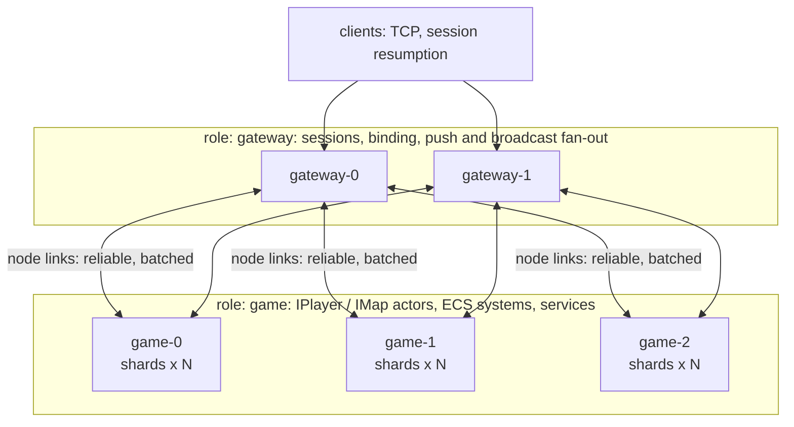
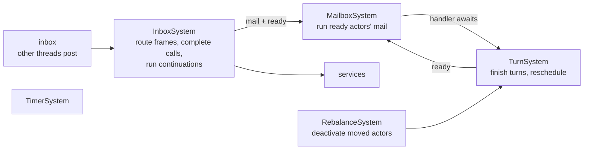

# DaServer design

DaServer is a .NET 10 framework for building **clusters**: game servers (many gateways, many map/logic nodes) and
other low-latency, high-concurrency backends. Developers write contracts (interfaces), implementations, and ECS
systems. Source generators write the rest: proxies, dispatchers, registration and query jobs.

Priorities, in order:

1. Latency and throughput, with zero GC on hot paths.
2. Correctness under concurrency and failures.
3. Code a person or an AI can extend without touching plumbing.

## 1. Building blocks

| Concept | What it is | Threading |
|---|---|---|
| **Node** | One process. Has a `NodeId`, roles, hosted contracts, a cluster endpoint and optionally a client endpoint. | IO threads plus the shards it owns. |
| **Shard** | A single-threaded executor: one thread, a lock-free inbox and an EasyEcs `World` holding everything else (see [ECS in DaServer](#8-ecs-in-daserver)). A node runs N shards (default: one per core). | One dedicated thread. Every handler and system of the shard runs on it, so user code needs no locks. |
| **Actor** (`IActor` contract) | Keyed, stateful (player, map instance, room, guild). One activation per key in the cluster. The activation is an entity: its state is components (`Actor<TState>`). Turn-based: one message at a time, including its awaits. | Its shard's thread. |
| **Service** (`IService` contract) | Stateless (login, matchmaking, chat routing). One instance per shard; calls are load-balanced and may overlap. | The shard thread of the instance that handles the call. |
| **Client callback** (`IClientCallback`) | Server → client push contract, to a session or a `ClientGroup`. | Fire-and-forget. |
| **System** (EasyEcs `EcsSystem`, `[ForEach]`) | One per-tick responsibility over every matching entity of a shard (movement, AOI, buffs, sync). | The shard thread, at the tick rate. |
| **Event** (EasyEcs `IEvent`, `IEventHandler<T>`) | Synchronous, in-shard notification between systems and actors (`Died` → loot, quests). | The publisher's shard thread. |

Data flow of a call:

```mermaid
sequenceDiagram
    participant C as caller (shard thread or client)
    participant L as node link (TCP, batched)
    participant T as target shard
    C->>C: generated proxy serializes arguments once into a pooled frame
    alt same node
        C->>T: frame into the target shard's inbox (zero copy)
    else other node
        C->>L: frame copied into the link's batch buffer
        L->>T: peer IO thread posts it to the target shard's inbox
    end
    T->>T: InboxSystem routes it to the actor's mailbox (or a service)
    T->>T: MailboxSystem runs the generated dispatcher, then the handler
    T-->>C: reply on the same path; the caller resumes on its own shard
```

## 2. Wire protocol

- Frames carry a fixed 24-byte header: `length`, `kind`, `status`, `hops`, `flags`, `requestId`, `methodId`, `key`. The payload is Nino-serialized arguments.
- `methodId` is FNV-1a of `Namespace.Interface.Method(ParamTypes)`, computed at compile time. Collisions are build errors (DAS005, from the analyzer) and registration errors at runtime.
- Frame kinds:
  - `Request` / `OneWay` / `Response`
  - `Push` (one session)
  - `Broadcast` (a group of sessions)
  - `Control` (handshake, gossip, acks, session binding)
  - `Ping` / `Pong`
- Gateways route client frames by patching header fields (`requestId`, `key`). They never deserialize payloads.

## 3. Performance model (zero GC)

| Concern | Design |
|---|---|
| Message objects | None. Arguments are serialized straight into pooled `FrameWriter` buffers; dispatchers deserialize straight from the received bytes. |
| Buffers | `BufferPool`: power-of-two buckets on the **Pinned Object Heap**. Sockets use the buffers without pinning, and they never fragment gen0/1/2. |
| Queues | Bounded Vyukov MPMC rings with struct slots. Producer and consumer cursors are padded onto separate 64-byte cache lines. |
| Awaiting | `PendingCall<T>` is a pooled `IValueTaskSource<T>`. Dispatch helpers use `PoolingAsyncValueTaskMethodBuilder`. A synchronously completed handler replies without any state machine. |
| Sending | Each connection copies frames into one batch buffer under a short lock. One send loop swaps and writes whole batches, so N frames cost one syscall. A broadcast serializes once and fans out by `memcpy`. |
| Receiving | Frames are parsed in place. Zero-byte reads mean an idle client connection holds no receive buffer, which matters with tens of thousands of sockets. |
| Proxies | Generated `readonly struct` proxies, so `Cluster.Player(42).AddGold(10)` allocates nothing. |
| ECS | EasyEcs v4: struct components, `[ForEach]` struct jobs, zero allocations per tick. The runtime keeps per-actor state in components and visits only ready or busy actors. |
| GC mode | Server GC, concurrent, `SustainedLowLatency` during steady state. Allocation tests in CI hold the zero-GC budget. |

## 4. Latency

- A shard wakes **as soon as** a message arrives. It doesn't wait for the next tick. It waits on its mailbox signal with a timeout set to the next tick deadline, so message latency is independent of tick rate.
- At most two thread hops per remote call: the IO thread, then the target shard. Same-node calls skip the socket.
- `TCP_NODELAY`. Batching comes from the send loop draining everything queued while the previous write was in flight. It adds no timer delay.
- Gateways forward bytes without parsing payloads.

## 5. Reliability

| Layer | Guarantee |
|---|---|
| Ordering | FIFO per (sender shard → target actor): one link per node pair and one mailbox per shard. |
| Requests | At most once, with timeouts (`RpcStatus.Timeout`, `Disconnected`, `NotHosted`). Retrying is the caller's choice, and only for idempotent operations. |
| Link resumption | Node links and client sessions number their stream by **byte offset**. Sent batches stay in an unacked list (the batch buffers themselves, so no extra copy) until the peer acks the offset. On reconnect, the handshake exchanges the last received offset and the sender replays from there. A network blip becomes a delay instead of a lost message. Clients resume within a grace period (default 30 s) after switching networks. |
| Backpressure | Mailboxes are bounded. When a shard is full, the remote link's receive loop pauses, which pushes back through TCP. A slow client hits a per-session send limit and is disconnected (it can resume). |
| Single activation | Rendezvous hashing over the `Up` nodes that host the actor type: every node computes the same owner from the same view. A node activates an actor only if it is the owner in its own view. Otherwise it forwards the call (hop limit 2) or answers `NotHosted`, and the caller retries once membership converges. When ownership changes, the old owner deactivates (`OnDeactivateAsync`, the persistence hook) before the new one activates on the next call. |
| Graceful shutdown | `SIGTERM` → `Leaving` (gossiped) → stop accepting activations → drain mailboxes → deactivate actors → exit. |

## 6. Membership and discovery

- Seeds come from static `host:port` entries or DNS names (a Kubernetes headless service resolves to every pod). A node joins through any reachable seed.
- Gossip runs every second, from each node to up to 3 random peers. The digest is the full member table: `NodeId`, endpoints, roles, hosted contract ids, incarnation, heartbeat counter, status and load. Merge rule: the higher incarnation wins; within the same incarnation, the higher heartbeat wins, and the status order is `Joining < Up < Leaving < Dead`.
- Failure detection doesn't depend on synchronized clocks:
  - A member whose heartbeat hasn't advanced for `SuspectAfter` (3 s) becomes `Suspect`.
  - After `DeadAfter` (10 s) it is `Dead`.
  - A node that hears it is suspected refutes by bumping its incarnation.
- Routing reads an immutable snapshot (`ClusterView`) that is swapped atomically on change. Lookups are lock-free.

## 7. Game server reference architecture



- **Login.** The client calls `IAuth.Login`, a client-accessible service. The handler validates credentials and binds the session to a player id. Later client calls to `[ClientAccessible]` actor contracts are routed with the **bound** key, so a client can never address someone else's actor.
- **Player and map.**
  - `IPlayer` is keyed by player id. It holds persistent state: inventory, quests, currencies.
  - `IMap` is keyed by map instance id. Its avatars are entities of its shard; `[ForEach]` systems do movement, AOI, combat and sync.
  - The player's avatar entity lives in the map. To switch maps, the client calls `Leave` on map A, then `Enter` on map B, and the player actor stays where it is.
- **Push and broadcast.**
  - `Cluster.PlayerClient(session).OnChat(msg)` pushes to one session.
  - `Cluster.PlayerClient(new ClientGroup(id)).OnChat(msg)` serializes once and sends one frame per gateway. Each gateway fans out to its local sessions in the group.
  - AOI lists, guild channels and shard chat are all groups.

## 8. ECS in DaServer

Business code and the runtime follow the same ECS rules (EasyEcs `doc/ecs-principles.md`).

| Element | Responsibility | Never |
|---|---|---|
| Actor | Network boundary of one keyed entity: validate a call, write input as components or events; lifecycle and persistence hooks. | Per-tick logic. |
| Service | Stateless request handling. | State between calls. |
| Component | Data of one entity (actor state via `Actor<TState>`, avatars, buffs). | Logic. |
| System | One per-tick responsibility; stateless; communicates through data and events. | References to other systems, IO. |
| Event | One-way in-shard notification. | Commands to a specific receiver. |

The shard runtime itself is ECS. `Shard` owns only the thread, the cross-thread inbox and the wake/tick loop:

| Data | Kind | Meaning |
|---|---|---|
| `ActorLink`, `ActorIdentity` | components | the activation object and its directory key |
| `Mailbox` | component | messages waiting for the actor (a turn at a time) |
| `Turn` | component | the asynchronous call, activation or deactivation in progress (present = busy) |
| `Deactivating` | tag | the actor is being deactivated (mail is forwarded afterwards) |
| `ActorDirectory`, `ServiceDirectory` | singletons | activations by id, service instances by contract |
| `ReadyActors` | singleton | idle actors with mail: the only actors the mailbox system visits (dirty set) |
| `ServiceTasks`, `ShardTimers`, `ShardActivity` | singletons | running service calls, timers, per-wake bookkeeping |



Runtime systems belong to the `ShardMessages` group, updated on every wake (`world.Update<ShardMessages>()`), so message
latency does not depend on the tick. User systems are in the default group, updated at the tick rate
(`world.Update()`). The only per-message work is a dictionary lookup, a queue push and the handler. Busy actors are
found by archetype (`Turn`), and idle actors with mail come from the ready queue, so nothing scans all actors.

## 9. Developer experience (generated code)

```csharp
[ClientAccessible]
public interface IPlayer : IActor
{
    ValueTask<int> AddGold(int amount);
    void Emote(int id);                                   // one-way
}

public record struct Wallet(int Gold) : IComponent;

public sealed class Player : Actor<Wallet>, IPlayer
{
    public ValueTask<int> AddGold(int amount) => new(State.Gold += amount);
    public void Emote(int id) => Cluster.PlayerClient(new ClientGroup(Key)).OnEmote(Key, id);
}

public sealed partial class RegenSystem : EcsSystem
{
    [ForEach, Without<Dead>]
    static void Regen(ref Health hp, in Regen r) => hp.Value = Math.Min(hp.Max, hp.Value + r.PerTick);
}
```

`ContractGenerator` emits the proxy struct, the dispatcher switch, wire ids, contract registration and cluster
accessors (`Cluster.Player(key)`, `Cluster.PlayerClient(session or group)`). `HostGenerator` registers actor and
service factories and every `EcsSystem` with their `[Role]`s. EasyEcs's generator compiles `[ForEach]` methods and
event subscriptions. Both follow the incremental-generator rules: syntax-only predicates, equatable models, tracking
names, and no diagnostics. `DaServerAnalyzer` reports DAS001–DAS008 from the same symbol reader (`Shapes`), and
EasyEcs's analyzer reports EECS001–EECS008, including the ECS-principle warnings. There is no reflection scanning, no
configuration strings and no hand-written registration list.

## 10. Orchestration

- One binary per application. Roles, ports and seeds come from configuration (`DaServer:Roles`, environment
  `DaServer__Roles__0=gateway`), bound by `DaServer.Hosting` on the Generic Host. `SIGTERM` triggers a graceful leave.
- The cluster is described once in an Aspire AppHost with `DaServer.Aspire`. `AddDaServerCluster` and
  `AddNodes<TProject>(name, replicas, roles, gateway)` give every node a cluster endpoint, its roles, seeds (every
  other node) and, for gateways, a client endpoint. `WithGateways` hands the gateway endpoints to clients and bots.
- The same model runs locally (`dotnet run` on the AppHost, with the dashboard showing logs and OTLP metrics) and is
  published with `aspire publish`: Docker Compose via `AddDockerComposeEnvironment`, Kubernetes via
  `AddKubernetesEnvironment`. There are no hand-maintained deployment files.

## 11. Quality gates

| Level | What | Where |
|---|---|---|
| Unit | Queues, buffer pool, frame parsing, pending-call table, membership merge, rendezvous placement | `tests/DaServer.Tests` |
| Generator | Valid input compiles, every DAS rule fires from the analyzer, unrelated edits hit the incremental cache | `tests/DaServer.Tests` |
| Integration | In-process clusters on loopback (`ClusterTest`): RPC semantics and ordering, turn-based actors, ECS systems over actor state, single activation, failover, gateway binding, push and broadcast | `tests/DaServer.Tests` |
| Allocation | Steady-state cross-shard actor calls allocate nothing per call | `tests/DaServer.Tests` |
| Benchmarks | BenchmarkDotNet on real loopback sockets: RPC at 1/64/1,024 outstanding calls (local and remote), broadcast to 1k/5k client sockets | `benchmarks/DaServer.Benchmark` |
