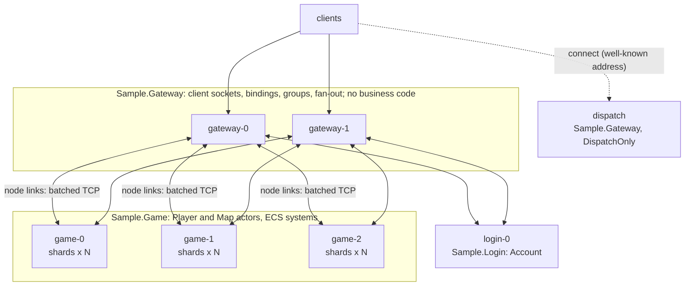
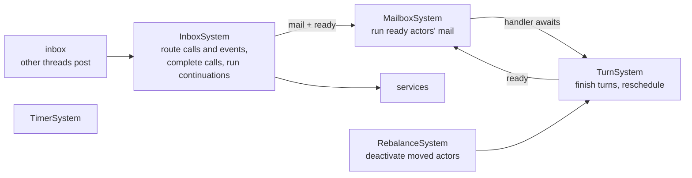

# DaServer design

DaServer is a .NET 10 framework for building **clusters**: game servers (many gateways, many map/logic nodes) and
other low-latency, high-concurrency backends (matchmaking, chat, trading, IoT fan-in). Developers write contracts
(interfaces), implementations, event handlers and ECS systems. Source generators write the rest: proxies,
dispatchers, registration, entry points and query jobs.

Priorities, in order:

1. Latency and throughput, with zero GC on hot paths.
2. Correctness under concurrency and failures.
3. Code a person or an AI can extend without touching plumbing.

Acceptance criteria and metrics are in [requirements.md](requirements.md); the reasons behind each choice are in
[decisions.md](decisions.md).

## 1. Building blocks

| Concept | What it is | Threading |
|---|---|---|
| **Node** | One process: a random `NodeId`, a cluster endpoint, optionally a client endpoint (gateway). It hosts every actor, service and system compiled into its project; there are no roles. | IO threads plus the shards it owns. |
| **Shard** | A single-threaded executor: one thread, a lock-free inbox and an EasyEcs `World` holding everything else ([§9](#9-ecs-in-daserver)). A node runs N shards (default: one per core). | One dedicated thread. Every handler and system of the shard runs on it, so user code needs no locks. |
| **Actor** | Keyed and stateful (player, map instance, room, guild): one activation per key in the cluster, activated on demand, turn-based. The activation is an entity; its state is components (`Actor<TState>`). | Its shard's thread. |
| **Service** | Stateless (login, matchmaking, chat routing). One instance per shard; calls are load-balanced (local node first) and may overlap. | The shard thread that received the call. |
| **Client callback** | Server → client push contract, to one session or a `ClientGroup`. | Fire-and-forget. |
| **Event** | A fact published to the cluster (`PlayerLoggedIn`). The publisher does not know the handlers. | Delivered like a one-way call to each handler. |
| **System** | EasyEcs `EcsSystem` with `[ForEach]` methods: one per-tick responsibility over every matching entity of a shard. | The shard thread, at the tick rate. |

### Vocabulary

Everything a developer declares is one of these (ADR-018). Attributes on the contract say how a target is chosen
and what game clients may call.

| Declaration | Callers | Target |
|---|---|---|
| `[Service] interface IX` | servers | any node hosting it (load-balanced, local first) |
| `[Actor] interface IX` | servers | the activation of a key (rendezvous placement) |
| `[Client]` on a contract or method | also clients | services: any; actors: the key the server bound to the session (`Cluster.Bind<IX>`) |
| `[Client(AnyKey = true)]` | also clients | actors: clients choose the key (public rooms, leaderboards) |
| `[Push] interface IX` | servers | one session or a client group |
| `[NinoType]` struct, optional `[Key]` member | `Cluster.Publish(e)` | every `[Handle]` method for it: each service implementation once, the actor activation of the key |
| `class S : EcsSystem` with `[ForEach]` | the shard loop | every matching entity of the shard |
| `[NinoType]` | | wire data (arguments, results, events); anything else crossing the wire is a build error (DAS009) |

Access is per method. The sample's `IMap` lets servers call `Enter` and `Leave` and lets the bound client call only
`[Client] Move` and `[Client] Chat`, so a client can never call `Enter` with someone else's player id.

Business code reaches the cluster only through `ICluster` (`Cluster` in actors and services, `world.Cluster()` in
systems): generated proxies, session binding, client groups and `Publish`. `Node` (lifecycle, membership, links) is
not visible to it.

### Data flow of a call

```mermaid
sequenceDiagram
    participant C as caller (shard thread or client)
    participant L as node link (TCP, batched)
    participant T as target shard
    C->>C: generated proxy serializes arguments once into a pooled frame
    alt same node
        C->>T: frame into the target shard's inbox (zero copy)
    else other node
        C->>L: frame copied into the link's batch buffer
        L->>T: peer IO thread posts it to the target shard's inbox
    end
    T->>T: InboxSystem routes it to the actor's mailbox (or a service)
    T->>T: MailboxSystem runs the generated dispatcher, then the handler
    T-->>C: reply on the same path; the caller resumes on its own shard
```

Events take the same path. `Publish` serializes the event once and sends one `Event` frame per handling
implementation. The route comes from the handlers every node gossips. A keyed event is routed to the owner of its
key and enters the activation's mailbox, so it is turn-based like a call. A service handler runs once per
implementation, on the local node when it hosts one.

## 2. Wire protocol

- Frames carry a fixed 24-byte header: `length`, `kind`, `status`, `hops`, `flags`, `requestId`, `methodId`, `key`.
  The payload is Nino-serialized arguments.
- `methodId` is FNV-1a of `Namespace.Interface.Method(ParamTypes)`, computed at compile time. Collisions are build
  errors (DAS005, from the analyzer) and registration errors at runtime. Event ids are FNV-1a of the event type name.
- Frame kinds:
  - `Request` / `OneWay` / `Response`
  - `Event`: `methodId` is the event id, `requestId` is the target implementation, `key` is the event key
  - `Push` (one session) / `Broadcast` (a group of sessions)
  - `Control` (gossip, session binding, groups, kick)
  - `Ping` / `Pong`
- Gateways route client frames by patching header fields and prepending the caller session. They never deserialize
  payloads.

## 3. Performance model (zero GC)

| Concern | Design |
|---|---|
| Message objects | None. Arguments and events are serialized straight into pooled `FrameWriter` buffers; dispatchers deserialize straight from the received bytes. |
| Buffers | `BufferPool`: power-of-two buckets on the **Pinned Object Heap**, each bucket bounded by a byte budget (64 MB). Sockets use the buffers without pinning, and they never fragment gen0/1/2. |
| Queues | Bounded Vyukov MPMC rings with struct slots. Producer and consumer cursors are padded onto separate 64-byte cache lines. |
| Awaiting | `PendingCall<T>` is a pooled `IValueTaskSource<T>`. Dispatch helpers use `PoolingAsyncValueTaskMethodBuilder`. A synchronously completed handler replies without any state machine. |
| Sending | Each connection copies frames into one batch buffer under a short lock. One send loop swaps and writes whole batches, so N frames cost one syscall. A broadcast serializes once and fans out by `memcpy`. |
| Receiving | Frames are parsed in place. Zero-byte reads mean an idle client connection holds no receive buffer, which matters with tens of thousands of sockets. |
| Proxies | Generated `readonly struct` proxies, so `Cluster.Player(42).AddGold(10)` allocates nothing. Event keys are read through a constrained call bound once per event type (no boxing). |
| ECS | EasyEcs v4: struct components, `[ForEach]` struct jobs, singleton parameters resolved once per pass, zero allocations per tick. The runtime keeps per-actor state in components and visits only ready or busy actors. |
| GC mode | Server GC, concurrent. Allocation tests hold the budget: < 1 B per call and per event in steady state. |

## 4. Latency

What a request costs, and what keeps it low:

| Technique | Effect |
|---|---|
| Wake on message | A shard waits on its inbox signal with a timeout set to the next tick, so message latency does not depend on the tick rate. Runtime systems run on every wake (`ShardMessages` group); simulation systems at the tick rate. |
| At most two thread hops | Remote call: peer IO thread, then the target shard. Same-node calls skip the socket entirely; same-shard callers resume inline. |
| No placement lookup | Rendezvous hashing over the gossiped view: every node computes the owner of a key locally. There is no directory service on the call path. |
| Local first | Services and service event handlers run on the calling node when it hosts them. |
| Batching without delay | `TCP_NODELAY`. The send loop drains everything queued while the previous write was in flight, so batching costs no timer. |
| Gateway pass-through | Gateways patch headers; they never deserialize payloads. One broadcast frame per gateway, `memcpy` per session. |
| Input as data | High-rate client input (movement) is written into components by the actor and integrated by `[ForEach]` systems on the next tick: one cache-friendly pass instead of a turn per message. |

Planned (roadmap): placement hints to co-locate actors that talk a lot (a player next to its map), and a gateway shard
that keeps session state as ECS components.

## 5. Reliability

| Layer | Guarantee |
|---|---|
| Ordering | FIFO per (sender → target actor): one link per node pair, one inbox per shard, one mailbox per actor. Calls and events of one sender keep their order (tests rely on it). |
| Calls | At most once, with timeouts (`RpcStatus.Timeout`, `Disconnected`, `NotHosted`). Retrying is the caller's choice, and only for idempotent operations. |
| Deadlines | A request carries its caller's remaining time; each hop turns it into a local deadline and a shard drops a request that expired before it ran (ADR-028). Work nobody waits for is not done. |
| Events | At most once, like one-way calls. Events that must not be lost are written to storage by the publisher first (outbox) and re-published on recovery; DaServer does not hide a broker inside the call path. |
| Single activation | Rendezvous hashing over the `Up` nodes hosting the implementation: every node computes the same owner from the same view. A node activates an actor only if it is the owner in its own view; otherwise it forwards (hop limit 3) or answers `NotHosted`. When ownership changes, the old owner deactivates (`OnDeactivateAsync`, the persistence hook) and forwards its remaining mail. |
| Sessions | A gateway owns its sockets. Bindings and groups live on the gateway; when a session closes, every actor it was bound to that handles `SessionClosed` receives it, so no actor keeps a dead session. |
| Graceful shutdown | `SIGTERM` → `Leaving` (pushed to every member) → stop accepting activations → drain mailboxes → deactivate actors → exit. |
| Backpressure | Shard inboxes and actor mailboxes are bounded and refuse with `Overloaded` (ADR-027). Planned (roadmap): pausing a link's receive loop while its target shard is full (TCP pushes back to the sender). A slow client hits the per-connection send backlog bound and is disconnected. |
| Link resumption | A node link's stream survives disconnects (ADR-008): the sender keeps unacknowledged bytes, the new connection's Hello names the stream, the receiver answers how much it processed and the sender replays the rest before anything new. A network blip is a delay: nothing is lost or run twice, calls in flight keep waiting. Calls fail with `Disconnected` only when the stream cannot resume (peer restarted, unreachable, declared dead, or the window no longer holds what it needs). Client sessions do not resume: a client reconnects and logs in again. |

## 6. Membership and discovery

- Seeds come from static `host:port` entries or DNS names (a Kubernetes headless service resolves to every pod). A
  node joins through any reachable seed.
- Gossip runs every second (configurable), from each node to up to 3 random peers (push-pull). The digest is the full
  member table: `NodeId`, endpoints, hosted services, hosted actor implementations, event handlers, incarnation,
  heartbeat, status and load.
- Failure detection doesn't depend on synchronized clocks: a member whose heartbeat hasn't advanced for
  `SuspectAfter` becomes `Suspect`, after `DeadAfter` it is `Dead`; a node that hears it is suspected refutes by
  bumping its incarnation.
- Routing reads an immutable snapshot (`ClusterView`: services, actor placement, event routes) that is swapped
  atomically on change. Lookups are lock-free.

## 7. Reference architectures

### Game cluster: many gateways, many map/logic nodes



The topology is the list of projects and replica counts in the AppHost. A small deployment can compile everything
into one project. A large one splits it by load profile: gateways are IO-bound, map nodes are CPU-bound.

```mermaid
sequenceDiagram
    participant Cl as client
    participant G as gateway
    participant A as Account (service, login node)
    participant P as Player (actor)
    participant M as Map (actor)
    Cl->>G: Account.Login(name)
    G->>A: call (caller session prepended)
    A->>G: Bind<IPlayer>(session, playerId)
    A-->>P: Publish(PlayerLoggedIn) (event, keyed by player id)
    Cl->>G: Player().EnterMap(7)
    G->>P: routed to the bound player id
    P->>M: Map(7).Enter(playerId, session)
    M->>G: Bind<IMap>(session, 7)  (also joins the map's Group)
    Cl->>G: Map().Move(vx, vy)  (one-way, [Client])
    G->>M: routed to the bound map
    M->>M: writes Velocity; MovementSystem, PositionSyncSystem, SnapshotSystem run on the tick
    M-->>G: PlayerClient(Group).OnMoves(changes)  one message per map per tick, one frame per gateway
    G-->>Cl: fan-out to the group's local sessions
    Cl--xG: disconnect
    G-->>P: SessionClosed (bound)
    G-->>M: SessionClosed (bound): the avatar is removed
```

- **Player and map.** `IPlayer` (keyed by player id) holds persistent state. The map (keyed by map instance id) owns
  the avatars as entities of its shard; `[ForEach]` systems do movement, AOI, combat and sync. Switching maps is
  `Leave` on map A and `Enter` on map B; the player actor stays where it is.
- **Push and broadcast.** `Cluster.PlayerClient(session)` pushes to one session. `Cluster.PlayerClient(Group)` (every
  actor has its own group) serializes once and sends one frame per gateway, which fans out locally (ADR-025).
  `ClientGroup.All` reaches every session of the cluster (the sample's realm status every 5 ticks).
- **Batch per tick.** Systems collect changes into the map's state and one system sends them as one message per map
  per tick: n moving avatars cost n entries, not n x n messages.
- **Measured.** 10k bots through a dispatch and 3 gateways to one game node: see the README's Performance section.

### Backend cluster without clients

The same blocks without gateways: `[Service]` nodes for stateless request handling behind an HTTP or queue edge, and
`[Actor]` nodes for keyed state (accounts, carts, devices, matches) with events between them. Nodes are added and
removed at run time; placement moves only the keys of the node that joined or left.

## 8. Clients

`ClusterClient` connects to a gateway (`host:port`, DNS names included); given a dispatch address it moves to the
gateway the dispatch names (ADR-026), waiting while the cluster forms. It uses the same generated proxies as
servers: `client.Account().Login(..)`, `client.Player().GetInfo()` (session actors need no key: the gateway uses the
binding), `client.Room(id).Join()` (public actors). Callbacks are registered with `client.Register<IPlayerClient>(x)`
and run on the IO thread or, for game loops and UIs, on the application's thread through `ProcessCallbacks`.

## 9. ECS in DaServer

Business code and the runtime follow the same ECS rules (EasyEcs `doc/ecs-principles.md`). EasyEcs is data plus
systems; messaging across actors and nodes is DaServer's job (calls and cluster events), so there is no event bus
inside a world.

| Element | Responsibility | Never |
|---|---|---|
| Actor | Network boundary of one keyed entity: validate a call or event, write input as components; lifecycle and persistence hooks. | Per-tick logic. |
| Service | Stateless request and event handling. | State between calls. |
| Component | Data of one entity (actor state via `Actor<TState>`, avatars, buffs). | Logic. |
| Singleton | Data of one shard world (statistics, configuration). | Per-entity data. |
| System | One per-tick responsibility; stateless; reads and writes components and singletons. | References to other systems, IO. |

The shard runtime itself is ECS. `Shard` owns only the thread, the cross-thread inbox and the wake/tick loop:

| Data | Kind | Meaning |
|---|---|---|
| `ActorLink`, `ActorIdentity` | components | the activation object and its directory key |
| `Mailbox` | component | calls and events waiting for the actor (a turn at a time) |
| `Turn` | component | the asynchronous call, event, activation or deactivation in progress (present = busy) |
| `Deactivating` | tag | the actor is being deactivated (mail is forwarded afterwards) |
| `ActorDirectory`, `ServiceDirectory` | singletons | activations by id, service instances by implementation |
| `ReadyActors` | singleton | idle actors with mail: the only actors the mailbox system visits (dirty set) |
| `ServiceTasks`, `ShardTimers`, `ShardActivity` | singletons | running service calls, timers, per-wake bookkeeping |



The only per-message work is a dictionary lookup, a queue push and the handler. Busy actors are found by archetype
(`Turn`), idle actors with mail come from the ready queue, so nothing scans all actors.

## 10. Developer experience (generated code)

```csharp
[Actor, Client]
public interface IPlayer
{
    ValueTask<int> AddGold(int amount);
}

[NinoType] public readonly partial record struct PlayerLoggedIn([property: Key] long Player, SessionRef Session);

public record struct Wallet(int Gold, int Logins) : IComponent;

public sealed class Player : Actor<Wallet>, IPlayer
{
    public ValueTask<int> AddGold(int amount) => new(State.Gold += amount);

    [Handle]
    public ValueTask On(PlayerLoggedIn e)
    {
        State.Logins++;
        return default;
    }
}

public sealed partial class RegenSystem : EcsSystem
{
    [ForEach, Without<Dead>]
    static void Regen(ref Health hp, in Regen r) => hp.Value = Math.Min(hp.Max, hp.Value + r.PerTick);
}
```

What the generators write:

| Generator | Output |
|---|---|
| `ContractGenerator` | proxy struct, dispatcher switch, wire ids, contract registration with per-method client access, `IKeyed` for keyed events, cluster accessors (`Cluster.Player(key)`, `client.Player()`, `Cluster.PlayerClient(session or group)`) |
| `HostGenerator` | registration of every actor and service (contracts and `[Handle]` dispatchers) and every `EcsSystem`; the node entry point when the project has no `Program.cs` |
| EasyEcs `SystemGenerator` | `[ForEach]` struct jobs (components, singletons, entity, world parameters) and `GeneratedUpdate` |
| Analyzers | DAS001–DAS014 (contracts, wire types, contract attributes, handlers, event keys), EECS001–EECS008 (ECS rules) |

Both generators follow the incremental-generator rules: syntax-only predicates, equatable models, tracking names, and
no diagnostics. There is no reflection scanning, no configuration string and no hand-written registration list. A
node project is its business classes only.

## 11. Orchestration

- The deployment unit is a project: a node hosts what the project compiles. Names, ports and seeds come from the
  environment the AppHost sets, bound by `DaServer.Hosting` on the Generic Host. `SIGTERM` triggers a graceful
  leave. Each node logs a stats line (CPU, allocation rate, GCs, sessions, actors, queue, rejected) every 30 s.
- The cluster is described once in an Aspire AppHost with `DaServer.Aspire`:
  `AddDaServerCluster`, `AddNodes<TProject>(name, replicas)`, `AddGateways<TProject>(name, replicas)`,
  `AddDispatch<TProject>(name)`. Every node gets a cluster endpoint and seeds (every other node), gateways a client
  endpoint; `WithGateways(dispatch)` hands the dispatch address to clients and bots.
- The same model runs locally (`dotnet run` on the AppHost, with the dashboard showing logs and OTLP metrics) and is
  published with `aspire publish`: Docker Compose via `AddDockerComposeEnvironment`, Kubernetes via
  `AddKubernetesEnvironment`. There are no hand-maintained deployment files.
- In-process tests run several nodes in one process with `NodeOptions.Hosts` (a type filter).

## 12. Quality gates

| Level | What | Where |
|---|---|---|
| Unit | Queues, buffer pool, frame parsing, pending-call table, membership merge, rendezvous placement | `tests/DaServer.Tests` |
| Generator | Valid input compiles, every DAS rule fires from the analyzer, the entry point is generated only when missing, unrelated edits hit the incremental cache | `tests/DaServer.Tests` |
| Integration | In-process clusters on loopback (`ClusterTest`): RPC semantics and ordering, turn-based actors, ECS systems over actor state, single activation, failover, events (keyed, once per service, ordering, routing), gateway access by `[Client]`, binding isolation, broadcast (exact under churn), dispatch, `SessionClosed` (close and gateway crash), backpressure, placement under suspicion | `tests/DaServer.Tests` |
| Allocation | Steady-state cross-shard calls, keyed events, gateway fan-out and client calls through a gateway allocate nothing per message | `tests/DaServer.Tests` |
| End to end | AppHost topology (login, game, 3 gateways, dispatch) + `Sample.Bot` with 10k bots: fails on any gap, disconnect or p99 over the limit | `samples/` |
| Benchmarks | BenchmarkDotNet on real loopback sockets: RPC at 1/64/1,024 outstanding calls (local and remote), keyed events (local and remote), group broadcast to 1k/5k client sockets, broadcast to everyone through 3 gateways (3k/9k) | `benchmarks/DaServer.Benchmark` |
