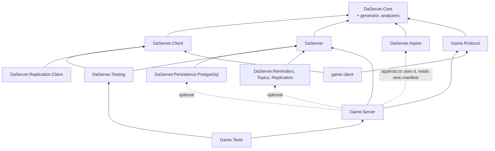

# Target architecture (draft, not implemented)

The architecture DaServer is refactored to (breaking, roadmap phase W): the v61 programming model of
[programming-model.md](programming-model.md) on EasyEcs 4.7 (the draft's header lists the features it uses), with Native AOT support. The programming model draft is
the source of truth for what users write and what each rule means; this file says how the pieces fit together, holds the runtime's internal data and the client protocol's
internals, and links to the draft's sections instead of repeating them. Today's architecture is [design.md](../design.md); the
decisions are ADR-082 to ADR-092 in [decisions.md](../decisions.md). When W is done, this file and the draft are
promoted into design.md and decisions.md and deleted (W10).

## 1. Layers and projects

### Framework packages

Six packages. A package exists when something references it without the others: a Unity client takes no server, a
node takes no AppHost code, production takes no test tools, and a capability is off unless referenced (ADR-045).

| Package | Targets | Holds |
|---|---|---|
| `DaServer.Core` | netstandard2.1, net11.0 | What both sides see: the client-facing contracts (`IFromClient`, `IFromClient<R>`, `IToClient`, `[To]`, `IServer`, `TypeId<T>`, status codes) and the wire and transport (frames, buffers, channels, the pending-call table). Ships the generators, the analyzers and the `wire.manifest` task (below). |
| `DaServer.Client` | netstandard2.1, net11.0 | The client SDK: connect, send `IFromClient`, receive `IToClient`, slots and re-joining, moving on `Retire` ([draft §7](programming-model.md#7-客户端与-presence)). |
| `DaServer` | net11.0 | The server: the model (`IActor<T>`, `[Handles<K>]`, `[On<T>]`, `IMessageTo<K>`, `IRequestTo<K,R>`, `[From<K>]`, `IEvent`, `IClaims`, `IConfigTable<T>`, `IWorldSingleton<T>`, `[Persist]`, `[NotSaved]`, `Entity` operations, `Connection`), the framework systems, cluster, placement, persistence, migration, hot restart, and the node host: Generic Host and ASP.NET Core, configuration, OpenTelemetry, shutdown, the HTTP plane (service managers are .NET's own `UseSystemd()` and `UseWindowsService()`; launchd needs only its plist, [deployment.md section 0](deployment.md#0-launch-flows)). |
| `DaServer.Persistence.PostgreSql` | net11.0 | The record store: epoch-fenced, compare-and-swap writes. |
| `DaServer.Testing` | net11.0 | `TestActor<K>` (one actor, one world, DaServer's manual clock, ADR-071), `TestCluster` (in-process nodes) and simulated users (`Swarm`, HTN behaviors) over `DaServer.Client` for load tests and E2E. |
| `DaServer.Aspire` | net11.0 | AppHost side: `AddDaServerCluster`, `AddNodes<TServer>` (a `DaServerNodeGroup<TServer>`), `WithActorStore`, `WithClientConnections(port)` on a node group, `WithClientEndpoints(gateways)` for a client app, the `{cluster}-restart` command, and a generator that writes the server types from the committed `wire.manifest` of the `#:project` (`actor` and `hosted-by` lines), each bound to that project. References no server assembly. |

### Optional capability packages

Each is off unless referenced and lives in its own namespace; the runtime references none of them (ADR-045, ADR-090; design in [draft §15](programming-model.md#15-扩展能力可选包)).

| Package | Targets | Holds |
|---|---|---|
| `DaServer.Reminders` | net11.0 | `Reminder<T>`, `Reminded<T>`, `root.Remind<T>`; reminders are persistent entities whose next firing is the runtime's `WakeAt`; the runtime's `ArmSystem` arms their `Due`, the package only handles the firing |
| `DaServer.Topics` | net11.0 | The `Topic` actor type, `ITopicMessage`, `Subscribe`/`Unsubscribe`/`Publish` on `Entity` (each a one-way package message to the Topic without `[From<…>]`; `Publish` carries the payload's type id and bytes, which the Topic never decodes), the one-way `NotSubscribed(ActorId, Epoch) : IMessageTo<Topic>` (an ordinary package message, not control mail), the subscriber-side `Subscription` buffer and the system renewing it every `DaServer:Topics:RenewInterval`; table changes ride the normal checkpoint, the receiving node drops a delivery whose topic is not in the subscriber root's `Subscription` buffer and sends the Topic, from the subscriber's shard, a one-way `NotSubscribed` echoing the `(ActorId, Epoch)` the delivery frame carried (dropped under `Busy`, it is sent again at the next publish), which the Topic deletes only when that epoch equals its table's; delivery is at most once, a lost or reordered subscription message costs at most one renew interval of missed publishes, and once unsubscribed no handler runs for a later delivery and the Topic stops sending at the next publish |
| `DaServer.Replication` | net11.0 | `[Replicated]`, `ReplicatedTo`, the per-type replication systems with generated field bitmasks; its own state: `Replica<T>` (last sent value and the world's `ChangeTick` it was sent at), a bounded ring of exits per group, an incarnation per actor (renewed on activation from the record, migration arrival, hot-restart load and a reload after a throw, so the stamps compare only within one; a renewal clears the actor's exit rings and zeroes its `Replica<T>` stamps) |
| `DaServer.Replication.Client` | netstandard2.1, net11.0 | Applies replication patches into a client's EasyEcs world |
| `@daserver/client` (npm) | TypeScript | The client SDK over WebSocket, per the published client protocol; message classes and codecs generated by Nino.TypeScript from `Game.Protocol`'s build (no DaServer generator); replication patches into an entity table |

`DaServer.Templates` is a `dotnet new` template package (`daserver`, `daserver-mmo`, `daserver-flashsale`, `daserver-arena`, `daserver-relay`), generated from the samples; nothing references it (ADR-091).

`DaServer.Generator` (netstandard2.0) is not a package of its own: it is built twice (Roslyn 5.x and 4.3, Unity's
oldest) into `DaServer.Core`'s `analyzers/` folder, so every project using DaServer gets it. It holds the generators
(explicit `Key`, typed sends and reply accessors, `[On<T>]` jobs, `Registration`, `wire.manifest`), the analyzers
([draft §13](programming-model.md#13-编译期检查)). `DaServer.WireTool` ships in the same `analyzers/`-side tools folder
and stays out of process: `-p:UpdateWireManifest=true` runs it with `dotnet exec` after the build (one section per
project, [draft §10](programming-model.md#10-持久化迁移热重启升级)); an in-process MSBuild task would need a second build
for Visual Studio's .NET Framework MSBuild and would load `Microsoft.CodeAnalysis` into the MSBuild node, where its
version conflicts. It reads the built assembly and builds one `Registration` to read prefab compositions, which only
run time knows.

Merged away: `DaServer.Abstractions` into `DaServer.Core` (both are referenced by every client and every server; the
analyzer, not a package boundary, keeps server types out of `Game.Protocol`), `DaServer.Hosting` into `DaServer` (a
node always runs both; `TestCluster` simply starts no HTTP), `DaServer.Simulation` into `DaServer.Testing` (both are
test tools); `DaServer.WireTool` is no package of its own, it ships inside `DaServer.Core` beside the generator (ADR-086).

### User projects

| Project | Targets | Holds | Code changes |
|---|---|---|---|
| `Game.Protocol` | netstandard2.1, net11.0 | Client messages only: data, no actor types, no addresses, no nodes | Shipped to clients |
| `Game.Server` | net11.0 | Actor types, server-to-server messages, events, components, the `IClaims` type, prefabs, server types (several per project), `[Handles<K>]` classes of `[On<T>]` methods, `[UpdateInGroup<K>]` systems, the generated `Registration`, the node's `Program.cs` (about five lines), and `apphost.cs`, the deployment | Hot restart or rolling upgrade, JIT and AOT alike (section 5) |

- **One project may define several server types** (`[Hosts<Map>] public readonly struct MapServer : IServer`); **a
  node is one process running one server type** ([draft §2](programming-model.md#2-服务器与节点)). The AppHost picks the
  type per node group (`AddNodes<MapServer>("map", replicas: 4)`); a small deployment declares an `AllInOne` type.
- **The AppHost is `Game.Server/apphost.cs`**, an Aspire file-based AppHost; group names, the store and the ports per
  group are its business ([draft §2](programming-model.md#2-服务器与节点)), the launch flows per environment are
  [deployment.md section 0](deployment.md#0-launch-flows).
- A node sizes its own thread count from the CPUs it is given (section 2); nobody writes it.
- `[Hosts<Connection>]` is "accepts clients": the gateway is a server type hosting the built-in `Connection` actor type.

### Dependency directions

An arrow reads "references". Dotted: no assembly reference.



- Everything points one way: `DaServer` never references a capability, a sample or a user project; `DaServer.Core`
  references only Nino; `DaServer.Client` never references `DaServer`.
- `Game.Protocol` references only `DaServer.Core`: the analyzer refuses actor types, server messages, `ActorId`,
  `PresenceId` and `EntityId` there, and server-only APIs are not in `DaServer.Core` to begin with.
- `apphost.cs` takes `DaServer.Aspire` by `#:package` and `Game.Server`'s project metadata by `#:project`, and the
  generator reads that project's `wire.manifest`; no server assembly is referenced. `DaServer.Aspire` references
  `DaServer.Core`: the generated server types implement `IServer`.

## 2. Runtime structure

Users see four words: **server type** (`MapServer`), **node** (a process running one server type), **actor**
(`Map(7)`: its root entity and all its descendants) and **entity/component** (EasyEcs's own). A node's threads are
the framework's business; inside DaServer one thread with its EasyEcs world is a **shard**, a word that appears in no
public API, attribute, configuration key or AppHost call.

| Level | What it is | Owns |
|---|---|---|
| Node | One process, one server type, a node generation it picks when it joins the membership table ([draft §2](programming-model.md#2-服务器与节点)) | Links, membership (its view of the table), placement view, its shards, the HTTP plane, `DueScan`, and the node state (`StoreDegraded`, `ActivationSlots`, `PeerHealth`, `RestartingNodes`) as one immutable snapshot swapped atomically |
| Shard (internal) | One thread and one EasyEcs world; the actor types the server hosts share it; an actor lands on a shard by its key's hash. A node runs one shard per CPU it is given (the container's CPU request, `DaServer:Worlds` overrides) | The dispatch queue, the framework systems, singletons (`Time`, `Ordered<K>`, `Current`, `Outbox`) and its copies of the node singletons, the due heap, the chain stack, the call index |
| Actor | Its root entity (carrying the actor type component, e.g. `Map(7)`) and the root's descendants | Its mail, its `Due` items, its presences, its waiting asks |
| Entity | A root, an avatar, a presence, a waiting ask, a scheduled event | Components; `In<K>` on every entity of a K actor; `Persisted` on every persistent one |

- **Parallelism**: many actors per shard, many shards per node, many nodes. Inside an actor the ordered phase is
  serial. Each world sets `WorldOptions.MaxDegreeOfParallelism` = node cores / node shards, at least 1 (EasyEcs D36:
  the budget is per world); with the default of one shard per core that is 1, so `[ForEach(Parallel = true)]` takes
  effect only when a server type runs fewer worlds than cores (`DaServer:Worlds`, e.g. one huge map per node).
- **Node singletons**: node-level state that user code may read (`RestartingNodes`) or the runtime consults (`StoreDegraded`, `ActivationSlots`, `PeerHealth`) is one immutable snapshot the node swaps atomically. Each world holds its own copy as a world singleton, refreshed from the snapshot at the start of each batch and tick, so world threads read it without locks and an item sees one value throughout.
- **Node-wide limits are per-world shares**: a stale snapshot cannot hold a counter, so the two node-wide budgets
  (`ActivationSlots`' concurrent epoch claims and `PeerHealth`'s in-flight requests per destination node) are split into
  shares, one per world, recomputed at each refresh from the node's limit and the world's recent use. A share never
  drops below what the world already has in flight (only the remainder is handed out), and when the worlds outnumber
  the limit some get 0, the non-zero shares rotating among the worlds with demand at each refresh; so the shares
  always sum to at most the limit. A share is recomputed only from what the worlds have reported releasing at the
  refresh (each world publishes its in-flight count then), never from an older published count, so the sum of what is
  really in flight cannot pass the limit between refreshes. A world spends only its own share, a plain field on its thread. The node never
  overshoots its limit and no counter is contended; the cost is that a burst on one world waits for the next refresh
  before it borrows another world's unused share.
- **The dispatch queue** is the only cross-thread handoff: IO threads and other shards post frames to it; the shard
  thread moves them into mailbox snapshots. Queues are bounded (`Busy`); the control channel (presence control,
  answers) is bounded by what the node itself holds ([draft §11](programming-model.md#11-失败时的结果)).

### Terms

The draft uses these before or apart from the section that defines them:
- **Subject**: the entity a message or event acts on; a handler's component parameters bind to it ([draft §5](programming-model.md#5-逻辑)).
- **Ordered phase** (`OrderedPhase`): the framework system that runs, at the start of each tick, the mail and due items one by one by `(time, seq)`.
- **Immediate chain**: `Schedule` without `after` inside an item, run right after the item; a value on the world's chain stack, not an entity. Outside an item (in a system) `Schedule(ev)` is `Schedule(ev, after: TimeSpan.Zero)`: a `Due` child at `Time.Elapsed`, run in the next ordered phase ([draft §9](programming-model.md#9-时间与广播)).
- **`Due`**: an instant; delayed events, request deadlines and join confirmation deadlines are entities with a `Due`, ordered by the runtime's heap.
- **`Outbox`**: what an item sends, serialized on append into pooled frames per destination and handed to the links after each ordered phase and once at the end of the loop iteration.
- **Epoch**: the number an activation claims; record writes compare and swap it, so only one activation of an actor writes.
- **Placeholder**: the root entity of an actor not yet active or being saved; mail waits on it.
- **Settling**: step c of a tick: `Depart`, `SyncSubscriptions`, and removing `Restarting` and `Resumed`.
- **Tick-end write**: at the end of every tick (actor types without `[TickRate]`: after every mail batch) a world writes the roots due for a write asynchronously in one store statement (ADR-068's `unnest`; one more per 512 rows, at most `DaServer:StoreWritesInFlight` in flight) ([draft §10](programming-model.md#默认异步成批地写); its runtime data below).
- **Held output**, **write generation**: the only output that waits for a record is the first attempt of an outgoing `[Durable]` request and an answer to one; it carries the generation of the root's write that holds the item that produced it, and leaves when that write succeeds; the actor keeps running meanwhile ([draft §8](programming-model.md#durable两端由框架负责)).
- **Connection stamp**, **`Retire`**: section 3.
- **Node singleton**: above.

### The shard loop

```text
loop on the shard's thread:
    wait for frames in the dispatch queue, the next due tick, or the due heap's head
    if the volatile frozen flag is set, or the lease clock has passed the published lease deadline (the node is Dead,
            isolated or restarting): run nothing (the world is frozen); drain nothing either, except in a hot
            restart's short freeze, whose IO keeps receiving (an isolation freeze keeps mail in the bounded dispatch
            queue, so a full queue answers Busy rather than growing mailboxes)
    drain the dispatch queue (one bounded batch) into mailbox snapshots, split by actor type,
        at most a budget of items per actor (the rest waits for the next batch, still by (time, seq));
        a message's time is its arrival, stamped when the link reads the frame, so mail drained after a freeze
        still sorts by when it came, ahead of answers and events that came later
    for each actor type K without [TickRate] that has mail or due items, or whose quiet pass is due
            (every DaServer:QuietPass, 1 s, so that time-gated systems run in an idle world; the chain stack is empty between items):
        write Time         K's Tick, TickRate and DeltaTime (all 0 here) from Ordered<K>; Elapsed = the pass start (now), Utc;
                               Elapsed and Utc again per item
        Ordering<K>        OrderedPhase: chain stack, due heap (At <= now) and mailbox merged by (time, seq)
        hand Outbox frames to the links (held [Durable] output stays, tagged with its write generation),
            after checking the lease deadline again: frames of a pass the lease ran out in stay in the Outbox
        write Time         Elapsed back to the pass start, Utc read once
        world.Update<K>()  K's systems, Time.DeltaTime 0
        Settling<K>        Depart, SyncSubscriptions, Restarting and Resumed removed
    for each actor type K with [TickRate], for each of its due ticks t, oldest first, at most the catch-up cap:
        write Time         K's Tick (advanced in Ordered<K>), TickRate, DeltaTime, Elapsed = t, Utc
        Ordering<K>        the window (t - Δ, t]
        hand Outbox frames to the links
        write Time         Elapsed back to t, Utc read once
        world.Update<K>()
        Settling<K>
    write Time           Utc and Elapsed; Tick, TickRate and DeltaTime keep the last pass's values, which Cleanup does not read
    Cleanup              per world: ReleaseRoutes, the Persisted cleanup, WakeSystem, then CheckpointSystem (collects
                               the ids of WriteNow roots first, then of Unsaved roots whose checkpoint interval has passed,
                               skipping roots with a write in flight, as many as the free statements hold, and clears
                               their flags; it saves nothing: World.Save throws inside a pass)
    StoreWrite           per world, outside world.Update: Descendants and SaveEntities for each collected root and each
                               deactivation (a framework job only marks them), then the tick-end write goes out when it
                               holds any record, one statement per 512 rows, at most DaServer:StoreWritesInFlight in
                               flight; held output is released as its rows succeed
    hand Outbox frames to the links
```

- **Time-gated systems**: EasyEcs's `UpdateInterval` counts group updates, not time (`update % interval`), and an actor
  type without `[TickRate]` updates once per mail batch, irregularly and never while idle. A system that must run every
  N seconds there declares `[EverySeconds(n)]`: the runtime skips it until `Time.Elapsed` passes its next instant, and the
  world's quiet pass (above) guarantees an update at least every `DaServer:QuietPass`. `UpdateInterval` keeps EasyEcs's
  meaning and is for ticking types, where updates are regular.
- Ordering state (tick number, sequence counter, tick window, chain budget) is per actor type, the singleton `Ordered<K>`.
  `Time` is one world singleton, so the runtime writes it at the start of each actor type's pass: actor types with
  different tick rates share a world, and each pass sees its own type's `Tick`, `TickRate` and `DeltaTime`
  ([draft §9](programming-model.md#时间)); before `Cleanup` it writes only `Utc` and `Elapsed`, the values the per-world
  Cleanup systems read.
- `WriteNow` is set only by the durable operations themselves (`Ask` and `Reply` of a `[Durable]` request, the dispatch of a
  `[Durable]` request or its `Replied`), in handlers and systems alike, so an item of a system rides the same tick's
  write ([draft §8](programming-model.md#durable两端由框架负责)).
- **Fixed step with a catch-up cap** (EasyEcs's pattern, `guide/hosting.mdx` "A fixed step that catches up", applied per actor type): a shard that fell behind (a long tick, a GC pause)
  runs the missed ticks one by one, each with the same `Δ`, but at most a few per wake (node configuration); past the
  cap it skips the rest and moves its tick clock on, counted in `daserver.ticks.skipped`. Items keep their exact
  times, so a skipped tick shifts no order, it only widens the next window.
- **Memory after a peak**: `world.TrimExcess()` runs only explicitly: a framework system in
  Cleanup with a long `[EverySeconds(…)]` once the world's rows have dropped well below their peak (after a scale-in or
  migrations out), and the admin command `POST /admin/worlds/{i}/trim`; never on a hot path.
- Server types hosting several ticking actor types keep rates that divide the fastest one.
- Before a hot restart (the member is `NodeRestarting`) the runtime adds the `Restarting` tag to every root for the
  last tick (Settling removes it in that tick, so no snapshot holds it) and then stops calling the loop; after the load and the cleared `restart_until`
  every root carries `Resumed(Pause, Aborted)` for one tick ([draft §10](programming-model.md#热重启)).

### Runtime data

The draft names what users touch; everything below is internal and shows up in diagnostics and metrics (names as
exported, OpenTelemetry). Names users never write but meet in diagnostics: the SDK's slot numbers, `Ready`,
`JoinConfirmed(slot, call id)`, `PresenceClosed(slot)`, `PresenceLost(slot)`, `HandedOff(slot)`, `Superseded`,
`Unavailable(retryAfter)`; the runtime's `Mail`, `Unsaved` and the rows below.

| Data | Kind | Role | Metric |
|---|---|---|---|
| `Due(TimeSpan At, long Seq)` | component | Delayed events, request deadlines and `[Durable]` re-asks, join confirmation deadlines, a `Detached` presence's grace, join-on-connect back-off: one timer mechanism ([draft §9](programming-model.md#9-时间与广播)). Saved in migrations and snapshots, not in records (live only) | — |
| Live-only components | components | `Due`, `Presence`, `Joined`, `Detached`, `Leaving`, `Subscribed`, `Route`, `GroupRate` (the root's send rates, set by `SetGroupRate`; the root copy of a ticking actor type carries the empty buffer, and `Join()` adds an empty `Subscribed` buffer, so `SetGroupRate` and `SetGroups` are not structural changes): meaningful only in memory, so they migrate and go into snapshots but never into records | — |
| `FromPrefab(int Prefab, int Composition)` | component | On every entity spawned from a registered prefab copy, persistent or not, the root included: the prefab's id and the hash of its component set, both from `wire.manifest`. On every load (record, migration bytes, snapshot) the runtime adds the copy's `[NotSaved]` components the entity lacks and the components the prefab gained since `Composition` (known from the earlier compositions the manifest keeps; components removed at run time are not added back), then updates `Composition`, tagging the root `Unsaved` when it added persisted ones ([draft §10](programming-model.md#恢复)) | `daserver.records.unknown_types` |
| `Persisted(EntityId Root)` | cleanup component | On every persistent entity (from a persistent prefab's registered copy; the root's points at itself): `ChangeSystem` filters by it, the record collects it, and destroying a persistent descendant tags its root `Unsaved` ([draft §10](programming-model.md#要保存的是实体不是组件类型)) | — |
| `Deactivating` | tag on the root, declared `ITrackChanges` | The last pass before a deactivation; declared `ITrackChanges` because EasyEcs's `RemovedAttribute<T>` requires it, so `[Removed<Deactivating>]` sees a cancelled idle deactivation (`DaServer.Topics` re-subscribes there, [draft §15](programming-model.md#15-扩展能力可选包)) | |
| `Pending` | component on the root | Pending delayed events and waiting asks (the `MaxPending` count); idle deactivation considers only roots where it is zero ([draft §6](programming-model.md#6-生命周期)) | `daserver.actors.pending` |
| Tick-end write | runtime value per world | The records taken this tick (`WriteNow` roots first, then checkpoint and deactivation ones), sent as `IActorStore.SaveAsync` calls (one statement per 512 rows, as today); at most `DaServer:StoreWritesInFlight` statements per world in flight (default 2), never two writes for one root; roots beyond wait with their tags for the next round ([draft §10](programming-model.md#默认异步成批地写)). Outcomes come back per row: a refused row fences only its actor and discards only its held output; a failed row is retried with the same bytes and write generation; a root whose `SaveEntities` throws is left out of the statement and logged (`RecordUnwritable`), the rest of the batch goes and the root is tagged `Unsaved` again for the next interval (on deactivation, stop, migration and freeze: section 4) | `daserver.store.writes_waiting` |
| `Writing`, `WriteNow`, write generation | fields of `RootState`, a framework component every root carries from its prefab copy | Fields, not tags, so setting them is no structural change (a `Reply` that may answer a stored `[Durable]` token stays inside `INoStructuralChanges` jobs). `Writing`: a record write of the root is in flight; `CheckpointSystem` skips the root, so one process never overlaps two writes; changes meanwhile keep or regain `Unsaved` and go in the next write, which carries the latest state. The CAS compares the epoch and the write generation (`write_gen < :write_gen`, reset to 0 by every epoch claim, continued from the snapshot across an in-place hot restart), so a timed-out statement landing late never overwrites newer state ([draft §10](programming-model.md#激活-epoch一个-actor-只有一个激活能写)). `WriteNow`: the root ran a `[Durable]` item (set by the operation itself, in a handler or a system), so the next tick-end write takes it whatever the checkpoint interval. The write generation counts the root's records taken; held output carries the generation its item's state goes into and leaves once a write of that generation or later succeeds ([draft §8](programming-model.md#durable两端由框架负责)) | `daserver.durable.held`, `daserver.durable.commit_latency` |
| `ReplyLog` | persisted component on the root | Bounded in entries and in bytes: replies take at most `DaServer:ReplyLogBytes` per actor (default 256 KiB); a new `[Durable]` request that would pass it is answered `Busy` with `RetryAfter` at the earliest entry's expiry (definite: not executed), and a reply larger than a quarter of the budget fails the item (`Faulted`), so one hot actor's record never grows into megabytes rewritten on every durable item (the BDN suite records record sizes). `[Durable]` dedupe: call id → reply bytes, "token taken" (replaced by the reply in the write of the item that replies), `Faulted` or "refused" (every definite refusal the root gives the call id: `TooLate` for a settling re-ask of a call that never ran or for too little time left to the settle-by instant, `Skipped`, a `NotHandled` to a first attempt; so the call id never runs later), kept until the request's settle-by instant (UTC, carried in its envelope) plus `DaServer:ClockSkew`; at most `DaServer:ReplyLogCapacity` reply and `Faulted` entries (full: `Busy`) and, apart, at most `DaServer:ReplyLogRefusedCapacity` refused ones (default 1,024; full: a refusal is neither recorded nor answered and the handler does not run, so a settling re-ask ends `Expired`) | `daserver.durable.duplicates` |
| Durable waiting entity | persistent child entity | Request bytes, ask state, call id, UTC deadline (`settleBy`: no attempt leaves once `Time.Utc` reaches it, the ask ends `Expired`), `WakeAt`, a cleanup component (destroyed with its asker by a user handler or system, it fails the item and the actor reloads, since a durable asker's type persists and uses `Reload`; a framework destroy such as `Depart` re-parents it to the root first); the first attempt's timeout and `WakeAt` start at its release, not at `Ask`; re-asked on transient outcomes and after re-activation; one settling re-ask at settle-by − the attempt's deadline (`deadline:`, else `AskTimeout`) − `DaServer:ClockSkew` on the asker's clock (when the settling instant has passed at the first attempt's release, the held first attempt is the last and counts as the settling one, but runs as usual); re-asks are not held and set no `WriteNow`, since the record already holds the entity, its call id, request and settle-by instant, but leave only once the write generation holding the entity has succeeded; kept in the final record by a forced deactivation (only an idle one is cancelled by a durable `Ask` in its `Deactivating` pass); `Expired` only when the settling re-ask goes unanswered | `daserver.durable.reasks`, `daserver.durable.expired` |
| `WakeAt(DateTime Utc)` | persisted component on descendants | When the actor must be awake: a durable waiting entity (its next attempt's timeout or scheduled re-ask, its settle-by instant after the settling re-ask), a reminder (its next firing); while active, `ArmSystem` (`[With<WakeAt>, Without<Due>]`) arms `Due = Elapsed + (WakeAt − Utc)` once, after which only the monotonic `Due` counts | — |
| `IssueSeq` | persisted component on the root | The client-token issue sequence `root.IssueClientToken` increments ([draft §7](programming-model.md#7-客户端与-presence)) | — |
| `NextDue` | persisted component on the root | The minimum `WakeAt` of the root's descendants, computed only by the runtime: `WakeSystem` (from `[Changed<WakeAt>]`, `[Removed<WakeAt>]` and the `Persisted` cleanup; it tags the root `Unsaved` whenever the value changes, since `NextDue` is the runtime's and not in the generated `ChangeSystem` filter) runs before `CheckpointSystem`, which takes every record; every write puts it into the record's `next_due` column ([draft §10](programming-model.md#唤醒wakeatnextdueduescan)) | — |
| `DueScan` | node system | Every `DaServer:DueScanInterval`, `IActorStore.DueKeys(slots, until, after)` over the slots the node owns (`until` fixed for the scan; the first page's `after` is a sentinel below every real row, each later page's the previous page's last row, which `DueKeys` returns; each page probes only the pairs at or after the cursor's, taking at most 512 rows from each through `LATERAL … LIMIT`, so no page sorts the backlog of every later pair); sends `Wake` (the one control mail that activates) to keys not active; an activation by `Wake` always rewrites `next_due`. The query does not exclude active keys (the store cannot tell); an active actor moves its `WakeAt` on as each instant comes, so its key shows up only between an instant and the checkpoint that writes the moved `WakeAt` (re-asks set no `WriteNow`): at most the instants of the last checkpoint interval, and its world drops the `Wake` | `daserver.wakes` |
| `Joined(bool MissedPushes)`, `Detached` | component and tag on a presence | Confirmed, and whether a push may have been missed (false only after a `Retire` behind the `HandedOff` fence); a presence of a lost connection in its grace period ([draft §7](programming-model.md#7-客户端与-presence)) | — |
| Due heap | runtime index per world | A 4-ary min-heap of `(At, Seq, EntityId with version)`; lazy deletion: a popped entry is valid only if its entity is alive (same version) and its `(At, Seq)` equals the entity's current `Due` (a durable waiting entity or a reminder re-armed on the same entity keeps its version, so the version alone would fire it early); others are skipped. Rebuilt after `world.Load`, and for a migration's arrival only once its claim has succeeded (an arrival does not run before its claim, so its entries are not in the heap until then, neither skipped nor fired), and compacted in place (stale entries dropped, heap rebuilt in O(n)) whenever the stale count (heap size − `CountOf<Due>`, O(1)) passes the live one: most asks are answered in milliseconds while their timeout entry waits for its `At`, so without compaction the heap would hold rate × timeout dead entries. So the heap holds at most twice the world's live `Due` entities, which `MaxPending` bounds per actor. EasyEcs's ordered value index is a sorted array, so each pop would move the whole array | `daserver.dueheap.entries{state}` |
| Chain stack | runtime value per world | `Schedule` without `after`: the event as a value, run right after the item; empty between items, so never saved | — |
| Call index | runtime hash index per world | Call id → the waiting entity (`EntityId` with version), so a `Replied` finds its asker in one lookup | — |
| `Ordered<K>` | singleton per actor type | Tick number, sequence counter, current tick window, immediate chain budget | — |
| `Current` | singleton | The running item's time, root, sender and client context; operations read the client context from it, and its absence is a typed outcome (`Join()` returns `NoClient`) | — |
| `Outbox` | singleton | Everything an item sends (`Send`, `Ask`, `Reply`, `Push`, join routes), serialized on append into pooled `FrameWriter`s per destination node (a group push once, one frame per gateway); handed to the links after each ordered phase and once at the end of the loop iteration (a group with a rate from `SetGroupRate` only on its due tick, and before any membership change of that group, [draft §9](programming-model.md#广播)), each destination in append order, so a join's route always precedes its reply; first attempts of outgoing `[Durable]` requests and answers to `[Durable]` requests are held apart per root (pooled) with their write generation, released in order into the destination frames when that write succeeds and discarded on fencing, while everything else leaves at once; `TestActor<K>` decodes it for assertions | — |
| `Time` | singleton | `Tick`, `DeltaTime`, `TickRate` (written at the start of each actor type's pass, from its `Ordered<K>`), `Elapsed` (monotonic, process-local), `Utc` (the world's `TimeProvider`, read once per item) | — |
| `RestartingNodes` | node singleton | The members in `NodeRestarting`, with their expected pauses; `TryGetPause(connection, out pause)` for gateway systems that tell clients | `daserver.members{state}` |
| `StoreDegraded`, `ActivationSlots`, `PeerHealth` | node singletons | The store is slow or down (no idle deactivation, `Saving` placeholders capped); concurrent epoch claims (jittered back-off); in-flight requests and latency per destination node with an adaptive limit (fail fast with `Busy`) ([draft §6](programming-model.md#6-生命周期), [§11](programming-model.md#11-失败时的结果)) | `daserver.store.degraded`, `daserver.activations.claiming`, `daserver.peer.inflight`, `daserver.peer.limit` |
| Placeholder | entity | A key not yet active or being saved: the copy of `K.RootPrefab` without `In<K>`, the key, `Loading`, `Arriving` (a key of a handoff-pending slot waiting for its source's answer, section 4), `Saving` or `ActivationFailed(until)`, a bounded `DynamicBuffer<Mail>`; a throw in a persisted actor (reload) turns a root back into one in place, keeping only the key, the `Mail` and the faulting `[Durable]` call ids (a bounded `DynamicBuffer<FaultedCall>`: a system pass that throws can fault several stored tokens of one root; past `DaServer:FaultedCallsMax`, default 64, the rest are not recorded and their askers end `Expired`) (values reset to the prefab copy's) | `daserver.activations.failed` |
| Control mail | mail on the control channel | `Route`, `Lost`, `JoinConfirmed`, `Fence(key, epoch)`, `Wake` (`TakeOver` and `HandedOff` are not control mail: they travel on the data stream, in order with the group frames, section 3's Retire, but like control mail they
bypass `PeerHealth`'s fail-fast `Busy` and the mailbox drops: a fence is never refused or dropped, only ordered); mail to a `Connection` is addressed by its `ConnectionId` (the presence records it), so the gateway routes it to the world by that key's hash like any actor's; bounded by what the node holds, never `Busy` | `daserver.messages.dropped{reason}` |
| Membership states | per member, from the membership table | `Joining`, `Active`, `ShuttingDown`, `Dead` (the table's statuses); `NodeJoining`, `NodeLeaving` (placement is changing), `NodeRestarting` (its row holds `restart_until`: a hot restart, announced on SIGTERM, or at once under an `exit=true` arm; user systems see the `Restarting` tag and `RestartingNodes`), `Rejoining` (the new process reading its row before it clears `restart_until`, or finding itself `Dead`) | `daserver.members{state}` |

### `Registration`

- Generated: `Registration.Create()` is a C# 14 static extension member in the server project's root namespace (its
  container named after the assembly, one per server project whatever server types it defines, so a test project
  importing two server projects calls the container, [draft §5](programming-model.md#其他)), one new instance per call (no static registries, no module initializers):
  actor types with their `K.RootPrefab` prefabs and `[ActorOptions]`, child prefab copies with `In<K>` (and `Persisted`
  for persistent ones), the persist set (computed here at run time from the registered persistent prefabs' components,
  read through EasyEcs request (b); until it ships, by instantiating each prefab once into a scratch world and reading
  the instance's `Entity.Describe()` types, cold and once; and the `[Durable]` ask states; the generator cannot compute it, since prefabs are
  built with members another generator writes and a generator never sees another's output; checked against the
  generated tracked-type list, which comes from the `ITrackChanges` declarations in source), each prefab's composition hash (the same way), configuration tables and
  world singletons, claims, join-on-connect, dispatch tables per actor type, client routes, systems per group
  ([draft §12](programming-model.md#12-完整例子连接进地图移动放技能捡东西看见别人)).
- Nodes, `TestCluster` and `TestActor<K>` take the object. Its constructor also checks what only the prefabs can tell:
  a handler's component parameter that no prefab of its subject carries (a client message bound to a root whose
  `RootPrefab` lacks it, for example) throws there, so the first test or node start reports it, never a message at
  run time (`Skipped` stays for an entity that lost a component).
- Every type in it is closed at compile time in the user's assembly (section 8).

## 3. Messaging

| Path | Shape | Route |
|---|---|---|
| Client → server | `IFromClient`, `IFromClient<R>` in Protocol | Client → its `Connection` entity on the gateway → `[On<Incoming>]` filter on the frame header → generated route table → straight to the target actor (no hop through Player) |
| `[To]` parameter | `EnterMap([To] long Map)` | To the actor of the handling type whose key is the parameter; the subject is the root ([draft §4](programming-model.md#4-消息)) |
| No `[To]` | `MoveTo(...)` | To the client's presence on the handling actor type; the subject is the presence entity; none: `NotJoined` |
| Server → client | `IToClient` | `e.Push(msg)` to a presence, `e.Push(in group, msg)` to a `ClientGroup` (`root.Group(key)`; `root.Everyone` is every joined presence of the actor, one fan-out path) |
| Server → server | `IMessageTo<K>`, `IRequestTo<K,R>` with `[From<K>]` | Generated typed `Send`/`Ask` on `Entity`; the answer is `Replied<TReq>` or `Replied<TReq,TState>` mail to the asking entity ([draft §8](programming-model.md#8-等待别的-actor-的结果)) |
| Inside an actor | `IEvent` | `e.Schedule(ev[, after:])`: a chain value, or a child entity with `Due`, run in the ordered phase |
| Actors to topics (optional) | `ITopicMessage` | `e.Publish(topic, msg)` to a `Topic` actor, one frame per subscriber node; `DaServer.Topics` ([draft §15](programming-model.md#15-扩展能力可选包)) |
| Outside actors | `ICluster` | HTTP, back-office, tests: any server-to-server message with a deadline (sent as the budget) or a `CancellationToken` and an optional `CallId.From(externalKey)` (a `[Durable]` request also takes a required `settleBy:`); `cluster.Disconnect(clientId)` |

Client transports are TCP and WebSocket (`/clients/ws`), both behind `IFrameChannel`; a datagram transport is out of
scope for now and would be another `IFrameChannel` (ADR-092).

### A client message, hop by hop

1. **Client SDK → gateway IO thread**: the frame lands in a pooled receive buffer (`BufferPool`).
2. **→ the gateway shard's dispatch queue** (bounded; full: `Busy` to the client), the world chosen by the hash of the
   connection's key, the `ConnectionId` made at accept. The shard finds the `Connection` root by that key.
3. **Filter and route**: `Incoming` is a view of the frame header (`TypeId`, length, claims); the payload is never
   decoded. With an `[On<Incoming>]` method it runs as a job per message; without one the forward is a pass over the
   batch. The route table maps the `TypeId` to the handling actor type; the target key comes from the `[To]`
   parameter or the `DynamicBuffer<Route>` entry of that actor type. Before `Ready`, messages wait on the
   `Connection` (bounded, `Busy` beyond).
4. **→ the target node**: the frame, re-headed with the client context (and the `PresenceId` without `[To]`), goes into
   the `Outbox` frame for that node, handed to the link after the ordered phase; the link's resend window keeps it until
   acknowledged (and while the target is `NodeRestarting`), records when it entered and subtracts the time held from a
   request's budget on replay, so a pause never extends a budget.
5. **Target node IO thread → the dispatch queue of the shard** chosen by the key's hash.
6. **Target shard**: the mailbox snapshot; the root by `world.Index<K, K>().TryGet` (the generic form of the generated `world.MapIndex`; a placeholder if not active, its mail
   bounded); the subject is the root (`[To]`) or the presence by its `PresenceId` index.
7. **Ordered phase**: the handler's job runs; the reply (and a join's route before it) is serialized into the
   `Outbox` frame for the gateway and handed to the link after the ordered phase.
8. **Gateway**: the reply reaches the `Connection`, which writes the client frame (one write per connection per batch,
   ADR-034).

### An ask and its answer, hop by hop

1. **`me.Ask(to, req, state)`**: a waiting child entity with the state and a `Due` (inside a request's context at most
   that request's remaining time; for a held `[Durable]` first attempt it starts at the release), an entry in the call index and in the due heap, `Pending` incremented; the
   request with its remaining time is serialized into the `Outbox` frame for the target's node, unless `PeerHealth`
   is at its limit for that node (`Busy` at once).
2. **Target**: link → dispatch queue → shard → mailbox → root → the request's job (dropped and counted if its
   deadline passed); the reply (returned, or later through `Reply(token)`) is serialized into the `Outbox` frame
   addressed by (actor type, key, call id), or for a `[Durable]` request held until the write that holds its
   `ReplyLog` entry succeeds.
3. **Back at the asker's node**: link → dispatch queue → shard; the call index finds the waiting entity (a tombstone
   forwards it if the asker migrated); the `Replied` mail runs in the ordered phase; `TryGetValue` reads the reply
   bytes from the mail's frame; the waiting entity is destroyed after the handler and its heap entry is dropped
   lazily.
4. **Timeout**: the due heap pops the waiting entity first and the runtime delivers `Replied` with `TimedOut`. A full
   link fails the ask at once with `Busy`.
5. **`[Durable]`** ([draft §8](programming-model.md#durable两端由框架负责)): the first attempt is held until the tick-end
   write that holds the waiting entity succeeds, and its timeout starts then; re-asks leave at once, never before that write; the target first looks the call
   id up in the root's `ReplyLog` (a repeat is answered from it, or dropped while its token is taken), then refuses with
   `TooLate` a request whose time left to its settle-by instant is below the store's write latency, and only then runs the job; every
   definite refusal is recorded as refused, so the call id never runs later; the answer is
   held until the target's tick-end write succeeds; the rest of either side's output leaves at once. The target drops,
   unrecorded and unanswered, an attempt whose settle-by instant has passed on its own clock. A transient outcome re-arms the waiting
   entity's `Due` for a re-ask with the same call id (retry-after, jitter, the node's retry budget); every attempt's
   envelope carries the settle-by instant (UTC), which bounds the receiver's `ReplyLog` entry and a stored durable
   token; at settle-by − the attempt's deadline − `DaServer:ClockSkew` on its clock the asker sends a single settling re-ask (when the settling instant has already passed at the held first attempt's release, decided then and not at `Ask`, that attempt is the last and counts as the settling one, but carries no settling mark and runs as usual), which the target answers from `ReplyLog` or by
   recording the call id as refused (under its own cap; full: no answer) and answering `TooLate`; only an unanswered
   settling re-ask gives `Expired`, and so does any transient outcome of it (`Busy`, `NoOwner`, a full link window, a
   send that fails), never `NotExecuted`, since an earlier attempt may still run; the generated `Ask` refuses a
   `settleBy` shorter than the attempt's deadline + `DaServer:ClockSkew` + the node's write-latency estimate at once
   (`Status.SettleTooShort`, not executed), since the first attempt would then be the last and could never be refused; the asker sends no attempt once its `Time.Utc` reaches the settle-by instant. The
   asker's `Replied` handler is a durable item too (its root rides the next tick-end write), but its plain output is not
   held: after a crash it runs again with the same answer. After a crash, `DueScan` finds the asker's key through `next_due` (its waiting entity's
   `WakeAt`) and wakes it; on any activation from the record, `ArmSystem` arms the waiting entity's `Due` from `WakeAt`, which re-asks.

- **Presences** ([draft §7](programming-model.md#7-客户端与-presence)): a client's existence on an actor, at most one
  per actor and at most `[ActorOptions(PresencesPerClient = n)]` per actor type (default 1; the slot is keyed by
  (actor type, key)): a child entity with `Presence` (a cleanup component) on the target, a `Route` in the `Connection`'s
  `DynamicBuffer<Route>`, a slot number in the SDK. `e.Join()` is immediate, returns a `Status` and appends the route
  to `Outbox`; `Leave()` adds `Leaving`, systems react, `Depart` destroys. A lost connection or gateway leaves the
  presence `Detached` for its grace period instead. Stamps, takeovers and route registration: below.
- **Gateway**: a server type with `[Hosts<Connection>]`. `Connection` is pinned to its socket's node, never placed among nodes or
  migrated, activated on connect (admitted by a token bucket), deactivated on disconnect. It filters, routes, keeps
  the routes and fans out groups.
- **`Connection` is keyed per connection**: `Connection(ConnectionId)`, 16 random bytes made at accept, never the
  `ClientId`. One login can hold two connections on one node (a `Retire` that lands on the same gateway, a reconnect
  while a half-open connection lingers), and an actor key is a unique index, which throws on a duplicate key.
  A `Connection` lands on a world by its key's hash like every actor, and every frame addressed to a connection
  (`TakeOver`, `Lost`, `HandedOff`, pushes) routes by the `ConnectionId` alone, which the presence records.
  `ClientOf(ClientId)` on the root is a non-unique value index (`IIndexed<ClientId>`), used only where a `ClientId`
  must be found: `cluster.Disconnect(clientId)` goes to every gateway node, which asks each of its worlds (a rare
  admin operation).
- **`ClientGroup` fan-out**: subscriptions are data (`DynamicBuffer<Subscribed>` on presences); `SyncSubscriptions`
  sends the full set of each changed presence to the gateways, which replace it; a group push is serialized once, one
  frame per gateway with members, fanned out there.
- **Order**: one sender to one target arrives in send order unless one of them migrates
  ([draft §1](programming-model.md#1-保证)).

### Connection stamps

The client protocol's internals behind [draft §7](programming-model.md#7-客户端与-presence).

- **A token** is a `SignedToken` whose content is `(ClientId, issue sequence, claims)`. The issue sequence is a
  per-account counter the issuer persists before the token leaves (`root.IssueClientToken` inside a `[Durable]`
  request's handler keeps it in `IssueSeq` on the root; the mmo sample's account actor does so) and increments on
  every login; a refresh keeps it, so a refreshed token on an old device never outranks a newer login. A login is its
  `ClientId`: one login's reconnects share it.
- **A connection stamp** is `(issue sequence, ClientId, attempt)`. The attempt is a per-login counter the SDK carries
  in the handshake: it starts at the Unix milliseconds when the SDK starts (so an app restarted with the same token
  still outranks its old connection) and grows by one per connection attempt. Two connections of one login (the same
  issue sequence and `ClientId`) are ordered by the attempt alone, never by the gateway: a reconnect through a gateway
  with an older generation still takes over. A larger attempt takes over and the older connection closes quietly; a
  smaller one (a stale attempt arriving late) closes quietly too; an equal one is the same connection retrying,
  answered again idempotently. A device clock moved back would make every new attempt smaller than the one a target
  holds: a `Detached` presence therefore never refuses a newcomer of its own `ClientId` (it was lost; the newcomer takes
  it over and its attempt becomes the stamp), and a refusal of a smaller attempt carries the target's current attempt,
  above which the SDK continues (`attempt = max(own + 1, reported + 1)`). Between different `ClientId`s the larger issue sequence takes over and an equal one
  counts the newcomer as the newer login; only the side with the other `ClientId` and the smaller sequence (on a tie,
  the older connection) gets `Superseded`, which the SDK treats as terminal.
- **Two connections of one login** are never compared on a gateway, even on one node (a `Retire` that lands on the
  same gateway, a reconnect while the old connection is half-open): the stamps settle them at the targets. Each target's `TakeOver` reaches the old connection by its `ConnectionId`, whichever world holds it. A
  retiring old connection (it received `ControlOp.Retire`) stays until the takeovers have moved its routes and its
  open calls are answered; a non-retiring one closes quietly at the first `TakeOver` of its own `ClientId`, its
  remaining presences go `Detached`, and the new connection's joins take them over with `Joined.MissedPushes` true. A
  stale newcomer (a smaller attempt) closes quietly once its joins come back `Superseded` under its own `ClientId`.
- **A presence** remembers its connection: `Presence(PresenceId Id, ClientId, node, ConnectionId, stamp)` on the target, and
  `Route(ActorId target, PresenceId, Slot)` in the `Connection`'s `DynamicBuffer<Route>`.
- **Takeover** (`Join()` with a larger stamp): the target drops `Joined`, `Leaving` and `Detached`, draws a new
  `PresenceId`, releases the old route by the old `(PresenceId, stamp)` (so a late release or leave from the old
  connection matches nothing), and appends `TakeOver(old ConnectionId, new stamp, new ClientId)` for the old connection's gateway (the node
  and connection recorded on the old presence, across gateways too; the gateway routes it by the old `ConnectionId`). The old `Connection` compares by the stamp rule above: another
  `ClientId` with a larger or equal issue sequence closes it with `Superseded`; the same `ClientId` (the same login on
  a new connection, or a `Retire`) closes it quietly, a retiring one only once its routes have moved and its open calls
  are answered. If it drops half-way, its presences go `Detached` and the new connection takes them over with
  `Joined.MissedPushes` true.
- **`[JoinOnConnect]`**: the activated `Connection` sends an internal join request carrying its stamp (and the
  handshake's retire flag, so a retired client's `[JoinOnConnect]` presences get the `HandedOff` fence too) to the actor
  whose key has the claims' shape; that side creates or takes over the presence by stamp and `Takeover` (`Reject`
  refuses only another `ClientId` while the presence is `Joined`: the same `ClientId` always takes over by attempt, and a
  `Detached` presence never rejects); failures
  retry by `RetryAfter` or jittered back-off (joins are idempotent by stamp) until `Unavailable(retryAfter)`.
- **Registering a route** after `Join()` (asynchronous):
  1. The route precedes the request's reply in the same `Outbox` frame, so the `Connection` writes the route before it
     hands the reply to the client.
  2. When the client already holds `PresencesPerClient` routes of the actor type to other targets, the oldest is
     removed first and `(old PresenceId, stamp)` sent to its target, which `Leave()`s that presence if it matches (with
     the default of one, joining map 8 leaves map 7). That route's slot is released; the new route gets a slot keyed
     by (actor type, key).
  3. The `Connection` then sends `JoinConfirmed(PresenceId)` to the target before forwarding anything (same source and
     destination, so the confirmation arrives first; a lost one is implied by the first forwarded message) and
     `JoinConfirmed(slot, call id)` to the SDK ahead of the reply, so the SDK knows which message joined the slot.
  4. The target adds `Joined(MissedPushes)` and drops the confirmation deadline; `MissedPushes` is false only when the
     client moved because of a `Retire` (the join carries the flag, from the SDK's re-join or from the `Connection`'s
     `[JoinOnConnect]` join, and the old route holds a `HandedOff` fence).
  5. If the `Connection` is gone, the confirmation deadline passes and the target `Leave()`s the presence, the path of a
     client that disconnects right after joining.
  6. A request whose client already timed out still writes the route; only the reply is dropped.
- **Losing a presence**: `ReleaseRoutes` (framework group `Cleanup`, `[With<Destroyed>, With<Presence>]`, no `In<K>`)
  appends `Lost(PresenceId, stamp)` for a presence destroyed without `Leave()`; the `Connection` removes the route
  when it receives `Lost`, when a forward comes back `NotJoined`, or when the target's node leaves the view, and then
  delivers `PresenceLost`.
- **When notices get lost**: when a link between two nodes reconnects, the target lists its presences per gateway and
  the gateway names those it no longer knows, which go `Detached`; when a gateway leaves the view, every node marks
  the presences recorded on it `Detached`. Presence control mail travels on the control channel, bounded by the
  node's presences, never `Busy`.

### Retire and rebalancing

- **Gateway upgrade or scale-in**: gateways do not hot restart (`Connection` is pinned to its socket). On Kubernetes they roll
  surge then drain (Compose: a plain rolling restart, a client may move twice): every new gateway is ready before an old one leaves the load balancer and sends `ControlOp.Retire`
  in waves (make before break, ADR-026; at most 20 waves of at least 100 connections). The SDK connects through the
  same public address with the handshake flagged "moved by `Retire`", re-sends each slot's join with the same flag (the
  new `Connection` passes it on in its `[JoinOnConnect]` joins), and the larger stamp takes over each presence.
- **The push-order fence** (ADR-026): on takeover the target first appends, for the old gateway, every group frame still
  held for the presence's groups (rate-limited ones included, ahead of their due tick), then removes the old
  connection's subscriptions (`TakeOver` carries them, so the old gateway stops fanning out to it at once), then pushes
  `HandedOff(slot)` on the old route, then switches. The flushed group frames, `TakeOver` and `HandedOff` go to the old
  gateway on one FIFO stream (the data stream of that link, not the control channel), and the gateway applies them in
  arrival order, fan-out and `TakeOver` alike, into the old connection's world with no hop through another world, so
  the flushed frames still find their subscriptions before `TakeOver` removes them. So `HandedOff`
  is the last frame the old connection gets for the slot. The SDK holds the new connection's pushes for that slot until the old connection's `HandedOff` arrives, and
  discards any push for the slot that the old connection delivers after it. Nothing is missed, so `Joined.MissedPushes`
  is false; an application can still owe a snapshot of its own after the handover (the mmo sample's `Resnap` for an avatar that crossed cells meanwhile, [draft §12](programming-model.md#12-完整例子连接进地图移动放技能捡东西看见别人)).
- **A fence that never comes**: when the old connection or its gateway dies before `HandedOff` arrives, the SDK stops
  holding after its call timeout and re-joins the slot with a "fence missing" flag (same connection, same attempt).
  An equal stamp is otherwise answered idempotently; with this flag the target sets `Joined.MissedPushes` true (and
  writes `Joined`, so `[Changed<Joined>]` systems see it) and the snapshot system sends the full state; pushes lost on
  the old connection are covered by it.
- The old connection closes once its open calls are answered; its released routes no longer match, and the SDK ignores
  `PresenceLost` from a retiring connection. A connection still there after `RetireGrace` is dropped and handled as a
  lost connection (`Detached`).
- **Rebalancing by load** (ADR-089): every client-facing node puts its connection count in its pulse (ADR-031), leaving
  out connections it is retiring (their replacements already count on the new gateway, and a count that included them
  would keep shedding up to `RetireGrace` × the shed rate past the excess), and
  computes its group's average from its own view over the gateways that are Up and ready (a `NodeJoining` one counts
  only once it is Up and ready: its empty count would make the others shed before it can take connections); only above the average by more than a tolerance (10%,
  `DaServer:Clients:RebalanceTolerance`) does it retire its excess as above, at most 1% of its connections a second,
  and the load balancer picks where they go. A balanced group retires nobody; no coordinator is involved. Paused
  while a gateway of the group is `NodeLeaving` (draining) or `RestartingNodes` is not empty. A maximum connection age
  (`WithClientConnections(port, maxConnectionAge:)` or `DaServer:Clients:MaxConnectionAge`) stays optional, off by
  default, for deployments that want periodic reconnection.
- **Admission**: a gateway admits new connections through a token bucket and answers `Busy(retryAfter)` when it is
  empty; the SDK reconnects with exponential back-off and full jitter. Re-joins after a migration go through it too.

## 4. Placement, activation, persistence

The rules are [draft §6](programming-model.md#6-生命周期) and [§10](programming-model.md#10-持久化迁移热重启升级);
in short:

- **Placement**: an actor type is bound to server types (`[Hosts<…>]`); its keys are placed among the nodes hosting
  it, moved when nodes join or leave (rate-limited per node) or by the coordinator's slot table (ADR-079). Every placement
  change of a type, slot-table moves included, bumps its placement version. A node activates a key only when its own view makes it
  the owner and no tombstone for the key is present; otherwise it forwards. `[ActivatedBy<T>]` narrows only a key's
  first activation (no record yet); server `[Durable]` requests, like `Wake`, always activate, while a client `[Durable]`
  request obeys `[ActivatedBy]` like any client `[To]` message (a key without a written record never ran a durable
  request, since its reply leaves only after the write, so `NoActor` is a safe final answer). `[Stateless]` actors live
  on any node, never persisted. `Connection` is pinned.
- **Moves hand off before the target claims** (ADR-072's "mail first", kept): when a placement change (a slot-table
  move, a node joining or leaving gracefully) moves key `k` from A to B, B treats the keys of every slot it received as
  handoff-pending until A reports the slot done or leaves the view. Mail for a pending key with no local state does not
  claim: B parks it on a placeholder (`Arriving`) and asks A (`HandoffQuery(k)`); A answers with the migration bytes
  (it moves the actor now, mail first, then the subtree), with "not here" (never active, or already written and
  deactivated), after which B claims as usual, or with "postponed" (A cannot write the root before moving, for example
  while the store is down), after which B forwards the mail to A, which keeps the actor running there, and asks again
  after a back-off. `HandoffQuery` carries the slot and B's placement version: A records "slot s left me at vB" for that slot only (it
  does not know the new table's other slots), so from then on A forwards that slot's keys instead of activating them,
  even before its view catches up; A's own claims always use its own view's version. A key never has a claim racing a live source: the store's placement version decides only between
  a source that has left and its successor. The coordinator does not move a slot again while its previous move is
  still handoff-pending (the slot table marks it until the source reports it done or leaves the view), so a chained
  move A→B→C never lets C ask a B that never held the key. Mail A forwards for a parked key goes ahead of the mail B
  parked (A sends it on the migration's stream before the bytes), so per-sender order holds across the move.
- **Membership is a table in the store** (Orleans' membership protocol, [Orleans: cluster
  management](https://learn.microsoft.com/dotnet/orleans/implementation/cluster-management), behind a feature point,
  `IMembershipTable`, with a PostgreSQL implementation and an in-memory one): the store decides who is in the cluster,
  so there is no quorum, ballot or formation size to reason about, and any number of members may fail.
  - **Rows**: `daserver_members` holds one row per node incarnation: cluster, name, node generation, address, server
    type, status (`Joining`, `Active`, `ShuttingDown`, `Dead`), the suspicions against it (suspecting member,
    generation, and the store's `now()` when written, so every node judges a vote's age by one clock), `restart_until`
    (a granted hot restart and its deadline), `dead_seen_at` (the store's `now()` in the coordinator's first write after it read the member `Dead`; below), start time and
    `i_am_alive`;
    `daserver_membership` holds one row per cluster: the table version, the slot table and its per-type placement
    versions. Every change (a join, a status, a suspicion, a death, a restart permit, a slot move) is one transaction
    that updates the changed rows and sets the version row to version + 1 where the version is still the one read
    (compare-and-swap); a conflict re-reads and retries with back-off. So all membership changes are totally ordered
    by the table version, and every node that has read version v computes the same members, coordinator and slot
    table. `i_am_alive` (every `DaServer:Membership:IAmAliveInterval`, 30 s, as the store's `now()`) is written without
    touching the version, and no versioned write ever sets it (the row upsert leaves it out of `DO UPDATE SET`, so a
    stale copy never overwrites a newer heartbeat).
  - **Joining**: a node reads the table, picks its generation as max(Unix ms, the largest generation recorded for its
    name + 1), and in one versioned transaction inserts its row as `Joining` and marks every older generation of its
    name `Dead` (an old process of the same name that is still running reads that and stops). It then checks two-way
    connectivity to every `Active` member (skipping a member whose `i_am_alive` is three intervals older than the
    newest `i_am_alive` in the table, not than the joiner's clock: a crashed node that was never declared dead does not
    block a restart of the whole cluster, and after a store outage, when every heartbeat is old, nobody is skipped) and
    writes itself `Active`; a member that skipped a check casts no suspicion vote until it has probed every member
    once. Until
    then it hosts no slots and serves no clients. If a member does not answer, it does not become `Active` and retries
    (a node cut off from part of the cluster never joins it). The first node of a cluster creates the version row.
    No seeds are needed for membership: the table is where nodes find each other.
  - **Failure detection**: every `Active` member probes up to `DaServer:Membership:ProbedNodes` (10) others, its
    successors on a ring of the active members' hashed identities, over the node links every
    `DaServer:Membership:ProbeInterval` (1 s); after `DaServer:Membership:MissedProbes` (3) missed replies it first
    asks one other member to probe the target (an indirect probe) and, if that also fails, writes a timestamped
    suspicion into the target's row. When a suspicion makes `DaServer:Membership:VotesForDeath` (2, or every other
    `Active` member when fewer remain) suspicions from distinct `Active` members younger than
    `DaServer:Membership:SuspicionExpiry` (3 min), the writer marks the target `Dead` in the same transaction. A writer
    must be `Active` at the version it writes against, so in a partition where both sides reach the store the first
    death written wins and the other side's attempts fail their compare: a side that finds itself `Dead` stops. A two-node
    cluster split in two therefore keeps exactly one node.
  - **Learning the view**: a node reads the table every `DaServer:Membership:TableRefresh` (5 s) and, after any write it
    makes, sends the new snapshot to the other members, who adopt it when its version is newer than theirs. Frames
    carry the sender's table version, so a peer with a newer view answers a stale one with its snapshot. A read is one
    snapshot: the version row and the member rows come from one statement (a `UNION ALL` of both tables), so under
    READ COMMITTED a node never pairs version v with rows of v + 1; the in-memory table hands out the same atomic
    copy.
  - **A node declared dead stops**: once it reads itself `Dead` (or a peer refuses its frames because its generation is
    `Dead`, which peers do once they see it), it freezes every world, fences all its actors and exits with a non-zero
    code; the platform starts a new process, which joins with a new generation. Peers stop sending to a `Dead` member
    at once.
  - **The isolation lease**: a node may run its worlds only within `DaServer:Membership:IsolationTimeout` (20 s) of
    the moment it **issued** its last table read that returned its generation `Active`. The read's snapshot is taken
    after it was issued, so a reply that arrives late, holding a state from before a death, never stretches the lease
    past that state. A snapshot a peer pushes, or sends in answer to a stale frame version, updates the view but never
    the lease: its age is unknown. Lease times come from a clock that keeps counting while the machine is suspended
    (`CLOCK_BOOTTIME` on Linux, `QueryInterruptTime` on Windows, `mach_continuous_time` on macOS; `Stopwatch` uses
    `CLOCK_MONOTONIC`, which stops during suspend and under checkpoint-restore), so a process that was suspended or
    restored wakes with its lease expired. The membership loop publishes the lease deadline as one value; **each shard
    compares it with that clock itself** before every ordered phase and before handing Outbox frames to the links, so a
    shard that wakes from a pause runs nothing past the lease even when the membership loop (on the thread pool) has
    not run yet.
  - **No table, no work**: a node whose lease has run out freezes its worlds: it runs no item and sends nothing, but
    keeps its process, its connections and its snapshot of the worlds. Its shards stop draining their dispatch queues
    (the loop checks the freeze before the drain, above), so mail stays in the queues, bounded by
    `DaServer:DispatchQueueCapacity` (65,536 per shard, ADR-040): beyond it a request is refused `Busy` and a one-way
    message dropped and counted, as for any full queue (draft §9), so a long outage does not grow memory. It keeps reading; when a read shows its generation still `Active`, the
    worlds resume, and when it shows `Dead`, it stops as above. A frozen node also **tells the cluster it is isolated**:
    it answers probes, direct and indirect, with `Isolated`, which the prober counts as a failed probe at once (no
    indirect probe first) when its own lease has been valid without a break for at least `IsolationTimeout` (so after
    a store outage, when the nodes' first reads land a few seconds apart, nobody votes against a node that simply has
    not read yet), and its peers vote it `Dead` as soon as they reach the store. While at least one peer answers its
    own probes as not isolated (the peers reach the store and it does not), it is **isolated alone**: its `/health`
    readiness fails, and once it has been frozen for `DaServer:Membership:IsolationExit` (1 min) that way, it exits
    with code 75 and the platform starts it
    again, to join with a new generation once it reaches the store. So a node that reaches its peers but not the store
    (an exhausted pool, a DNS failure, a network policy) gives its slots up instead of holding them frozen forever.
    When every peer it reaches is isolated too, the store is down for everyone: readiness holds (a store outage must
    not take every gateway out of the load balancer, deployment.md section 2) and nobody exits: the cost is stated
    plainly, **a store outage pauses the whole cluster** (no actor runs, clients stay connected and their requests wait
    or answer `Busy`) until the store is back, when every node resumes where it stopped. The pause is reported
    (`daserver_membership_frozen`, the `MembershipFrozen` log) so the store's outage is visible as the cluster's.
  - **Stall guard**: a node whose loop finds a gap above `ProbeInterval` on the lease clock since its last pass (a GC
    pause, a stopped VM) keeps its worlds frozen until a table read confirms its generation is still `Active`, and
    probe misses measured across the gap are ignored, so a stall neither runs stale work nor votes a peer dead. The
    shards' own lease check is what safety rests on; the guard only shortens the stale work a pause shorter than the
    lease could still do.
  - **A dead member keeps its slots until it is re-placed**: a member written `Dead` stays in every node's placement
    set (rendezvous ranking and slot-table overrides alike) until the coordinator's re-placement write removes it, so
    no node activates its keys before that write, whatever the order in which nodes learn of the death. Peers stop
    sending to a `Dead` generation, so mail for its keys is answered by the sending node with
    `Unavailable(retryAfter)`, `retryAfter` the time left to the re-placement deadline as the view tells it (about
    `IsolationTimeout + DeathMargin`, 25 s, at most): asks retry by their own rules (a `[Durable]` ask re-asks after
    it), client calls get `Unavailable`, one-way mail waits in the sender's window. A new generation of the same name
    hosts none of the old generation's slots before that write either.
  - **Re-placement**: the deadline counts from `dead_seen_at`, not from the death's own write. A death is a transaction
    of several statements whose `now()` is its start, and a writer that stalls before `COMMIT` (a GC pause, a slow
    synchronous commit) would commit long after that time, while the dead node, still reading itself `Active`, renews
    its lease until the commit. So the coordinator, on the first table read that shows a member `Dead` with no
    `dead_seen_at`, stamps it with the store's `now()` in a versioned write of its own: that transaction began after a
    read that saw the death committed, so `dead_seen_at` is later than the commit, and the dead node's last lease began
    before the commit. Once the store's `now()` passes `dead_seen_at + IsolationTimeout + DaServer:Membership:DeathMargin`
    (5 s; it covers the drift between the store's clock rate and the node's lease clock), the coordinator removes the
    member from the placement set in one versioned write, the placement-version bump of every type it hosted: by then
    the dead node has either read its death and stopped, or seen its lease run out and frozen. The coordinator reads
    both times from the store, so its own clock and the moment it learned of the death do not matter.
  - **Asymmetric reachability** (C cannot reach B, A can): A's indirect probe clears B, so B is not declared dead and
    C's mail to B waits and times out. Orleans has the same gap; DaServer reports it rather than guessing
    (`daserver_link_unreachable{from,to}`, and the Dashboard lists the pair).
  - **The coordinator** is the `Active` member with the oldest start time (then the smallest name) at the table version
    a node has read: every node with that version agrees, and a stale coordinator cannot act, since everything it
    decides (slot moves, a restart permit, a hot restart's deadline) is a versioned write whose compare fails. It plans
    slot moves (ADR-079) and writes the slot table; the placement version of a type is the table version of the last
    change to its hosting nodes or its slots, so every node derives the same versions. A hot restart's permit and
    deadline are the restarting node's `restart_until`: granted by a versioned write when no other row holds one, and a
    member whose `restart_until` has passed is written `Dead` by the coordinator. A hot restart keeps the node's row
    and generation (draft §10).
  - **Without a store**: the in-memory table serves a single node (a local run, a starter without a database, an
    `AllInOne` deployment) and `TestCluster`, whose in-process nodes share one instance (wrapped per node in a
    fault-injecting `IMembershipTable` that tests use to cut one node off the store, delay its reads or stall it). A
    node without a membership store starts only when `DaServer:Membership:SingleNode = true` says it is alone; any
    other configuration refuses to start, so two storeless replicas never form two clusters running every actor twice; `SingleNode = true` on a node that also has a membership store (or an actor store) refuses to start as well, since a second replica configured the same way would bypass the store's table. A single node's hot restart and standby handover carry its member row (name, generation, start time, `restart_until`) in the snapshot header, and the new process seeds its in-memory table from it before `Rejoining`, so the check "still `Active`, own generation, own `restart_until`" passes as on a cluster.
    `DaServer.Aspire` sets `SingleNode` when the AppHost has one node and no store, and adds a PostgreSQL resource for
    membership when it declares more than one node and no store. A cluster of more than one process needs the table in
    a store: the actor store's PostgreSQL by default, or a separate connection (`WithMembershipStore(db)`). Every node,
    gateways included, needs that connection (the runtime role's grants, section 4's schema).
  The timer defaults are one table in [draft §11](programming-model.md#定时的默认值).
- **Activation**: the placeholder (`Loading`) holds the mail; one statement claims the epoch and reads the record
  (`INSERT … ON CONFLICT (type_id, key) DO UPDATE SET … WHERE … RETURNING …`, inserting the placeholder row for a new key, its
  every epoch (a new key, a takeover, the no-insert claim) taken from a sequence so a key whose row was swept never
  reuses an epoch, an empty result under READ COMMITTED retried, and
  returning the displaced owner as PostgreSQL 18's `old.owner`; the store keeps epoch, write generation (reset to 0 by the claim), owner and placement version: taking a key from another owner needs a
  strictly newer version, a displaced owner gets `Fence(key, epoch)`), within `ActivationSlots`;
  `LoadEntitiesInto(record, into, markWritten: false)` with the placeholder as the root; `In<K>` added;
  `Activated` first, then the placeholder's mail, then later mail. When the claim does not take the key, the same
  statement returns the stored placement and owner and whether a record exists, so "a newer owner holds it" (forward)
  and "no record" (`NoActor`) are told apart.
- **Who may create a key**: a type without `[ActivatedBy]` lets every server message create a key and no client
  message; a type with `[ActivatedBy]` lets only the listed messages create one, server messages included (the list is
  the type's whole set of creating messages), with server `[Durable]` requests, `Wake` and the `[JoinOnConnect]` join always activating (the join's key is computed from the claims, never chosen by the client, so neither `[ActivatedBy]` nor `CanCreate` applies to it and a first login creates the `Player` row). When the mail that triggers the activation may not create the key (a client `[To]`
  message or client `[Durable]` request to a type without `[ActivatedBy]` for it, or any message the type's
  `[ActivatedBy]` list leaves out), the claim runs without its `INSERT` branch and requires a written record
  (`record IS NOT NULL`): no row, or a row never written, answers `NoActor` and writes nothing. A message that may
  create the key first passes the type's pure gate, `static bool CanCreate(in TClaims, in TMessage)` (a server message has no claims: `CanCreate(in TMessage)`; another shape is an analyzer error) beside
  `[ActivatedBy]` (no world, no allocation; besides the claims and the message it may take at most one `in`
  configuration table, the node's immutable snapshot, an analyzer error otherwise; checked on the owner before the claim, for example a map id against the map
  table): for a saved type `false` turns the claim into the no-insert one above, so a key that already has a record
  still activates (a map taken out of the map table keeps its record and still runs), and only a key without a record
  answers `NoActor`, writing nothing; a type that saves nothing has no record to find, so `false` is `NoActor`. So a client cannot create rows by inventing keys.
- **Actor types that save nothing claim no row**: a type whose root is not persisted has no record, so its activation
  writes nothing to the store, no claim included. What keeps one activation per key for it is the view: a node
  activates only keys its view makes it the owner of and not handoff-pending, peers forward by the same rule, a
  node written `Dead` in the membership table stops when it reads it, a node that cannot read the table freezes after
  `IsolationTimeout`, and its slots move only after `dead_seen_at + IsolationTimeout + DeathMargin` on the store's clock. Between two views that briefly disagree (a slot-table change still
  spreading) two activations of such a key can exist for a moment; neither writes anything, so the cost is mail split
  between them, and the forward-by-version rule (frames carry the highest placement version seen) ends it within one
  view exchange. `[ActivatedBy]` and `CanCreate` apply to them as well: they decide whether an activation happens.
- **Rows never written expire**: a row whose record is still `NULL` `DaServer:EmptyRecordTtl` (default 1 day) after
  its last claim is deleted. Any live activation of a persisted type writes its first record within a checkpoint
  interval (a new key is tagged `Unsaved`), so such a row belongs to an activation that was refused or crashed before
  writing. The oldest `Active` member that hosts a persisted type (it has the actor store)
  runs the sweep in its first world every `DaServer:EmptyRecordSweepInterval` (1 h), in key-set batches of 1,000 rows
  that walk the primary key once per sweep (no index fits `record IS NULL`, and a partial index on it would make every
  record write non-HOT), through `daserver_sweep_empty(ttl, limit, after)`, a `SECURITY DEFINER` function owned by the
  schema's owner role that deletes only `record IS NULL AND claimed < now() - ttl` rows; the runtime role gets
  `EXECUTE` on it and no `DELETE` on the table. If an activation somehow outlived the TTL without writing, its first
  write finds no row, which is a failed compare: it fences, and the next mail activates the key again.
- **The table**: one row per actor, keyed by `(type_id, key)` (`Map(7)` and `Loot(7)` are two rows), with the columns
  `type_id, key, slot, epoch, write_gen, owner, placement, record, next_due` and an index on `(type_id, slot, next_due)`. The
  key is `bytea`, the key's fields big-endian (any key shape up to 16 bytes in one column); the slot is the key's
  placement slot, computed by the node ([draft §10](programming-model.md#激活-epoch一个-actor-只有一个激活能写), ADR-068).
- **Epoch fencing**: every record write compares the epoch; a failed compare fences the activation. A migration's
  arrival claims a new epoch too (writing `GREATEST` of the stored and the type's current placement version), so a late write from the source fails. A root's writes never overlap in one process (`Writing`,
  section 2), and the CAS also compares the write generation, so a late timed-out statement never overwrites newer state;
  a failed or timed-out write is retried with the same bytes and generation;
  `Unsaved` is cleared when the record is taken at the write's start and put back if the write fails, and changes
  meanwhile tag the root again and join the next write.
- **Writes** are asynchronous and batched: one statement per 512 rows per world per tick end, at most `DaServer:StoreWritesInFlight` in flight, a root with a
  `[Durable]` item in the next one, other changed roots at most every checkpoint interval (`DaServer:CheckpointInterval`); graceful exits lose nothing and a crash at most the
  last interval, except a root whose state does not serialize, which loses everything since its last good record (below); actors keep running, only `[Durable]` requests and answers wait for their write
  ([draft §10](programming-model.md#默认异步成批地写), section 2's tick-end write).
- **Persistence** is per entity kind: entities spawned from a persistent prefab (the root's `K.RootPrefab` with
  `[Persist]`, child prefabs with `[Prefab<K>, Persist]`) carry `Persisted` and are saved with every component
  but `[NotSaved]` ones; others are not. Records are `SaveEntities` of the root and its `Persisted` descendants
  (`world.Descendants(root).AddTo(ids, includeRoot: true)`, then the non-persistent ones removed in place, saved as
  `SaveEntities(output, CollectionsMarshal.AsSpan(ids), in persist)`) with the `persist` component set built once in `Registration`, components only (a group save refuses a set naming a singleton): the types on persistent
  prefabs and those spawned into persistent entities, `[Durable]` ask states, plus the framework's; it is used at run
  time only. Change tracking comes from the source: every persisted user component type declares `ITrackChanges`
  (buffers are tracked already), the generator emits the tracked-type list and the `ChangedAny`/`RemovedAny` filters
  from those declarations (EasyEcs 4.7's filters name their types at compile time; each DaServer package's generator emits its share (its tracked types, prefabs and systems) as `internal static Registration <package namespace>.Generated.PackageHooks.Register(Registration)`, always, an empty one when it has nothing to register, and the server project's generator calls the hook of every referenced DaServer package in `Registration.Create()`'s chain; buffers enter the server project's list only when their element type is declared there), and `Registration` throws at start
  when a type on a `[Persist]` prefab is missing from that list; ask states are written once at `Ask` and tag the root
  `Unsaved` there, untracked. `root.Spawn` of a persistent prefab, `ChangeSystem`
  (`ChangedAny<…>(since)` over the tracked types that reach records, `[NotSaved]` types and buffers of `[NotSaved]` elements left out, split into balanced calls of 2 to 9 types joining one group, a single type as `ChangedAny<T, T>`/`RemovedAny<T, T>` (never `Changed<T>`, which would AND with the group), `.With<Persisted>()`, and `RemovedAny`) and the `Persisted` cleanup tag the root `Unsaved`;
  `CheckpointSystem` puts `WriteNow` roots and, each interval, the `[With<Unsaved>]` roots into the tick-end write, each row with an epoch CAS; both skip roots that are placeholders
  (`Loading`, `Saving`, `ActivationFailed`). Every load completes entities from their prefab copies by `FromPrefab`
  (`[NotSaved]` components and those the prefab gained since; section 2) and skips unknown type ids, counted. The waiting entities of
  `[Durable]` asks, `ReplyLog`, `IssueSeq` and `NextDue` are in the record, and a root that ran a `[Durable]` item is
  written at the next tick end. **Wake**: the
  runtime's `WakeSystem` keeps the root's `NextDue` at the minimum `WakeAt` of its descendants and tags the root `Unsaved` when it changes; each node's `DueScan`
  asks the store for keys of its slots whose `next_due` has passed (`IActorStore.DueKeys(slots, until, after)` over the node's `(type, slot)` pairs, the
  `(type_id, slot, next_due)` index, in keyset pages of 512 from a sentinel first row, `until` fixed per scan, at most a page per pair through `LATERAL … LIMIT`) and activates them, so a `[Durable]` asker or a reminder survives a crash.
- **Deactivation**: idle past `IdleTimeout` (`[ActorOptions]`; `Pending` zero, no presence other than `Detached` ones;
  not while `StoreDegraded`) or `root.Deactivate()` (while `StoreDegraded`, beyond the cap on `Saving` placeholders it
  is postponed): presences leave, the root carries
  `Deactivating` for the last pass of systems, the subtree is saved and destroyed, a `Saving` placeholder holds new
  mail until the write lands, and held `[Durable]` output leaves then.
- **Unwritable root off the checkpoint path**: deactivation, stop and migration run `SaveEntities` before the destroy.
  If it throws, an idle deactivation is cancelled and the actor stays active (tagged `Unsaved` again); a forced
  deactivation (`root.Deactivate()` and the other uncancellable ones) or a graceful stop gives the write up, keeps the
  last stored record, logs `RecordUnwritable` and destroys as usual; a migration falls back to such a forced
  deactivation (placement already names the target, which activates from the last record); an in-place hot restart's
  snapshot leaves the root out (its subtree destroyed in the frozen world as by fencing, `RecordUnwritable`), so it
  re-activates from its last record in the new process and the restart goes on. The write that releases a root's held
  `[Durable]` output before a migration or a freeze takes the same fallback at once, its held output dropped rather
  than waiting for a write that never succeeds ([draft §10](programming-model.md#只写改过的)).

### Store statements

The PostgreSQL statements behind the rules above ([draft §10](programming-model.md#激活-epoch一个-actor-只有一个激活能写)
and its wake section); the store implements `IActorStore` with them.

**The schema** (created by the schema Job as the owner role, in the schema `:schema`, default `public`; `:runtime_role` is
the `Username` of the runtime connection string, so the role names are the user's). DDL takes no bind parameters, so
`:schema` and `:runtime_role` are formatted into the text as quoted identifiers (`quote_ident`, `format('%I')`). Every
object is qualified with `:schema`, in the DDL and in the runtime statements alike (the store prefixes the names it
formats into its statements), so neither role depends on its `search_path`; the sketches below leave the prefix out
for brevity. The owner role needs `CREATE` on `:schema` (in PostgreSQL 15 and later, `public` grants it to nobody but
the database owner). Every statement is re-runnable, since the Job runs on every release: `IF NOT EXISTS` and
`CREATE OR REPLACE` throughout, and the index is created only when `to_regclass` does not find it, so a release takes
no index lock. There are no composite types: Npgsql cannot map one under Native AOT, so the owner is two columns.

```sql
CREATE SEQUENCE IF NOT EXISTS :schema.actor_records_epoch;                 -- every epoch: never reused after a sweep
CREATE TABLE IF NOT EXISTS :schema.actor_records (
  type_id    integer     NOT NULL,   -- the actor type's id (Nino's type id)
  key        bytea       NOT NULL,   -- the key's fields in order, each big-endian at its own width (at most 16 bytes)
  slot       smallint    NOT NULL,   -- the key's placement slot (0..4095, ADR-074), computed by the node
  epoch      bigint      NOT NULL,
  write_gen  bigint      NOT NULL,
  owner_name text        NOT NULL,   -- the node name of the last claim
  owner_gen  bigint      NOT NULL,   -- and its node generation
  placement  bigint      NOT NULL,   -- the placement version of the last claim
  claimed    timestamptz NOT NULL,   -- the last claim's time: a never-written row expires from it
  record     bytea,                  -- NULL: claimed, never written
  next_due   timestamptz,            -- NextDue; NULL: nothing due
  PRIMARY KEY (type_id, key));
-- when to_regclass(':schema.actor_records_due') IS NULL:
CREATE INDEX IF NOT EXISTS actor_records_due ON :schema.actor_records (type_id, slot, next_due) WHERE next_due IS NOT NULL;
CREATE TABLE IF NOT EXISTS :schema.daserver_membership (    -- one row per cluster: the version row
  cluster    text   PRIMARY KEY,
  version    bigint NOT NULL,        -- every membership change sets it to version + 1 where it is still the one read
  slots      bytea  NOT NULL,        -- the slot table (ADR-079)
  placements bytea  NOT NULL,        -- per actor type: the table version of its last hosting or slot change
  configs    bytea);                 -- configuration tables: (name, version, hash)
CREATE TABLE IF NOT EXISTS :schema.daserver_members (       -- one row per node incarnation
  cluster       text        NOT NULL,
  name          text        NOT NULL,
  generation    bigint      NOT NULL,
  address       text        NOT NULL,
  server_type   text        NOT NULL,
  status        smallint    NOT NULL,   -- Joining, Active, ShuttingDown, Dead
  suspicions    bytea,                  -- (suspecting name, generation, store now()) per suspicion
  restart_until timestamptz,            -- a granted hot restart's deadline; NULL: none
  dead_seen_at  timestamptz,            -- store now() of the coordinator's first write after reading it Dead
  started       timestamptz NOT NULL,
  i_am_alive    timestamptz NOT NULL,   -- diagnostics and the join's skip rule; written without a version change
  PRIMARY KEY (cluster, name, generation));
GRANT USAGE ON SCHEMA :schema TO :runtime_role;
GRANT SELECT, INSERT, UPDATE ON :schema.actor_records TO :runtime_role;  -- no DELETE: only the sweep function deletes
GRANT USAGE ON SEQUENCE :schema.actor_records_epoch TO :runtime_role;  -- nextval in both claims
GRANT SELECT, INSERT, UPDATE ON :schema.daserver_membership, :schema.daserver_members TO :runtime_role;
```

The schema Job does not create roles. The samples' AppHosts add an init step that runs with the database's superuser
(Aspire's PostgreSQL resource has only `postgres`) before the schema Job (which retries until the roles exist) and
creates both roles, neither a superuser: the owner role (`CREATE` on the schema, owns the tables, the sequence and the
two `SECURITY DEFINER` functions) and the runtime role. It is re-runnable, since on Kubernetes it runs as a Job with
a fresh name every release, and every run converges the database to the configuration: (1) each role is created if
missing and its password set on every run, so a changed password parameter reaches the database (`DO $$ BEGIN IF NOT
EXISTS (SELECT FROM pg_roles WHERE rolname = '<owner>') THEN CREATE ROLE … LOGIN; END IF; END $$`, then `ALTER ROLE
… PASSWORD …`; a `DO` body takes no bind parameters and psql does not substitute `:'var'` inside dollar quotes, so
the step builds each statement with `format('… %I … PASSWORD %L', name, password)` and runs it with `EXECUTE`); (2)
`CREATE SCHEMA IF NOT EXISTS <schema> AUTHORIZATION <owner>`, so a configured schema other than `public` exists and
the owner role owns it (its `GRANT USAGE ON SCHEMA … TO <runtime>` then takes effect; PostgreSQL ignores a grant from
a role without the privilege's grant option), and for `public`, `GRANT CREATE, USAGE ON SCHEMA public` to the owner
and `USAGE` to the runtime role; (3) `ALTER TABLE`/`SEQUENCE`/`FUNCTION … OWNER TO <owner>` for every DaServer
object that already exists under another owner (tables created by today's nodes as `postgres`), so the owner's
grants and later `ALTER`s on them work. Against an external database the operator provisions
both roles (deployment.md section 4).

**A membership change** (one transaction; `:v` is the version the node read, and the node must have been `Active` at
it unless it is joining):

```sql
BEGIN;
UPDATE daserver_membership SET version = :v + 1, slots = coalesce(:slots, slots), placements = coalesce(:placements, placements)
 WHERE cluster = :cluster AND version = :v;                 -- 0 rows: a conflict, ROLLBACK, re-read the table, retry
INSERT INTO daserver_members ... ON CONFLICT (cluster, name, generation) DO UPDATE SET ...;   -- the changed rows;
       -- SET lists status, suspicions, restart_until, address and
       --   dead_seen_at = CASE WHEN excluded.dead_seen_at IS NOT NULL      -- the coordinator asks for the stamp
       --                  THEN coalesce(daserver_members.dead_seen_at, now())  -- the store's clock, set once
       --                  ELSE daserver_members.dead_seen_at END;
       -- never i_am_alive, so a stale copy cannot overwrite a heartbeat written since
COMMIT;
```

The rows of members written `Dead` stay for `DaServer:Membership:DefunctRowAge` (7 days, for diagnostics) and are
deleted by `daserver_members_cleanup(cluster, age)`, a `SECURITY DEFINER` function the schema Job creates like the
sweep below, with the same `SET search_path = pg_catalog, pg_temp`, schema-qualified objects and grants
(`REVOKE ALL ON FUNCTION :schema.daserver_members_cleanup(text, interval) FROM PUBLIC; GRANT EXECUTE … TO
:runtime_role`: PostgreSQL grants `EXECUTE` to `PUBLIC` by default); the runtime role has no `DELETE`. The coordinator
calls it once a day.

**The claim** (a new key inserts the placeholder row; when the condition fails nothing changes and the stored row
comes back, `taken` false, so the node tells "forward to the newer owner" from "no record"):

```sql
WITH c AS (
  INSERT INTO actor_records AS a (type_id, key, slot, epoch, write_gen, owner_name, owner_gen, placement, claimed, record, next_due)
  VALUES (:type_id, :key, :slot, nextval('actor_records_epoch'), 0, :name, :gen, :v, now(), NULL, NULL)  -- a new key
  ON CONFLICT (type_id, key) DO UPDATE
     SET epoch = excluded.epoch, write_gen = 0, owner_name = excluded.owner_name, owner_gen = excluded.owner_gen,
         placement = excluded.placement, claimed = now()
     WHERE a.placement < excluded.placement
        OR (a.placement = excluded.placement AND a.owner_name = excluded.owner_name AND a.owner_gen = excluded.owner_gen)
  RETURNING new.epoch, new.record, old.owner_name, old.owner_gen, new.placement)  -- PostgreSQL 18: OLD, NULL if inserted
SELECT true AS taken, epoch, record, owner_name, owner_gen, placement FROM c
UNION ALL
SELECT false, a.epoch, NULL, a.owner_name, a.owner_gen, a.placement  -- not taken: the row as stored before the statement
FROM actor_records a
WHERE a.type_id = :type_id AND a.key = :key AND NOT EXISTS (SELECT 1 FROM c)
```

Every epoch comes from the sequence (`excluded.epoch` is the `nextval` of `VALUES`, which PostgreSQL evaluates on a
conflict too), so epochs rise across the whole store and a row created again after a sweep never repeats an epoch an
old activation held. Under READ COMMITTED the fallback `SELECT` uses the statement's snapshot, while the `ON CONFLICT`
condition is checked on the latest committed row, so two results are races, not answers, and the node runs the
statement again (a new statement sees the committed row): an empty result (two nodes claimed the same new key at once,
and the second one's snapshot predates the first one's row), and a not-taken row that would have met the condition
(a placement older than `:v`, or `:v` with this node as owner: the row the condition saw had changed since the
snapshot). Only a not-taken row that fails the condition means "forward".

**A claim that times out** may still commit. The node cancels it first (Npgsql's cancellation sends PostgreSQL's
cancel request and waits for the command to end) and only then runs it again; if the first attempt had committed, the
retry is taken with the node itself as the old owner, so the node remembers the owner it read before the first
attempt (the row's owner, or the previous placement's host) and treats that one as the displaced owner it notifies.

**The claim that may not create the key** (no `INSERT` branch; `has_record` false answers `NoActor`):

```sql
WITH c AS (
  UPDATE actor_records a
     SET epoch = nextval('actor_records_epoch'), write_gen = 0, owner_name = :name, owner_gen = :gen, placement = :v,
         claimed = now()
   WHERE a.type_id = :type_id AND a.key = :key AND a.record IS NOT NULL
     AND (a.placement < :v OR (a.placement = :v AND a.owner_name = :name AND a.owner_gen = :gen))
  RETURNING a.epoch, a.record, a.placement)
SELECT true AS taken, epoch, record, NULL::text AS owner_name, NULL::bigint AS owner_gen, placement, true AS has_record FROM c
UNION ALL
SELECT false, a.epoch, NULL, a.owner_name, a.owner_gen, a.placement, a.record IS NOT NULL
FROM actor_records a
WHERE a.type_id = :type_id AND a.key = :key AND NOT EXISTS (SELECT 1 FROM c)
```

(The displaced owner is read the same way as above when PostgreSQL 18's `old` is used; the sketch leaves it out for
brevity.) The same races are run again: a not-taken row with a record that would have met the condition, and a result
that says no record (no row, or `has_record` false) while the row may have been written meanwhile: the node runs the
statement once more, and answers `NoActor` only when the second run agrees.

**The sweep of never-written rows** (created by the schema Job; the runtime role has `EXECUTE` only):

```sql
CREATE OR REPLACE FUNCTION :schema.daserver_sweep_empty(ttl interval, max_rows integer, after_type integer, after_key bytea)
RETURNS TABLE (deleted integer, last_type integer, last_key bytea)       -- the cursor for the next batch
LANGUAGE sql SECURITY DEFINER SET search_path = pg_catalog, pg_temp AS $$
  WITH page AS (SELECT a.type_id, a.key FROM :schema.actor_records a      -- key-set walk: the table once per sweep
                WHERE (a.type_id, a.key) > (after_type, after_key)     -- first batch: the sentinel
                                                                         -- (-2147483648, '\x'), never NULL
                ORDER BY a.type_id, a.key LIMIT max_rows),
       d AS (DELETE FROM :schema.actor_records a USING page p
             WHERE a.type_id = p.type_id AND a.key = p.key
               AND a.record IS NULL AND a.claimed < now() - ttl         -- rechecked on the row being deleted
             RETURNING 1)
  SELECT (SELECT count(*)::integer FROM d), max(p.type_id), (SELECT p2.key FROM page p2
          ORDER BY p2.type_id DESC, p2.key DESC LIMIT 1) FROM page p $$;
REVOKE ALL ON FUNCTION :schema.daserver_sweep_empty(interval, integer, integer, bytea) FROM PUBLIC;
GRANT EXECUTE ON FUNCTION :schema.daserver_sweep_empty(interval, integer, integer, bytea) TO :runtime_role;
```

**The batched write** (compare and swap on epoch and write generation). The rows not updated come back as the
statement's snapshot stored them, and the node reads each: a different epoch, or a NULL one (the row is gone, for
example swept), is a failed compare and fences the activation; the same epoch with a `write_gen` at or above the
written one is a write that already landed (a retried batch); the same epoch with a lower `write_gen` is a race (a
concurrent claim changed the row after the snapshot, so the `UPDATE` saw the new epoch while the `SELECT` shows the
old one), and that row is written again in the next batch, where it fails or lands:

```sql
WITH r AS (SELECT * FROM unnest(:type_ids, :keys, :records, :next_dues, :epochs, :write_gens)
               AS r(type_id, key, record, next_due, epoch, write_gen)),
     w AS (UPDATE actor_records a SET record = r.record, next_due = r.next_due, write_gen = r.write_gen
           FROM r WHERE a.type_id = r.type_id AND a.key = r.key
                    AND a.epoch = r.epoch AND a.write_gen < r.write_gen
           RETURNING a.type_id, a.key)
SELECT r.type_id, r.key, a.epoch, a.write_gen                 -- the rows not updated, as stored; a missing row
FROM r LEFT JOIN actor_records a ON a.type_id = r.type_id AND a.key = r.key   -- comes back with a NULL epoch:
WHERE NOT EXISTS (SELECT 1 FROM w WHERE w.type_id = r.type_id AND w.key = r.key)   -- a failed compare, it fences
```

**`DueKeys(slots, until, after)`: one page**:

```sql
SELECT s.type_id, s.slot, a.next_due, a.key
FROM (SELECT u.type_id, u.slot FROM unnest(:type_ids, :slots) AS u(type_id, slot)
      WHERE (u.type_id, u.slot) >= (:type_id, :slot)                               -- pairs at or after the cursor's pair
      ORDER BY u.type_id, u.slot) AS s
CROSS JOIN LATERAL (
  SELECT r.next_due, r.key FROM actor_records r
  WHERE r.type_id = s.type_id AND r.slot = s.slot
    AND r.next_due <= :until                                                       -- fixed once per scan
    AND (r.type_id, r.slot, r.next_due, r.key) > (:type_id, :slot, :next_due, :key) -- after: the previous page's last row,
  ORDER BY r.next_due, r.key                                                       -- first page (-2147483648, -1, '-infinity', '\x')
  LIMIT 512) AS a                                                                  -- at most a page from one pair
ORDER BY s.type_id, s.slot, a.next_due, a.key                                      -- pairs already in order: sorted per pair
LIMIT 512
```

## 5. Migration, upgrades, hot restart

- **Migration**: the whole subtree (`Descendants(root).AddTo`, as records) with the component set `migrate` (every component not `[NotSaved]`), including
  waiting asks, presences with `Subscribed`, and delayed events with their remaining time (their `Seq` re-stamped on
  arrival in their old order, the due heap rebuilt). The header carries each component's layout hash and each prefab's composition hash from
  `wire.manifest`; one layout mismatch (mixed versions) falls back to deactivate, write the record, load it on the
  target, while a changed composition only completes entities on arrival (`FromPrefab`, section 2). The source first
  writes the root and waits for its held `[Durable]` output to leave (the store not answering postpones the move), so no
  held output travels; a root whose `SaveEntities` throws drops its held output at once and falls back to a forced
  deactivation (section 4).
  Arrivals load with `markWritten: true`, so `[Changed<T>]` systems treat them as written (re-subscribe, re-cell,
  first checkpoint). A tombstone forwards all mail for the key. Across shards it is bytes too (`MoveEntities` needs
  one thread).
- **Time across processes** is remaining time only; each process runs on its own monotonic clock.
- **`wire.manifest`**: one section per project; `Game.Server`'s holds actor types, hosting server types, tick rates,
  claims, message endpoints, events, state types, configuration tables with their format hash, prefabs with their id, composition hash
  (earlier compositions kept) and whether they persist, the record's component types, layout hashes, pushes, client routes, event
  and `Replied` handlers, `Activated` handlers and tag consumers. The AppHost reads `actor` and `hosted-by`; nodes
  check their server type against it at start.
- **One manifest diff** (`ManifestDiff`, beside the manifest model: one source compiled into `DaServer.Core` and linked into the generator, which cannot load packages): compares two manifests
  and classifies every change (in place, through records, rolling, refused, unsafe to roll back). Four users, one
  implementation: the node's arm (`/admin/restart`, and `?dryRun=true` answers the path without arming), the upgrade
  check and the Compose deploy step (both call a running node's dry-run arm), the route check (the committed
  manifests of the AppHost's projects, read at build time: no node process is started) and the AppHost generator's build
  check (`actor` and `hosted-by` lines).
- **Rolling upgrades**: `[Hosts]` on the member card, `NotHandled` from old nodes retried once after placement is
  resolved again (an unknown client message at an old gateway is reported by the SDK as a version mismatch),
  migration falls back to records across layouts, load moves resume once the stateful groups have rolled, and the
  upgrade check refuses a release whose record fields or record types an older build could not keep (rollback safety). Changes of hosting
  or client routes change this way. **Gateways** always roll; on Kubernetes surge then drain: every new gateway is ready before an old one leaves the load
  balancer and retires its connections in waves (`ControlOp.Retire`, make before break, ADR-026), so each client
  moves once ([deployment.md section 2](deployment.md#stateless-groups-and-gateways-deployment)).
- **Hot restart** (ADR-084, ADR-088; mechanics only in [draft §10](programming-model.md#热重启)): the same on JIT and
  AOT and on every platform. Arming only prepares (the node records a nonce); the platform's SIGTERM starts
  it, or, for a same-image roll (a secret or config change), an arm with `exit=true` starts it at once
  (the node needs no signal): the node takes the cluster's one restart permit by writing its row's `restart_until`
  (the deadline) in the membership table, which other members see as `NodeRestarting` (its slots pinned), and freezes once
  that write commits, roots carry `Restarting` for one last tick, the worlds freeze (bounded; in-flight writes land first and roots with held output are written, so no held output is in the snapshot; a root whose `SaveEntities` throws drops its held output at once and is destroyed in the frozen world, left out of the snapshot) while IO keeps receiving,
  the process writes a snapshot file under `DaServer:SnapshotPath` (temp file, fsync, rename; the header records the
  world count; `Save(output, in exclude)` with `exclude` naming the user singletons and the framework's runtime
  singletons: `Outbox` (pooled writers), `Current`, `Time` and the world's copies of the node singletons, which the new
  process creates before `Load(input, in keep, …)` keeps them) and exits; the platform
  restarts it with the new build (or the same one, re-reading its configuration); the new process checks the snapshot (checksum, boot id, deadline, the armed
  manifest), creates the recorded number of worlds whatever its CPU share (through records only when configuration pins
  another count), loads the cluster's current
  configuration tables and creates its world singletons, loads the snapshot keeping them (`Load(input, in keep, markWritten: false)`), deletes it and waits in `Rejoining` while it reads its row: still `Active` with its generation, it clears
  `restart_until` (a versioned write) and reconnects with the same identity (name, generation); written `Dead` (the
  deadline passed), it fences everything and joins with a new generation and the peers resume its streams from their resend windows; roots carry
  `Resumed` for one tick. No actor re-activates, epochs stay. An aborted freeze falls back to a graceful stop.
  Arming writes every `Unsaved` root once (a checkpoint round, while the actors keep running), so the snapshot carries
  only the changes since. A snapshot the new process rejects (another boot id or image than armed, the deadline
  passed, the file gone because the pod was rescheduled or the volume filled) is **crash-equivalent**: the actors
  re-activate from their records, losing the changes made between the arm's write and the freeze, and the one-way mail
  that peers saw acknowledged but that waited in the frozen dispatch queues (requests are re-asked or time out as after
  a crash). [Draft §11](programming-model.md#11-失败时的结果) lists the cases. Keeping the freeze short matters more
  than writing every root inside it, so the freeze does not write the remaining changes.
- **Warm standby** (optional, `DaServer:HotRestart:Mode = Standby`, default `Restart`; set per platform by
  `DaServer.Aspire`). Two instances of the node exist on the machine (two units, services or containers, below); the
  **role is decided at run time, never by configuration**: the live process holds an exclusive lock on
  `<snapshot dir>/node.lock` (`flock` on Unix, an exclusive file handle on Windows), which the kernel releases when the
  process exits or crashes. An instance that starts and takes the lock is the node: it runs normally and loads a
  snapshot file if one is there (so a boot, a crash restart or a promoted standby's later restart all just run). An
  instance that cannot take the lock is the standby: it finishes .NET start-up, warms its code (nothing to JIT under
  AOT; ReadyToRun plus the warm-up path under JIT), opens its store connection pool, joins nothing, serves nothing, and
  **listens** (it is the pipe's server) on a named pipe (`NamedPipeServerStream` with `PipeOptions.CurrentUserOnly`: a
  Unix domain socket in the snapshot directory on Linux and macOS, mode 0600, a stale socket unlinked; a named pipe on
  Windows; AOT-safe; not an anonymous pipe, since the platform's supervisor starts the standby, so no handle can be
  inherited). A socket path longer than the platform's limit (108 bytes on Linux, 104 on macOS) is refused: the node
  will not start in `Standby` mode with it, and `DaServer.Aspire` checks the path at publish; there is no fallback
  under `/tmp`, which Compose (`tmpfs: [/tmp]` per container) and systemd's `PrivateTmp=` do not share and where
  another user could take the name. On Windows the pair runs under one service account (a dedicated user or gMSA), or
  the pipe carries an explicit `PipeSecurity` ACL granting the other service's SID; with two default virtual accounts
  `CurrentUserOnly` would refuse the old process and every handover would fail. Each instance knows its own name from
  `DaServer:Instance` (the unit instance `%i`, the service name, the container's service: below), and both share the
  node name.
  - **The handover**: the armed old process (draft section 10) is the pipe's **client**. From the arm on it connects to
    the standby's pipe and retries (with back-off) until a standby passes the handshake or the arm expires: a standby
    still on the old build, running since boot before the trigger replaced it, fails the handshake on the manifest
    hash and the old process simply tries again, since the trigger is about to replace that standby. The handshake
    carries the arm nonce, the armed manifest hash (it must equal the standby's own) and the deadline, before any
    bytes. Only once it passes does the old process start its freeze; it then streams the bytes it would write to the
    file (header, per-world `Save` bytes, checksum) from a pooled buffer, with no intermediate file. The standby checks
    them as it checks the file (checksum, nonce, manifest hash, deadline; the boot id is trivially the same) and answers
    an ack or a nack. On the ack the old process closes its listening sockets, releases the lock and exits with code 0.
    On a nack, a broken stream or no answer within the handover timeout, **the old process resumes in place**: it has
    released nothing (it still holds the lock, its sockets and its row, whose `restart_until` it clears), its roots
    carry `Resumed(Pause, Aborted: true)` for one tick and it keeps serving (unlike an aborted freeze after SIGTERM,
    which then stops gracefully: nothing asked this process to stop), and nothing is lost; it reports the failure to the rollout loop
    (`/health` keeps its manifest hash and instance id, below), which stops the roll for that node, as it stops on any
    failed step. A standby that nacks or loses the stream discards what it read and stays a standby. Without a standby
    that passes the handshake by the arm's timeout, the old process never freezes: the arm expires and the loop
    reports it. The standby learns the old process is gone by the pipe's EOF and by taking the lock, then binds the
    node's ports (retrying on `EADDRINUSE` for a moment, since sockets of the old process may linger) and continues at
    `Rejoining`.
  - **A standby that takes the lock without a handover**: when the live process dies (a crash, a kill, a host
    problem) the kernel releases the lock and the standby becomes the node. It uses streamed bytes only when it checked
    and acked them (the old process, once it has the ack, does nothing but exit, so they are complete and current);
    otherwise it runs the normal start path: a snapshot file if one is there and valid (step 5's checks), else records.
    Rejoining's `restart_until` check rules out a double load. Once the node is `Active` it deletes any snapshot file
    left in the directory, so a stale one is never loaded by a later start.
  - **Readiness**: `/health` reports the process's instance id (a random id at start), the instance's name
    (`DaServer:Instance`) and the running manifest hash. The rollout restarts the instance that is not live, and waits
    for a new instance id **with the armed manifest hash** before moving on: on Compose the pair shares one network
    namespace and an old process still answers, and an old process that resumed after a failed handover reports the
    old hash, so the loop never mistakes it for success.
  - The pause targets, measured in W6, are about 0.1–0.3 s for JIT and AOT alike (freeze, serialize, deserialize),
    against about 0.3–1 s (AOT) and 1–2 s (JIT) for the restart path. The machine holds both processes' memory during
    the window, so arming refuses a standby when twice the working set plus the snapshot would pass the memory limit.
  - **Where it exists**: systemd (two unit instances, `daserver@map-0-a` and `daserver@map-0-b`, both enabled: at boot
    one takes the lock and the other waits as a standby), launchd (two jobs), Windows (two services), Compose and local
    Aspire runs. Both instances may run at once at any time; the lock keeps one of them the node. On Compose the
    network namespace must outlive either process, and a namespace joined through `network_mode: service:map-0` is torn
    down when `map-0`'s container stops: so a small holder service per stateful node (`map-0-net`, a pinned image that
    does not change per release, so no deploy recreates it under a live node) owns the namespace and the node's
    hostname, and two node services, `map-0-a` and `map-0-b`, join it (`network_mode: service:map-0-net`) and share
    the snapshot volume (deployment.md section 8). Not on Kubernetes: a running pod cannot gain a container from a new
    image (the pod spec's containers are immutable; ephemeral containers are for debugging, cannot have ports or probes
    and are not meant to run a workload), and an in-pod supervisor is not an option since DaServer starts no supervisor
    process. Handing the listening sockets over instead of rebinding them (`SCM_RIGHTS` through P/Invoke on Unix,
    `Socket.DuplicateAndClose` on Windows) would remove the rebind gap; it is a later improvement.
- **Deployment on Kubernetes** (ADR-085, roadmap W11): actor-hosting groups are StatefulSets with `OnDelete` and a
  memory-backed `emptyDir` for the snapshot; the rollout Job patches each running pod's image, one at a time;
  gateways and stateless groups are Deployments. The full target shape is [deployment.md](deployment.md).
- **Changes without a restart** are data swaps between two ticks: tuning tables (`IConfigTable<T>` singletons; with a
  store it keeps one current version per table, (name, version, hash, bytes), the coordinator writes (name, version,
  hash) into the membership table's version row, every starting or hot-restarted node loads that version, the first reader seeds a table type
  the store has no version of from its configuration, `POST /admin/tables/{name}` validates and replaces it
  cluster-wide, a rollback posts the old bytes again, and a node whose `TryLoad` rejects the current version fails
  readiness, which the upgrade check prevents by trying the new build's `TryLoad` when a table's format hash changed;
  without a store each node reads `DaServer:Tables:{name}` and a `POST` changes only that node) and feature flags choosing between handlers compiled into the binary (a singleton or a
  tag that handlers and systems filter on).

## 6. Distributed guarantees and failure handling

The guarantees and their mechanisms are [draft §1](programming-model.md#1-保证); the outcome of each failure, what each
path guarantees (delivery, order, dedupe key, who times out and who retries), the retry rules and the timer defaults
are [draft §11](programming-model.md#11-失败时的结果).

## 7. EasyEcs features used

Which EasyEcs 4.7 feature each mechanism uses, what DaServer's attributes and
generator add, and what the runtime does:

| Mechanism | EasyEcs | DaServer attributes and generator | Runtime |
|---|---|---|---|
| Finding entities by key | Value indexes and their generated members (`world.NetIdIndex.TryGet`, `world.CellIndex.Find`, its O(1) `Count` for an empty cell); unique ones `IUniqueIndexed<T>` (`Get`/`TryGet`; a write that would repeat a key throws before it changes anything) | Explicit `T IIndexed<T>.Key => this` for every partial `IActor<T>` and self-keyed `IIndexed<T>` record struct | `world.Index<K, K>().TryGet` on receipt (the generic form of the same index) |
| Which actor type logic belongs to | — | `[Handles<K>]` | Dispatch tables per actor type |
| Order of events | Singletons | `Due` component | `OrderedPhase` merges the mailbox snapshot, the due heap and the chain by `(time, seq)`; state in `Ordered<K>` |
| Message handling | Single-entity jobs (`entity.Run(ref job[, filter])`), `[With<T>]`, `[Without<T>]`, `INoStructuralChanges` | `[On<T>]` methods compiled into job structs with EasyEcs's own `Writes`/`OwnStamps` contract (`Writes` = the `ref` and `Mut<T>` bits, which also decides which refs are carried to a new row after a structural change; `OwnStamps` = the `Mut<T>` bits, which stamp only when written, as EasyEcs's `SystemGenerator` emits); `Run` takes one to nine components, so a method without component parameters is no job: the dispatch tests the filter itself (`IsAlive`, `Has<T>` per `[With<T>]`/`[Without<T>]`) and calls it directly | One item at a time, exceptions isolated per item |
| Parameter binding | `[ForEach]`'s parameter rules, `Mut<T>` | Component parameters bind to the subject; the actor type and `IClaims` parameters are fields of the job | The job gets the subject's components |
| Output | Singletons | — | `Outbox`, serialized on append; the item's context in `Current` |
| Per-tick logic | `EcsSystem`, `[ForEach]`, batch methods, `Parallel`, `[Changed<T>]`, `[UpdateAfter<T>]`, `ISystemGroup`, `IGroupWith<T>`, `SetIfChanged`/`SetXIfChanged` | The actor type is the system group, `[TickRate]`, `In<K>` | Ordering → `world.Update<K>()` → Settling |
| Events inside an actor | `ChildOf` | `Schedule(ev, after:)`, `Pending<T>`, `IEvent`, `Due` | Due heap, chain stack; gone with their initiator |
| Send direction | — | `[From<K>]`: typed sends, the analyzer checks the calling actor type | Send, reply, timeout |
| Client routing | — | `[Handles<K>]` and `[To]` give the route table | `Connection` forwards on the frame header without decoding the payload |
| Asks and replies | `ChildOf` | `Replied<TReq[, TState]>`, `ReplyTo<T>`, `[Durable]` | Call index, `Due` deadlines, remaining time; for `[Durable]`: persistent waiting entities, re-asks, the settling re-ask, `ReplyLog`, held output |
| Presences | Child entities, value index, cleanup components (`ICleanupComponent`, `Destroyed`) | `[JoinOnConnect]`, find by the unique index or `root.Spawn`, `Join()`, `Leaving`, `Detached`, `Joined(MissedPushes)` | Stamps, routes, confirmation, grace, reconciliation, `ReleaseRoutes` |
| Subscriptions | `DynamicBuffer`, `[Changed<DynamicBuffer<T>>]` | `Subscribed`, `SetGroups` | `SyncSubscriptions` |
| Lifecycle | Tags | `[On<Activated>]`, systems on `Leaving`, `Deactivating`, `Restarting`, `Resumed` | Placeholders, epochs, fencing, `Depart` |
| An actor's entities | `ChildOf`, `world.Children`, prefabs, `world.Instantiate` with up to nine given components (`ChildOf` one of them) | `In<K>`, `K.RootPrefab`, `[Prefab<K>]`, `[Persist]`, `root.Spawn`, `e.Root` | Registered prefab copies |
| Writing only what changed | `ITrackChanges`, `[Changed<T>]`, `[Removed<T>]`, `ChangedAny`/`RemovedAny`, `ICleanupComponent`, `DynamicBuffer` (itself `ITrackChanges`); persisted types declare `ITrackChanges` in source, since 4.7's `ChangedAny<T1..Tn>` names its types at compile time (request (b) for prefab compositions, not in 4.7) | Persistent prefabs, `[NotSaved]`, `[Durable]`; `Registration` throws at start when a type on a `[Persist]` prefab lacks `ITrackChanges` | `Persisted`, `ChangeSystem`, `CheckpointSystem` |
| Records, migration | `ComponentSet`, `Descendants(root).AddTo(ids, includeRoot: true)` (parents first, returns the count added, 0 B with a reused list), `SaveEntities` (ids as a span; a set without singletons), `LoadEntitiesInto` (`markWritten: false` on restore) | Persistent prefabs, `[NotSaved]` | Store, epoch CAS, layout hashes |
| Wake | `[Changed<WakeAt>]`, `[Removed<WakeAt>]` | — | `WakeAt`, `NextDue`, `DueScan` |
| Version compatibility | Nino type ids, `[NinoFormerName]` | `wire.manifest` | Rolling upgrades |
| Hot restart | `world.Save(output, in exclude)`, `world.Load(input, in keep, markWritten: false)`, `ComponentSet.WithSingleton<T>()` | `wire.manifest` diff picks the path; the snapshot format | Freeze between two ticks, the snapshot file, no re-activation |
| Tests, diagnostics | One world, `SystemErrorPolicy.Throw`, `Capture`/`Restore`, `world.Count<Destroyed>()`, `world.Describe()`, `DescribeSchedule()` (text or mermaid), `SystemStats` allocated bytes and entities visited, O(1) `Find(key).Count`, `Children(parent).Count` and `ValueIndex.KeyCount` | `Registration`, `TestActor<K>` | Manual clock, decoded `Outbox`, allocation assertions |
| Pooling | `DynamicBuffer` pools, Nino's `[NinoPooled]` | — | Frames and send buffers |

## 8. Native AOT

A DaServer node can publish with `PublishAot=true`, chosen per node (ADR-083, requirement E11, [draft §10](programming-model.md#native-aot)); the release
checklist publishes the samples' nodes with it. JIT images stay supported and behave the same: neither loads assemblies at run time, and both change code by hot restart
or rolling upgrade (section 5).

| | JIT deployment | Native AOT deployment |
|---|---|---|
| Start-up, memory | JIT warm-up, tiered compilation | Native start (tens of milliseconds), smaller working set |
| Reflection | Allowed where documented as JIT-only | None |

### What makes it work

- **Registration is generated and closed**: `Registration.Create()` names every closed type in the user's assembly
  (`.Actor<Map>()`, which reads `Map.RootPrefab`; `.Dispatch<Map>(…)`; `world.AddSystem<Steering>()`). No reflection,
  no `MakeGenericType`, no `Activator`, no assembly scanning, no module initializers.
- **Per-actor-type framework groups are closed subclasses**: EasyEcs assigns a system to a group only through
  `[UpdateInGroup<T>]`, and C# forbids that attribute on a generic `OrderedPhase<K>` with `K` as the argument
  (CS8968). The generator therefore writes, per actor type, `[UpdateInGroup<Ordering<Map>>] sealed class
  OrderedPhase_Map : OrderedPhase<Map>;` and likewise `Depart_Map`, `SyncSubscriptions_Map` in `Settling<Map>`, and
  `Registration` adds those; the loop calls `world.Update<Ordering<Map>>()` and `world.Update<Settling<Map>>()`, so
  `DescribeSchedule()` shows each type's own groups (EasyEcs request (c), adding a system to a group without the
  attribute, would remove the subclasses).
- **Framework per-actor-type systems are emitted closed by the generator**: the generated `Registration` names each
  instantiation. The framework's generic systems have no `[ForEach]` methods (they run their jobs from `OnUpdate`
  through EasyEcs's generic runners, closed by their type arguments), so EasyEcs has no generic system code to close
  at run time. EasyEcs closes a generic system named only by another assembly with `MakeGenericType`, which Native AOT
  cannot do (EasyEcs D20; `faq.mdx#native-aot`), and suppresses the warning for it: such a mistake would fail at run
  time, so DaServer's analyzer reports a user's generic `[ForEach]` system closed outside its own assembly
  ([draft §13](programming-model.md#13-编译期检查)).
- **Handlers are jobs**: `[On<T>]` methods become struct jobs called through generic `entity.Run<…, TJob>`, closed at
  compile time; dispatch tables hold static method-group delegates.
- **Serialization is Nino's generated formatters** (messages, persisted components, records, managed components in
  migration bytes); unmanaged components travel as raw bytes under their layout hash; type ids are Nino's. EasyEcs
  records types by Nino type id (D30).
- **EasyEcs**: `EasyEcs.Core` is marked `IsAotCompatible`; its generated code calls user methods directly (what it publishes without warnings: the zero-warning gate below).
- **The HTTP plane, no JSON in the framework** (the one place for these rules): `WebApplication.CreateSlimBuilder`;
  minimal APIs through ASP.NET Core's request delegate generator.
  - **Admin endpoints** (`/admin/membership`, `/admin/stats`, `/admin/restart` with `mode=snapshot|unload`, `exit=true` and `dryRun=true`, unload, `/admin/tables/{name}`, the inspector below) answer typed `[NinoType]`
    records as Nino through Nino.AspNetCore's Minimal API results (`NinoResults`, `application/x-nino`), or a plain-text
    table for `Accept: text/plain` (an operator with curl). The Aspire commands decode the Nino reply and show the text.
  - **Probes and metrics** keep their platform formats: plain-text health, Prometheus text exposition.
  - **`MapAsk` / `MapSend`** take Nino bodies only by default (Nino.AspNetCore's `NinoBody<T>`; a wrong content type is
    415), and answer through `NinoResults`. An application that must accept JSON (a third-party
    webhook) opts in per endpoint with a source-generated `JsonSerializerContext` it declares (the System.Text.Json
    generator does not see other generators' output, so DaServer cannot declare it). No reflection-based JSON
    anywhere.
  - **Routes** are read from `wire.manifest`, not from assemblies.
- **Configuration**: the binding calls live in the framework library (`DaServer`, after ADR-086), where
  `PublishAot` of the user's project does not switch the configuration binding generator on, so the library sets
  `<EnableConfigurationBindingGenerator>true</EnableConfigurationBindingGenerator>` itself. `NodeOptions` splits into a
  bound POCO of values (`NodeSettings`: sizes, intervals, paths) and the runtime wiring set in code (the type filter,
  `ISeedResolver`, `TimeProvider`, `IActorStore`, `ILoggerFactory`, the feature list), which the binder cannot and
  must not bind. `GetValue<TimeSpan>` and the generic `configuration.Get<TOptions>()` of `AddDaServerFeature<TOptions>`
  move to closed call sites. A W8 test publishes a node with warnings as errors and checks no SYSLIB1100/1101,
  IL2026 or IL3050.
- **Framework projects** set `IsAotCompatible` on their net11.0 targets, so the trim and AOT analyzers run on every
  build under `TreatWarningsAsErrors`.

### Telemetry

- **One exit per node in production**: OTLP (metrics, logs, traces) to one OpenTelemetry Collector, which sends
  metrics to Prometheus, logs to Loki and traces to Tempo. With a Collector, Prometheus does not also scrape the nodes:
  one metrics path, so no series arrives twice under two identities. `/metrics` stays on the HTTP plane for an
  environment without a Collector, which scrapes it instead. KEDA and the Prometheus adapter query Prometheus, not the
  pod, so autoscaling works the same on either path. Stop-phase durations (`daserver.stop.phase.duration`) go out over
  OTLP with the final flush, and as stop-phase log lines in Loki; a scrape would rarely catch a stopping node.
- **One identity**: `AddDaServerTelemetry` sets one OpenTelemetry resource, `service.name` = the node group (server
  type) and `service.instance.id` = the node name. Metrics keep a `node` label with the same value, which a direct
  scrape needs; logs carry no separate node attribute, since Loki indexes `service.instance.id`.
- **One reading table**: the node's readings (name, unit, kind, reader) are declared once; the instruments, the
  `/admin/stats` answer and the stats line are generated from it. The stats line is off by default when OTLP is set
  (load tests turn it on); it would repeat Prometheus in Loki every 30 s per node.
- **One definition of "wrong"**: `observability/prometheus-rules.yaml`. The Dashboard's triage shows the alerts that
  fire and uses outliers only to find the culprit node within one; its history links open Grafana (Explore for logs
  and traces), which reads Prometheus, Loki and Tempo.

### Inspector and admin clients

The admin endpoints are the single source; every client is thin over them:

| Client | Where | What it shows or does |
|---|---|---|
| Aspire commands | Local runs (Aspire has resource commands in run mode only) | Membership, stats, the inspector, unload, `{cluster}-restart` |
| `DaServer.Dashboard` | Production (ADR-093) | The same endpoints, the node restart and table actions confirmed and audited; the view (members, their states, the slot table with its version) from one node's `/admin/membership`, so it finds an actor's owner without being a member; a type's hot restart goes through the deploy pipeline's webhook (the one rollout loop), not a loop of its own |
| curl | Anywhere, with the admin token | `Accept: text/plain` answers |

The inspector's read-only endpoints are modelled on flecs's REST API behind its Explorer
([Remote API](https://www.flecs.dev/flecs/FlecsRemoteApi.html)):

| Endpoint | Answers |
|---|---|
| `GET /admin/actors/{type}/{key}` | `Describe()` of the actor's root and of each entity in `world.Descendants(root)`: component names and values, decoded through `wire.manifest`, and each entity's child count (`world.Children(e).Count`, O(1)) |
| `GET /admin/actors/top` | The busiest actors by mailbox depth and handler time |
| `GET /admin/worlds/{i}` | `world.Describe()`: tables, rows, memory; per value index its distinct keys with entities (`ValueIndex.KeyCount`, O(1); e.g. occupied cells), also exported as metrics |
| `GET /admin/worlds/{i}/systems` | `world.DescribeSchedule()` (per group its stages, why a system waits, the pairs only registration order orders; as text, or `ToMermaid()`) and each system's `system.Stats` (time, `LastAllocated`/`TotalAllocated`, `LastEntities`/`TotalEntities`, under `MeasureSystems`, also exported as metrics) and `system.Error` (a system disabled by `SystemErrorPolicy.Disable`) |
| `GET /admin/worlds/{i}/count?with=Health,Dead` | The number of entities with those components; names resolve to `TypeId`s through the registration's component table, no reflection |

- The cold path: each call runs on the world's thread between two items, allocates, and only on request.
- Answers are Nino or plain text, like every admin endpoint (above, ADR-083).
- Nothing writes through them: an operator changes an actor by sending it a message through `ICluster` (`MapSend`,
  `MapAsk`, an Aspire command), so the change runs as an ordered item under the actor's own rules.

### To verify (W8)

| Dependency | Version in the repo | Status |
|---|---|---|
| OpenTelemetry (`Extensions.Hosting`, OTLP exporter, ASP.NET Core, HTTP and runtime instrumentation) | 1.19.x | To verify: warnings under `PublishAot` |
| `OpenTelemetry.Exporter.Prometheus.AspNetCore` | 1.19.1-beta.1 (beta: pinned) | Marked trim- and AOT-compatible since 1.17.0-beta.1 (OpenTelemetry .NET PR #7441); W8 confirms with the publish. Production uses the Collector path anyway (Telemetry above) |
| Npgsql through `Aspire.Npgsql` | 13.6.1 | To verify: whether the Aspire integration builds the data source in a way Native AOT accepts |
| `Nino.AspNetCore` | see `Directory.Packages.props` | Its project sets `IsTrimmable` and `IsAotCompatible` (targets net8.0 and net10.0), but its docs claim no AOT support and Nino's AOT test app publishes `Nino.Core` only: verify a published node using `NinoBody<T>` and `NinoResults` |
| `Microsoft.Extensions.ServiceDiscovery`, `Microsoft.Extensions.Http.Resilience` | see `Directory.Packages.props` | To verify |
| ASP.NET Core with `CreateSlimBuilder` | .NET 11 | To verify that `AddDaServer` needs nothing the slim builder drops (TLS is the platform's) |

### The zero-warning gate

- Builds and publishes have 0 warnings (release checklist step 1, E11). A suppression of a library's warning in the
  user's program is not accepted, scoped or documented.
- EasyEcs 4.7 publishes without warnings with tracked components (`faq.mdx` "Native AOT"; every stateful DaServer node has them:
  persistent entities' components are tracked), disabled components and saves (its CI publishes and runs a native server with
  warnings as errors). What W8 still verifies is the third-party packages in the table above.
- **Proof**: `dotnet publish -p:PublishAot=true` for each sample node (mmo, flashsale) with 0 warnings, and the E2E
  tests passing against the AOT binaries.

## 9. From today's code to the target

Derived from [design.md](../design.md); what today's code has and the target drops is this table.

| Today | Target |
|---|---|
| `[Actor<TId>]` static class, a separate id type, `ActorKey` component | The actor type `record struct Map(long Id) : IActor<Map>`: address, root component (value index), root prefab (`Map.RootPrefab`) and system group; `ActorId` for any actor |
| `[Handle]` methods, generated dispatchers, `in Context` | `[On<T>]` methods in `[Handles<K>]` classes, compiled into EasyEcs single-entity jobs; one binding rule (the subject; the actor key and the claims are the two exceptions) |
| `[Service]` | `[Stateless]` actor type |
| `ctx.Send`/`Ask`/`ReplyLater`/`BindSession` | `Entity` operations (`Send`, `Ask`, `Reply`, `Push`, `Join`, `Leave`, `Schedule`, `Spawn`), serialized into `Outbox` |
| `Answered<TRequest,TReply>`, `PendingReply`, `Answer<T>.Later` | `Replied<TReq>` / `Replied<TReq,TState>` to the asking entity (a waiting child with `Due`), the value through `TryGetValue`; `ReplyTo<T>` as data |
| `IRequest<TReply>`, `[Message]`, `[FromClient]`/`[ToClient]` | `IFromClient`, `IFromClient<R>`, `IToClient` (Protocol); `IMessageTo<K>`, `IRequestTo<K,R>`, `[From<K>]` (Server); `IEvent` |
| `Publish` (to every service type handling a message) | Deleted; pub/sub between actors is the optional `DaServer.Topics` (ADR-090), fan-out to clients is `ClientGroup` |
| `[Filter]`, `IMessageFilter` | `[On<Incoming>]` in `[Handles<Connection>]`, over the frame header |
| Mailbox used only while an actor is not live; `DispatchSystem`, `MailSystem` | Every item through the ordered phase, merged with the due heap and the chain by `(time, seq)`; mail waits on the placeholder |
| Lifecycle tags (`Loading`, `Ready`, `UnloadRequested`, `Leaving`, `Fenced`, `Removing`), `Created`/`Loaded`/`Unloading` | Placeholder root (`Loading`, `Saving`), `Activated(Activation)`, the `Deactivating` tag, fencing by epoch |
| `TimerSystem`, timer wheel, `SendAfter` | `Due` component with the runtime's due heap; `e.Schedule(ev, after:)`; `Pending<T>` (also what `Ask` returns) |
| Sessions: bind and grant, `KnownSession` children, `Known`/`Granted`/`Superseded`, `SessionClosed` | Presences: `Join()`/`Leave()`, `Presence`/`Joined`/`Leaving`, `PresenceLost`, `[JoinOnConnect<TClaims>]`, ordered stamps |
| `ClientConnections` feature (`DaServer:Clients`) | `Connection` actor type hosted by a `[Hosts<Connection>]` server type |
| `MaxConnectionAge` spreads connections after a scale-out | Each gateway sheds only its excess above the group average, rate-limited, through `Retire` (ADR-089); the age stays an optional setting, off by default |
| Tick rate in configuration, the default group at the tick rate | `[TickRate(n)]` on the actor type; `[UpdateInGroup<K>]` |
| `UnloadAfterIdleSeconds` | `[ActorOptions(IdleTimeout = …)]` on the actor type |
| `SaveEverySeconds` (30 s per actor type) | `DaServer:CheckpointInterval` (30 s per node) for plain changes; `[Durable]` items write at the next tick end |
| Callers retry by hand and receivers deduplicate by hand | `[Durable]` requests: the asker's waiting entity is saved and re-asked until `Expired`, the receiver deduplicates through `ReplyLog`; other requests are the asker's to retry |
| `[Persist]` per component type with a generated `ITrackChanges`, the own record format | Persistence per entity kind (`[Persist]` roots and children, `[NotSaved]` components left out); records as `SaveEntities` over `Descendants` with a `ComponentSet`; epoch CAS |
| State handoff (ADR-072) | Migration bytes with layout hashes, a new epoch on arrival; fallback to records |
| `Registration_{Assembly}` run by a module initializer (ADR-012) | `Registration` instance from the generated `Registration.Create()` |
| One project per server (ADR-017), Contracts / Model / Logic (N1) | Protocol / Server; several server types per Server project; node = one server type |
| Hot reload of the logic assembly (ADR-067, never built) | Hot restart through a snapshot file, the same on every platform (JIT and AOT) |
| `AddNodes<TProject>` in a `Sample.AppHost` project | `AddNodes<TServer>` over server types generated from `wire.manifest`, in `Game.Server/apphost.cs`; ports declared per group |
| Packages Abstractions, Core, Client, Simulation, `DaServer`, Hosting, WireTool, Testing, Persistence.PostgreSql, Aspire (ADR-052) | Core, Client, `DaServer`, Persistence.PostgreSql, Testing, Aspire; the generator and the out-of-process manifest tool inside Core (ADR-086) |
| Shard count in configuration and AppHost parameters (`DaServer:Shards`, `map_shards`) | Sized by the node from its CPUs; `DaServer:Worlds` overrides; the word shard is internal |
| Random `NodeId` per process | Node generation assigned by the coordinator; identity on the link Hello is (name, generation), so a hot-restarted node resumes its streams |
| A Kubernetes Deployment per node group | StatefulSet with `OnDelete` for actor-hosting groups, Deployments for gateways (surge then drain) and stateless groups (ADR-085); one rollout loop with a restart adapter per platform |
| Deadlines in UTC milliseconds | Monotonic `TimeSpan`; remaining time across processes |
| Route listing by reflection (`Routes`, the route check starting each node project in `ListRoutes` mode) | Routes from `wire.manifest`; the route check reads the committed manifests through `ManifestDiff` (section 5) |
| Admin JSON of anonymous objects | Typed `[NinoType]` records as Nino, or plain text for `Accept: text/plain` |
| `MapAsk` bodies as JSON or Nino | Nino; JSON only per endpoint, through the application's source-generated context |
| The node host calls no service manager | `Program.cs` declares `UseSystemd().UseWindowsService()`, each a no-op off its platform; launchd is configured in its plist |
| `/admin/drain` (a graceful unloading stop that the platform restarts) and its Aspire command | `/admin/restart` only (`mode=snapshot|unload`, `exit=true`, `dryRun=true`); taking a node out is the platform's scale-down |
| Each node creates the table at start (`InitializeTimeout`, its own backoff) | A schema Job (`--DaServer:Migrate`); nodes are not ready until the table answers, one backoff |
| The Npgsql health check in `/health` | The store is not part of readiness once a node has started |
| `NodeMetrics`, `/admin/stats` and the stats line list the readings separately; the stats line always on | One reading table generates all three; the stats line off when OTLP is set |
| No OpenTelemetry resource; runtime metrics carry only `instance` | One resource (`service.name` = group, `service.instance.id` = node) |

## 10. Open points to settle during W

1. **EasyEcs compile and behaviour checks**: listed, each with its test, only in roadmap step W1
   ([roadmap.md](../roadmap.md)).
2. **Evaluations**, each adopted only without a regression: the Prometheus exporter under AOT (W8, section 8). The
   cluster and client ports keep the own listener: Kestrel's connection pipeline was measured and regressed (roadmap,
   "Open cleanup"), and `TransportBenchmark` stays to measure again when Kestrel changes.
3. **Replication field diff** (W7a): per-field bitmasks against the `Replica<T>` copy of the last sent value double the
   memory of replicated components; measure against diffing whole components on the mmo AOI benchmark (W7a) before adopting. The
   copy's sent stamp (the world's `ChangeTick` when the replication pass ran, opaque to the client) and the incarnation
   stay either way: they decide what a rejoining client still needs.
