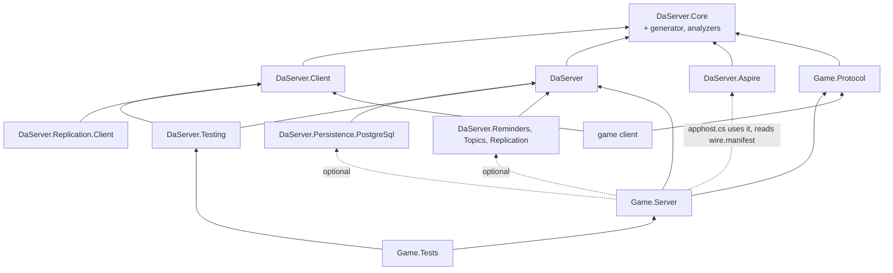

# Target architecture (draft, not implemented)

The architecture DaServer is refactored to (breaking, roadmap phase W): the v57 programming model of
[programming-model.md](programming-model.md) on EasyEcs 4.7 (the draft's header lists the features it uses), with Native AOT support. The programming model draft is
the source of truth for what users write and what each rule means; this file says how the pieces fit together, holds the runtime's internal data and the client protocol's
internals, and links to the draft's sections instead of repeating them. Today's architecture is [design.md](../design.md); the
decisions are ADR-082 to ADR-092 in [decisions.md](../decisions.md). When W is done, this file and the draft are
promoted into design.md and decisions.md and deleted (W10).

## 1. Layers and projects

### Framework packages

Six packages. A package exists when something references it without the others: a Unity client takes no server, a
node takes no AppHost code, production takes no test tools, and a capability is off unless referenced (ADR-045).

| Package | Targets | Holds |
|---|---|---|
| `DaServer.Core` | netstandard2.1, net11.0 | What both sides see: the client-facing contracts (`IFromClient`, `IFromClient<R>`, `IToClient`, `[To]`, `IServer`, `TypeId<T>`, status codes) and the wire and transport (frames, buffers, channels, the pending-call table). Ships the generators, the analyzers and the `wire.manifest` task (below). |
| `DaServer.Client` | netstandard2.1, net11.0 | The client SDK: connect, send `IFromClient`, receive `IToClient`, slots and re-joining, moving on `Retire` ([draft §7](programming-model.md#7-客户端与-presence)). |
| `DaServer` | net11.0 | The server: the model (`IActor<T>`, `IChildKey<T>`, `[Handles<K>]`, `[On<T>]`, `IMessageTo<K>`, `IRequestTo<K,R>`, `[From<K>]`, `IEvent`, `IClaims`, `IConfigTable<T>`, `IWorldSingleton<T>`, `[Persist]`, `[Prefab<K>(Persist = true)]`, `[NotSaved]`, `Entity` operations, `Connection`), the framework systems, cluster, placement, persistence, migration, hot restart, and the node host: Generic Host and ASP.NET Core, configuration, OpenTelemetry, shutdown, the HTTP plane, and `UseLaunchd()` (DaServer's counterpart of the official `UseSystemd()` and `UseWindowsService()`, [deployment.md section 0](deployment.md#0-launch-flows)). |
| `DaServer.Persistence.PostgreSql` | net11.0 | The record store: epoch-fenced, compare-and-swap writes. |
| `DaServer.Testing` | net11.0 | `TestActor<K>` (one actor, one world, DaServer's manual clock, ADR-071), `TestCluster` (in-process nodes) and simulated users (`Swarm`, HTN behaviors) over `DaServer.Client` for load tests and E2E. |
| `DaServer.Aspire` | net11.0 | AppHost side: `AddDaServerCluster`, `AddNodes<TServer>` (a `DaServerNodeGroup<TServer>`), `WithActorStore`, `WithClientConnections(port)` on a node group, `WithClientEndpoints(gateways)` for a client app, the `{cluster}-restart` command, and a generator that writes the server types from the committed `wire.manifest` of the `#:project` (`actor` and `hosted-by` lines), each bound to that project. References no server assembly. |

### Optional capability packages

Each is off unless referenced and lives in its own namespace; the runtime references none of them (ADR-045, ADR-090; design in [draft §15](programming-model.md#15-扩展能力可选包)).

| Package | Targets | Holds |
|---|---|---|
| `DaServer.Reminders` | net11.0 | `Reminder<T>`, `Reminded<T>`, `root.Remind<T>`; reminders are persistent entities with the runtime's `WakeAt`; its systems arm a `Due` while the actor is active |
| `DaServer.Topics` | net11.0 | The `Topic` actor type, `ITopicMessage`, `Subscribe`/`Unsubscribe`/`Publish` on `Entity`, the subscriber-side `Subscription` buffer and the system renewing it every `DaServer:Topics:RenewInterval`; table changes ride the normal checkpoint, the receiving node drops a delivery whose topic is not in the subscriber root's `Subscription` buffer and answers the Topic with an epoch-carrying not-subscribed notice; delivery is at most once, a lost or reordered subscription message costs at most one renew interval of missed publishes, and once unsubscribed no handler runs for a later delivery and the Topic stops sending at the next publish |
| `DaServer.Replication` | net11.0 | `[Replicated]`, `ReplicatedTo`, the per-type replication systems with generated field bitmasks; its own state: `Replica<T>` (last sent value and the world's `ChangeTick` it was sent at), a bounded ring of exits per group, an incarnation per actor (renewed on activation from the record, migration arrival, hot-restart load and `OnError = Reload`, so the stamps compare only within one; a renewal clears the actor's exit rings and zeroes its `Replica<T>` stamps) |
| `DaServer.Replication.Client` | netstandard2.1, net11.0 | Applies replication patches into a client's EasyEcs world |
| `@daserver/client` (npm) | TypeScript | The client SDK over WebSocket, per the published client protocol; message classes and codecs generated by Nino.TypeScript from `Game.Protocol`'s build (no DaServer generator); replication patches into an entity table |

`DaServer.Templates` is a `dotnet new` template package (`daserver`, `daserver-mmo`, `daserver-flashsale`, `daserver-arena`, `daserver-relay`), generated from the samples; nothing references it (ADR-091).

`DaServer.Generator` (netstandard2.0) is not a package of its own: it is built twice (Roslyn 5.x and 4.3, Unity's
oldest) into `DaServer.Core`'s `analyzers/` folder, so every project using DaServer gets it. It holds the generators
(explicit `Key`, typed sends and reply accessors, `[On<T>]` jobs, `Registration`, `wire.manifest`), the analyzers
([draft §13](programming-model.md#13-编译期检查)) and the MSBuild task behind
`-p:UpdateWireManifest=true` (one section per project, [draft §10](programming-model.md#10-持久化迁移热重启升级)).

Merged away: `DaServer.Abstractions` into `DaServer.Core` (both are referenced by every client and every server; the
analyzer, not a package boundary, keeps server types out of `Game.Protocol`), `DaServer.Hosting` into `DaServer` (a
node always runs both; `TestCluster` simply starts no HTTP), `DaServer.Simulation` into `DaServer.Testing` (both are
test tools), `DaServer.WireTool` into the generator's MSBuild task (ADR-086).

### User projects

| Project | Targets | Holds | Code changes |
|---|---|---|---|
| `Game.Protocol` | netstandard2.1, net11.0 | Client messages only: data, no actor types, no addresses, no nodes | Shipped to clients |
| `Game.Server` | net11.0 | Actor types, server-to-server messages, events, components, the `IClaims` type, prefabs, server types (several per project), `[Handles<K>]` classes of `[On<T>]` methods, `[UpdateInGroup<K>]` systems, the generated `Registration`, the node's `Program.cs` (about five lines), and `apphost.cs`, the deployment | Hot restart or rolling upgrade, JIT and AOT alike (section 5) |

- **One project may define several server types** (`[Hosts<Map>] public readonly struct MapServer : IServer`); **a
  node is one process running one server type** ([draft §2](programming-model.md#2-服务器与节点)). The AppHost picks the
  type per node group (`AddNodes<MapServer>("map", replicas: 4)`); a small deployment declares an `AllInOne` type.
- **The AppHost is `Game.Server/apphost.cs`**, an Aspire file-based AppHost; group names, the store and the ports per
  group are its business ([draft §2](programming-model.md#2-服务器与节点)), the launch flows per environment are
  [deployment.md section 0](deployment.md#0-launch-flows).
- A node sizes its own thread count from the CPUs it is given (section 2); nobody writes it.
- `[Hosts<Connection>]` is "accepts clients": the gateway is a server type hosting the built-in `Connection` actor type.

### Dependency directions

An arrow reads "references". Dotted: no assembly reference.



- Everything points one way: `DaServer` never references a capability, a sample or a user project; `DaServer.Core`
  references only Nino; `DaServer.Client` never references `DaServer`.
- `Game.Protocol` references only `DaServer.Core`: the analyzer refuses actor types, server messages, `ActorId`,
  `PresenceId` and `EntityId` there, and server-only APIs are not in `DaServer.Core` to begin with.
- `apphost.cs` takes `DaServer.Aspire` by `#:package` and `Game.Server`'s project metadata by `#:project`, and the
  generator reads that project's `wire.manifest`; no server assembly is referenced. `DaServer.Aspire` references
  `DaServer.Core`: the generated server types implement `IServer`.

## 2. Runtime structure

Users see four words: **server type** (`MapServer`), **node** (a process running one server type), **actor**
(`Map(7)`: its root entity and all its descendants) and **entity/component** (EasyEcs's own). A node's threads are
the framework's business; inside DaServer one thread with its EasyEcs world is a **shard**, a word that appears in no
public API, attribute, configuration key or AppHost call.

| Level | What it is | Owns |
|---|---|---|
| Node | One process, one server type, a node generation assigned by the coordinator ([draft §2](programming-model.md#2-服务器与节点)) | Links, membership (with its lease), placement view, its shards, the HTTP plane, `DueScan`, and the node state (`StoreDegraded`, `ActivationSlots`, `PeerHealth`, `RestartingNodes`) as one immutable snapshot swapped atomically |
| Shard (internal) | One thread and one EasyEcs world; the actor types the server hosts share it; an actor lands on a shard by its key's hash. A node runs one shard per CPU it is given (the container's CPU request, `DaServer:Worlds` overrides) | The dispatch queue, the framework systems, singletons (`Time`, `Ordered<K>`, `Current`, `Outbox`) and its copies of the node singletons, the due heap, the chain stack, the call index |
| Actor | Its root entity (carrying the actor type component, e.g. `Map(7)`) and the root's descendants | Its mail, its `Due` items, its presences, its waiting asks |
| Entity | A root, an avatar, a presence, a waiting ask, a scheduled event | Components; `In<K>` on every entity of a K actor; `Persisted` on every persistent one |

- **Parallelism**: many actors per shard, many shards per node, many nodes. Inside an actor the ordered phase is
  serial. Each world sets `WorldOptions.MaxDegreeOfParallelism` = node cores / node shards, at least 1 (EasyEcs D36:
  the budget is per world); with the default of one shard per core that is 1, so `[ForEach(Parallel = true)]` takes
  effect only when a server type runs fewer worlds than cores (`DaServer:Worlds`, e.g. one huge map per node).
- **Node singletons**: node-level state that user code may read (`RestartingNodes`) or the runtime consults (`StoreDegraded`, `ActivationSlots`, `PeerHealth`) is one immutable snapshot the node swaps atomically. Each world holds its own copy as a world singleton, refreshed from the snapshot at the start of each batch and tick, so world threads read it without locks and an item sees one value throughout.
- **The dispatch queue** is the only cross-thread handoff: IO threads and other shards post frames to it; the shard
  thread moves them into mailbox snapshots. Queues are bounded (`Busy`); the control channel (presence control,
  answers) is bounded by what the node itself holds ([draft §11](programming-model.md#11-失败时的结果)).

### Terms

The draft uses these before or apart from the section that defines them:
- **Subject**: the entity a message or event acts on; a handler's component parameters bind to it ([draft §5](programming-model.md#5-逻辑)).
- **Ordered phase** (`OrderedPhase`): the framework system that runs, at the start of each tick, the mail and due items one by one by `(time, seq)`.
- **Immediate chain**: `Schedule` without `after` inside an item, run right after the item; a value on the world's chain stack, not an entity. Outside an item (in a system) `Schedule(ev)` is `Schedule(ev, after: TimeSpan.Zero)`: a `Due` child at `Time.Elapsed`, run in the next ordered phase ([draft §9](programming-model.md#9-时间与广播)).
- **`Due`**: an instant; delayed events, request deadlines and join confirmation deadlines are entities with a `Due`, ordered by the runtime's heap.
- **`Outbox`**: what an item sends, serialized on append into pooled frames per destination and handed to the links after each ordered phase and once at the end of the loop iteration.
- **Epoch**: the number an activation claims; record writes compare and swap it, so only one activation of an actor writes.
- **Placeholder**: the root entity of an actor not yet active or being saved; mail waits on it.
- **Settling**: step c of a tick: `Depart`, `SyncSubscriptions`, and removing `Restarting` and `Resumed`.
- **Tick-end write**: at the end of every tick (actor types without `[TickRate]`: after every mail batch) a world writes the roots due for a write asynchronously in one store statement (ADR-068's `unnest`; one more per 512 rows, at most `DaServer:StoreWritesInFlight` in flight) ([draft §10](programming-model.md#默认异步成批地写); its runtime data below).
- **Held output**, **write generation**: the only output that waits for a record is the first attempt of an outgoing `[Durable]` request and an answer to one; it carries the generation of the root's write that holds the item that produced it, and leaves when that write succeeds; the actor keeps running meanwhile ([draft §8](programming-model.md#durable两端由框架负责)).
- **Connection stamp**, **`Retire`**: section 3.
- **Node singleton**: above.

### The shard loop

```text
loop on the shard's thread:
    wait for frames in the dispatch queue, the next due tick, or the due heap's head
    drain the dispatch queue (one bounded batch) into mailbox snapshots, split by actor type,
        at most a budget of items per actor (the rest waits for the next batch, still by (time, seq))
    if the volatile lease-expiry stamp has passed: run nothing (the world is frozen)
    for each actor type K without [TickRate] that has mail or due items (the chain stack is empty between items):
        write Time         K's Tick, TickRate and DeltaTime (all 0 here) from Ordered<K>; Elapsed = the pass start (now), Utc;
                               Elapsed and Utc again per item
        Ordering<K>        OrderedPhase: chain stack, due heap (At <= now) and mailbox merged by (time, seq)
        hand Outbox frames to the links (held [Durable] output stays, tagged with its write generation)
        write Time         Elapsed back to the pass start, Utc read once
        world.Update<K>()  K's systems, Time.DeltaTime 0
        Settling<K>        Depart, SyncSubscriptions, Restarting and Resumed removed
    for each actor type K with [TickRate], for each of its due ticks t, oldest first, at most the catch-up cap:
        write Time         K's Tick (advanced in Ordered<K>), TickRate, DeltaTime, Elapsed = t, Utc
        Ordering<K>        the window (t - Δ, t]
        hand Outbox frames to the links
        write Time         Elapsed back to t, Utc read once
        world.Update<K>()
        Settling<K>
    write Time           Utc and Elapsed; Tick, TickRate and DeltaTime keep the last pass's values, which Cleanup does not read
    Cleanup              per world: ReleaseRoutes, the Persisted cleanup, WakeSystem, then CheckpointSystem (takes the
                               records of WriteNow roots first, then of Unsaved roots whose checkpoint interval has passed,
                               skipping roots with a write in flight, as many as the free statements hold)
    StoreWrite           per world: the tick-end write goes out when it holds any record (deactivations' included), one
                               statement per 512 rows, at most DaServer:StoreWritesInFlight in flight; held output is
                               released as its rows succeed
    hand Outbox frames to the links
```

- Ordering state (tick number, sequence counter, tick window, chain budget) is per actor type, the singleton `Ordered<K>`.
  `Time` is one world singleton, so the runtime writes it at the start of each actor type's pass: actor types with
  different tick rates share a world, and each pass sees its own type's `Tick`, `TickRate` and `DeltaTime`
  ([draft §9](programming-model.md#时间)); before `Cleanup` it writes only `Utc` and `Elapsed`, the values the per-world
  Cleanup systems read.
- `WriteNow` is set only by the durable operations themselves (`Ask` and `Reply` of a `[Durable]` request, the dispatch of a
  `[Durable]` request or its `Replied`), in handlers and systems alike, so an item of a system rides the same tick's
  write ([draft §8](programming-model.md#durable两端由框架负责)).
- **Fixed step with a catch-up cap** (DaServer's own design): a shard that fell behind (a long tick, a GC pause)
  runs the missed ticks one by one, each with the same `Δ`, but at most a few per wake (node configuration); past the
  cap it skips the rest and moves its tick clock on, counted in `daserver.ticks.skipped`. Items keep their exact
  times, so a skipped tick shifts no order, it only widens the next window.
- **Memory after a peak**: `world.TrimExcess()` runs only explicitly: a framework system in
  Cleanup with a long `UpdateInterval` once the world's rows have dropped well below their peak (after a scale-in or
  migrations out), and the admin command `POST /admin/worlds/{i}/trim`; never on a hot path.
- Server types hosting several ticking actor types keep rates that divide the fastest one.
- Before a hot restart (the member is `NodeRestarting`) the runtime adds the `Restarting` tag to every root for the
  last tick (Settling removes it in that tick, so no snapshot holds it) and then stops calling the loop; after the load and the coordinator's `Readmit`
  every root carries `Resumed(Pause, Aborted)` for one tick ([draft §10](programming-model.md#热重启)).

### Runtime data

The draft names what users touch; everything below is internal and shows up in diagnostics and metrics (names as
exported, OpenTelemetry). Names users never write but meet in diagnostics: the SDK's slot numbers, `Ready`,
`JoinConfirmed(slot, call id)`, `PresenceClosed(slot)`, `PresenceLost(slot)`, `HandedOff(slot)`, `Superseded`,
`Unavailable(retryAfter)`; the runtime's `Mail`, `Unsaved` and the rows below.

| Data | Kind | Role | Metric |
|---|---|---|---|
| `Due(TimeSpan At, long Seq)` | component | Delayed events, request deadlines and `[Durable]` re-asks, join confirmation deadlines, a `Detached` presence's grace, join-on-connect back-off: one timer mechanism ([draft §9](programming-model.md#9-时间与广播)). Saved in migrations and snapshots, not in records (live only) | — |
| Live-only components | components | `Due`, `Presence`, `Joined`, `Detached`, `Leaving`, `Subscribed`, `Route`, `GroupRate` (the root's send rates, set by `SetGroupRate`; the root copy of a ticking actor type carries the empty buffer, and `Join()` adds an empty `Subscribed` buffer, so `SetGroupRate` and `SetGroups` are not structural changes): meaningful only in memory, so they migrate and go into snapshots but never into records | — |
| `FromPrefab(int Prefab, int Composition)` | component | On every entity spawned from a registered prefab copy, persistent or not, the root included: the prefab's id and the hash of its component set, both from `wire.manifest`. On every load (record, migration bytes, snapshot) the runtime adds the copy's `[NotSaved]` components the entity lacks and the components the prefab gained since `Composition` (known from the earlier compositions the manifest keeps; components removed at run time are not added back), then updates `Composition`, tagging the root `Unsaved` when it added persisted ones ([draft §10](programming-model.md#恢复)) | `daserver.records.unknown_types` |
| `Persisted(EntityId Root)` | cleanup component | On every persistent entity (from a persistent prefab's registered copy; the root's points at itself): `ChangeSystem` filters by it, the record collects it, and destroying a persistent descendant tags its root `Unsaved` ([draft §10](programming-model.md#要保存的是实体不是组件类型)) | — |
| `Deactivating` | tag on the root, declared `ITrackChanges` | The last pass before a deactivation; declared `ITrackChanges` because EasyEcs's `RemovedAttribute<T>` requires it, so `[Removed<Deactivating>]` sees a cancelled idle deactivation (`DaServer.Topics` re-subscribes there, [draft §15](programming-model.md#15-扩展能力可选包)) | |
| `Pending` | component on the root | Pending delayed events and waiting asks (the `MaxPending` count); idle deactivation considers only roots where it is zero ([draft §6](programming-model.md#6-生命周期)) | `daserver.actors.pending` |
| Tick-end write | runtime value per world | The records taken this tick (`WriteNow` roots first, then checkpoint and deactivation ones), sent as `IActorStore.SaveAsync` calls (one statement per 512 rows, as today); at most `DaServer:StoreWritesInFlight` statements per world in flight (default 2), never two writes for one root; roots beyond wait with their tags for the next round ([draft §10](programming-model.md#默认异步成批地写)). Outcomes come back per row: a refused row fences only its actor and discards only its held output; a failed row is retried with the same bytes and write generation; a root whose `SaveEntities` throws is left out of the statement and logged (`RecordUnwritable`), the rest of the batch goes and the root is tagged `Unsaved` again for the next interval (on deactivation, stop, migration and freeze: section 4) | `daserver.store.writes_waiting` |
| `Writing`, `WriteNow`, write generation | tags and a counter on the root | `Writing`: a record write of the root is in flight; `CheckpointSystem` skips the root, so one process never overlaps two writes; changes meanwhile keep or regain `Unsaved` and go in the next write, which carries the latest state. The CAS compares the epoch and the write generation (`write_gen < :write_gen`, reset to 0 by every epoch claim, continued from the snapshot across an in-place hot restart), so a timed-out statement landing late never overwrites newer state ([draft §10](programming-model.md#激活-epoch一个-actor-只有一个激活能写)). `WriteNow`: the root ran a `[Durable]` item (set by the operation itself, in a handler or a system), so the next tick-end write takes it whatever the checkpoint interval. The write generation counts the root's records taken; held output carries the generation its item's state goes into and leaves once a write of that generation or later succeeds ([draft §8](programming-model.md#durable两端由框架负责)) | `daserver.durable.held`, `daserver.durable.commit_latency` |
| `ReplyLog` | persisted component on the root | `[Durable]` dedupe: call id → reply bytes, "token taken" (replaced by the reply in the write of the item that replies), `Faulted` or "refused" (every definite refusal the root gives the call id: `TooLate` for a settling re-ask of a call that never ran or for too little time left to the settle-by instant, `Skipped`, a `NotHandled` to a first attempt; so the call id never runs later), kept until the request's settle-by instant (UTC, carried in its envelope) plus `DaServer:ClockSkew`; at most `DaServer:ReplyLogCapacity` reply and `Faulted` entries (full: `Busy`) and, apart, at most `DaServer:ReplyLogRefusedCapacity` refused ones (default 1,024; full: a refusal is neither recorded nor answered and the handler does not run, so a settling re-ask ends `Expired`) | `daserver.durable.duplicates` |
| Durable waiting entity | persistent child entity | Request bytes, ask state, call id, UTC deadline (`settleBy`: no attempt leaves once `Time.Utc` reaches it, the ask ends `Expired`), `WakeAt`, a cleanup component (destroyed with its asker by a user handler or system, it fails the item and the actor reloads, since a durable asker's type persists and uses `Reload`; a framework destroy such as `Depart` re-parents it to the root first); the first attempt's timeout and `WakeAt` start at its release, not at `Ask`; re-asked on transient outcomes and after re-activation; one settling re-ask at settle-by − the attempt's deadline (`deadline:`, else `AskTimeout`) − `DaServer:ClockSkew` on the asker's clock (when the settling instant has passed at the first attempt's release, the held first attempt is the last and counts as the settling one, but runs as usual); re-asks are not held and set no `WriteNow`, since the record already holds the entity, its call id, request and settle-by instant, but leave only once the write generation holding the entity has succeeded; kept in the final record by a forced deactivation (only an idle one is cancelled by a durable `Ask` in its `Deactivating` pass); `Expired` only when the settling re-ask goes unanswered | `daserver.durable.reasks`, `daserver.durable.expired` |
| `WakeAt(DateTime Utc)` | persisted component on descendants | When the actor must be awake: a durable waiting entity (its next attempt's timeout or scheduled re-ask, its settle-by instant after the settling re-ask), a reminder (its `UtcAt`) | — |
| `IssueSeq` | persisted component on the root | The client-token issue sequence `root.IssueClientToken` increments ([draft §7](programming-model.md#7-客户端与-presence)) | — |
| `NextDue` | persisted component on the root | The minimum `WakeAt` of the root's descendants, computed only by the runtime: `WakeSystem` (from `[Changed<WakeAt>]`, `[Removed<WakeAt>]` and the `Persisted` cleanup) runs before `CheckpointSystem`, which takes every record; every write puts it into the record's `next_due` column ([draft §10](programming-model.md#唤醒wakeatnextdueduescan)) | — |
| `DueScan` | node system | Every `DaServer:DueScanInterval`, `IActorStore.DueKeys(slots, until, after)` over the slots the node owns (`until` fixed for the scan; the first page's `after` is a sentinel below every real row, each later page's the previous page's last row, which `DueKeys` returns; each page probes only the pairs at or after the cursor's, taking at most 512 rows from each through `LATERAL … LIMIT`, so no page sorts the backlog of every later pair); sends `Wake` (the one control mail that activates) to keys not active; an activation by `Wake` always rewrites `next_due`. The query does not exclude active keys (the store cannot tell); an active actor moves its `WakeAt` on as each instant comes, so its key shows up only between an instant and the checkpoint that writes the moved `WakeAt` (re-asks set no `WriteNow`): at most the instants of the last checkpoint interval, and its world drops the `Wake` | `daserver.wakes` |
| `Joined(bool MissedPushes)`, `Detached` | component and tag on a presence | Confirmed, and whether a push may have been missed (false only after a `Retire` behind the `HandedOff` fence); a presence of a lost connection in its grace period ([draft §7](programming-model.md#7-客户端与-presence)) | — |
| Due heap | runtime index per world | A 4-ary min-heap of `(At, Seq, EntityId with version)`; lazy deletion (a popped entry whose entity version changed is skipped); rebuilt after `world.Load` and a migration's arrival. EasyEcs's ordered value index is a sorted array, so each pop would move the whole array | — |
| Chain stack | runtime value per world | `Schedule` without `after`: the event as a value, run right after the item; empty between items, so never saved | — |
| Call index | runtime hash index per world | Call id → the waiting entity (`EntityId` with version), so a `Replied` finds its asker in one lookup | — |
| `Ordered<K>` | singleton per actor type | Tick number, sequence counter, current tick window, immediate chain budget | — |
| `Current` | singleton | The running item's time, root, sender and client context; operations read the client context from it, and its absence is a typed outcome (`Join()` returns `NoClient`) | — |
| `Outbox` | singleton | Everything an item sends (`Send`, `Ask`, `Reply`, `Push`, `Broadcast`, join routes), serialized on append into pooled `FrameWriter`s per destination node (a broadcast or group push once, one frame per gateway); handed to the links after each ordered phase and once at the end of the loop iteration (a group with a rate from `SetGroupRate` only on its due tick, and before any membership change of that group, [draft §9](programming-model.md#广播)), each destination in append order, so a join's route always precedes its reply; first attempts of outgoing `[Durable]` requests and answers to `[Durable]` requests are held apart per root (pooled) with their write generation, released in order into the destination frames when that write succeeds and discarded on fencing, while everything else leaves at once; `TestActor<K>` decodes it for assertions | — |
| `Time` | singleton | `Tick`, `DeltaTime`, `TickRate` (written at the start of each actor type's pass, from its `Ordered<K>`), `Elapsed` (monotonic, process-local), `Utc` (the world's `TimeProvider`, read once per item) | — |
| `RestartingNodes` | node singleton | The members in `NodeRestarting`, with their expected pauses; `TryGetPause(connection, out pause)` for gateway systems that tell clients | `daserver.members{state}` |
| `StoreDegraded`, `ActivationSlots`, `PeerHealth` | node singletons | The store is slow or down (no idle deactivation, `Saving` placeholders capped); concurrent epoch claims (jittered back-off); in-flight requests and latency per destination node with an adaptive limit (fail fast with `Busy`) ([draft §6](programming-model.md#6-生命周期), [§11](programming-model.md#11-失败时的结果)) | `daserver.store.degraded`, `daserver.activations.claiming`, `daserver.peer.inflight`, `daserver.peer.limit` |
| Placeholder | entity | A key not yet active or being saved: the copy of `K.RootPrefab` without `In<K>`, the key, `Loading`, `Saving` or `ActivationFailed(until)`, a bounded `DynamicBuffer<Mail>`; `OnError = Reload` turns a root back into one in place, keeping only the key, the `Mail` and the faulting `[Durable]` call id (values reset to the prefab copy's) | `daserver.activations.failed` |
| Control mail | mail on the control channel | `Route`, `Lost`, `JoinConfirmed`, `TakeOver(ConnectionId, stamp)` (a takeover closing the old connection), the `HandedOff(slot)` marker on a retired route, `Fence(key, epoch)`, `Wake`; mail to a `Connection` is addressed by its `ConnectionId` (the presence records it), so the gateway routes it to the world by that key's hash like any actor's; bounded by what the node holds, never `Busy` | `daserver.messages.dropped{reason}` |
| Membership states | per member in the view | `NodeJoining`, `NodeLeaving` (placement is changing), `NodeRestarting` (a hot restart, announced on SIGTERM, or at once under an `exit=true` arm; user systems see the `Restarting` tag and `RestartingNodes`), `Rejoining` (the new process waiting for the coordinator's `Readmit` or `Gone`) | `daserver.members{state}` |

### `Registration`

- Generated: `Registration.Create()` is a C# 14 static extension member in the server project's root namespace (its
  container named after the assembly, one per server project whatever server types it defines, so a test project
  importing two server projects calls the container, [draft §5](programming-model.md#其他)), one new instance per call (no static registries, no module initializers):
  actor types with their `K.RootPrefab` prefabs and `[ActorOptions]`, child prefab copies with `In<K>` (and `Persisted`
  for persistent ones), the persist set (with change tracking switched on for its types), configuration tables and
  world singletons, claims, join-on-connect, dispatch tables per actor type, client routes, systems per group
  ([draft §12](programming-model.md#12-完整例子连接进地图移动放技能捡东西看见别人)).
- Nodes, `TestCluster` and `TestActor<K>` take the object.
- Every type in it is closed at compile time in the user's assembly (section 8).

## 3. Messaging

| Path | Shape | Route |
|---|---|---|
| Client → server | `IFromClient`, `IFromClient<R>` in Protocol | Client → its `Connection` entity on the gateway → `[On<Incoming>]` filter on the frame header → generated route table → straight to the target actor (no hop through Player) |
| `[To]` parameter | `EnterMap([To] long Map)` | To the actor of the handling type whose key is the parameter; the subject is the root ([draft §4](programming-model.md#4-消息)) |
| No `[To]` | `MoveTo(...)` | To the client's presence on the handling actor type; the subject is the presence entity; none: `NotJoined` |
| Server → client | `IToClient` | `e.Push(msg)` to a presence, `root.Broadcast(msg)` to every joined presence, `e.Push(in group, msg)` to a `ClientGroup` (`root.Group(key)`) |
| Server → server | `IMessageTo<K>`, `IRequestTo<K,R>` with `[From<K>]` | Generated typed `Send`/`Ask` on `Entity`; the answer is `Replied<TReq>` or `Replied<TReq,TState>` mail to the asking entity ([draft §8](programming-model.md#8-等待别的-actor-的结果)) |
| Inside an actor | `IEvent` | `e.Schedule(ev[, after:])`: a chain value, or a child entity with `Due`, run in the ordered phase |
| Actors to topics (optional) | `ITopicMessage` | `e.Publish(topic, msg)` to a `Topic` actor, one frame per subscriber node; `DaServer.Topics` ([draft §15](programming-model.md#15-扩展能力可选包)) |
| Outside actors | `ICluster` | HTTP, back-office, tests: any server-to-server message with a deadline (sent as the budget) or a `CancellationToken` and an optional `CallId.From(externalKey)` (a `[Durable]` request also takes a required `settleBy:`); `cluster.Disconnect(clientId)` |

Client transports are TCP and WebSocket (`/clients/ws`), both behind `IFrameChannel`; a datagram transport is out of
scope for now and would be another `IFrameChannel` (ADR-092).

### A client message, hop by hop

1. **Client SDK → gateway IO thread**: the frame lands in a pooled receive buffer (`BufferPool`).
2. **→ the gateway shard's dispatch queue** (bounded; full: `Busy` to the client), the world chosen by the hash of the
   connection's key, the `ConnectionId` made at accept. The shard finds the `Connection` root by that key.
3. **Filter and route**: `Incoming` is a view of the frame header (`TypeId`, length, claims); the payload is never
   decoded. With an `[On<Incoming>]` method it runs as a job per message; without one the forward is a pass over the
   batch. The route table maps the `TypeId` to the handling actor type; the target key comes from the `[To]`
   parameter or the `DynamicBuffer<Route>` entry of that actor type. Before `Ready`, messages wait on the
   `Connection` (bounded, `Busy` beyond).
4. **→ the target node**: the frame, re-headed with the client context (and the `PresenceId` without `[To]`), goes into
   the `Outbox` frame for that node, handed to the link after the ordered phase; the link's resend window keeps it until
   acknowledged (and while the target is `NodeRestarting`), records when it entered and subtracts the time held from a
   request's budget on replay, so a pause never extends a budget.
5. **Target node IO thread → the dispatch queue of the shard** chosen by the key's hash.
6. **Target shard**: the mailbox snapshot; the root by `world.Index<K, K>().TryGet` (the generic form of the generated `world.MapIndex`; a placeholder if not active, its mail
   bounded); the subject is the root (`[To]`) or the presence by its `PresenceId` index.
7. **Ordered phase**: the handler's job runs; the reply (and a join's route before it) is serialized into the
   `Outbox` frame for the gateway and handed to the link after the ordered phase.
8. **Gateway**: the reply reaches the `Connection`, which writes the client frame (one write per connection per batch,
   ADR-034).

### An ask and its answer, hop by hop

1. **`me.Ask(to, req, state)`**: a waiting child entity with the state and a `Due` (inside a request's context at most
   that request's remaining time; for a held `[Durable]` first attempt it starts at the release), an entry in the call index and in the due heap, `Pending` incremented; the
   request with its remaining time is serialized into the `Outbox` frame for the target's node, unless `PeerHealth`
   is at its limit for that node (`Busy` at once).
2. **Target**: link → dispatch queue → shard → mailbox → root → the request's job (dropped and counted if its
   deadline passed); the reply (returned, or later through `Reply(token)`) is serialized into the `Outbox` frame
   addressed by (actor type, key, call id), or for a `[Durable]` request held until the write that holds its
   `ReplyLog` entry succeeds.
3. **Back at the asker's node**: link → dispatch queue → shard; the call index finds the waiting entity (a tombstone
   forwards it if the asker migrated); the `Replied` mail runs in the ordered phase; `TryGetValue` reads the reply
   bytes from the mail's frame; the waiting entity is destroyed after the handler and its heap entry is dropped
   lazily.
4. **Timeout**: the due heap pops the waiting entity first and the runtime delivers `Replied` with `TimedOut`. A full
   link fails the ask at once with `Busy`.
5. **`[Durable]`** ([draft §8](programming-model.md#durable两端由框架负责)): the first attempt is held until the tick-end
   write that holds the waiting entity succeeds, and its timeout starts then; re-asks leave at once, never before that write; the target first looks the call
   id up in the root's `ReplyLog` (a repeat is answered from it, or dropped while its token is taken), then refuses with
   `TooLate` a request whose time left to its settle-by instant is below the store's write latency, and only then runs the job; every
   definite refusal is recorded as refused, so the call id never runs later; the answer is
   held until the target's tick-end write succeeds; the rest of either side's output leaves at once. The target drops,
   unrecorded and unanswered, an attempt whose settle-by instant has passed on its own clock. A transient outcome re-arms the waiting
   entity's `Due` for a re-ask with the same call id (retry-after, jitter, the node's retry budget); every attempt's
   envelope carries the settle-by instant (UTC), which bounds the receiver's `ReplyLog` entry and a stored durable
   token; at settle-by − the attempt's deadline − `DaServer:ClockSkew` on its clock the asker sends a single settling re-ask (when the settling instant has already passed at the held first attempt's release, decided then and not at `Ask`, that attempt is the last and counts as the settling one, but carries no settling mark and runs as usual), which the target answers from `ReplyLog` or by
   recording the call id as refused (under its own cap; full: no answer) and answering `TooLate`; only an unanswered
   settling re-ask gives `Expired`; the asker sends no attempt once its `Time.Utc` reaches the settle-by instant. The
   asker's `Replied` handler is a durable item too (its root rides the next tick-end write), but its plain output is not
   held: after a crash it runs again with the same answer. After a crash, `DueScan` finds the asker's key through `next_due` (its waiting entity's
   `WakeAt`) and wakes it.

- **Presences** ([draft §7](programming-model.md#7-客户端与-presence)): a client's existence on an actor, one per
  actor type: a child entity with `Presence` (a cleanup component) on the target, a `Route` in the `Connection`'s
  `DynamicBuffer<Route>`, a slot number in the SDK. `e.Join()` is immediate, returns a `Status` and appends the route
  to `Outbox`; `Leave()` adds `Leaving`, systems react, `Depart` destroys. A lost connection or gateway leaves the
  presence `Detached` for its grace period instead. Stamps, takeovers and route registration: below.
- **Gateway**: a server type with `[Hosts<Connection>]`. `Connection` is pinned to its socket's node, never placed among nodes or
  migrated, activated on connect (admitted by a token bucket), deactivated on disconnect. It filters, routes, keeps
  the routes and fans out groups.
- **`Connection` is keyed per connection**: `Connection(ConnectionId)`, 16 random bytes made at accept, never the
  `ClientId`. One login can hold two connections on one node (a `Retire` that lands on the same gateway, a reconnect
  while a half-open connection lingers), and an actor key is a unique index, which throws on a duplicate key.
  A `Connection` lands on a world by its key's hash like every actor, and every frame addressed to a connection
  (`TakeOver`, `Lost`, `HandedOff`, pushes) routes by the `ConnectionId` alone, which the presence records.
  `ClientOf(ClientId)` on the root is a non-unique value index (`IIndexed<ClientId>`), used only where a `ClientId`
  must be found: `cluster.Disconnect(clientId)` goes to every gateway node, which asks each of its worlds (a rare
  admin operation).
- **`ClientGroup` fan-out**: subscriptions are data (`DynamicBuffer<Subscribed>` on presences); `SyncSubscriptions`
  sends the full set of each changed presence to the gateways, which replace it; a group push is serialized once, one
  frame per gateway with members, fanned out there.
- **Order**: one sender to one target arrives in send order unless one of them migrates
  ([draft §1](programming-model.md#1-保证)).

### Connection stamps

The client protocol's internals behind [draft §7](programming-model.md#7-客户端与-presence).

- **A token** is a `SignedToken` whose content is `(ClientId, issue sequence, claims)`. The issue sequence is a
  per-account counter the issuer persists before the token leaves (`root.IssueClientToken` inside a `[Durable]`
  request's handler keeps it in `IssueSeq` on the root; the mmo sample's account actor does so) and increments on
  every login; a refresh keeps it, so a refreshed token on an old device never outranks a newer login. A login is its
  `ClientId`: one login's reconnects share it.
- **A connection stamp** is `(issue sequence, ClientId, attempt)`. The attempt is a per-login counter the SDK carries
  in the handshake: it starts at the Unix milliseconds when the SDK starts (so an app restarted with the same token
  still outranks its old connection) and grows by one per connection attempt. Two connections of one login (the same
  issue sequence and `ClientId`) are ordered by the attempt alone, never by the gateway: a reconnect through a gateway
  with an older generation still takes over. A larger attempt takes over and the older connection closes quietly; a
  smaller one (a stale attempt arriving late) closes quietly too; an equal one is the same connection retrying,
  answered again idempotently. Between different `ClientId`s the larger issue sequence takes over and an equal one
  counts the newcomer as the newer login; only the side with the other `ClientId` and the smaller sequence (on a tie,
  the older connection) gets `Superseded`, which the SDK treats as terminal.
- **Two connections of one login** are never compared on a gateway, even on one node (a `Retire` that lands on the
  same gateway, a reconnect while the old connection is half-open): the stamps settle them at the targets. Each target's `TakeOver` reaches the old connection by its `ConnectionId`, whichever world holds it. A
  retiring old connection (it received `ControlOp.Retire`) stays until the takeovers have moved its routes and its
  open calls are answered; a non-retiring one closes quietly at the first `TakeOver` of its own `ClientId`, its
  remaining presences go `Detached`, and the new connection's joins take them over with `Joined.MissedPushes` true. A
  stale newcomer (a smaller attempt) closes quietly once its joins come back `Superseded` under its own `ClientId`.
- **A presence** remembers its connection: `Presence(PresenceId Id, ClientId, node, ConnectionId, stamp)` on the target, and
  `Route(ActorId target, PresenceId, Slot)` in the `Connection`'s `DynamicBuffer<Route>`.
- **Takeover** (`Join()` with a larger stamp): the target drops `Joined`, `Leaving` and `Detached`, draws a new
  `PresenceId`, releases the old route by the old `(PresenceId, stamp)` (so a late release or leave from the old
  connection matches nothing), and appends `TakeOver(old ConnectionId, new stamp, new ClientId)` for the old connection's gateway (the node
  and connection recorded on the old presence, across gateways too; the gateway routes it by the old `ConnectionId`). The old `Connection` compares by the stamp rule above: another
  `ClientId` with a larger or equal issue sequence closes it with `Superseded`; the same `ClientId` (the same login on
  a new connection, or a `Retire`) closes it quietly, a retiring one only once its routes have moved and its open calls
  are answered. If it drops half-way, its presences go `Detached` and the new connection takes them over with
  `Joined.MissedPushes` true.
- **`[JoinOnConnect]`**: the activated `Connection` sends an internal join request carrying its stamp (and the
  handshake's retire flag, so a retired client's `[JoinOnConnect]` presences get the `HandedOff` fence too) to the actor
  whose key has the claims' shape; that side creates or takes over the presence by stamp and `Takeover` (`Reject`
  refuses only another `ClientId` while the presence is `Joined`: the same `ClientId` always takes over by attempt, and a
  `Detached` presence never rejects); failures
  retry by `RetryAfter` or jittered back-off (joins are idempotent by stamp) until `Unavailable(retryAfter)`.
- **Registering a route** after `Join()` (asynchronous):
  1. The route precedes the request's reply in the same `Outbox` frame, so the `Connection` writes the route before it
     hands the reply to the client.
  2. A route of the same actor type to another target is removed first and `(old PresenceId, stamp)` sent to the old
     target, which `Leave()`s that presence if it matches (one presence per actor type). The slot stays.
  3. The `Connection` then sends `JoinConfirmed(PresenceId)` to the target before forwarding anything (same source and
     destination, so the confirmation arrives first; a lost one is implied by the first forwarded message) and
     `JoinConfirmed(slot, call id)` to the SDK ahead of the reply, so the SDK knows which message joined the slot.
  4. The target adds `Joined(MissedPushes)` and drops the confirmation deadline; `MissedPushes` is false only when the
     client moved because of a `Retire` (the join carries the flag, from the SDK's re-join or from the `Connection`'s
     `[JoinOnConnect]` join, and the old route holds a `HandedOff` fence).
  5. If the `Connection` is gone, the confirmation deadline passes and the target `Leave()`s the presence, the path of a
     client that disconnects right after joining.
  6. A request whose client already timed out still writes the route; only the reply is dropped.
- **Losing a presence**: `ReleaseRoutes` (framework group `Cleanup`, `[With<Destroyed>, With<Presence>]`, no `In<K>`)
  appends `Lost(PresenceId, stamp)` for a presence destroyed without `Leave()`; the `Connection` removes the route
  when it receives `Lost`, when a forward comes back `NotJoined`, or when the target's node leaves the view, and then
  delivers `PresenceLost`.
- **When notices get lost**: when a link between two nodes reconnects, the target lists its presences per gateway and
  the gateway names those it no longer knows, which go `Detached`; when a gateway leaves the view, every node marks
  the presences recorded on it `Detached`. Presence control mail travels on the control channel, bounded by the
  node's presences, never `Busy`.

### Retire and rebalancing

- **Gateway upgrade or scale-in**: gateways do not hot restart (`Connection` is pinned to its socket). They roll
  surge then drain: every new gateway is ready before an old one leaves the load balancer and sends `ControlOp.Retire`
  in waves (make before break, ADR-026; at most 20 waves of at least 100 connections). The SDK connects through the
  same public address with the handshake flagged "moved by `Retire`", re-sends each slot's join with the same flag (the
  new `Connection` passes it on in its `[JoinOnConnect]` joins), and the larger stamp takes over each presence.
- **The push-order fence** (ADR-026): on takeover the target pushes `HandedOff(slot)` on the old route after its last
  push there, then switches; the SDK holds the new connection's pushes for that slot until the old connection's
  `HandedOff` arrives, or for at most its call timeout. Nothing is missed, so `Joined.MissedPushes` is false; an application can still owe a snapshot of its own after the handover (the mmo sample's `Resnap` for an avatar that crossed cells meanwhile, [draft §12](programming-model.md#12-完整例子连接进地图移动放技能捡东西看见别人)).
- The old connection closes once its open calls are answered; its released routes no longer match, and the SDK ignores
  `PresenceLost` from a retiring connection. A connection still there after `RetireGrace` is dropped and handled as a
  lost connection (`Detached`).
- **Rebalancing by load** (ADR-089): every client-facing node puts its connection count in its pulse (ADR-031) and
  computes its group's average from its own view over the gateways that are Up and ready (a `NodeJoining` one counts
  only once it is Up and ready: its empty count would make the others shed before it can take connections); only above the average by more than a tolerance (10%,
  `DaServer:Clients:RebalanceTolerance`) does it retire its excess as above, at most 1% of its connections a second,
  and the load balancer picks where they go. A balanced group retires nobody; no coordinator is involved. Paused
  while a gateway of the group is `NodeLeaving` (draining) or `RestartingNodes` is not empty. A maximum connection age
  (`WithClientConnections(port, maxConnectionAge:)` or `DaServer:Clients:MaxConnectionAge`) stays optional, off by
  default, for deployments that want periodic reconnection.
- **Admission**: a gateway admits new connections through a token bucket and answers `Busy(retryAfter)` when it is
  empty; the SDK reconnects with exponential back-off and full jitter. Re-joins after a migration go through it too.

## 4. Placement, activation, persistence

The rules are [draft §6](programming-model.md#6-生命周期) and [§10](programming-model.md#10-持久化迁移热重启升级);
in short:

- **Placement**: an actor type is bound to server types (`[Hosts<…>]`); its keys are placed among the nodes hosting
  it, moved when nodes join or leave (rate-limited per node) or by the coordinator's slot table (ADR-079). Every placement
  change of a type, slot-table moves included, bumps its placement version. A node activates a key only when its own view makes it
  the owner and no tombstone for the key is present; otherwise it forwards. `[ActivatedBy<T>]` narrows only a key's
  first activation (no record yet); `[Durable]` requests, like `Wake`, always activate. `[Stateless]` actors live on any node,
  never persisted. `Connection` is pinned.
- **Membership lease**: renewed only by a coordinator ack echoing the node's own heartbeat counter, timed from the
  send; each world checks the expiry before its ordered phase and freezes past it; peers re-place its actors after
  max(`DeadAfter`, `SuspectAfter` + lease). The coordinator (the oldest member Up and not `NodeRestarting`, ADR-079)
  assigns node generations (max(last seen + 1, Unix ms)), grants the one cluster-wide restart permit and keeps a
  restarting node's deadline. The timer defaults are one table in
  [draft §11](programming-model.md#定时的默认值).
- **Activation**: the placeholder (`Loading`) holds the mail; one statement claims the epoch and reads the record
  (`INSERT … ON CONFLICT (type_id, key) DO UPDATE SET … WHERE … RETURNING …`, inserting the placeholder row for a new key and
  returning the displaced owner as PostgreSQL 18's `old.owner`; the store keeps epoch, write generation (reset to 0 by the claim), owner and placement version: taking a key from another owner needs a
  strictly newer version, a displaced owner gets `Fence(key, epoch)`), within `ActivationSlots`;
  `LoadEntitiesInto(record, into, markWritten: false)` with the placeholder as the root; `In<K>` added;
  `Activated` first, then the placeholder's mail, then later mail.
- **The table**: one row per actor, keyed by `(type_id, key)` (`Map(7)` and `Loot(7)` are two rows), with the columns
  `type_id, key, slot, epoch, write_gen, owner, placement, record, next_due` and an index on `(type_id, slot, next_due)`. The
  key is `bytea`, the key's fields big-endian (any key shape up to 16 bytes in one column); the slot is the key's
  placement slot, computed by the node ([draft §10](programming-model.md#激活-epoch一个-actor-只有一个激活能写), ADR-068).
- **Epoch fencing**: every record write compares the epoch; a failed compare fences the activation. A migration's
  arrival claims a new epoch too (writing `GREATEST` of the stored and the type's current placement version), so a late write from the source fails. A root's writes never overlap in one process (`Writing`,
  section 2), and the CAS also compares the write generation, so a late timed-out statement never overwrites newer state;
  a failed or timed-out write is retried with the same bytes and generation;
  `Unsaved` is cleared when the record is taken at the write's start and put back if the write fails, and changes
  meanwhile tag the root again and join the next write.
- **Writes** are asynchronous and batched: one statement per 512 rows per world per tick end, at most `DaServer:StoreWritesInFlight` in flight, a root with a
  `[Durable]` item in the next one, other changed roots at most every checkpoint interval (`DaServer:CheckpointInterval`); graceful exits lose nothing and a crash at most the
  last interval, except a root whose state does not serialize, which loses everything since its last good record (below); actors keep running, only `[Durable]` requests and answers wait for their write
  ([draft §10](programming-model.md#默认异步成批地写), section 2's tick-end write).
- **Persistence** is per entity kind: entities spawned from a persistent prefab (the root's `K.RootPrefab` with
  `[Persist]`, child prefabs with `[Prefab<K>(Persist = true)]`) carry `Persisted` and are saved with every component
  but `[NotSaved]` ones; others are not. Records are `SaveEntities` of the root and its `Persisted` descendants
  (`world.Descendants(root).AddTo(ids, includeRoot: true)`, then the non-persistent ones removed in place, saved as
  `SaveEntities(output, CollectionsMarshal.AsSpan(ids), in persist)`) with the `persist` component set built once in `Registration`, components only (a group save refuses a set naming a singleton): the types on persistent
  prefabs and those spawned into persistent entities, `[Durable]` ask states, plus the framework's. Change tracking is
  switched on for that set's types but the ask states, which are written once at `Ask` and tag the root `Unsaved`
  there (EasyEcs request #27, proposed, not yet forwarded; until then the generator declares `ITrackChanges`, so
  those types are `partial`). `root.Spawn`/`GetOrSpawn` of a persistent prefab, `ChangeSystem`
  (`ChangedAny<…>(since)` over the set's tracked types, at most nine per call, the calls joining one group, `.With<Persisted>()`, and `RemovedAny`) and the `Persisted` cleanup tag the root `Unsaved`;
  `CheckpointSystem` puts `WriteNow` roots and, each interval, the `[With<Unsaved>]` roots into the tick-end write, each row with an epoch CAS; both skip roots that are placeholders
  (`Loading`, `Saving`, `ActivationFailed`). Every load completes entities from their prefab copies by `FromPrefab`
  (`[NotSaved]` components and those the prefab gained since; section 2) and skips unknown type ids, counted. The waiting entities of
  `[Durable]` asks, `ReplyLog`, `IssueSeq` and `NextDue` are in the record, and a root that ran a `[Durable]` item is
  written at the next tick end. **Wake**: the
  runtime's `WakeSystem` keeps the root's `NextDue` at the minimum `WakeAt` of its descendants; each node's `DueScan`
  asks the store for keys of its slots whose `next_due` has passed (`IActorStore.DueKeys(slots, until, after)` over the node's `(type, slot)` pairs, the
  `(type_id, slot, next_due)` index, in keyset pages of 512 from a sentinel first row, `until` fixed per scan, at most a page per pair through `LATERAL … LIMIT`) and activates them, so a `[Durable]` asker or a reminder survives a crash.
- **Deactivation**: idle past `IdleTimeout` (`[ActorOptions]`; `Pending` zero, no presence other than `Detached` ones;
  not while `StoreDegraded`) or `root.Deactivate()` (while `StoreDegraded`, beyond the cap on `Saving` placeholders it
  is postponed): presences leave, the root carries
  `Deactivating` for the last pass of systems, the subtree is saved and destroyed, a `Saving` placeholder holds new
  mail until the write lands, and held `[Durable]` output leaves then.
- **Unwritable root off the checkpoint path**: deactivation, stop and migration run `SaveEntities` before the destroy.
  If it throws, an idle deactivation is cancelled and the actor stays active (tagged `Unsaved` again); a forced
  deactivation (`root.Deactivate()` and the other uncancellable ones) or a graceful stop gives the write up, keeps the
  last stored record, logs `RecordUnwritable` and destroys as usual; a migration falls back to such a forced
  deactivation (placement already names the target, which activates from the last record); an in-place hot restart's
  snapshot leaves the root out (its subtree destroyed in the frozen world as by fencing, `RecordUnwritable`), so it
  re-activates from its last record in the new process and the restart goes on. The write that releases a root's held
  `[Durable]` output before a migration or a freeze takes the same fallback at once, its held output dropped rather
  than waiting for a write that never succeeds ([draft §10](programming-model.md#只写改过的)).

## 5. Migration, upgrades, hot restart

- **Migration**: the whole subtree (`Descendants(root).AddTo`, as records) with the component set `migrate` (every component not `[NotSaved]`), including
  waiting asks, presences with `Subscribed`, and delayed events with their remaining time (their `Seq` re-stamped on
  arrival in their old order, the due heap rebuilt). The header carries each component's layout hash and each prefab's composition hash from
  `wire.manifest`; one layout mismatch (mixed versions) falls back to deactivate, write the record, load it on the
  target, while a changed composition only completes entities on arrival (`FromPrefab`, section 2). The source first
  writes the root and waits for its held `[Durable]` output to leave (the store not answering postpones the move), so no
  held output travels; a root whose `SaveEntities` throws drops its held output at once and falls back to a forced
  deactivation (section 4).
  Arrivals load with `markWritten: true`, so `[Changed<T>]` systems treat them as written (re-subscribe, re-cell,
  first checkpoint). A tombstone forwards all mail for the key. Across shards it is bytes too (`MoveEntities` needs
  one thread).
- **Time across processes** is remaining time only; each process runs on its own monotonic clock.
- **`wire.manifest`**: one section per project; `Game.Server`'s holds actor types, hosting server types, tick rates,
  claims, message endpoints, events, state types, configuration tables with their format hash, prefabs with their id, composition hash
  (earlier compositions kept) and whether they persist, the record's component types, layout hashes, pushes, client routes, event
  and `Replied` handlers, `Activated` handlers and tag consumers. The AppHost reads `actor` and `hosted-by`; nodes
  check their server type against it at start; a hot restart diffs the old and new manifests to pick its path.
- **Rolling upgrades**: `[Hosts]` on the member card, `NotHandled` from old nodes retried once after placement is
  resolved again (an unknown client message at an old gateway is reported by the SDK as a version mismatch),
  migration falls back to records across layouts, load moves resume once the stateful groups have rolled, and the
  upgrade check refuses a release whose record fields or record types an older build could not keep (rollback safety). Changes of hosting
  or client routes change this way. **Gateways** always roll, surge then drain: every new gateway is ready before an old one leaves the load
  balancer and retires its connections in waves (`ControlOp.Retire`, make before break, ADR-026), so each client
  moves once ([deployment.md section 2](deployment.md#stateless-groups-and-gateways-deployment)).
- **Hot restart** (ADR-084, ADR-088; mechanics only in [draft §10](programming-model.md#热重启)): the same on JIT and
  AOT and on every platform. Arming only prepares (the coordinator records a nonce); the platform's SIGTERM starts
  it, or, for a same-image roll (a secret or config change), an arm with `exit=true` starts it at once
  (the node needs no signal): the node announces `NodeRestarting` and freezes once the coordinator acks (its slots pinned, its deadline kept by
  the coordinator), roots carry `Restarting` for one last tick, the worlds freeze (bounded; in-flight writes land first and roots with held output are written, so no held output is in the snapshot; a root whose `SaveEntities` throws drops its held output at once and is destroyed in the frozen world, left out of the snapshot) while IO keeps receiving,
  the process writes a snapshot file under `DaServer:SnapshotPath` (temp file, fsync, rename; the header records the
  world count; user singletons excluded, `Save(output, in exclude)`) and exits; the platform
  restarts it with the new build (or the same one, re-reading its configuration); the new process checks the snapshot (checksum, boot id, deadline, the armed
  manifest), creates the recorded number of worlds whatever its CPU share (through records only when configuration pins
  another count), loads the cluster's current
  configuration tables and creates its world singletons, loads the snapshot keeping them (`Load(input, in keep, markWritten: false)`), deletes it and waits in `Rejoining` for the coordinator's `Readmit` or `Gone`, then reconnects
  with the same identity (name, generation) and the peers resume its streams from their resend windows; roots carry
  `Resumed` for one tick. No actor re-activates, epochs stay. An aborted freeze falls back to a graceful stop.
- **Deployment on Kubernetes** (ADR-085, roadmap W11): actor-hosting groups are StatefulSets with `OnDelete` and a
  memory-backed `emptyDir` for the snapshot; the rollout Job patches each running pod's image, one at a time;
  gateways and stateless groups are Deployments. The full target shape is [deployment.md](deployment.md).
- **Changes without a restart** are data swaps between two ticks: tuning tables (`IConfigTable<T>` singletons; with a
  store it keeps one current version per table, (name, version, hash, bytes), the coordinator puts (name, version,
  hash) in the view, every starting or hot-restarted node loads that version, the first reader seeds a table type
  the store has no version of from its configuration, `POST /admin/tables/{name}` validates and replaces it
  cluster-wide, a rollback posts the old bytes again, and a node whose `TryLoad` rejects the current version fails
  readiness, which the upgrade check prevents by trying the new build's `TryLoad` when a table's format hash changed;
  without a store each node reads `DaServer:Tables:{name}` and a `POST` changes only that node) and feature flags choosing between handlers compiled into the binary (a singleton or a
  tag that handlers and systems filter on).

## 6. Distributed guarantees and failure handling

The guarantees and their mechanisms are [draft §1](programming-model.md#1-保证); the outcome of each failure, what each
path guarantees (delivery, order, dedupe key, who times out and who retries), the retry rules and the timer defaults
are [draft §11](programming-model.md#11-失败时的结果).

## 7. EasyEcs features used

Which EasyEcs 4.7 feature each mechanism uses, what DaServer's attributes and
generator add, and what the runtime does:

| Mechanism | EasyEcs | DaServer attributes and generator | Runtime |
|---|---|---|---|
| Finding entities by key | Value indexes and their generated members (`world.NetIdIndex.TryGet`, `world.CellIndex.Find`, its O(1) `Count` for an empty cell); unique ones `IUniqueIndexed<T>` (`Get`/`TryGet`; a write that would repeat a key throws before it changes anything) | Explicit `T IIndexed<T>.Key => this` for every partial `IActor<T>`, `IChildKey<T>` and self-keyed `IIndexed<T>` record struct | `world.Index<K, K>().TryGet` on receipt (the generic form of the same index) |
| Which actor type logic belongs to | — | `[Handles<K>]` | Dispatch tables per actor type |
| Order of events | Singletons | `Due` component | `OrderedPhase` merges the mailbox snapshot, the due heap and the chain by `(time, seq)`; state in `Ordered<K>` |
| Message handling | Single-entity jobs (`entity.Run(ref job[, filter])`), `[With<T>]`, `[Without<T>]`, `INoStructuralChanges` | `[On<T>]` methods compiled into job structs; `Run` takes one to nine components, so a method without component parameters is no job: the dispatch tests the filter itself (`IsAlive`, `Has<T>` per `[With<T>]`/`[Without<T>]`) and calls it directly | One item at a time, exceptions isolated per item |
| Parameter binding | `[ForEach]`'s parameter rules, `Mut<T>` | Component parameters bind to the subject; the actor type and `IClaims` parameters are fields of the job | The job gets the subject's components |
| Output | Singletons | — | `Outbox`, serialized on append; the item's context in `Current` |
| Per-tick logic | `EcsSystem`, `[ForEach]`, batch methods, `Parallel`, `[Changed<T>]`, `[UpdateAfter<T>]`, `ISystemGroup`, `IGroupWith<T>`, `SetIfChanged`/`SetXIfChanged` | The actor type is the system group, `[TickRate]`, `In<K>` | Ordering → `world.Update<K>()` → Settling |
| Events inside an actor | `ChildOf` | `Schedule(ev, after:)`, `Scheduled<T>`, `IEvent`, `Due` | Due heap, chain stack; gone with their initiator |
| Send direction | — | `[From<K>]`: typed sends, the analyzer checks the calling actor type | Send, reply, timeout |
| Client routing | — | `[Handles<K>]` and `[To]` give the route table | `Connection` forwards on the frame header without decoding the payload |
| Asks and replies | `ChildOf` | `Replied<TReq[, TState]>`, `ReplyTo<T>`, `[Durable]` | Call index, `Due` deadlines, remaining time; for `[Durable]`: persistent waiting entities, re-asks, the settling re-ask, `ReplyLog`, held output |
| Presences | Child entities, value index, cleanup components (`ICleanupComponent`, `Destroyed`) | `[JoinOnConnect]`, `GetOrSpawn`, `Join()`, `Leaving`, `Detached`, `Joined(MissedPushes)` | Stamps, routes, confirmation, grace, reconciliation, `ReleaseRoutes` |
| Subscriptions | `DynamicBuffer`, `[Changed<DynamicBuffer<T>>]` | `Subscribed`, `SetGroups` | `SyncSubscriptions` |
| Lifecycle | Tags | `[On<Activated>]`, systems on `Leaving`, `Deactivating`, `Restarting`, `Resumed` | Placeholders, epochs, fencing, `Depart` |
| An actor's entities | `ChildOf`, `world.Children`, prefabs, `world.Instantiate` with up to nine given components (`ChildOf` one of them) | `In<K>`, `K.RootPrefab`, `[Prefab<K>(Persist = …)]`, `root.Spawn`, `GetOrSpawn`, `e.Root` | Registered prefab copies |
| Writing only what changed | `ITrackChanges`, `[Changed<T>]`, `[Removed<T>]`, `ChangedAny`/`RemovedAny`, `ICleanupComponent`, `DynamicBuffer`; tracking switched on at run time (request #27, proposed, not yet forwarded; not in 4.7) | Persistent prefabs, `[NotSaved]`, `[Durable]` | `Persisted`, `ChangeSystem`, `CheckpointSystem` |
| Records, migration | `ComponentSet`, `Descendants(root).AddTo(ids, includeRoot: true)` (parents first, returns the count added, 0 B with a reused list), `SaveEntities` (ids as a span; a set without singletons), `LoadEntitiesInto` (`markWritten: false` on restore) | Persistent prefabs, `[NotSaved]` | Store, epoch CAS, layout hashes |
| Wake | `[Changed<WakeAt>]`, `[Removed<WakeAt>]` | — | `WakeAt`, `NextDue`, `DueScan` |
| Version compatibility | Nino type ids, `[NinoFormerName]` | `wire.manifest` | Rolling upgrades |
| Hot restart | `world.Save(output, in exclude)`, `world.Load(input, in keep, markWritten: false)`, `ComponentSet.WithSingleton<T>()` | `wire.manifest` diff picks the path; the snapshot format | Freeze between two ticks, the snapshot file, no re-activation |
| Tests, diagnostics | One world, `SystemErrorPolicy.Throw`, `Capture`/`Restore`, `world.Count<Destroyed>()`, `world.Describe()`, `DescribeSchedule()` (text or mermaid), `SystemStats` allocated bytes and entities visited, O(1) `Find(key).Count`, `Children(parent).Count` and `ValueIndex.KeyCount` | `Registration`, `TestActor<K>` | Manual clock, decoded `Outbox`, allocation assertions |
| Pooling | `DynamicBuffer` pools, Nino's `[NinoPooled]` | — | Frames and send buffers |

## 8. Native AOT

A DaServer node can publish with `PublishAot=true`, chosen per node (ADR-083, requirement E11, [draft §10](programming-model.md#native-aot)); the release
checklist publishes the samples' nodes with it. JIT images stay supported and behave the same: neither loads assemblies at run time, and both change code by hot restart
or rolling upgrade (section 5).

| | JIT deployment | Native AOT deployment |
|---|---|---|
| Start-up, memory | JIT warm-up, tiered compilation | Native start (tens of milliseconds), smaller working set |
| Reflection | Allowed where documented as JIT-only | None |

### What makes it work

- **Registration is generated and closed**: `Registration.Create()` names every closed type in the user's assembly
  (`.Actor<Map>()`, which also adds the framework's closed `OrderedPhase<Map>`, `Depart<Map>` and
  `SyncSubscriptions<Map>` and reads `Map.RootPrefab`; `.Dispatch<Map>(…)`; `world.AddSystem<Steering>()`). No reflection,
  no `MakeGenericType`, no `Activator`, no assembly scanning, no module initializers.
- **Framework per-actor-type systems are emitted closed by the generator**: the generated `Registration` names each
  instantiation. The framework's generic systems have no `[ForEach]` methods (they run their jobs from `OnUpdate`
  through EasyEcs's generic runners, closed by their type arguments), so EasyEcs has no generic system code to close
  at run time. EasyEcs closes a generic system named only by another assembly with `MakeGenericType`, which Native AOT
  cannot do (EasyEcs D20; `faq.mdx#native-aot`), and suppresses the warning for it: such a mistake would fail at run
  time, so DaServer's analyzer reports a user's generic `[ForEach]` system closed outside its own assembly
  ([draft §13](programming-model.md#13-编译期检查)).
- **Handlers are jobs**: `[On<T>]` methods become struct jobs called through generic `entity.Run<…, TJob>`, closed at
  compile time; dispatch tables hold static method-group delegates.
- **Serialization is Nino's generated formatters** (messages, persisted components, records, managed components in
  migration bytes); unmanaged components travel as raw bytes under their layout hash; type ids are Nino's. EasyEcs
  records types by Nino type id (D30).
- **EasyEcs**: `EasyEcs.Core` is marked `IsAotCompatible`; its generated code calls user methods directly, and a
  program with tracked components publishes without warnings (EasyEcs 4.7, `faq.mdx` "Native AOT").
- **The HTTP plane, no JSON in the framework** (the one place for these rules): `WebApplication.CreateSlimBuilder`;
  minimal APIs through ASP.NET Core's request delegate generator.
  - **Admin endpoints** (`/admin/membership`, `/admin/stats`, drain, unload, restart, `/admin/manifest`, `/admin/tables/{name}`, the inspector below) answer typed `[NinoType]`
    records as Nino through Nino.AspNetCore's Minimal API results (`NinoResults`, `application/x-nino`), or a plain-text
    table for `Accept: text/plain` (an operator with curl). The Aspire commands decode the Nino reply and show the text.
  - **Probes and metrics** keep their platform formats: plain-text health, Prometheus text exposition.
  - **`MapAsk` / `MapSend`** take Nino bodies only by default (Nino.AspNetCore's `NinoBody<T>`; a wrong content type is
    415), and answer through `NinoResults`. An application that must accept JSON (a third-party
    webhook) opts in per endpoint with a source-generated `JsonSerializerContext` it declares (the System.Text.Json
    generator does not see other generators' output, so DaServer cannot declare it). No reflection-based JSON
    anywhere.
  - **Routes** are read from `wire.manifest`, not from assemblies.
- **Configuration**: `Configure<NodeOptions>(section)` is handled by the configuration binding generator;
  `configuration.Get<TOptions>()` inside the generic `AddDaServerFeature<TOptions>` has an open type there and
  moves to a closed call site (to verify with the first AOT publish).
- **Framework projects** set `IsAotCompatible` on their net11.0 targets, so the trim and AOT analyzers run on every
  build under `TreatWarningsAsErrors`.

### Inspector

Read-only endpoints on the HTTP plane, also Aspire commands (ADR-090), modelled on flecs's REST API behind its Explorer
([Remote API](https://www.flecs.dev/flecs/FlecsRemoteApi.html)):

| Endpoint | Answers |
|---|---|
| `GET /admin/actors/{type}/{key}` | `Describe()` of the actor's root and of each entity in `world.Descendants(root)`: component names and values, decoded through `wire.manifest`, and each entity's child count (`world.Children(e).Count`, O(1)) |
| `GET /admin/actors/top` | The busiest actors by mailbox depth and handler time |
| `GET /admin/worlds/{i}` | `world.Describe()`: tables, rows, memory; per value index its distinct keys with entities (`ValueIndex.KeyCount`, O(1); e.g. occupied cells), also exported as metrics |
| `GET /admin/worlds/{i}/systems` | `world.DescribeSchedule()` (per group its stages, why a system waits, the pairs only registration order orders; as text, or `ToMermaid()`) and each system's `system.Stats` (time, `LastAllocated`/`TotalAllocated`, `LastEntities`/`TotalEntities`, under `MeasureSystems`, also exported as metrics) and `system.Error` (a system disabled by `SystemErrorPolicy.Disable`) |
| `GET /admin/worlds/{i}/count?with=Health,Dead` | The number of entities with those components; names resolve to `TypeId`s through the registration's component table, no reflection |

- The cold path: each call runs on the world's thread between two items, allocates, and only on request.
- Answers are Nino or plain text, like every admin endpoint (above, ADR-083).
- Nothing writes through them: an operator changes an actor by sending it a message through `ICluster` (`MapSend`,
  `MapAsk`, an Aspire command), so the change runs as an ordered item under the actor's own rules.

### To verify (W8)

| Dependency | Version in the repo | Status |
|---|---|---|
| OpenTelemetry (`Extensions.Hosting`, OTLP exporter, ASP.NET Core, HTTP and runtime instrumentation) | 1.19.x | To verify: warnings under `PublishAot` |
| `OpenTelemetry.Exporter.Prometheus.AspNetCore` | 1.19.1-beta.1 (beta: pinned) | To verify under AOT; if it warns, nodes export OTLP only and an OpenTelemetry Collector serves Prometheus |
| Npgsql through `Aspire.Npgsql` | 13.6.1 | To verify: whether the Aspire integration builds the data source in a way Native AOT accepts |
| `Nino.AspNetCore` | see `Directory.Packages.props` | Its project sets `IsTrimmable` and `IsAotCompatible` (targets net8.0 and net10.0), but its docs claim no AOT support and Nino's AOT test app publishes `Nino.Core` only: verify a published node using `NinoBody<T>` and `NinoResults` |
| `Microsoft.Extensions.ServiceDiscovery`, `Microsoft.Extensions.Http.Resilience` | see `Directory.Packages.props` | To verify |
| ASP.NET Core with `CreateSlimBuilder` | .NET 11 | To verify that `AddDaServer` needs nothing the slim builder drops (TLS is the platform's) |

### The zero-warning gate

- Builds and publishes have 0 warnings (release checklist step 1, E11). A suppression of a library's warning in the
  user's program is not accepted, scoped or documented.
- EasyEcs 4.7 publishes without warnings with tracked components (every stateful DaServer node has them:
  persistent entities' components are tracked), disabled components and saves (its CI publishes and runs a native server with
  warnings as errors). What W8 still verifies is the third-party packages in the table above.
- **Proof**: `dotnet publish -p:PublishAot=true` for each sample node (mmo, flashsale) with 0 warnings, and the E2E
  tests passing against the AOT binaries.

## 9. From today's code to the target

Derived from [design.md](../design.md); what today's code has and the target drops is this table.

| Today | Target |
|---|---|
| `[Actor<TId>]` static class, a separate id type, `ActorKey` component | The actor type `record struct Map(long Id) : IActor<Map>`: address, root component (value index), root prefab (`Map.RootPrefab`) and system group; `ActorId` for any actor |
| `[Handle]` methods, generated dispatchers, `in Context` | `[On<T>]` methods in `[Handles<K>]` classes, compiled into EasyEcs single-entity jobs; one binding rule (the subject; the actor key and the claims are the two exceptions) |
| `[Service]` | `[Stateless]` actor type |
| `ctx.Send`/`Ask`/`ReplyLater`/`BindSession` | `Entity` operations (`Send`, `Ask`, `Reply`, `Push`, `Join`, `Leave`, `Schedule`, `Spawn`), serialized into `Outbox` |
| `Answered<TRequest,TReply>`, `PendingReply`, `Answer<T>.Later` | `Replied<TReq>` / `Replied<TReq,TState>` to the asking entity (a waiting child with `Due`), the value through `TryGetValue`; `ReplyTo<T>` as data |
| `IRequest<TReply>`, `[Message]`, `[FromClient]`/`[ToClient]` | `IFromClient`, `IFromClient<R>`, `IToClient` (Protocol); `IMessageTo<K>`, `IRequestTo<K,R>`, `[From<K>]` (Server); `IEvent` |
| `Publish` (to every service type handling a message) | Deleted; pub/sub between actors is the optional `DaServer.Topics` (ADR-090), fan-out to clients is `ClientGroup` |
| `[Filter]`, `IMessageFilter` | `[On<Incoming>]` in `[Handles<Connection>]`, over the frame header |
| Mailbox used only while an actor is not live; `DispatchSystem`, `MailSystem` | Every item through the ordered phase, merged with the due heap and the chain by `(time, seq)`; mail waits on the placeholder |
| Lifecycle tags (`Loading`, `Ready`, `UnloadRequested`, `Leaving`, `Fenced`, `Removing`), `Created`/`Loaded`/`Unloading` | Placeholder root (`Loading`, `Saving`), `Activated(Activation)`, the `Deactivating` tag, fencing by epoch |
| `TimerSystem`, timer wheel, `SendAfter` | `Due` component with the runtime's due heap; `e.Schedule(ev, after:)`; `Scheduled<T>` |
| Sessions: bind and grant, `KnownSession` children, `Known`/`Granted`/`Superseded`, `SessionClosed` | Presences: `Join()`/`Leave()`, `Presence`/`Joined`/`Leaving`, `PresenceLost`, `[JoinOnConnect<TClaims>]`, ordered stamps |
| `ClientConnections` feature (`DaServer:Clients`) | `Connection` actor type hosted by a `[Hosts<Connection>]` server type |
| `MaxConnectionAge` spreads connections after a scale-out | Each gateway sheds only its excess above the group average, rate-limited, through `Retire` (ADR-089); the age stays an optional setting, off by default |
| Tick rate in configuration, the default group at the tick rate | `[TickRate(n)]` on the actor type; `[UpdateInGroup<K>]` |
| `UnloadAfterIdleSeconds` | `[ActorOptions(IdleTimeout = …)]` on the actor type |
| `SaveEverySeconds` (30 s per actor type) | `DaServer:CheckpointInterval` (30 s per node) for plain changes; `[Durable]` items write at the next tick end |
| Callers retry by hand and receivers deduplicate by hand | `[Durable]` requests: the asker's waiting entity is saved and re-asked until `Expired`, the receiver deduplicates through `ReplyLog`; other requests are the asker's to retry |
| `[Persist]` per component type with a generated `ITrackChanges`, the own record format | Persistence per entity kind (`[Persist]` roots and `[Prefab<K>(Persist = true)]` children, `[NotSaved]` components left out); records as `SaveEntities` over `Descendants` with a `ComponentSet`; epoch CAS |
| State handoff (ADR-072) | Migration bytes with layout hashes, a new epoch on arrival; fallback to records |
| `Registration_{Assembly}` run by a module initializer (ADR-012) | `Registration` instance from the generated `Registration.Create()` |
| One project per server (ADR-017), Contracts / Model / Logic (N1) | Protocol / Server; several server types per Server project; node = one server type |
| Hot reload of the logic assembly (ADR-067, never built) | Hot restart through a snapshot file, the same on every platform (JIT and AOT) |
| `AddNodes<TProject>` in a `Sample.AppHost` project | `AddNodes<TServer>` over server types generated from `wire.manifest`, in `Game.Server/apphost.cs`; ports declared per group |
| Packages Abstractions, Core, Client, Simulation, `DaServer`, Hosting, WireTool, Testing, Persistence.PostgreSql, Aspire (ADR-052) | Core, Client, `DaServer`, Persistence.PostgreSql, Testing, Aspire; the generator and the manifest task inside Core (ADR-086) |
| Shard count in configuration and AppHost parameters (`DaServer:Shards`, `map_shards`) | Sized by the node from its CPUs; `DaServer:Worlds` overrides; the word shard is internal |
| Random `NodeId` per process | Node generation assigned by the coordinator; identity on the link Hello is (name, generation), so a hot-restarted node resumes its streams |
| A Kubernetes Deployment per node group | StatefulSet with `OnDelete` for actor-hosting groups, Deployments for gateways (surge then drain) and stateless groups (ADR-085) |
| Deadlines in UTC milliseconds | Monotonic `TimeSpan`; remaining time across processes |
| Route listing by reflection (`Routes`) | Routes from `wire.manifest` |
| Admin JSON of anonymous objects | Typed `[NinoType]` records as Nino, or plain text for `Accept: text/plain` |
| `MapAsk` bodies as JSON or Nino | Nino; JSON only per endpoint, through the application's source-generated context |
| The node host calls no service manager | `Program.cs` declares `UseSystemd().UseWindowsService().UseLaunchd()`, each a no-op off its platform |

## 10. Open points to settle during W

1. **EasyEcs compile and behaviour checks**: listed, each with its test, only in roadmap step W1
   ([roadmap.md](../roadmap.md)).
2. **Evaluations**, each adopted only without a regression: Kestrel's `ConnectionHandler` for the cluster and client
   ports against the own listener (BenchmarkDotNet, W4; the earlier raw-TCP measurement in the roadmap regressed); the
   Prometheus exporter under AOT (W8, section 8).
3. **Replication field diff** (W7a): per-field bitmasks against the `Replica<T>` copy of the last sent value double the
   memory of replicated components; measure against diffing whole components on the mmo sample before adopting. The
   copy's sent stamp (the world's `ChangeTick` when the replication pass ran, opaque to the client) and the incarnation
   stay either way: they decide what a rejoining client still needs.
