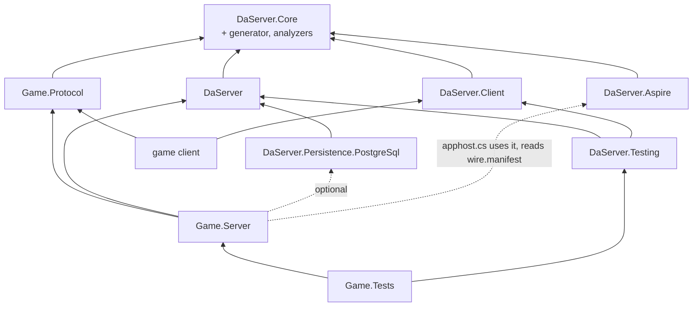

# Target architecture (draft, not implemented)

The architecture DaServer is refactored to (breaking, roadmap phase R): the v28 programming model of
[programming-model.md](programming-model.md) on EasyEcs 4.5.0, with Native AOT support. The programming model draft is
the source of truth for what users write and what each rule means; this file says how the pieces fit together and
links to the draft's sections instead of repeating them. Today's architecture is [design.md](../design.md); the
decisions are ADR-082 to ADR-086 in [decisions.md](../decisions.md). When R is done, this file and the draft are
promoted into design.md and decisions.md and deleted (R10).

## 1. Layers and projects

### Framework packages

Six packages. A package exists when something references it without the others: a Unity client takes no server, a
node takes no AppHost code, production takes no test tools, and a capability is off unless referenced (ADR-045).

| Package | Targets | Holds |
|---|---|---|
| `DaServer.Core` | netstandard2.1, net11.0 | What both sides see: the client-facing contracts (`IFromClient`, `IFromClient<R>`, `IToClient`, `[To]`, `IServer`, `TypeId<T>`, status codes) and the wire and transport (frames, buffers, channels, the pending-call table). Ships the generators, the analyzers and the `wire.manifest` task (below). |
| `DaServer.Client` | netstandard2.1, net11.0 | The client SDK: connect, send `IFromClient`, receive `IToClient`, slots and re-joining ([draft §7](programming-model.md#7-客户端与-presence)). |
| `DaServer` | net11.0 | The server: the model (`IActor<T>`, `[Handles<K>]`, `[On<T>]`, `IMessageTo<K>`, `IRequestTo<K,R>`, `[From<K>]`, `IEvent`, `IPersisted`, `Entity` operations, `Connection`), the framework systems, cluster, placement, persistence, migration, hot restart, and the node host: Generic Host and ASP.NET Core, configuration, OpenTelemetry, shutdown, the HTTP plane. |
| `DaServer.Persistence.PostgreSql` | net11.0 | The record store: epoch-fenced, compare-and-swap writes. |
| `DaServer.Testing` | net11.0 | `TestActor<K>` (one actor, one world, a manual clock), `TestCluster` (in-process nodes) and simulated users (`Swarm`, HTN behaviors) over `DaServer.Client` for load tests and E2E. |
| `DaServer.Aspire` | net11.0 | AppHost side: `AddDaServerCluster`, `AddNodes<TServer>` (a `DaServerNodeGroup<TServer>`), `WithActorStore`, `WithClientConnections(port)` on a node group, `WithClientEndpoints(gateways)` for a client app, the `{cluster}-restart` command, and a generator that writes the server types from the committed `wire.manifest` of the `#:project` (`actor` and `hosted-by` lines), each bound to that project. References no server assembly. |
| `DaServer.Generator` | netstandard2.0 | Not a package of its own: built twice (Roslyn 5.x and 4.3, Unity's oldest) into `DaServer.Core`'s `analyzers/` folder, so every project using DaServer gets it. The generators (explicit `Key`, typed sends, `[On<T>]` jobs, `Registration`, `wire.manifest`), the analyzers ([draft §13](programming-model.md#13-编译期检查删掉的东西版本记录)) and the MSBuild task behind `-p:UpdateWireManifest=true` (one section per project, [draft §10](programming-model.md#10-持久化迁移热重启升级easyecs-45)). |

Merged away: `DaServer.Abstractions` into `DaServer.Core` (both are referenced by every client and every server; the
analyzer, not a package boundary, keeps server types out of `Game.Protocol`), `DaServer.Hosting` into `DaServer` (a
node always runs both; `TestCluster` simply starts no HTTP), `DaServer.Simulation` into `DaServer.Testing` (both are
test tools), `DaServer.WireTool` into the generator's MSBuild task (ADR-086).

### User projects

| Project | Targets | Holds | Code changes |
|---|---|---|---|
| `Game.Protocol` | netstandard2.1, net11.0 | Client messages only: data, no actor types, no addresses, no nodes | Shipped to clients |
| `Game.Server` | net11.0 | Actor types, server-to-server messages, events, components, claims, prefabs, server types (several per project), `[Handles<K>]` classes of `[On<T>]` methods, `[UpdateInGroup<K>]` systems, the generated `Registration`, the node's five-line `Program.cs`, and `apphost.cs`, the deployment | Hot restart or rolling upgrade, JIT and AOT alike (section 5) |

- **One project may define several server types** (`[Hosts<Map>] struct MapServer : IServer`); **a node is one process
  running one server type** ([draft §2](programming-model.md#2-服务器与节点)). The AppHost picks the type per node
  group (`AddNodes<MapServer>("map", replicas: 4)`); a small deployment declares an `AllInOne` type.
- **The AppHost is `Game.Server/apphost.cs`**, an Aspire file-based AppHost (`#:sdk Aspire.AppHost.Sdk`,
  `#:package DaServer.Aspire`, `#:project Game.Server.csproj`), run with `dotnet run --file apphost.cs` or
  `aspire run` and published with `aspire publish`. The `DaServer` package's build props remove it from the server's
  compilation. A group's `name` is the Aspire resource and the pod prefix; a server type's identity is its `FullName`;
  the cluster's name differs from every group's. Visual Studio does not open file-based AppHosts yet; a separate
  AppHost project with the same code also works.
- **Ports are declared per node group**, the same on every replica (one pod template, an IP per pod). The cluster
  and HTTP (health, admin) ports are assigned by `DaServer.Aspire` and reachable only inside the cluster. Only what
  the AppHost writes is exposed: `WithClientConnections(port)` (client TCP and WebSocket, behind one load-balanced
  address by default; the load balancer's kind is the application's) and Aspire's `WithExternalHttpEndpoints()`
  (webhooks). `[Hosts<Connection>]` without `WithClientConnections`, or the reverse, fails the build. Per-replica
  public addresses (direct connect, as Agones does) are a non-goal for now. A node sizes its
  own thread count from the CPUs it is given (section 2); nobody writes it.
- `[Hosts<Connection>]` is "accepts clients": the gateway is a server type hosting the built-in `Connection` actor type.

### Dependency directions

An arrow reads "references". Dotted: no assembly reference.

- Everything points one way: `DaServer` never references a capability, a sample or a user project; `DaServer.Core`
  references only Nino; `DaServer.Client` never references `DaServer`.
- `Game.Protocol` references only `DaServer.Core`: the analyzer refuses actor types, server messages, `ActorId`,
  `PresenceId` and `EntityId` there, and server-only APIs are not in `DaServer.Core` to begin with.
- `apphost.cs` takes `DaServer.Aspire` by `#:package` and `Game.Server`'s project metadata by `#:project`, and the
  generator reads that project's `wire.manifest`; no server assembly is referenced. `DaServer.Aspire` references
  `DaServer.Core`: the generated server types implement `IServer`.

## 2. Runtime structure

Users see four words: **server type** (`MapServer`), **node** (a process running one server type), **actor**
(`Map(7)`: its root entity and all its descendants) and **entity/component** (EasyEcs's own). A node's threads are
the framework's business; inside DaServer one thread with its EasyEcs world is a **shard**, a word that appears in no
public API, attribute, configuration key or AppHost call.

| Level | What it is | Owns |
|---|---|---|
| Node | One process, one server type, a cluster-assigned node generation ([draft §2](programming-model.md#2-服务器与节点)) | Links, membership, placement view, its shards, the HTTP plane |
| Shard (internal) | One thread and one EasyEcs world; the actor types the server hosts share it; an actor lands on a shard by its key's hash. A node runs one shard per CPU it is given (the container's CPU request, `DaServer:Worlds` overrides) | The dispatch queue, the framework systems, singletons (`Time`, `Ordered`, `Current`, `Outbox`) |
| Actor | Its root entity (carrying the actor type component, e.g. `Map(7)`) and the root's descendants | Its mail, its `Due` items, its presences, its waiting asks |
| Entity | A root, an avatar, a presence, a waiting ask, a scheduled event | Components; `In<K>` on every entity of a K actor |

- **Parallelism**: many actors per shard, many shards per node, many nodes. Inside an actor the ordered phase is
  serial; heavy system methods use `[ForEach(Parallel = true)]`. Each shard's world sets
  `WorldOptions.MaxDegreeOfParallelism` = node cores / node shards, at least 1 (EasyEcs D36: the budget is per world).
- **The dispatch queue** is the only cross-thread handoff: IO threads and other shards post frames to it; the shard
  thread moves them into its mailbox snapshot. Queues are bounded (`Busy`); the control channel (presence control,
  answers) is bounded by what the node itself holds ([draft §11](programming-model.md#11-失败时的结果)).

### A tick

Per actor type with `[TickRate(n)]`, at time t ([draft §1](programming-model.md#执行模型每个-actor-是一个离散事件模拟)):

| Step | Systems | What happens |
|---|---|---|
| 1. Ordering | `OrderedPhase` (framework group) | Mail of the tick window and due items merged by `(time, seq)`; each item runs as a single-entity job, then its immediate chain (at most 1,024); `Outbox` flushed after each item |
| 2. The actor type's group | `world.Update<Map>()` | The user's `[UpdateInGroup<Map>]` systems; the group filter `In<Map>` comes with `IActor<Map>` (`IGroupWith<In<Map>>`) |
| 3. Settling | `Depart`, `SyncSubscriptions` (framework group) | Presences with `Leaving` destroyed; changed `DynamicBuffer<Subscribed>` sent to the gateways |
| 4. Cleanup | `ReleaseRoutes`, the `Persisted` cleanup (framework group, per shard, no `In<K>`) | Cleanup components of destroyed entities processed; `Outbox` flushed |

- Actor types without `[TickRate]` (Player, `Connection`) run items as they arrive; their group and settling run after
  each batch of mail with `Time.DeltaTime` 0.
- Server types hosting several ticking actor types keep rates that divide the fastest one.

### Runtime data

| Data | Kind | Role |
|---|---|---|
| `Due(TimeSpan At, long Seq)` | ordered value index | Delayed events, request deadlines, join confirmation deadlines, join-on-connect back-off: one timer mechanism ([draft §9](programming-model.md#9-时间与广播)). The ordered phase takes the first `Range(Due.Min, (t, max))` entry, compares it with the mailbox head, runs the earlier, and queries again |
| `Ordered` | singleton | Sequence counter, current tick window, immediate chain budget |
| `Current` | singleton | The running item's time, root, sender and client context; operations read the client context from it |
| `Outbox` | singleton | Everything an item sends (`Send`, `Ask`, `Reply`, `Push`, `Broadcast`, join routes), flushed in append order after the item: a join's route always precedes its reply; tests assert it as data |
| `Time` | singleton | `Tick`, `DeltaTime`, `TickRate`, `Elapsed` (monotonic, process-local) |
| Placeholder | entity | A key not yet active or being saved: the root prefab copy without `In<K>`, the key, `Loading` or `Saving`, `DynamicBuffer<Mail>` |

### `Registration`

- Generated, one instance per call of `Registrations.Create()` (no static registries, no module initializers): actor
  types, root and child prefab copies with `In<K>`, claims, join-on-connect, dispatch tables per actor type, client
  routes, systems per group ([draft §12](programming-model.md#12-完整例子连接进地图移动放技能看见别人)).
- Nodes, `TestCluster` and `TestActor<K>` take the object.
- Every type in it is closed at compile time in the user's assembly (section 8).

## 3. Messaging

| Path | Shape | Route |
|---|---|---|
| Client → server | `IFromClient`, `IFromClient<R>` in Protocol | Client → its `Connection` entity on the gateway → `[On<Incoming>]` filter → generated route table → straight to the target actor (no hop through Player) |
| `[To]` field | `EnterMap([To] long Map)` | To the actor of the handling type whose key is the field; the subject is the root ([draft §4](programming-model.md#4-消息)) |
| No `[To]` | `MoveTo(...)` | To the client's presence on the handling actor type; the subject is the presence entity; none: `NotJoined` |
| Server → client | `IToClient` | `e.Push(msg)` to a presence, `root.Broadcast(msg)` to every joined presence, `e.Push(in group, msg)` to a `ClientGroup` |
| Server → server | `IMessageTo<K>`, `IRequestTo<K,R>` with `[From<K>]` | Generated typed `Send`/`Ask` on `Entity`; the answer is `Answer<TReq>` or `Answer<TReq,TState>` mail to the asking entity ([draft §8](programming-model.md#8-等待别的-actor-的结果)) |
| Inside an actor | `IEvent` | `e.Schedule(ev[, after:])`: a child entity with `Due`, run in the ordered phase |
| Outside actors | `ICluster` | HTTP, back-office, tests: any server-to-server message; `cluster.Disconnect(clientId)` |

- **Presences** ([draft §7](programming-model.md#7-客户端与-presence)): a client's existence on an actor, one per
  actor type: a child entity with `Presence` (a cleanup component) on the target, a `Route` in the `Connection`'s
  `DynamicBuffer<Route>`, a slot number in the SDK. `e.Join()` is immediate and appends the route to `Outbox`;
  `Leave()` adds `Leaving`, systems react, `Depart` destroys. Connection stamps are ordered (token issue sequence,
  gateway generation, connection counter): the larger takes over.
- **`[JoinOnConnect<TClaims>]`**: the framework joins the client to the actor whose key has the claims' shape
  (Player) and joins it again when that presence is lost.
- **Gateway**: a server type with `[Hosts<Connection>]`. `Connection` is pinned to its socket's node, never placed or
  migrated, activated on connect, deactivated on disconnect. It filters, routes, keeps the routes and fans out groups.
- **`ClientGroup` fan-out**: subscriptions are data (`DynamicBuffer<Subscribed>` on presences); `SyncSubscriptions`
  sends the differences to the gateways; a group push is serialized once, one frame per gateway with members, fanned
  out there.
- **Order**: one sender to one target arrives in send order unless one of them migrates
  ([draft §1](programming-model.md#1-保证)).

## 4. Placement, activation, persistence

- **Placement**: an actor type is bound to server types (`[Hosts<…>]`); its keys are placed among the nodes hosting
  it, moved when nodes join or leave (rate-limited per node). `[Stateless]` actors live on any node, never persisted.
  `Connection` is pinned.
- **Activation** ([draft §6](programming-model.md#6-生命周期), [§10](programming-model.md#10-持久化迁移热重启升级easyecs-45)):
  1. The first message creates the placeholder (`Loading`); mail waits on it.
  2. The activation takes an epoch: a conditional write `(key, epoch) → epoch + 1`, even without a record.
  3. The record is loaded into the placeholder and n−1 empty entities:
     `LoadEntitiesInto(record, into, markWritten: false)`. **The placeholder stays the root**: key and mail never move.
  4. `In<K>` added, `Loading` removed; the first mail is `Activated(Activation)`.
- **Epoch fencing**: every record write compares the epoch; a failed compare fences the activation (destroyed without
  a save, `Leaving` or `Deactivating`; presences' routes released by their cleanup components). A node removed from
  the view fences all its actors before re-joining with a new generation.
- **Persistence**: components marked `IPersisted : IComponent, ITrackChanges`. `ChangeSystem` (`[Changed<T>]`,
  `[Removed<T>]`) tags the root `Unsaved`; the `Persisted` cleanup component tags it when a persisted descendant is
  destroyed; `CheckpointSystem` writes `[With<Unsaved>]` roots at the checkpoint interval with an epoch CAS.
- **Records**: `SaveEntities` over `world.Descendants(root)` with the component set
  `persist` = every `IPersisted` + `ChildOf` + `In<K>` + `Persisted`, built once in `Registration`. Restored values
  do not count as writes (`markWritten: false`), so an activation does not write the record back.
- **Deactivation**: idle past `[IdleTimeout]` or `root.Deactivate()`: presences leave, `Deactivating` runs, the subtree is
  saved and destroyed, a `Saving` placeholder holds new mail until the write lands.

## 5. Migration, upgrades, hot restart

- **Migration**: the whole subtree with the component set `migrate` (every component not `[Transient]`), including
  waiting asks, presences with `Subscribed`, and delayed events with their remaining time. The header carries each
  component's layout hash from `wire.manifest`; one mismatch (mixed versions) falls back to deactivate, write the
  record, load it on the target. Arrivals load with `markWritten: true`, so `[Changed<T>]` systems treat them as
  written (re-subscribe, re-cell, first checkpoint). A tombstone forwards late control messages. Across shards it is
  bytes too (`MoveEntities` needs one thread).
- **Time across processes** is remaining time only; each process runs on its own monotonic clock.
- **`wire.manifest`**: one section per project; `Game.Server`'s holds actor types, hosting server types, tick rates,
  claims, message endpoints, events, state types, persisted components, layout hashes, pushes, client routes, event
  and `Answer` handlers, lifecycle handlers and `Leaving` consumers. The AppHost reads `actor` and `hosted-by`; nodes
  check their server type against it at start; a hot restart diffs the old and new manifests to pick its path.
- **Rolling upgrades**: `[Hosts]` on the member card, `NotHandled` from old nodes retried once after placement is
  resolved again, migration falls back to records across layouts. Gateways and changes of hosting or client routes
  change this way.
- **Hot restart** ([draft §10](programming-model.md#热重启), the same on JIT and Native AOT nodes; the decision and why
  not `AssemblyLoadContext` are ADR-084): the node is replaced in place by a process of the new build; no actor
  re-activates, clients stay connected.
  - **Paths**, picked from the manifest diff and reported by the `{cluster}-restart` command (`aspire do mmo-restart`): *in place* (same layout hashes, no handler
    or `Leaving` consumer dropped, same client routes; target pause: tens of milliseconds after warm-up, hundreds without), *through
    records* (layouts changed only where records stay readable: deactivate all, restart, activate from records; a
    longer pause), or refused in favour of a rolling upgrade (hosting or client routes changed).
  - **Handoff bytes** (one format, two transports): per shard the `world.Save` output (entities with ids, components,
    buffers including placeholder mail, singletons; no systems, indexes or change ticks), mail still in the dispatch
    queue and the shard's `Time.Elapsed`; per node the call id sequence, tombstones, the connection stamp counter and per
    peer link the inbound stream id with the bytes processed and the outbound stream id, offset and unacknowledged tail; a header with node name, generation, incarnation, handoff token and checksum. The new
    process loads each world, adds the systems from its `Registration` and resumes each shard clock at the saved
    `Time.Elapsed`, so every `Due` keeps its remaining time.
  - **Ownership**: the node announces `Restarting` with a deadline and the hash of the handoff token; peers keep it
    in the view and in placement (no `Suspect`, no re-placement, no fencing) until the deadline, measured on their own
    monotonic clocks, and hold messages to it in the bounded resend windows of their links (`Busy` with the existing
    back-off beyond that). The successor joins with the same name and generation, the incarnation plus one and the
    token; peers drop the old process's links, switch to the standby links (below) and replay their resend windows. Epochs stay in the
    roots and in the store, so its writes compare as before. Only one process runs shards at any time: the old one
    stops its shards and settles in-flight record writes before `Save` and never runs them again past the commit
    point (the successor's "loaded"); the successor runs them only after it. A deadline that passes first turns into
    an ordinary node departure: actors re-activate elsewhere under new epochs and a late successor discards the
    snapshot and joins with a new generation.
  - **Transports**: *successor launched by the node* (bare metal, VMs, Windows services, macOS, development): warm up,
    then hand over. The old process starts the new binary, connected over a local `System.IO.Pipes` named pipe (a
    Windows named pipe, a Unix domain socket elsewhere); the successor finishes JIT warm-up or AOT initialization,
    builds its empty worlds with their systems and authenticates standby peer links (below), binding no client port. Only then does the old process announce `Restarting`, stop its shards
    between two ticks and stream the bytes; the successor loads them and takes over with one membership update; the
    old process closes its listeners and exits, the successor binds the same ports. No `exec`. A service manager that tracks the PID
    must accept the handover (systemd: `sd_notify` with `MAINPID`) or supervise a small launcher instead. *Process
    restarted by the platform* (a container restart in the same Kubernetes pod, a systemd restart): the old process
    writes the bytes into a file in a node-local directory (a memory-backed `emptyDir`, tmpfs where available, a plain
    local directory otherwise) through `MemoryMappedFile.CreateFromFile` and exits; the new process loads a fresh,
    checksummed snapshot for its node name at start, and ignores a stale or invalid one (activation from records as
    usual). On Kubernetes the running pod's container image is changed in place, so the pod is not rescheduled
    (deployment below).
  - **Standby peer links** (ADR-084): today's links are one per peer address with one inbound slot, named by a random
    per-process id, and a `Resume` from another id restarts the stream. Target: identity on the wire is (name,
    generation) with the incarnation beside it; the successor's `LinkHello` carries the next incarnation, `Standby` and
    a temporary endpoint; a peer authenticates it as any Hello and parks it beside the live connection (no `Resume`,
    no traffic), only for a known member and a higher incarnation, dropping it at the deadline or on withdrawal. The
    membership update with that incarnation and the token switches: old connections close, the successor answers
    `Resume` with the counts restored from the handoff (which also carries each outbound stream's id, offset and
    unacknowledged tail), both sides replay. A rising incarnation also re-fetches the member's card (new build).
    After a platform restart the successor reconnects at its advertised address with the same identity and the
    streams resume the same way.
  - **Pause**: after warm-up it is save, transfer and load plus the membership switch: tens of milliseconds
    (one world, 5 unmanaged components per entity: 100,000 entities save in 0.76 ms and load in 2.7 ms, about 3.5 ms,
    4.4 MB, 0 B allocated; BenchmarkDotNet ShortRun, EasyEcs 4.5.0, .NET 11 RC2). A platform restart adds process
    start and peer reconnects: hundreds of milliseconds. R measures both end to end (BenchmarkDotNet per shard, E2E).
  - **Change ticks (prerequisite: EasyEcs request #22)**: `world.Load` stamps every loaded row as written (and rows
    lacking a tracked component as removed), and a system's first run filters `Since(LastRunTick + 1)` from
    `LastRunTick` 0, so it visits every row stamped since the world began. After a hot restart `ChangeSystem` would
    tag every root `Unsaved` and every actor would rewrite its record. Needed: `world.Load(input, markWritten: false)`
    (no tick, no removal stamp, as `LoadEntitiesInto`) and a first run from the current tick chosen at registration
    (`AddSystem(system, seeExisting: false)` or a settable baseline), for the framework's persistence systems
    (`ChangeSystem`, checkpoint); a user system re-firing once (one extra AOI pass) is acceptable. Pending writes are
    not lost: `Unsaved` is a tag on the root and travels in the save.
  - **Gateways** do not hot restart (`Connection` is pinned to its socket); they take rolling upgrades. A possible
    later optimization is handing the sockets to the new process (`SCM_RIGHTS`, Envoy-style), Unix only.
  - **`[Stateless]` actor types** deployed as their own node group are replaced by start-new-then-stop-old, without
    a pause.
- **Deployment on Kubernetes** (ADR-085, roadmap R11): node groups that host actors publish as a StatefulSet with
  `updateStrategy: OnDelete` (stable pod names are node names; a template change replaces no pod), its `serviceName`
  the headless `{group}-peers` Service, a `medium: Memory` `emptyDir` for the hot-restart snapshot; gateways and
  stateless groups stay Deployments. The release (`helm upgrade`) sets the template image, which replaces no pod; an
  in-cluster rollout Job then has every node pull the image and patches each running pod's container image one at a
  time (never the template): the kubelet restarts the container in the same pod (same UID and IP) and the `emptyDir`
  keeps the snapshot. The full target shape (Secrets, Jobs, probes, security, network policy) is
  [deployment.md](deployment.md), roadmap R12. Today `DaServer.Aspire` emits a Deployment per group (`AddNodes`, its `Kubernetes`
  hook) and the samples' VPA targets a Deployment (`samples/Shared/Publishing.cs`); R11 changes the publisher hooks,
  the VPA `targetRef`, the PDBs' selection, the probes and grace periods on the new workload kind, and adds the
  rollout Job with a Role for the pod patches.
- **Changes without a restart** are data swaps between two ticks: tuning tables (a validated world singleton, its
  version on the member card) and feature flags choosing between handlers compiled into the binary (a singleton or a
  tag that handlers and systems filter on).

## 6. Distributed guarantees and failure handling

The guarantees are [draft §1](programming-model.md#1-保证); the outcome of each failure is the table in
[draft §11](programming-model.md#11-失败时的结果). In short:

| Guarantee | Mechanism |
|---|---|
| Each actor runs its items one at a time in `(time, seq)` order; actors run in parallel | Ordered phase, `Due` index |
| Per sender-target order, best effort while migrating | One ordered link per node direction; no migration fence |
| One-way at most once; a request always ends (reply, refusal with a reason, timeout); a timeout may have run | Deadlines as `Due`; call ids are idempotency keys; reserve then commit |
| At most one activation writes a key's record | Epoch claim and CAS writes; fencing |
| A reconnect is a new connection; the larger stamp takes over | Ordered connection stamps; SDK re-joins per slot |
| Handler exceptions do not roll back | `[OnError] Resume` (default) or `Restart` from the last record |

## 7. EasyEcs 4.5 features used

| Part | EasyEcs features |
|---|---|
| Actor lookup | Value index `IIndexed<T>` on the actor type component (`world.Index<K,K>()`), explicit `Key` (generated) |
| `[On<T>]` handlers | Single-entity jobs `entity.Run<T1..Tn, TJob>(ref job[, in filter])`, `IForEachEntity<…>`, `Writes`, `QueryFilter`, `INoStructuralChanges` |
| Per-tick logic | `EcsSystem`, `[ForEach]`, batch methods, `Parallel = true`, `[Changed<T>]`, `[UpdateAfter<T>]`, `ISystemGroup`, `IGroupWith<T>` group filters, `world.Update<TGroup>()` |
| Ordering and timers | Ordered value index (`Range`) on `Due`, singletons |
| An actor's entities | `ChildOf`, `world.Children`, `world.Descendants(root)`, prefabs (`new Prefab(base)` copies) |
| Presences, cleanup | `ICleanupComponent`, `Destroyed`, `DynamicBuffer<T>`, `[Changed<DynamicBuffer<T>>]` |
| Persistence | `ITrackChanges`, `[Changed<T>]`, `[Removed<T>]`, `ComponentSet`, `SaveEntities`, `LoadEntitiesInto(…, markWritten: false)`, Nino type ids |
| Hot restart | `world.Save`, `world.Load` (singletons included, systems not), `AddSystem<T>()` |
| Diagnostics, tests | `SystemErrorPolicy` (`Disable` on nodes, `Throw` in `TestActor<K>`), `MeasureSystems`, `system.Stats`, `world.Count<Destroyed>()`, `world.Describe()`, `Capture`/`Restore` |
| Allocation-free reuse | Pooled `DynamicBuffer` storage, `MaxDegreeOfParallelism` per world |

## 8. Native AOT

DaServer nodes publish with `PublishAot=true` (ADR-083, requirement E11, [draft §10](programming-model.md#native-aot)).
JIT stays supported and behaves the same: neither loads assemblies at run time, and both change code by hot restart
or rolling upgrade (section 5).

| | JIT deployment | Native AOT deployment |
|---|---|---|
| Start-up, memory | JIT warm-up, tiered compilation | Native start (tens of milliseconds), smaller working set |
| Reflection | Allowed where documented as JIT-only | None |

### What makes it work

- **Registration is generated and closed**: `Registrations.Create()` names every closed type in the user's assembly
  (`.Actor<Map>(…)`, which also adds the framework's closed `OrderedPhase<Map>`, `Depart<Map>` and
  `SyncSubscriptions<Map>`; `.Dispatch<Map>(…)`; `world.AddSystem<Steering>()`). No reflection, no `MakeGenericType`, no
  `Activator`, no assembly scanning, no module initializers.
- **Framework per-actor-type systems are emitted closed by the generator**: the generated `Registration` names each
  instantiation. The framework's generic systems have no `[ForEach]` methods (they run their jobs from `OnUpdate`
  through EasyEcs's generic runners, closed by their type arguments), so EasyEcs has no generic system code to close
  at run time. EasyEcs closes a generic system named only by another assembly with `MakeGenericType`, which Native AOT
  cannot do (EasyEcs D20; `faq.mdx#native-aot`), and suppresses the warning for it: such a mistake would fail at run
  time, so DaServer's analyzer reports a user's generic `[ForEach]` system closed outside its own assembly
  ([draft §13](programming-model.md#13-编译期检查删掉的东西版本记录)).
- **Handlers are jobs**: `[On<T>]` methods become struct jobs called through generic `entity.Run<…, TJob>`, closed at
  compile time; dispatch tables hold static method-group delegates.
- **Serialization is Nino's generated formatters** (messages, persisted components, records, migration bytes); type
  ids are Nino's. EasyEcs records types by Nino type id (D30).
- **EasyEcs**: `EasyEcs.Core` is marked `IsAotCompatible`; its generated code calls user methods directly.
- **The HTTP plane, no JSON in the framework**: `WebApplication.CreateSlimBuilder`; minimal APIs through ASP.NET
  Core's request delegate generator.
  - **Admin endpoints** (`/admin/membership`, `/admin/stats`, drain, unload) answer typed `[NinoType]` records as
    Nino (`application/x-nino`, Nino.AspNetCore), or a plain-text table for `Accept: text/plain` (an operator with
    curl). The Aspire commands decode the Nino reply and show the text. Today's `Results.Json` of anonymous objects
    goes.
  - **Probes and metrics** keep their platform formats: plain-text health, Prometheus text exposition.
  - **`MapAsk` / `MapSend`** take Nino bodies only by default. An application that must accept JSON (a third-party
    webhook) opts in per endpoint with a source-generated `JsonSerializerContext` it declares (the System.Text.Json
    generator does not see other generators' output, so DaServer cannot declare it). No reflection-based JSON
    anywhere.
- **Configuration**: `Configure<NodeOptions>(section)` is handled by the configuration binding generator;
  `configuration.Get<TOptions>()` inside the generic `AddDaServerFeature<TOptions>` has an open type there and
  moves to a closed call site (to verify with the first AOT publish).
- **Route listing**: `Routes` (the `DaServer__ListRoutes` check mode) reads assemblies by reflection; the target reads
  the routes from `wire.manifest` instead.
- **Framework projects** set `IsAotCompatible` on their net11.0 targets, so the trim and AOT analyzers run on every
  build under `TreatWarningsAsErrors`.

### To verify (R8)

| Dependency | Version in the repo | Status |
|---|---|---|
| OpenTelemetry (`Extensions.Hosting`, OTLP exporter, ASP.NET Core, HTTP and runtime instrumentation) | 1.19.x | To verify: warnings under `PublishAot` |
| `OpenTelemetry.Exporter.Prometheus.AspNetCore` | 1.19.1-beta.1 | To verify |
| Npgsql through `Aspire.Npgsql` | 13.6.1 | To verify: whether the Aspire integration builds the data source in a way Native AOT accepts |
| `Nino.AspNetCore`, `Microsoft.Extensions.ServiceDiscovery`, `Microsoft.Extensions.Http.Resilience` | see `Directory.Packages.props` | To verify |
| ASP.NET Core with `CreateSlimBuilder` | .NET 11 | To verify that `AddDaServer` needs nothing the slim builder drops (TLS is the platform's) |

### The zero-warning gate

- The AOT compiler reports one **IL3054** (generic recursion through EasyEcs's change-tick column type) for any
  program with tracked components, and every stateful DaServer node has them (`IPersisted : ITrackChanges`).
- Builds and publishes have 0 warnings (release checklist step 1, E11). A suppression of a library's warning in the
  user's program is not accepted, scoped or documented.
- So the AOT publish check is **gated on EasyEcs request #21** (remove IL3054 for programs with tracked components,
  with an AOT sample in EasyEcs's CI). Until it ships, R8 prepares everything else and records the one remaining
  warning; the release checklist's AOT step stays open.
- **Proof**: `dotnet publish -p:PublishAot=true` for each sample node (mmo, flashsale) with 0 warnings, and the E2E
  tests passing against the AOT binaries.

## 9. From today's code to the target

Derived from [design.md](../design.md) and the deleted list in
[draft §13](programming-model.md#13-编译期检查删掉的东西版本记录).

| Today | Target |
|---|---|
| `[Actor<TId>]` static class, a separate id type, `ActorKey` component | The actor type `record struct Map(long Id) : IActor<Map>`: address, root component (value index) and system group; `ActorId` for any actor |
| `[Handle]` methods, generated dispatchers, `in Context` | `[On<T>]` methods in `[Handles<K>]` classes, compiled into EasyEcs single-entity jobs; one binding rule (the subject) |
| `[Service]` | `[Stateless]` actor type |
| `ctx.Send`/`Ask`/`ReplyLater`/`BindSession` | `Entity` operations (`Send`, `Ask`, `Reply`, `Push`, `Join`, `Leave`, `Schedule`, `Spawn`), appended to `Outbox` |
| `Answered<TRequest,TReply>`, `PendingReply`, `Answer<T>.Later` | `Answer<TReq>` / `Answer<TReq,TState>` to the asking entity (a waiting child with `Due`); `ReplyTo<T>` as data |
| `IRequest<TReply>`, `[Message]`, `[FromClient]`/`[ToClient]` | `IFromClient`, `IFromClient<R>`, `IToClient` (Protocol); `IMessageTo<K>`, `IRequestTo<K,R>`, `[From<K>]` (Server); `IEvent` |
| `Publish` | Deleted: explicit sends, `ClientGroup` |
| `[Filter]`, `IMessageFilter` | `[On<Incoming>]` in `[Handles<Connection>]` |
| Mailbox used only while an actor is not live; `DispatchSystem`, `MailSystem` | Every item through the ordered phase, merged with `Due` by `(time, seq)`; mail waits on the placeholder |
| Lifecycle tags (`Loading`, `Ready`, `UnloadRequested`, `Leaving`, `Fenced`, `Removing`), `Created`/`Loaded`/`Unloading` | Placeholder root (`Loading`, `Saving`), `Activated(Activation)`, `Deactivating`, fencing by epoch |
| `TimerSystem`, timer wheel, `SendAfter` | `Due` ordered index; `e.Schedule(ev, after:)`; `Scheduled<T>` |
| Sessions: bind and grant, `KnownSession` children, `Known`/`Granted`/`Superseded`, `SessionClosed` | Presences: `Join()`/`Leave()`, `Presence`/`Joined`/`Leaving`, `PresenceLost`, `[JoinOnConnect<TClaims>]`, ordered stamps |
| `ClientConnections` feature (`DaServer:Clients`) | `Connection` actor type hosted by a `[Hosts<Connection>]` server type |
| Tick rate in configuration, the default group at the tick rate | `[TickRate(n)]` on the actor type; `[UpdateInGroup<K>]` |
| `UnloadAfterIdleSeconds` | `[IdleTimeout]` on the actor type |
| `[Persist]` with a generated `ITrackChanges`, the own record format | `IPersisted`; records as `SaveEntities` over `Descendants` with a `ComponentSet`; epoch CAS |
| State handoff (ADR-072) | Migration bytes with layout hashes; fallback to records |
| `Registration_{Assembly}` run by a module initializer (ADR-012) | `Registration` instance from `Registrations.Create()` |
| One project per server (ADR-017), Contracts / Model / Logic (N1) | Protocol / Server; several server types per Server project; node = one server type |
| Hot reload of the logic assembly (planned N9) | Hot restart: the node replaced in place by the new build, world handed over (JIT and AOT) |
| `AddNodes<TProject>` in a `Sample.AppHost` project | `AddNodes<TServer>` over server types generated from `wire.manifest`, in `Game.Server/apphost.cs`; ports declared per group |
| Packages Abstractions, Core, Client, Simulation, `DaServer`, Hosting, WireTool, Testing, Persistence.PostgreSql, Aspire (ADR-052) | Core, Client, `DaServer`, Persistence.PostgreSql, Testing, Aspire; the generator and the manifest task inside Core (ADR-086) |
| Shard count in configuration and AppHost parameters (`DaServer:Shards`, `map_shards`) | Sized by the node from its CPUs; `DaServer:Worlds` overrides; the word shard is internal |
| Random `NodeId` per process | Cluster-assigned node generation; identity on the link Hello is (name, generation) plus incarnation, standby links for a successor |
| A Kubernetes Deployment per node group | StatefulSet with `OnDelete` for actor-hosting groups, Deployments for gateways and stateless groups (ADR-085) |
| Deadlines in UTC milliseconds | Monotonic `TimeSpan`; remaining time across processes |
| Route listing by reflection (`Routes`) | Routes from `wire.manifest` |
| Admin JSON of anonymous objects | Typed `[NinoType]` records as Nino, or plain text for `Accept: text/plain` |
| `MapAsk` bodies as JSON or Nino | Nino; JSON only per endpoint, through the application's source-generated context |

CLAUDE.md's Layout and ADR-017 change with R (one Server project may define several server types).

## 10. Open points to settle during R

1. **Messages as entities** ([draft §14](programming-model.md#14-已定的取舍以及待办) item 4): measured with
   BenchmarkDotNet in R4; changed only if not worse by more than 10%.
2. **EasyEcs 4.5.0 compile checks** (R1): the generated explicit `Key` is accepted by value indexes; `IActor<TSelf>`
   compiles in the framework assembly.
