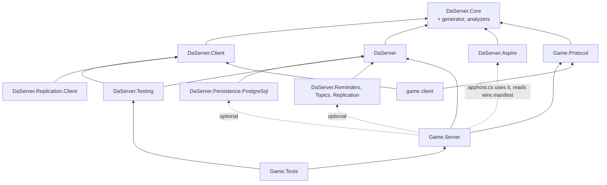

# Target architecture (draft, not implemented)

The architecture DaServer is refactored to (breaking, roadmap phase W): the v32 programming model of
[programming-model.md](programming-model.md) on EasyEcs 4.6.0 and the features planned for EasyEcs 4.7 (not released; the roadmap gates the steps that use them, the draft's §0 lists them), with Native AOT support. The programming model draft is
the source of truth for what users write and what each rule means; this file says how the pieces fit together and
links to the draft's sections instead of repeating them. Today's architecture is [design.md](../design.md); the
decisions are ADR-082 to ADR-092 in [decisions.md](../decisions.md). When W is done, this file and the draft are
promoted into design.md and decisions.md and deleted (W10).

## 1. Layers and projects

### Framework packages

Six packages. A package exists when something references it without the others: a Unity client takes no server, a
node takes no AppHost code, production takes no test tools, and a capability is off unless referenced (ADR-045).

| Package | Targets | Holds |
|---|---|---|
| `DaServer.Core` | netstandard2.1, net11.0 | What both sides see: the client-facing contracts (`IFromClient`, `IFromClient<R>`, `IToClient`, `[To]`, `IServer`, `TypeId<T>`, status codes) and the wire and transport (frames, buffers, channels, the pending-call table). Ships the generators, the analyzers and the `wire.manifest` task (below). |
| `DaServer.Client` | netstandard2.1, net11.0 | The client SDK: connect, send `IFromClient`, receive `IToClient`, slots and re-joining, moving on `Retire` ([draft §7](programming-model.md#7-客户端与-presence)). |
| `DaServer` | net11.0 | The server: the model (`IActor<T>`, `IChildKey<T>`, `[Handles<K>]`, `[On<T>]`, `IMessageTo<K>`, `IRequestTo<K,R>`, `[From<K>]`, `IEvent`, `IPersisted`, `Entity` operations, `Connection`), the framework systems, cluster, placement, persistence, migration, hot restart, and the node host: Generic Host and ASP.NET Core, configuration, OpenTelemetry, shutdown, the HTTP plane, and `UseLaunchd()` (DaServer's counterpart of the official `UseSystemd()` and `UseWindowsService()`, [deployment.md section 0](deployment.md#0-launch-flows)). |
| `DaServer.Persistence.PostgreSql` | net11.0 | The record store: epoch-fenced, compare-and-swap writes. |
| `DaServer.Testing` | net11.0 | `TestActor<K>` (one actor, one world, a manual clock), `TestCluster` (in-process nodes) and simulated users (`Swarm`, HTN behaviors) over `DaServer.Client` for load tests and E2E. |
| `DaServer.Aspire` | net11.0 | AppHost side: `AddDaServerCluster`, `AddNodes<TServer>` (a `DaServerNodeGroup<TServer>`), `WithActorStore`, `WithClientConnections(port)` on a node group, `WithClientEndpoints(gateways)` for a client app, the `{cluster}-restart` command, and a generator that writes the server types from the committed `wire.manifest` of the `#:project` (`actor` and `hosted-by` lines), each bound to that project. References no server assembly. |

### Optional capability packages

Each is off unless referenced and lives in its own namespace; the runtime references none of them (ADR-045, ADR-090; design in [draft §15](programming-model.md#15-扩展能力可选包)).

| Package | Targets | Holds |
|---|---|---|
| `DaServer.Reminders` | net11.0 | `Reminder<T>`, `Reminded<T>`, `root.Remind<T>`; its systems arm a `Due` while the actor is active and write the runtime's `NextDue` for the wake |
| `DaServer.Topics` | net11.0 | The `Topic` actor type, `ITopicMessage`, `Subscribe`/`Unsubscribe`/`Publish` on `Entity`, the subscriber-side `Subscription` buffer |
| `DaServer.Replication` | net11.0 | `[Replicated]`, `ReplicatedTo`, the per-type replication systems with generated field bitmasks |
| `DaServer.Replication.Client` | netstandard2.1, net11.0 | Applies replication patches into a client's EasyEcs world |
| `@daserver/client` (npm) | TypeScript | The client SDK over WebSocket, per the published client protocol; message codecs are Nino's TypeScript output from `wire.manifest`; replication patches into an entity table |

`DaServer.Templates` is a `dotnet new` template package (`daserver`, `daserver-mmo`, `daserver-flashsale`, `daserver-arena`, `daserver-relay`), generated from the samples; nothing references it (ADR-091).

`DaServer.Generator` (netstandard2.0) is not a package of its own: it is built twice (Roslyn 5.x and 4.3, Unity's
oldest) into `DaServer.Core`'s `analyzers/` folder, so every project using DaServer gets it. It holds the generators
(explicit `Key`, typed sends and reply accessors, `[On<T>]` jobs, `Registration`, `wire.manifest`), the analyzers
([draft §13](programming-model.md#13-编译期检查删掉的东西版本记录)) and the MSBuild task behind
`-p:UpdateWireManifest=true` (one section per project, [draft §10](programming-model.md#10-持久化迁移热重启升级easyecs-46)).

Merged away: `DaServer.Abstractions` into `DaServer.Core` (both are referenced by every client and every server; the
analyzer, not a package boundary, keeps server types out of `Game.Protocol`), `DaServer.Hosting` into `DaServer` (a
node always runs both; `TestCluster` simply starts no HTTP), `DaServer.Simulation` into `DaServer.Testing` (both are
test tools), `DaServer.WireTool` into the generator's MSBuild task (ADR-086).

### User projects

| Project | Targets | Holds | Code changes |
|---|---|---|---|
| `Game.Protocol` | netstandard2.1, net11.0 | Client messages only: data, no actor types, no addresses, no nodes | Shipped to clients |
| `Game.Server` | net11.0 | Actor types, server-to-server messages, events, components, claims, prefabs, server types (several per project), `[Handles<K>]` classes of `[On<T>]` methods, `[UpdateInGroup<K>]` systems, the generated `Registration`, the node's `Program.cs` (about five lines), and `apphost.cs`, the deployment | Hot restart or rolling upgrade, JIT and AOT alike (section 5) |

- **One project may define several server types** (`[Hosts<Map>] public readonly struct MapServer : IServer`); **a
  node is one process running one server type** ([draft §2](programming-model.md#2-服务器与节点)). The AppHost picks the
  type per node group (`AddNodes<MapServer>("map", replicas: 4)`); a small deployment declares an `AllInOne` type.
- **The AppHost is `Game.Server/apphost.cs`**, an Aspire file-based AppHost; group names, the store and the ports per
  group are its business ([draft §2](programming-model.md#2-服务器与节点)), the launch flows per environment are
  [deployment.md section 0](deployment.md#0-launch-flows).
- A node sizes its own thread count from the CPUs it is given (section 2); nobody writes it.
- `[Hosts<Connection>]` is "accepts clients": the gateway is a server type hosting the built-in `Connection` actor type.

### Dependency directions

An arrow reads "references". Dotted: no assembly reference.



- Everything points one way: `DaServer` never references a capability, a sample or a user project; `DaServer.Core`
  references only Nino; `DaServer.Client` never references `DaServer`.
- `Game.Protocol` references only `DaServer.Core`: the analyzer refuses actor types, server messages, `ActorId`,
  `PresenceId` and `EntityId` there, and server-only APIs are not in `DaServer.Core` to begin with.
- `apphost.cs` takes `DaServer.Aspire` by `#:package` and `Game.Server`'s project metadata by `#:project`, and the
  generator reads that project's `wire.manifest`; no server assembly is referenced. `DaServer.Aspire` references
  `DaServer.Core`: the generated server types implement `IServer`.

## 2. Runtime structure

Users see four words: **server type** (`MapServer`), **node** (a process running one server type), **actor**
(`Map(7)`: its root entity and all its descendants) and **entity/component** (EasyEcs's own). A node's threads are
the framework's business; inside DaServer one thread with its EasyEcs world is a **shard**, a word that appears in no
public API, attribute, configuration key or AppHost call.

| Level | What it is | Owns |
|---|---|---|
| Node | One process, one server type, a node generation assigned by the coordinator ([draft §2](programming-model.md#2-服务器与节点)) | Links, membership (with its lease), placement view, its shards, the HTTP plane, `DueScan`, and the node state (`StoreDegraded`, `ActivationSlots`, `PeerHealth`, `RestartingNodes`) as one immutable snapshot swapped atomically |
| Shard (internal) | One thread and one EasyEcs world; the actor types the server hosts share it; an actor lands on a shard by its key's hash. A node runs one shard per CPU it is given (the container's CPU request, `DaServer:Worlds` overrides) | The dispatch queue, the framework systems, singletons (`Time`, `Ordered<K>`, `Current`, `Outbox`) and its copies of the node singletons, the due heap, the chain stack, the call index |
| Actor | Its root entity (carrying the actor type component, e.g. `Map(7)`) and the root's descendants | Its mail, its `Due` items, its presences, its waiting asks |
| Entity | A root, an avatar, a presence, a waiting ask, a scheduled event | Components; `In<K>` on every entity of a K actor |

- **Parallelism**: many actors per shard, many shards per node, many nodes. Inside an actor the ordered phase is
  serial. Each world sets `WorldOptions.MaxDegreeOfParallelism` = node cores / node shards, at least 1 (EasyEcs D36:
  the budget is per world); with the default of one shard per core that is 1, so `[ForEach(Parallel = true)]` takes
  effect only when a server type runs fewer worlds than cores (`DaServer:Worlds`, e.g. one huge map per node).
- **Node singletons**: node-level state that user code may read (`RestartingNodes`) or the runtime consults (`StoreDegraded`, `ActivationSlots`, `PeerHealth`) is one immutable snapshot the node swaps atomically. Each world holds its own copy as a world singleton, refreshed from the snapshot at the start of each batch and tick, so world threads read it without locks and an item sees one value throughout.
- **The dispatch queue** is the only cross-thread handoff: IO threads and other shards post frames to it; the shard
  thread moves them into mailbox snapshots. Queues are bounded (`Busy`); the control channel (presence control,
  answers) is bounded by what the node itself holds ([draft §11](programming-model.md#11-失败时的结果)).

### The shard loop

```text
loop on the shard's thread:
    wait for frames in the dispatch queue, the next due tick, or the due heap's head
    drain the dispatch queue (one bounded batch) into mailbox snapshots, split by actor type,
        at most a budget of items per actor (the rest waits for the next batch, still by (time, seq))
    if the volatile lease-expiry stamp has passed: run nothing (the world is frozen)
    for each actor type K without [TickRate] that has mail, due items or a pending chain:
        Ordering<K>        OrderedPhase: chain stack, due heap (At <= now) and mailbox merged by (time, seq)
        hand Outbox frames to the links
        world.Update<K>()  K's systems, Time.DeltaTime 0
        Settling<K>        Depart, SyncSubscriptions, Resumed removed
    for each actor type K with [TickRate], for each of its due ticks t, oldest first, at most the catch-up cap:
        Ordering<K>        the window (t - Δ, t]
        hand Outbox frames to the links
        world.Update<K>()
        Settling<K>
    Cleanup              per world: ReleaseRoutes, the Persisted cleanup
    hand Outbox frames to the links
```

- Ordering state (sequence counter, tick window, chain budget) is per actor type, the singleton `Ordered<K>`.
- **Fixed step with a catch-up cap**, EasyEcs's documented pattern: a shard that fell behind (a long tick, a GC pause)
  runs the missed ticks one by one, each with the same `Δ`, but at most a few per wake (node configuration); past the
  cap it skips the rest and moves its tick clock on, counted in `daserver.ticks.skipped`. Items keep their exact
  times, so a skipped tick shifts no order, it only widens the next window.
- **Memory after a peak**: `world.TrimExcess()` (EasyEcs 4.7, planned) runs only explicitly: a framework system in
  Cleanup with a long `UpdateInterval` once the world's rows have dropped well below their peak (after a scale-in or
  migrations out), and the admin command `POST /admin/worlds/{i}/trim`; never on a hot path.
- Server types hosting several ticking actor types keep rates that divide the fastest one.
- Before a hot restart (the member is `NodeRestarting`) the runtime adds the `Restarting` tag to every root for the
  last tick (Settling removes it in that tick, so no snapshot holds it) and then stops calling the loop; after the load and the coordinator's `Readmit`
  every root carries `Resumed(Pause, Aborted)` for one tick ([draft §10](programming-model.md#热重启)).

### Runtime data

The draft names what users touch; everything below is internal and shows up in diagnostics and metrics (names as
exported, OpenTelemetry).

| Data | Kind | Role | Metric |
|---|---|---|---|
| `Due(TimeSpan At, long Seq)` | component | Delayed events, request deadlines and `[Durable]` re-asks, join confirmation deadlines, a `Detached` presence's grace, join-on-connect back-off: one timer mechanism ([draft §9](programming-model.md#9-时间与广播)). Saved in migrations and snapshots, not in records | — |
| `Pending` | component on the root | Pending delayed events and waiting asks (the `MaxPending` count); idle deactivation considers only roots where it is zero ([draft §6](programming-model.md#6-生命周期)) | `daserver.actors.pending` |
| `HeldReply`, `HeldAsk` | `DynamicBuffer`s on the root | Replies to and requests of `[Durable]` calls, released to `Outbox` only after the checkpoint's epoch CAS ([draft §8](programming-model.md#durable两端由框架负责)) | `daserver.durable.held` |
| `ReplyLog` | persisted component on the root | `[Durable]` dedupe: call id → reply bytes (or "token taken"), kept until the asker's deadline plus `DaServer:ClockSkew`, at most `DaServer:ReplyLogCapacity` entries; full: `Busy` | `daserver.durable.duplicates` |
| Durable waiting entity | child entity in the record | Request bytes, ask state, call id, UTC deadline; re-asked on transient outcomes and after re-activation; `Expired` at the deadline | `daserver.durable.reasks`, `daserver.durable.expired` |
| `NextDue` | persisted component on the root | The earliest UTC instant the actor must be awake for (a `[Durable]` re-ask, a reminder); the checkpoint writes it into the record's `next_due` column | — |
| `DueScan` | node system | Every `DaServer:DueScanInterval`, `IActorStore.DueKeys(slots, until)` over the slots the node owns; sends `Wake` (the one control mail that activates) to keys not active | `daserver.wakes` |
| `Joined(bool MissedPushes)`, `Detached` | component and tag on a presence | Confirmed, and whether a push may have been missed (false only after a `Retire` behind the `HandedOff` fence); a presence of a lost connection in its grace period ([draft §7](programming-model.md#7-客户端与-presence)) | — |
| Due heap | runtime index per world | A 4-ary min-heap of `(At, Seq, EntityId with version)`; lazy deletion (a popped entry whose entity version changed is skipped); rebuilt after `world.Load` and a migration's arrival. EasyEcs's ordered value index is a sorted array, so each pop would move the whole array | — |
| Chain stack | runtime value per world | `Schedule` without `after`: the event as a value, run right after the item; empty between items, so never saved | — |
| Call index | runtime hash index per world | Call id → the waiting entity (`EntityId` with version), so a `Replied` finds its asker in one lookup | — |
| `Ordered<K>` | singleton per actor type | Sequence counter, current tick window, immediate chain budget | — |
| `Current` | singleton | The running item's time, root, sender and client context; operations read the client context from it, and its absence is a typed outcome (`Join()` returns `NoClient`) | — |
| `Outbox` | singleton | Everything an item sends (`Send`, `Ask`, `Reply`, `Push`, `Broadcast`, join routes), serialized on append into pooled `FrameWriter`s per destination node (a broadcast or group push once, one frame per gateway); handed to the links once per phase (a group with `every: n` only on its due tick, [draft §9](programming-model.md#广播)), each destination in append order, so a join's route always precedes its reply; `TestActor<K>` decodes it for assertions | — |
| `Time` | singleton | `Tick`, `DeltaTime`, `TickRate`, `Elapsed` (monotonic, process-local), `Utc` (the world's `TimeProvider`, read once per item) | — |
| `RestartingNodes` | node singleton | The members in `NodeRestarting`, with their expected pauses; `TryGetPause(connection, out pause)` for gateway systems that tell clients | `daserver.members{state}` |
| `StoreDegraded`, `ActivationSlots`, `PeerHealth` | node singletons | The store is slow or down (no idle deactivation, `Saving` placeholders capped); concurrent epoch claims (jittered back-off); in-flight requests and latency per destination node with an adaptive limit (fail fast with `Busy`) ([draft §6](programming-model.md#6-生命周期), [§11](programming-model.md#11-失败时的结果)) | `daserver.store.degraded`, `daserver.activations.claiming`, `daserver.peer.inflight`, `daserver.peer.limit` |
| Placeholder | entity | A key not yet active or being saved: the copy of `K.RootPrefab` without `In<K>`, the key, `Loading`, `Saving` or `ActivationFailed(until)`, a bounded `DynamicBuffer<Mail>` | `daserver.activations.failed` |
| Control mail | mail on the control channel | `Route`, `Lost`, `JoinConfirmed`, `TakeOver(stamp)` (a takeover closing the old connection), the `HandedOff(slot)` marker on a retired route, `Fence(key, epoch)`, `Wake`; bounded by what the node holds, never `Busy` | `daserver.messages.dropped{reason}` |
| Membership states | per member in the view | `NodeRestarting` (a hot restart, announced on SIGTERM; user systems see the `Restarting` tag and `RestartingNodes`), `Rejoining` (the new process waiting for the coordinator's `Readmit` or `Gone`) | `daserver.members{state}` |

### `Registration`

- Generated, one instance per call of `Registrations.Create()` (no static registries, no module initializers): actor
  types with their `K.RootPrefab` prefabs and `[ActorOptions]`, child prefab copies with `In<K>`, claims, join-on-connect, dispatch tables per
  actor type, client routes, systems per group
  ([draft §12](programming-model.md#12-完整例子连接进地图移动放技能捡东西看见别人)).
- Nodes, `TestCluster` and `TestActor<K>` take the object.
- Every type in it is closed at compile time in the user's assembly (section 8).

## 3. Messaging

| Path | Shape | Route |
|---|---|---|
| Client → server | `IFromClient`, `IFromClient<R>` in Protocol | Client → its `Connection` entity on the gateway → `[On<Incoming>]` filter on the frame header → generated route table → straight to the target actor (no hop through Player) |
| `[To]` parameter | `EnterMap([To] long Map)` | To the actor of the handling type whose key is the parameter; the subject is the root ([draft §4](programming-model.md#4-消息)) |
| No `[To]` | `MoveTo(...)` | To the client's presence on the handling actor type; the subject is the presence entity; none: `NotJoined` |
| Server → client | `IToClient` | `e.Push(msg)` to a presence, `root.Broadcast(msg)` to every joined presence, `e.Push(in group, msg)` to a `ClientGroup` (`root.Group(key)`) |
| Server → server | `IMessageTo<K>`, `IRequestTo<K,R>` with `[From<K>]` | Generated typed `Send`/`Ask` on `Entity`; the answer is `Replied<TReq>` or `Replied<TReq,TState>` mail to the asking entity ([draft §8](programming-model.md#8-等待别的-actor-的结果)) |
| Inside an actor | `IEvent` | `e.Schedule(ev[, after:])`: a chain value, or a child entity with `Due`, run in the ordered phase |
| Actors to topics (optional) | `ITopicMessage` | `e.Publish(topic, msg)` to a `Topic` actor, one frame per subscriber node; `DaServer.Topics` ([draft §15](programming-model.md#15-扩展能力可选包)) |
| Outside actors | `ICluster` | HTTP, back-office, tests: any server-to-server message with a deadline (sent as the budget) or a `CancellationToken` and an optional `CallId.From(externalKey)`; `cluster.Disconnect(clientId)` |

Client transports are TCP and WebSocket (`/clients/ws`), both behind `IFrameChannel`; a datagram transport is out of
scope for now and would be another `IFrameChannel` (ADR-092).

### A client message, hop by hop

1. **Client SDK → gateway IO thread**: the frame lands in a pooled receive buffer (`BufferPool`).
2. **→ the gateway shard's dispatch queue** (bounded; full: `Busy` to the client). The shard finds the `Connection`
   root by its `ClientId` unique value index.
3. **Filter and route**: `Incoming` is a view of the frame header (`TypeId`, length, claims); the payload is never
   decoded. With an `[On<Incoming>]` method it runs as a job per message; without one the forward is a pass over the
   batch. The route table maps the `TypeId` to the handling actor type; the target key comes from the `[To]`
   parameter or the `DynamicBuffer<Route>` entry of that actor type. Before `Ready`, messages wait on the
   `Connection` (bounded, `Busy` beyond).
4. **→ the target node**: the frame, re-headed with the client context (and the `PresenceId` without `[To]`), goes into
   the `Outbox` frame for that node, handed to the link once per batch; the link's resend window keeps it until
   acknowledged (and while the target is `NodeRestarting`), records when it entered and subtracts the time held from a
   request's budget on replay, so a pause never extends a budget.
5. **Target node IO thread → the dispatch queue of the shard** chosen by the key's hash.
6. **Target shard**: the mailbox snapshot; the root by `world.Index<K, K>()` (a placeholder if not active, its mail
   bounded); the subject is the root (`[To]`) or the presence by its `PresenceId` index.
7. **Ordered phase**: the handler's job runs; the reply (and a join's route before it) is serialized into the
   `Outbox` frame for the gateway and handed to the link at the end of the phase.
8. **Gateway**: the reply reaches the `Connection`, which writes the client frame (one write per connection per batch,
   ADR-034).

### An ask and its answer, hop by hop

1. **`me.Ask(to, req, state)`**: a waiting child entity with the state and a `Due` (inside a request's context at most
   that request's remaining time), an entry in the call index and in the due heap, `Pending` incremented; the
   request with its remaining time is serialized into the `Outbox` frame for the target's node, unless `PeerHealth`
   is at its limit for that node (`Busy` at once).
2. **Target**: link → dispatch queue → shard → mailbox → root → the request's job (dropped and counted if its
   deadline passed); the reply (returned, or later through `Reply(token)`) is serialized into the `Outbox` frame
   addressed by (actor type, key, call id), or for a `[Durable]` request held in `HeldReply` until the record write
   succeeds.
3. **Back at the asker's node**: link → dispatch queue → shard; the call index finds the waiting entity (a tombstone
   forwards it if the asker migrated); the `Replied` mail runs in the ordered phase; `TryGetValue` reads the reply
   bytes from the mail's frame; the waiting entity is destroyed after the handler and its heap entry is dropped
   lazily.
4. **Timeout**: the due heap pops the waiting entity first and the runtime delivers `Replied` with `TimedOut`. A full
   link fails the ask at once with `Busy`.
5. **`[Durable]`** ([draft §8](programming-model.md#durable两端由框架负责)): the request waits in `HeldAsk` until the
   asker's record holds the waiting entity; the target looks the call id up in the root's `ReplyLog` before the job
   (a repeat is answered from it or dropped while its reply is still held) and holds the reply in `HeldReply` until
   its own record write; a transient outcome re-arms the waiting entity's `Due` for a re-ask with the same call id
   (retry-after, jitter, the node's retry budget) until the UTC deadline, then `Expired`. After a crash, `DueScan`
   finds the asker's key through `next_due` and wakes it.

- **Presences** ([draft §7](programming-model.md#7-客户端与-presence)): a client's existence on an actor, one per
  actor type: a child entity with `Presence` (a cleanup component) on the target, a `Route` in the `Connection`'s
  `DynamicBuffer<Route>`, a slot number in the SDK. `e.Join()` is immediate, returns a `Status` and appends the route
  to `Outbox`; `Leave()` adds `Leaving`, systems react, `Depart` destroys. A lost connection or gateway leaves the
  presence `Detached` for its grace period instead. Connection stamps are ordered (token issue sequence, gateway
  generation, connection counter): the larger takes over and sends `TakeOver` to the old connection's gateway;
  a `Retire` keeps each actor's push order with a `HandedOff` marker on the old route, and the presence's
  `Joined(MissedPushes)` tells snapshot systems whether to resend.
- **`[JoinOnConnect<TClaims>]`**: the framework joins the client to the actor whose key has the claims' shape
  (Player) and joins it again when that presence is lost.
- **Gateway**: a server type with `[Hosts<Connection>]`. `Connection` is pinned to its socket's node, never placed or
  migrated, activated on connect (admitted by a token bucket), deactivated on disconnect. It filters, routes, keeps
  the routes and fans out groups. Gateways rebalance connections by load, only above the group average (ADR-089).
- **`ClientGroup` fan-out**: subscriptions are data (`DynamicBuffer<Subscribed>` on presences); `SyncSubscriptions`
  sends the full set of each changed presence to the gateways, which replace it; a group push is serialized once, one
  frame per gateway with members, fanned out there.
- **Order**: one sender to one target arrives in send order unless one of them migrates
  ([draft §1](programming-model.md#1-保证)).

## 4. Placement, activation, persistence

The rules are [draft §6](programming-model.md#6-生命周期) and [§10](programming-model.md#10-持久化迁移热重启升级easyecs-46);
in short:

- **Placement**: an actor type is bound to server types (`[Hosts<…>]`); its keys are placed among the nodes hosting
  it, moved when nodes join or leave (rate-limited per node). A node activates a key only when its own view makes it
  the owner and no tombstone for the key is present; otherwise it forwards. `[Stateless]` actors live on any node,
  never persisted. `Connection` is pinned.
- **Membership lease**: renewed only by a coordinator ack echoing the node's own heartbeat counter, timed from the
  send; each world checks the expiry before its ordered phase and freezes past it; peers re-place its actors after
  max(`DeadAfter`, `SuspectAfter` + lease). The coordinator (the oldest member Up and not `NodeRestarting`, ADR-079)
  assigns node generations (max(last seen + 1, Unix ms)), grants the one cluster-wide restart permit and keeps a
  restarting node's deadline. The timer defaults are one table in
  [draft §11](programming-model.md#定时的默认值).
- **Activation**: the placeholder (`Loading`) holds the mail; one statement claims the epoch and reads the record
  (`UPDATE … RETURNING`; the store keeps epoch, owner and placement version: taking a key from another owner needs a
  strictly newer version, a displaced owner gets `Fence(key, epoch)`), within `ActivationSlots`;
  `LoadEntitiesInto(record, into, markWritten: false)` with the placeholder as the root; `In<K>` added;
  `Activated` first, then the placeholder's mail, then later mail.
- **Epoch fencing**: every record write compares the epoch; a failed compare fences the activation. A migration's
  arrival claims a new epoch too, so a late write from the source fails.
- **Persistence**: `IPersisted : IComponent, ITrackChanges`; `ChangeSystem` and the `Persisted` cleanup tag the root
  `Unsaved`; `CheckpointSystem` writes `[With<Unsaved>]` roots with an epoch CAS. Records are `SaveEntities` over
  `world.Descendants(root)` with the `persist` component set built once in `Registration`; the waiting entities of
  `[Durable]` asks, `ReplyLog` and `NextDue` are in the record too, and roots holding a `[Durable]` reply or request
  are written at once. **Wake**: each node's `DueScan` asks the store for keys of its slots whose `next_due` has
  passed (`IActorStore.DueKeys(slots, until)`, an index on the column) and activates them, so a `[Durable]` asker
  or a reminder survives a crash.
- **Deactivation**: idle past `IdleTimeout` (`[ActorOptions]`; `Pending` zero, no presence other than `Detached` ones) or
  `root.Deactivate()`, never while `StoreDegraded`: presences leave, the root carries
  `Deactivating` for the last pass of systems, the subtree is saved and destroyed, a `Saving` placeholder holds new
  mail until the write lands.

## 5. Migration, upgrades, hot restart

- **Migration**: the whole subtree with the component set `migrate` (every component not `[Transient]`), including
  waiting asks, presences with `Subscribed`, and delayed events with their remaining time (their `Seq` re-stamped on
  arrival in their old order, the due heap rebuilt). The header carries each component's layout hash from
  `wire.manifest`; one mismatch (mixed versions) falls back to deactivate, write the record, load it on the target.
  Arrivals load with `markWritten: true`, so `[Changed<T>]` systems treat them as written (re-subscribe, re-cell,
  first checkpoint). A tombstone forwards all mail for the key. Across shards it is bytes too (`MoveEntities` needs
  one thread).
- **Time across processes** is remaining time only; each process runs on its own monotonic clock.
- **`wire.manifest`**: one section per project; `Game.Server`'s holds actor types, hosting server types, tick rates,
  claims, message endpoints, events, state types, persisted components, layout hashes, pushes, client routes, event
  and `Replied` handlers, `Activated` handlers and tag consumers. The AppHost reads `actor` and `hosted-by`; nodes
  check their server type against it at start; a hot restart diffs the old and new manifests to pick its path.
- **Rolling upgrades**: `[Hosts]` on the member card, `NotHandled` from old nodes retried once after placement is
  resolved again (an unknown client message at an old gateway is reported by the SDK as a version mismatch),
  migration falls back to records across layouts, load moves resume once the stateful groups have rolled, and the
  upgrade check refuses a release whose records an older build could not keep (rollback safety). Changes of hosting
  or client routes change this way. **Gateways** always roll, surge then drain: every new gateway is ready before an old one leaves the load
  balancer and retires its connections in waves (`ControlOp.Retire`, make before break, ADR-026), so each client
  moves once ([deployment.md section 2](deployment.md#stateless-groups-and-gateways-deployment)).
- **Hot restart** (ADR-084, ADR-088; mechanics only in [draft §10](programming-model.md#热重启)): the same on JIT and
  AOT and on every platform. Arming only prepares (the coordinator records a nonce); the platform's SIGTERM starts
  it: the node announces `NodeRestarting` and freezes once the coordinator acks (its slots pinned, its deadline kept by
  the coordinator), roots carry `Restarting` for one last tick, the worlds freeze (bounded) while IO keeps receiving,
  the process writes a snapshot file under `DaServer:SnapshotPath` (temp file, fsync, rename) and exits; the platform
  restarts it with the new build; the new process checks the snapshot (checksum, boot id, deadline, the armed
  manifest), loads it, deletes it and waits in `Rejoining` for the coordinator's `Readmit` or `Gone`, then reconnects
  with the same identity (name, generation) and the peers resume its streams from their resend windows; roots carry
  `Resumed` for one tick. No actor re-activates, epochs stay. An aborted freeze falls back to a graceful stop.
- **Deployment on Kubernetes** (ADR-085, roadmap W11): actor-hosting groups are StatefulSets with `OnDelete` and a
  memory-backed `emptyDir` for the snapshot; the rollout Job patches each running pod's image, one at a time;
  gateways and stateless groups are Deployments. The full target shape is [deployment.md](deployment.md).
- **Changes without a restart** are data swaps between two ticks: tuning tables (a validated world singleton, its
  version on the member card) and feature flags choosing between handlers compiled into the binary (a singleton or a
  tag that handlers and systems filter on).

## 6. Distributed guarantees and failure handling

The guarantees and their mechanisms are [draft §1](programming-model.md#1-保证); the outcome of each failure, what each
path guarantees (delivery, order, dedupe key, who times out and who retries), the retry rules and the timer defaults
are [draft §11](programming-model.md#11-失败时的结果).

## 7. EasyEcs features used

Which EasyEcs feature each part uses is the table "谁做什么" in [draft §0](programming-model.md#谁做什么).

## 8. Native AOT

DaServer nodes publish with `PublishAot=true` (ADR-083, requirement E11, [draft §10](programming-model.md#native-aot)).
JIT stays supported and behaves the same: neither loads assemblies at run time, and both change code by hot restart
or rolling upgrade (section 5).

| | JIT deployment | Native AOT deployment |
|---|---|---|
| Start-up, memory | JIT warm-up, tiered compilation | Native start (tens of milliseconds), smaller working set |
| Reflection | Allowed where documented as JIT-only | None |

### What makes it work

- **Registration is generated and closed**: `Registrations.Create()` names every closed type in the user's assembly
  (`.Actor<Map>()`, which also adds the framework's closed `OrderedPhase<Map>`, `Depart<Map>` and
  `SyncSubscriptions<Map>` and reads `Map.RootPrefab`; `.Dispatch<Map>(…)`; `world.AddSystem<Steering>()`). No reflection,
  no `MakeGenericType`, no `Activator`, no assembly scanning, no module initializers.
- **Framework per-actor-type systems are emitted closed by the generator**: the generated `Registration` names each
  instantiation. The framework's generic systems have no `[ForEach]` methods (they run their jobs from `OnUpdate`
  through EasyEcs's generic runners, closed by their type arguments), so EasyEcs has no generic system code to close
  at run time. EasyEcs closes a generic system named only by another assembly with `MakeGenericType`, which Native AOT
  cannot do (EasyEcs D20; `faq.mdx#native-aot`), and suppresses the warning for it: such a mistake would fail at run
  time, so DaServer's analyzer reports a user's generic `[ForEach]` system closed outside its own assembly
  ([draft §13](programming-model.md#13-编译期检查删掉的东西版本记录)).
- **Handlers are jobs**: `[On<T>]` methods become struct jobs called through generic `entity.Run<…, TJob>`, closed at
  compile time; dispatch tables hold static method-group delegates.
- **Serialization is Nino's generated formatters** (messages, persisted components, records, managed components in
  migration bytes); unmanaged components travel as raw bytes under their layout hash; type ids are Nino's. EasyEcs
  records types by Nino type id (D30).
- **EasyEcs**: `EasyEcs.Core` is marked `IsAotCompatible`; its generated code calls user methods directly, and since
  4.6 a program with tracked components publishes without warnings.
- **The HTTP plane, no JSON in the framework** (the one place for these rules): `WebApplication.CreateSlimBuilder`;
  minimal APIs through ASP.NET Core's request delegate generator.
  - **Admin endpoints** (`/admin/membership`, `/admin/stats`, drain, unload, restart, the inspector below) answer typed `[NinoType]`
    records as Nino (`application/x-nino`, Nino.AspNetCore), or a plain-text table for `Accept: text/plain` (an
    operator with curl). The Aspire commands decode the Nino reply and show the text.
  - **Probes and metrics** keep their platform formats: plain-text health, Prometheus text exposition.
  - **`MapAsk` / `MapSend`** take Nino bodies only by default. An application that must accept JSON (a third-party
    webhook) opts in per endpoint with a source-generated `JsonSerializerContext` it declares (the System.Text.Json
    generator does not see other generators' output, so DaServer cannot declare it). No reflection-based JSON
    anywhere.
  - **Routes** are read from `wire.manifest`, not from assemblies.
- **Configuration**: `Configure<NodeOptions>(section)` is handled by the configuration binding generator;
  `configuration.Get<TOptions>()` inside the generic `AddDaServerFeature<TOptions>` has an open type there and
  moves to a closed call site (to verify with the first AOT publish).
- **Framework projects** set `IsAotCompatible` on their net11.0 targets, so the trim and AOT analyzers run on every
  build under `TreatWarningsAsErrors`.

### Inspector

Read-only endpoints on the HTTP plane, also Aspire commands (ADR-090), modelled on flecs's REST API behind its Explorer
([Remote API](https://www.flecs.dev/flecs/md_docs_2FlecsRemoteApi.html)):

| Endpoint | Answers |
|---|---|
| `GET /admin/actors/{type}/{key}` | `Describe()` of the actor's root and of each entity in `world.Descendants(root)`: component names and values, decoded through `wire.manifest` |
| `GET /admin/actors/top` | The busiest actors by mailbox depth and handler time |
| `GET /admin/worlds/{i}` | `world.Describe()`: tables, rows, memory |
| `GET /admin/worlds/{i}/systems` | `world.DescribeSchedule()` (groups, order, intervals) and each system's `system.Stats` (time, allocated bytes, matched entities; the last two EasyEcs 4.7, planned, under `MeasureSystems`, also exported as metrics) and `system.Error` (a system disabled by `SystemErrorPolicy.Disable`) |
| `GET /admin/worlds/{i}/count?with=Health,Dead` | The number of entities with those components; names resolve to `TypeId`s through the registration's component table, no reflection |

- The cold path: each call runs on the world's thread between two items, allocates, and only on request.
- Answers are Nino or plain text, like every admin endpoint (above, ADR-083).
- Nothing writes through them: an operator changes an actor by sending it a message through `ICluster` (`MapSend`,
  `MapAsk`, an Aspire command), so the change runs as an ordered item under the actor's own rules.

### To verify (W8)

| Dependency | Version in the repo | Status |
|---|---|---|
| OpenTelemetry (`Extensions.Hosting`, OTLP exporter, ASP.NET Core, HTTP and runtime instrumentation) | 1.19.x | To verify: warnings under `PublishAot` |
| `OpenTelemetry.Exporter.Prometheus.AspNetCore` | 1.19.1-beta.1 (beta: pinned) | To verify under AOT; if it warns, nodes export OTLP only and an OpenTelemetry Collector serves Prometheus |
| Npgsql through `Aspire.Npgsql` | 13.6.1 | To verify: whether the Aspire integration builds the data source in a way Native AOT accepts |
| `Nino.AspNetCore`, `Microsoft.Extensions.ServiceDiscovery`, `Microsoft.Extensions.Http.Resilience` | see `Directory.Packages.props` | To verify |
| ASP.NET Core with `CreateSlimBuilder` | .NET 11 | To verify that `AddDaServer` needs nothing the slim builder drops (TLS is the platform's) |

### The zero-warning gate

- Builds and publishes have 0 warnings (release checklist step 1, E11). A suppression of a library's warning in the
  user's program is not accepted, scoped or documented.
- EasyEcs 4.6 publishes without warnings with tracked components (every stateful DaServer node has them,
  `IPersisted : ITrackChanges`) and disabled components (EasyEcs D38; its CI publishes and runs a native server with
  warnings as errors). What W8 still verifies is the third-party packages in the table above.
- **Proof**: `dotnet publish -p:PublishAot=true` for each sample node (mmo, flashsale) with 0 warnings, and the E2E
  tests passing against the AOT binaries.

## 9. From today's code to the target

Derived from [design.md](../design.md) and the deleted list in
[draft §13](programming-model.md#13-编译期检查删掉的东西版本记录).

| Today | Target |
|---|---|
| `[Actor<TId>]` static class, a separate id type, `ActorKey` component | The actor type `record struct Map(long Id) : IActor<Map>`: address, root component (value index), root prefab (`Map.RootPrefab`) and system group; `ActorId` for any actor |
| `[Handle]` methods, generated dispatchers, `in Context` | `[On<T>]` methods in `[Handles<K>]` classes, compiled into EasyEcs single-entity jobs; one binding rule (the subject; the actor key and the claims are the two exceptions) |
| `[Service]` | `[Stateless]` actor type |
| `ctx.Send`/`Ask`/`ReplyLater`/`BindSession` | `Entity` operations (`Send`, `Ask`, `Reply`, `Push`, `Join`, `Leave`, `Schedule`, `Spawn`), serialized into `Outbox` |
| `Answered<TRequest,TReply>`, `PendingReply`, `Answer<T>.Later` | `Replied<TReq>` / `Replied<TReq,TState>` to the asking entity (a waiting child with `Due`), the value through `TryGetValue`; `ReplyTo<T>` as data |
| `IRequest<TReply>`, `[Message]`, `[FromClient]`/`[ToClient]` | `IFromClient`, `IFromClient<R>`, `IToClient` (Protocol); `IMessageTo<K>`, `IRequestTo<K,R>`, `[From<K>]` (Server); `IEvent` |
| `Publish` (to every service type handling a message) | Deleted; pub/sub between actors is the optional `DaServer.Topics` (ADR-090), fan-out to clients is `ClientGroup` |
| `[Filter]`, `IMessageFilter` | `[On<Incoming>]` in `[Handles<Connection>]`, over the frame header |
| Mailbox used only while an actor is not live; `DispatchSystem`, `MailSystem` | Every item through the ordered phase, merged with the due heap and the chain by `(time, seq)`; mail waits on the placeholder |
| Lifecycle tags (`Loading`, `Ready`, `UnloadRequested`, `Leaving`, `Fenced`, `Removing`), `Created`/`Loaded`/`Unloading` | Placeholder root (`Loading`, `Saving`), `Activated(Activation)`, the `Deactivating` tag, fencing by epoch |
| `TimerSystem`, timer wheel, `SendAfter` | `Due` component with the runtime's due heap; `e.Schedule(ev, after:)`; `Scheduled<T>` |
| Sessions: bind and grant, `KnownSession` children, `Known`/`Granted`/`Superseded`, `SessionClosed` | Presences: `Join()`/`Leave()`, `Presence`/`Joined`/`Leaving`, `PresenceLost`, `[JoinOnConnect<TClaims>]`, ordered stamps |
| `ClientConnections` feature (`DaServer:Clients`) | `Connection` actor type hosted by a `[Hosts<Connection>]` server type |
| `MaxConnectionAge` spreads connections after a scale-out | Each gateway sheds only its excess above the group average, rate-limited, through `Retire` (ADR-089); the age stays an optional setting, off by default |
| Tick rate in configuration, the default group at the tick rate | `[TickRate(n)]` on the actor type; `[UpdateInGroup<K>]` |
| `UnloadAfterIdleSeconds` | `[ActorOptions(IdleTimeout = …)]` on the actor type |
| Callers retry by hand and receivers deduplicate by hand | `[Durable]` requests: the asker's waiting entity is saved and re-asked until `Expired`, the receiver deduplicates through `ReplyLog`; other requests are the asker's to retry |
| `[Persist]` with a generated `ITrackChanges`, the own record format | `IPersisted`; records as `SaveEntities` over `Descendants` with a `ComponentSet`; epoch CAS |
| State handoff (ADR-072) | Migration bytes with layout hashes, a new epoch on arrival; fallback to records |
| `Registration_{Assembly}` run by a module initializer (ADR-012) | `Registration` instance from `Registrations.Create()` |
| One project per server (ADR-017), Contracts / Model / Logic (N1) | Protocol / Server; several server types per Server project; node = one server type |
| Hot reload of the logic assembly (planned N9) | Hot restart through a snapshot file, the same on every platform (JIT and AOT) |
| `AddNodes<TProject>` in a `Sample.AppHost` project | `AddNodes<TServer>` over server types generated from `wire.manifest`, in `Game.Server/apphost.cs`; ports declared per group |
| Packages Abstractions, Core, Client, Simulation, `DaServer`, Hosting, WireTool, Testing, Persistence.PostgreSql, Aspire (ADR-052) | Core, Client, `DaServer`, Persistence.PostgreSql, Testing, Aspire; the generator and the manifest task inside Core (ADR-086) |
| Shard count in configuration and AppHost parameters (`DaServer:Shards`, `map_shards`) | Sized by the node from its CPUs; `DaServer:Worlds` overrides; the word shard is internal |
| Random `NodeId` per process | Node generation assigned by the coordinator; identity on the link Hello is (name, generation), so a hot-restarted node resumes its streams |
| A Kubernetes Deployment per node group | StatefulSet with `OnDelete` for actor-hosting groups, Deployments for gateways (surge then drain) and stateless groups (ADR-085) |
| Deadlines in UTC milliseconds | Monotonic `TimeSpan`; remaining time across processes |
| Route listing by reflection (`Routes`) | Routes from `wire.manifest` |
| Admin JSON of anonymous objects | Typed `[NinoType]` records as Nino, or plain text for `Accept: text/plain` |
| `MapAsk` bodies as JSON or Nino | Nino; JSON only per endpoint, through the application's source-generated context |
| The node host calls no service manager | `Program.cs` declares `UseSystemd().UseWindowsService().UseLaunchd()`, each a no-op off its platform |

## 10. Open points to settle during W

1. **EasyEcs compile checks** (W1, on 4.7 once released, 4.6.0 until then): the generated explicit `Key` is accepted by
   unique value indexes (`IUniqueIndexed<T>`); `IActor<TSelf>`
   (inheriting `IEquatable<TSelf>`, with the static `RootPrefab`) compiles in the framework assembly and in a consumer.
2. **Evaluations**, each adopted only without a regression: Kestrel's `ConnectionHandler` for the cluster and client
   ports against the own listener (BenchmarkDotNet, W4; the earlier raw-TCP measurement in the roadmap regressed);
   `FakeTimeProvider` as the manual clock of `TestActor<K>` and `TestCluster` (W2); the Prometheus exporter under AOT
   (W8, section 8).
3. **Replication field diff** (W7a): per-field bitmasks against a `Replica<T>` copy of the last sent value double the
   memory of replicated components; measure against diffing whole components on the mmo sample before adopting.
