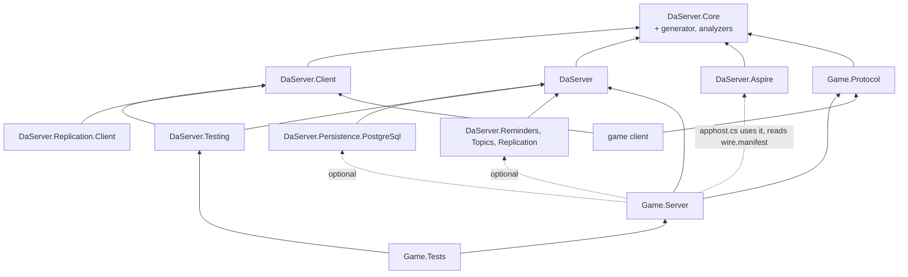

# Target architecture (draft, not implemented)

The architecture DaServer is refactored to (breaking, roadmap phase W): the v61 programming model of
[programming-model.md](programming-model.md) on EasyEcs 4.7 (the draft's header lists the features it uses), with Native AOT support. The programming model draft is
the source of truth for what users write and what each rule means; this file says how the pieces fit together, holds the runtime's internal data and the client protocol's
internals, and links to the draft's sections instead of repeating them. Today's architecture is [design.md](../design.md); the
decisions are ADR-082 to ADR-092 in [decisions.md](../decisions.md). When W is done, this file and the draft are
promoted into design.md and decisions.md and deleted (W10).

## 1. Layers and projects

### Framework packages

Six packages. A package exists when something references it without the others: a game client takes no server, a
node takes no AppHost code, production takes no test tools, and a capability is off unless referenced (ADR-045).

| Package | Targets | Holds |
|---|---|---|
| `DaServer.Core` | netstandard2.1, net10.0 | What both sides see: the client-facing contracts (`IFromClient`, `IFromClient<R>`, `IToClient`, `[To]`, `[Once]`, `[Latest]`, `IServer`, `TypeId<T>`, status codes) and the wire and transport (frames, buffers, channels, the pending-call table). Ships the generators, the analyzers and the `wire.manifest` task (below). |
| `DaServer.Client` | netstandard2.1, net10.0 | The client SDK: connect, send `IFromClient`, receive `IToClient`, slots and re-joining, moving on `Retire` ([draft §7](programming-model.md#7-客户端与-presence)). |
| `DaServer` | net11.0 | The server: the model (`IActor<T>`, `[Handles<K>]`, `[On<T>]`, `IMessageTo<K>`, `IRequestTo<K,R>`, `[From<K>]`, `IEvent`, `IClaims`, `IConfigTable<T>`, `IWorldSingleton<T>`, `[Persist]`, `[NotSaved]`, `Entity` operations, `Connection`), the framework systems, cluster, placement, persistence, migration, hot restart, and the node host: Generic Host and ASP.NET Core, configuration, OpenTelemetry, shutdown, the HTTP plane (service managers are .NET's own `UseSystemd()` and `UseWindowsService()`; launchd needs only its plist, [deployment.md section 0](deployment.md#0-launch-flows)). |
| `DaServer.Persistence.PostgreSql` | net11.0 | The reference store provider (`IStore`, section 4) for PostgreSQL and its wire family; Redis/Valkey and MongoDB providers follow as packages of their own (roadmap W6). |
| `DaServer.Testing` | net11.0 | `TestActor<K>` (one actor, one world, DaServer's manual clock, ADR-071), `TestCluster` (in-process nodes) and simulated users (`Swarm`, HTN behaviors) over `DaServer.Client` for load tests and E2E. |
| `DaServer.Aspire` | net11.0 | AppHost side: `AddDaServerCluster`, `AddNodes<TServer>` (a `DaServerNodeGroup<TServer>`), `WithActorStore`, `WithClientConnections(port)` on a node group, `WithClientEndpoints(gateways)` for a client app, the `{cluster}-restart` command, and a generator that writes the server types from the committed `wire.manifest` of the `#:project` (`actor` and `hosted-by` lines), each bound to that project. References no server assembly. |

### Optional capability packages

Each is off unless referenced and lives in its own namespace; the runtime references none of them (ADR-045, ADR-090; design in [draft §15](programming-model.md#15-扩展能力可选包)).

| Package | Targets | Holds |
|---|---|---|
| `DaServer.Reminders` | net11.0 | `Reminder<T>`, `Reminded<T>`, `root.Remind<T>`; reminders are persistent entities whose next firing is the runtime's `WakeAt`; the runtime's `ArmSystem` arms their `Due`, the package only handles the firing |
| `DaServer.Topics` | net11.0 | The `Topic` actor type, `ITopicMessage`, `Subscribe`/`Unsubscribe`/`Publish` on `Entity` (each a one-way package message to the Topic without `[From<…>]`; `Publish` carries the payload's type id and bytes, which the Topic never decodes), the one-way `NotSubscribed(ActorId, ActivationStamp) : IMessageTo<Topic>` (an ordinary package message, not control mail), the subscriber-side `Subscription` buffer and the system renewing it every `DaServer:Topics:RenewInterval`; table changes ride the normal checkpoint, the receiving node drops a delivery whose topic is not in the subscriber root's `Subscription` buffer and sends the Topic, from the subscriber's shard, a one-way `NotSubscribed` echoing the `(ActorId, ActivationStamp)` the delivery frame carried (dropped under `Busy`, it is sent again at the next publish), which the Topic deletes only when that stamp equals its table's (the subscriber activation's stamp, section 4's activation, defined for every actor type); delivery is at most once, a lost or reordered subscription message costs at most one renew interval of missed publishes, and once unsubscribed no handler runs for a later delivery and the Topic stops sending at the next publish |
| `DaServer.Replication` | net11.0 | `[Replicated]`, `ReplicatedTo`, the per-type replication systems with generated field bitmasks; its own state: `Replica<T>` (last sent value and the world's `ChangeTick` it was sent at), a bounded ring of exits per group, an incarnation per actor (renewed on activation from the record, migration arrival, hot-restart load and a reload after a throw, so the stamps compare only within one; a renewal clears the actor's exit rings and zeroes its `Replica<T>` stamps) |
| `DaServer.Replication.Client` | net10.0 | Applies replication patches into a client's EasyEcs world (EasyEcs ships `net10.0` only: Godot 4 .NET games and .NET bots; Unity waits for an EasyEcs netstandard2.1 build) |
| `@daserver/client` (npm) | TypeScript | The client SDK over WebSocket, per the published client protocol; message classes and codecs generated by Nino.TypeScript from `Game.Protocol`'s build (no DaServer generator); replication patches into an entity table |

Targets, one rule: code both sides load targets `net10.0`, plus netstandard2.1 where nothing needs EasyEcs
(`DaServer.Core`, `DaServer.Client`, users' `Game.Protocol` and `Game.Shared`; `DaServer.Replication.Client`, which
writes into an EasyEcs world, is `net10.0` only), and the server core (`DaServer`,
`DaServer.Persistence.PostgreSql`, `DaServer.Testing`, `DaServer.Aspire`, the optional server packages, `Game.Server`)
targets `net11.0` only, where runtime async and the other .NET 11 features live. `net10.0` is for the first client
engine, Godot 4 .NET, whose game projects target `net10.0` (EasyEcs's own guidance) and cannot load a `net11.0`
assembly; a server loads the same `net10.0` build. netstandard2.1 leaves the door open for Unity, which is future work
(ADR-086, roadmap W2).

`DaServer.Templates` is a `dotnet new` template package (`daserver`, `daserver-mmo`, `daserver-flashsale`, `daserver-arena`, `daserver-relay`), generated from the samples; nothing references it (ADR-091).

`DaServer.Generator` (netstandard2.0) is not a package of its own: it is built twice (Roslyn 5.x and 4.3, Unity's
oldest) into `DaServer.Core`'s `analyzers/` folder, so every project using DaServer gets it. It holds the generators
(explicit `Key`, typed sends and reply accessors, `[On<T>]` jobs, `Registration`, `wire.manifest`), the analyzers
([draft §13](programming-model.md#13-编译期检查)). `DaServer.WireTool` ships in the same `analyzers/`-side tools folder
and stays out of process: `-p:UpdateWireManifest=true` runs it with `dotnet exec` after the build (one section per
project, [draft §10](programming-model.md#10-持久化迁移热重启升级)); an in-process MSBuild task would need a second build
for Visual Studio's .NET Framework MSBuild and would load `Microsoft.CodeAnalysis` into the MSBuild node, where its
version conflicts. It reads the built assembly and builds one `Registration` to read prefab compositions, which only
run time knows.

Merged away: `DaServer.Abstractions` into `DaServer.Core` (both are referenced by every client and every server; the
analyzer, not a package boundary, keeps server types out of `Game.Protocol`), `DaServer.Hosting` into `DaServer` (a
node always runs both; `TestCluster` simply starts no HTTP), `DaServer.Simulation` into `DaServer.Testing` (both are
test tools); `DaServer.WireTool` is no package of its own, it ships inside `DaServer.Core` beside the generator (ADR-086).

### User projects

| Project | Targets | Holds | Code changes |
|---|---|---|---|
| `Game.Protocol` | netstandard2.1, net10.0 | Client messages only: data, no actor types, no addresses, no nodes | Shipped to clients |
| `Game.Shared` | netstandard2.1, net10.0 | Rules both sides run (movement checks, formulas), plain code over `Game.Protocol`'s types | Shipped to clients |
| `Game.Server` | net11.0 | Actor types, server-to-server messages, events, components, the `IClaims` type, prefabs, server types (several per project), `[Handles<K>]` classes of `[On<T>]` methods, `[UpdateInGroup<K>]` systems, the generated `Registration`, the node's `Program.cs` (about five lines), and `apphost.cs`, the deployment | Hot restart or rolling upgrade, JIT and AOT alike (section 5) |

- **One project may define several server types** (`[Hosts<Map>] public readonly struct MapServer : IServer`); **a
  node is one process running one server type** ([draft §2](programming-model.md#2-服务器与节点)). The AppHost picks the
  type per node group (`AddNodes<MapServer>("map", replicas: 4)`); a small deployment declares an `AllInOne` type.
- **The AppHost is `Game.Server/apphost.cs`**, an Aspire file-based AppHost; group names, the store and the ports per
  group are its business ([draft §2](programming-model.md#2-服务器与节点)), the launch flows per environment are
  [deployment.md section 0](deployment.md#0-launch-flows).
- A node sizes its own thread count from the CPUs it is given (section 2); nobody writes it.
- `[Hosts<Connection>]` is "accepts clients": the gateway is a server type hosting the built-in `Connection` actor type.

### Dependency directions

An arrow reads "references". Dotted: no assembly reference.



- Everything points one way: `DaServer` never references a capability, a sample or a user project; `DaServer.Core`
  references only Nino; `DaServer.Client` never references `DaServer`.
- `Game.Protocol` references only `DaServer.Core`: the analyzer refuses actor types, server messages, `ActorId`,
  `PresenceId` and `EntityId` there, and server-only APIs are not in `DaServer.Core` to begin with.
- `apphost.cs` takes `DaServer.Aspire` by `#:package` and `Game.Server`'s project metadata by `#:project`, and the
  generator reads that project's `wire.manifest`; no server assembly is referenced. `DaServer.Aspire` references
  `DaServer.Core`: the generated server types implement `IServer`.

## 2. Runtime structure

Users see four words: **server type** (`MapServer`), **node** (a process running one server type), **actor**
(`Map(7)`: its root entity and all its descendants) and **entity/component** (EasyEcs's own). A node's threads are
the framework's business; inside DaServer one thread with its EasyEcs world is a **shard**, a word that appears in no
public API, attribute, configuration key or AppHost call.

| Level | What it is | Owns |
|---|---|---|
| Node | One process, one server type, a node generation it picks when it joins the membership table ([draft §2](programming-model.md#2-服务器与节点)) | Links, membership (its view of the table), placement view, its shards, the HTTP plane, `DueScan`, and the node state (`StoreDegraded`, `ActivationSlots`, `PeerHealth`, `RestartingNodes`) as one immutable snapshot swapped atomically |
| Shard (internal) | One thread and one EasyEcs world; the actor types the server hosts share it; an actor lands on a shard by its key's hash. A node runs one shard per CPU it is given (the container's CPU request, `DaServer:Worlds` overrides) | The dispatch queue, the framework systems, singletons (`Time`, `Ordered<K>`, `Current`, `Outbox`) and its copies of the node singletons, the due heap, the chain stack, the call index |
| Actor | Its root entity (carrying the actor type component, e.g. `Map(7)`) and the root's descendants | Its mail, its `Due` items, its presences, its waiting asks |
| Entity | A root, an avatar, a presence, a waiting ask, a scheduled event | Components; `In<K>` on every entity of a K actor; `Persisted` on every persistent one |

- **Parallelism**: many actors per shard, many shards per node, many nodes. Inside an actor the ordered phase is
  serial. Each world sets `WorldOptions.MaxDegreeOfParallelism` = node cores / node shards, at least 1 (EasyEcs D36:
  the budget is per world); with the default of one shard per core that is 1, so `[ForEach(Parallel = true)]` takes
  effect only when a server type runs fewer worlds than cores (`DaServer:Worlds`, e.g. one huge map per node).
- **Node singletons**: node-level state that user code may read (`RestartingNodes`) or the runtime consults (`StoreDegraded`, `ActivationSlots`, `PeerHealth`) is one immutable snapshot the node swaps atomically. Each world holds its own copy as a world singleton, refreshed from the snapshot at the start of each batch and tick, so world threads read it without locks and an item sees one value throughout.
- **Node-wide limits are per-world shares**: a stale snapshot cannot hold a counter, so the two node-wide budgets
  (`ActivationSlots`' concurrent epoch claims and `PeerHealth`'s in-flight requests per destination node) are split into
  shares, one per world, recomputed at each refresh from the node's limit and the world's recent use. A share never
  drops below what the world already has in flight (only the remainder is handed out), and when the worlds outnumber
  the limit some get 0, the non-zero shares rotating among the worlds with demand at each refresh; so the shares
  always sum to at most the limit. A share is recomputed only from what the worlds have reported releasing at the
  refresh (each world publishes its in-flight count then), never from an older published count, so the sum of what is
  really in flight cannot pass the limit between refreshes. A world spends only its own share, a plain field on its thread. The node never
  overshoots its limit and no counter is contended; the cost is that a burst on one world waits for the next refresh
  before it borrows another world's unused share.
- **The dispatch queue** is the only cross-thread handoff: IO threads and other shards post frames to it; the shard
  thread moves them into each actor's mailbox. **Admission is per actor**: a mailbox holds at most
  `[ActorOptions(MaxMail, MaxMailBytes)]` (4,096 items, 4 MiB by default), and past it only that actor refuses
  (`Busy`, one-way mail dropped and counted; actors' `[Once]` requests are exempt, bounded instead by `OnceWindow` per
  sender and the receiver's `Unacked` total, which counts the `[Once]` items already in the mailbox at admission so a
  request past it gets `WindowFull` there, so a full mailbox never refuses the request that settles another root's
  ask), so a hot actor (a world boss, a flash-sale stock shard) never makes its
  neighbours on the shard answer `Busy`; the dispatch queue's own bound (`DaServer:DispatchQueueCapacity`) is the
  node's memory guard behind it (Akka bounds mailboxes per actor, Orleans caps queued requests per grain). Room is
  kept for answers and presence notices: an answer's room is reserved in bytes at both ends (the receiver reserves its
  outbound link window when it admits the request, the asker its dispatch queue when it asks; section 3), and
  presence notices are bounded by the join rate; both travel in the pair's order like any mail (section 3's links;
  [draft §11](programming-model.md#11-失败时的结果)).

### Terms

The draft uses these before or apart from the section that defines them:
- **Subject**: the entity a message or event acts on; a handler's component parameters bind to it ([draft §5](programming-model.md#5-逻辑)).
- **Ordered phase** (`OrderedPhase`): the framework system that runs, at the start of each tick, the mail and due items one by one by `(time, seq)`.
- **Immediate chain**: `Schedule` without `after` inside an item, run right after the item; a value on the world's chain stack, not an entity. Outside an item (in a system) `Schedule(ev)` is `Schedule(ev, after: TimeSpan.Zero)`: a `Due` child at `Time.Elapsed`, run in the next ordered phase ([draft §9](programming-model.md#9-时间与广播)).
- **`Due`**: an instant; delayed events, request deadlines and join confirmation deadlines are entities with a `Due`, ordered by the runtime's heap.
- **`Outbox`**: what an item sends, serialized on append into pooled frames per destination and handed to the links after each ordered phase and once at the end of the loop iteration.
- **Epoch**: the number an activation of a persisted type claims, per key; with the owner's node name and generation and the activation's count it is the activation's fencing token, which every record write compares, so only one activation of an actor writes.
- **Activation stamp**: `(placement version, node generation, activation count)`, which every activation has, saved or not, and every later activation of the key exceeds; `[Latest]` and topic subscriptions compare it (section 4's activation).
- **Placeholder**: the root entity of an actor not yet active or being saved; mail waits on it.
- **Settling**: step c of a tick: `Depart`, `SyncSubscriptions`, and removing `Restarting` and `Resumed`.
- **Tick-end write**: at the end of every tick (actor types without `[TickRate]`: after every mail batch) a world writes the roots due for a write asynchronously as one batch of the store contract: one guarded write per root (its record and its rows, atomic per root, nothing across roots), one batch per 512 roots or `DaServer:Store:BatchBytes` of records, at most `DaServer:Store:WritesInFlight` batches in flight, a write that ends `Unknown` confirmed durable before anything it held is released ([draft §10](programming-model.md#默认异步成批地写); its runtime data below; the contract in section 4).
- **Held output**, **write generation**: the only output that waits for a record is what an item that called `root.Commit()` sends; it carries the generation of the root's write that holds the item, leaves when that write is durable (`Landed`, or found by `Confirm`: Tick-end write in section 2), and holds back the root's later output to the same destination actor; a held group push is appended to its group's frame only on release, so it orders against other items' group pushes by release (the one exception besides migration); held output is bounded per root and per world (`Busy` beyond); the actor keeps running meanwhile ([draft §8](programming-model.md#贵重的改动rootcommit)).
- **Connection stamp**, **`Retire`**: section 3.
- **Node singleton**: above.

### The shard loop

```text
loop on the shard's thread:
    wait for frames in the dispatch queue, the next due tick, or the due heap's head
    if the volatile frozen flag is set, or the lease clock has passed the published lease deadline (the node is Dead,
            isolated or restarting): run nothing (the world is frozen); drain nothing either, except in a hot
            restart's short freeze, whose IO keeps receiving (an isolation freeze keeps mail in the bounded dispatch
            queue, so a full queue answers Busy rather than growing mailboxes)
    unless the world's write backlog is past DaServer:Store:BacklogPause (then the queue fills and answers Busy):
    drain the dispatch queue (one bounded batch) into the actors' mailboxes, each bounded by MaxMail/MaxMailBytes
        (a full mailbox refuses that actor's mail only), split by actor type,
        at most a budget of items per actor (the rest waits in its mailbox for the next batch, still by (time, seq));
        a message's time is its arrival, stamped when the link reads the frame, so mail drained after a freeze
        still sorts by when it came, ahead of answers and events that came later
    for each actor type K without [TickRate] that has mail or due items, or whose quiet pass is due
            (every DaServer:QuietPass, 1 s, so that time-gated systems run in an idle world; the chain stack is empty between items):
        write Time         K's Tick, TickRate and DeltaTime (all 0 here) from Ordered<K>; Elapsed = the pass start (now), Utc;
                               Elapsed and Utc again per item
        Ordering<K>        OrderedPhase: chain stack, due heap (At <= now) and mailbox merged by (time, seq)
        hand Outbox frames to the links (output held by Commit stays, tagged with its write generation),
            after checking the lease deadline again: frames of a pass the lease ran out in stay in the Outbox
        write Time         Elapsed back to the pass start, Utc read once
        world.Update<K>()  K's systems, Time.DeltaTime 0
        Settling<K>        Depart, SyncSubscriptions, Restarting and Resumed removed
    for each actor type K with [TickRate], for each of its due ticks t, oldest first, at most the catch-up cap:
        write Time         K's Tick (advanced in Ordered<K>), TickRate, DeltaTime, Elapsed = t, Utc
        Ordering<K>        the window (t - Δ, t]
        hand Outbox frames to the links
        write Time         Elapsed back to t, Utc read once
        world.Update<K>()
        Settling<K>
    write Time           Utc and Elapsed; Tick, TickRate and DeltaTime keep the last pass's values, which Cleanup does not read
    Cleanup              per world: ReleaseRoutes, the Persisted cleanup, WakeSystem, then CheckpointSystem (collects
                               the ids of WriteNow roots first and of Unsaved roots whose staggered checkpoint instant has
                               passed, oldest unsaved first, keeping at least a quarter of each round's rows for checkpoint
                               roots when both wait, skipping roots with a write in flight, as many as the free batches
                               hold, and clears their flags; it saves nothing: World.Save throws inside a pass)
    StoreWrite           per world, outside world.Update: Descendants and SaveEntitiesWith for each collected root and each
                               deactivation (a framework job only marks them), then the tick-end write goes out when it
                               holds any record: one guarded write per root (record and rows), batched per 512 roots or
                               DaServer:Store:BatchBytes of records, keys sorted, at most DaServer:Store:WritesInFlight
                               batches in flight; held output is released as its roots land
    hand Outbox frames to the links
```

- **Time-gated systems**: EasyEcs's `UpdateInterval` counts group updates, not time (`update % interval`), and an actor
  type without `[TickRate]` updates once per mail batch, irregularly and never while idle. A system that must run every
  N seconds there declares `[EverySeconds(n)]`: the runtime skips it until `Time.Elapsed` passes its next instant, and the
  world's quiet pass (above) guarantees an update at least every `DaServer:QuietPass`. `UpdateInterval` keeps EasyEcs's
  meaning and is for ticking types, where updates are regular.
- Ordering state (tick number, sequence counter, tick window, chain budget) is per actor type, the singleton `Ordered<K>`.
  `Time` is one world singleton, so the runtime writes it at the start of each actor type's pass: actor types with
  different tick rates share a world, and each pass sees its own type's `Tick`, `TickRate` and `DeltaTime`
  ([draft §9](programming-model.md#时间)); before `Cleanup` it writes only `Utc` and `Elapsed`, the values the per-world
  Cleanup systems read.
- `WriteNow` is set only by `root.Commit()` (and `root.IssueClientToken`, which commits), in handlers and systems
  alike, so an item of a system rides the same tick's write ([draft §8](programming-model.md#贵重的改动rootcommit)).
- **Fixed step with a catch-up cap** (EasyEcs's pattern, `guide/hosting.mdx` "A fixed step that catches up", applied per actor type): a shard that fell behind (a long tick, a GC pause)
  runs the missed ticks one by one, each with the same `Δ`, but at most a few per wake (node configuration); past the
  cap it skips the rest and moves its tick clock on, counted in `daserver.ticks.skipped`. Items keep their exact
  times, so a skipped tick shifts no order, it only widens the next window.
- **Memory after a peak**: `world.TrimExcess()` runs only explicitly and only from the shard loop between two
  `world.Update` calls, never inside a pass or a system (EasyEcs 4.7: "owner thread only, not during a pass or inside a
  parallel stage"; it also drops tables from cached queries): the loop checks every few minutes whether the world's rows
  have dropped well below their peak (after a scale-in or migrations out), and the admin command
  `POST /admin/worlds/{i}/trim` asks the loop to do it at its next gap; never on a hot path.
- Server types hosting several ticking actor types keep rates that divide the fastest one.
- Before a hot restart (the member is `NodeRestarting`) the runtime adds the `Restarting` tag to every root for the
  last tick (Settling removes it in that tick, so no handover carries it) and then stops calling the loop; after the load and the cleared `restart_until`
  every root carries `Resumed(Pause, Aborted)` for one tick ([draft §10](programming-model.md#热重启)).

### Runtime data

The draft names what users touch; everything below is internal and shows up in diagnostics and metrics (names as
exported, OpenTelemetry). Names users never write but meet in diagnostics: the SDK's slot numbers, `Ready`,
`JoinConfirmed(slot, call id)`, `PresenceClosed(slot)`, `PresenceLost(slot)`, `HandedOff(slot)`, `Superseded`,
`Unavailable(retryAfter)`; the runtime's `Mail`, `Unsaved` and the rows below.

| Data | Kind | Role | Metric |
|---|---|---|---|
| `Due(TimeSpan At, long Seq)` | component | Delayed events, request deadlines, armed `WakeAt` instants, join confirmation deadlines, a `Detached` presence's grace, join-on-connect back-off: one timer mechanism ([draft §9](programming-model.md#9-时间与广播)). Carried by migrations and hot-restart handovers, not in records (live only) | — |
| Live-only components | components | `Due`, `Presence`, `Joined`, `Detached`, `Leaving`, `Subscribed`, `Route`, `GroupRate` (the root's send rates, set by `SetGroupRate`; the root copy of a ticking actor type carries the empty buffer, and `Join()` adds an empty `Subscribed` buffer, so `SetGroupRate` and `SetGroups` are not structural changes): meaningful only in memory, so they migrate and are handed over but never go into records | — |
| `FromPrefab(int Prefab, int Composition)` | component | On every entity spawned from a registered prefab copy, persistent or not, the root included: the prefab's id and the hash of its component set, both from `wire.manifest`. On every load (record, migration bytes, hot-restart handover) the runtime adds the copy's `[NotSaved]` components the entity lacks and the components the prefab gained since `Composition` (known from the earlier compositions the manifest keeps; components removed at run time are not added back), then updates `Composition`, tagging the root `Unsaved` when it added persisted ones ([draft §10](programming-model.md#恢复)) | `daserver.records.unknown_types` |
| `Persisted(EntityId Root)` | cleanup component | On every persistent entity (from a persistent prefab's registered copy; the root's points at itself): `ChangeSystem` filters by it, the record collects it, and destroying a persistent descendant tags its root `Unsaved` ([draft §10](programming-model.md#要保存的是实体不是组件类型)). An entity never moves under another actor's root: the tags, `Persisted.Root` and the record all follow the subtree, so the record collector treats a descendant whose `Persisted.Root` names another root as a fault (that root's write is `RecordUnwritable`, logged); to change roots, spawn a new entity under the new root | — |
| `Deactivating` | tag on the root, declared `ITracked` | The last pass before a deactivation; declared `ITracked` because EasyEcs's `RemovedAttribute<T>` requires it, so `[Removed<Deactivating>]` sees a cancelled idle deactivation (`DaServer.Topics` re-subscribes there, [draft §15](programming-model.md#15-扩展能力可选包)) | |
| `Deleting` | tag on the root and on every entity of its subtree (spawns under a tagged root inherit it), persisted with the record, with a framework `WakeAt` | Set by `root.Delete()` (`Ok`; `Outstanding` while the root owns any ask row, `OnceAsks` below, in any state); a one-way passage: `IActor<T>` declares `ISystemGroupWithout<Deleting>`, so no system, reminder or `[ForEach]` of the type runs on the root or any descendant, and a Deleting actor never sends from a system; new requests get `Busy` (not stored), one-way mail is dropped and counted, only `[Once]` repeats are answered from `Unacked`; asking or sending after `Delete()` in the same item is a build error on the paths the analyzer sees (DAS033) and, on the paths it cannot see, a runtime error that reloads the item (counted in `daserver.delete.send_after`, alerted when it repeats, since a reloaded `Replied` item is delivered again). Its own pending ordinary `Ask`s are cancelled (their late answers are dropped as having no waiting entity); callers holding a `ReplyTo` token from it are not answered and time out (their requests ran, so no status saying they did not is sent). `NextDue` on a Deleting root counts only the delete `WakeAt`. The rebalancer skips it, a freeze writes it, and its `WakeAt` makes `DueScan` load it after a crash or idle unload to continue; the tombstone write (section 4) goes once the tag's write landed, `Unacked` is empty, the root owns no ask row and `MaxAskTimeout + 2 × ClockSkew` has passed since the later of that write and the last `[Once]` admission. Cost: one tag per descendant, written once | `daserver.actors.deleting`, `daserver.messages.dropped{reason=deleting}`, `daserver.delete.send_after` |
| `Pending` | component on the root | Pending delayed events and waiting asks (the `MaxPending` count); idle deactivation considers only roots where it is zero ([draft §6](programming-model.md#6-生命周期)) | `daserver.actors.pending` |
| Tick-end write | runtime value per world | The records taken this tick (`WriteNow` roots first, then checkpoint and deactivation ones), sent as one batch of the store contract (section 4): per root one guarded write, its record put compared on the version of its last landed write or claim, its row changes (ask rows, queued-index entries, `OnceSenders` rows) as dependents applied only with it; a root's new index entries (its due entry when its `NextDue` bucket changed, its ask-census entry when it gained its first ask row) go ahead of it in the batch, and halving a batch keeps index entries with their root. At most `DaServer:Store:WritesInFlight` batches per world in flight (default 2), never two writes for one root; roots beyond wait with their tags for the next round ([draft §10](programming-model.md#默认异步成批地写)). Batches split between roots at 512 roots and `DaServer:Store:BatchBytes` (8 MiB) of records; a root's guarded write is never split, however many rows changed (the provider applies a large one in as many statements or messages as it needs inside its atomic unit; test `LargeRootWriteStaysAtomic`); keys sorted, so racing writers lock in one order; a record above `DaServer:Store:MaxRecordBytes` (4 MiB, or the provider's lower `MaxValueBytes`) is unwritable. **Outcomes come back per root** and the runtime acts on their class, never on a store's error codes: `Landed` releases the root's held output up to its generation; `NotApplied` showing any other stored version (another fencing token, or the key absent) fences the actor and discards its held output; showing this activation's token with a generation below the last landed one means the store went back (one process never overlaps two writes of a root, and a provider rereads a race before it answers, so nothing else stores an older version of its own): the root is fenced and reloaded, never written again over the older state, and the finding is logged (`StoreRegression`: the root, the generations missing) and counted in `daserver.store.regressions` (test `OwnOlderVersionFencedAndCounted`); it is seen only by a root that writes again, so it reports what it meets and promises no detection (section 4's durability classes); `AlreadyLanded` (a retry finds its own version stored) and `Unknown` (the request may have been applied: a lost connection, a cut durability wait) release nothing until `Confirm` (below); `StoreLevel` (nothing applied) retries the same bytes and generation with a backoff (1 s doubling to 1 min, the slot released between attempts); `RowDeterministic` (this root's payload fails whatever the time) and the client-side failures (`SaveEntitiesWith` throws, a record above the cap) take the `RecordUnwritable` path: the root keeps its last record, is retried alone each interval outside the world's slots (at most `WritesInFlight` solo retries per world, so after an outage they never crowd claims and page-ins out), is never re-batched, and a solo retry failing the same way keeps it unwritable (tests `SingleRootWriteRuledUnwritable`, `UnwritableAloneRetryStaysUnwritable`); if a batch of at least 8 roots has more than a quarter of them `RowDeterministic`, the store is treated as failing instead: none is ruled unwritable and all retry as `StoreLevel`. A root ruled unwritable is counted in `daserver.store.unwritable_roots` and left out of `daserver.store.oldest_unsaved_age`, so one oversized record never reads as a store that stopped taking writes. Deadlines, cancellation, statement sizes and error codes are the provider's (the PostgreSQL provider's in section 4); the runtime sets no deadline that could cut a durability wait. **Durability, not visibility, releases**: a write that ended `Unknown` or `AlreadyLanded` releases only after `Confirm` of the record key (the provider's call: what it returns is at the store's durability point) shows the version of generation g; then held output up to g leaves. `Confirm` showing any other version (another token, or the key absent) fences the root; showing exactly the last landed version (the one write g was compared on) means write g never landed, and it is sent again (the same bytes and row changes); showing this activation's token with a generation below that is a regression, handled as above; a `Confirm` that ends `Unknown` is repeated, and a read alone never releases. Output tagged above g (items that ran while write g was in doubt) waits for the next record write (tests `UnknownReleasesOnlyAfterConfirm`, `RetriedWriteConfirmedBeforeRelease`, `ConfirmFindsWriteAbsentResends`, `ConfirmNeverReleasesLaterItems`). While the store takes no writes but answers membership reads (a provider waiting for its replicas, a locked table, a full disk), writes keep their slots and wait, membership reads answer on their own client (section 4), the lease renews and `DaServerStoreWritesBehind` fires | `daserver.store.writes_waiting`, `daserver.store.oldest_unsaved_age`, `daserver.store.unwritable_roots`, `daserver.store.regressions` (not alerted) |
| `Writing`, `WriteNow`, write generation | fields of `RootState`, a framework component every root carries from its prefab copy | Fields, not tags, so setting them is no structural change (`Commit` stays inside `INoStructuralChanges` jobs). `Writing`: a record write of the root, its `Confirm`, or a page-in of one of its ask destinations (count and head read), is in flight; `CheckpointSystem` skips the root, so one process never overlaps two writes; changes meanwhile keep or regain `Unsaved` and go in the next write, which carries the latest state. The record's version is its fencing token and write generation, `(epoch, owner name, owner generation, activation count, write generation)`; every write compares the stored version with the one of the root's last landed write or claim (the write generation reset to 0 by every claim, continued across a hot restart's handover), so a late write never overwrites newer state, and two activations never write the same version, even after a store rollback hands an epoch out twice to the same node ([draft §10](programming-model.md#激活-epoch一个-actor-只有一个激活能写)). `WriteNow`: the root called `Commit` (in a handler or a system), so the next tick-end write takes it whatever the checkpoint interval; a `Commit` with nothing unwritten writes nothing and releases at once. The write generation counts the root's records taken; held output carries the generation of the record write its item's state goes into (the root's next record write when the item ran) and leaves once a record write of that generation or later is durable: `Landed`, or shown by `Confirm` (Tick-end write above; [draft §8](programming-model.md#贵重的改动rootcommit)) | `daserver.commits.held`, `daserver.commits.held_bytes`, `daserver.commits.latency` |
| `OnceNext` | field of `RootState` (persisted) | The sender's `[Once]` sequence, a pair `(seed: long, counter: uint)` compared seed first: monotonic, never reused, taken by an ask only in the write that sends it (`OnceAsks` below), so a sequence never belongs to an ask not yet durably sent, and a crash, a migration or a handover continues it; an incarnation's seed is set by the claim that creates it: the larger of the store's clock in milliseconds at that claim and the tombstone's seed plus one (section 4), and its counter starts at 0, so a destroyed and recreated actor's numbers are above every number its earlier incarnation used (within the tombstone's horizon the tombstone carries the old seed; past it the old seed is older than the horizon, far more than the clocks may disagree), with no shift to overflow; an alert at 2^24 counters left, and the root stops sending `[Once]` when the counter runs out ([draft §8](programming-model.md#去重订单是自己的-actor转移价值的那一步是-once)) | `daserver.once.counter_low` |
| `OnceAsks` | store rows of their own under the root's key (`…|a|ordinal`, section 4), one per `AskUntilAnswered` ask, in any state; **not** in the record, nor in migration or handover bytes (the move's and the freeze's last write carries every unwritten ask-row change of the root, as it does `OnceSenders` changes; the target reads the rows after its claim lands). An active root holds in memory every `sent` row's metadata (the in-flight asks, so its acknowledgement to each receiver is exact even after `OnceInFlight` is lowered; test `LoweringOnceInFlightNeverAcksEarly`) and, **per destination**, a bounded head of queued rows (`DaServer:Once:QueuedHeadPerTarget`, 64) for up to `DaServer:Once:TargetsInMemory` destinations (256), served round-robin. While destinations not held wait, a held destination gives up its in-memory head (its rows stay in the store) once it has nothing sendable (in backoff, facing a zero window, or its rows waiting only on the root's `OnceInFlight`) or has used its quantum, `QueuedHeadPerTarget` sends since it was paged in, so busy healthy destinations cannot keep the slots for ever. Destinations not held are paged in **round-robin by a target cursor**: a walk over the root's queued-index keys (`…|q|target|ordinal`, one empty key per queued row, written with the row), each step a `Scan` for the first key whose target is after the last one paged in, wrapping to the start at the end and stepping over a target already held (each step one short scan), so every destination with queued rows comes back in turn and one that yielded goes to the back of the rotation; rows within a destination are paged by ordinal through the same keys. A queued row's `next_try_at` matters only while its destination is held. The bound that holds: a slow or stuck destination holds at most `OnceWindow` (16) of the root's `OnceInFlight` slots (its sent rows keep their sequences and never go back to queued), so healthy destinations keep sending while fewer than `OnceInFlight / OnceWindow` (64 with the defaults) destinations are stuck; past that new first sends wait for a slot, nothing is lost and `DaServerOnceAskOld` alerts; and a destination not held waits at most one rotation of the cursor, each held destination sending at most one quantum before it yields (tests `AskRowsPagedPerTarget`, `SlowTargetNeverHoldsOthers`, `ManyTargetsPastMemoryAllProgress`, `StuckTargetsBoundedByWindow`). The root's queued totals live in `RootState` (persisted, written in the same guarded write as the row changes): `QueuedRows`, `QueuedBytes` and, for each destination it holds, that destination's total queued rows in the store (counted at page-in by a keys-only scan of that target's queued-index keys, at most `OnceQueued` of them, kept with its head and updated with the row changes after; a page-in takes the root's `Writing` slot as a write does, so no write starts or lands while its count and head read are on their way, and the root's queued rows to that target not yet landed are attached to its head and added to that count, so the count never misses an ask whose insert is still in flight nor counts one twice; the root's next write waits for at most that one scan, page-ins and writes alternate, so a root that commits every tick still pages destinations in (test `PageInProgressesUnderCommitEveryTick`); never only the rows read into memory, which would let a head of 64 drained to 0 insert a new ask already sent ahead of the rows still in the store; test `PagedInCountIsTotal`) (a destination it does not hold counts as having some only while `QueuedRows` exceeds the sum of the held destinations' counts, so a root with no paged-out rows inserts a first ask to a new target already sent), so admission and `daserver.once.queued_full` are exact after an unload, a crash or a move (test `QueuedTotalsSurviveReload`), and memory stays bounded however far the store's rows grow (E3). A row's request and state bytes stay in memory until the write inserting it lands; a sent row keeps only its metadata, and each re-ask round re-reads the bytes of the rows it re-sends with the same read-ahead range read that serves first sends, each read bounded by bytes (`BatchBytes`) and a destination's round spread over as many reads as it needs, so sent rows cost metadata only (E3); a destination's next rows to send are read ahead in one range read (a crash between that read and their write is harmless: the bytes never change and only the owning root changes its rows). The activation's range read after the claim reads the sent rows and the queued heads only | Owner, a local ordinal (`RootState.AskOrdinal`, the order of the calls), phase (`queued`, `sent`, `stopped`), the sequence pair (NULL while queued), target, the asking entity (by its identity in the record, its unique key or its place in the saved tree remapped through `LoadEntitiesInto`, never a raw entity id, which EasyEcs reuses), the request bytes and the ask's own state (`ask_state`, the `state` argument of the call, NULL without one; its type follows the persisted-component layout rules and has a `state` line in the manifest) with that state's type (`state_type`, its `NinoTypeId`, so a reload knows which `Replied<TReq, TState>` handler gets the answer; a type the build does not know is not delivered here: the row stays `sent` and unanswered (the answer is not acknowledged, so the receiver keeps it and a node of a build that knows the type delivers it after the next move or restart), counted in `daserver.once.unknown_state` and alerted by `DaServerOnceUnknownState`; the upgrade check compares the manifest's `state` lines in both directions: a release whose state types an older build cannot read is not rollback-safe, and a state type is removed in two releases, one that stops creating it (the check then sees no new rows of it) and a later one that removes it, refused while the check still sees rows of it; a rollback past the build that added a type, or a removal that skipped the first step, meets rows no running build knows, which is the case `DaServerOnceUnknownState` reports, and its remedy is to re-release a build that knows the type until those rows are answered), together at most `DaServer:Once:MaxRequestBytes` (1 MiB, checked at the call: a larger one throws in the calling item), `created_at`, `next_try_at` (by phase: a queued row that may be sent now, now; one waiting on a window, `ZeroWindowProbe` or the receiver's `RetryAfter`; a sent one, its re-ask time; a stopped one, NULL, so a stopped row never keeps the root due) and the attempt count. `AskUntilAnswered` inserts the row in the item's own record write, joined to its compare as `OnceSenders` rows are, so a fenced activation writes none and a crash never keeps an item's changes without its intent; when the receiver's window and `OnceInFlight` allow at that write and no earlier row of the root to the same target is still queued, in memory or paged out, the row is inserted already `sent` with its sequence, so an ask leaves after one write; else `queued`, and the earlier rows are sent first, in ordinal order (test `SentInsertNeverOvertakesQueued`). **Per-item caps, no write budget**: a started item (a handler run, or a system's work on one entity) may add at most `[ActorOptions(AsksPerItem)]` asks (16) and `DaServer:Once:BytesPerItem` of request and state bytes (1 MiB); the call past either throws, deterministically (a programming error, an analyzer hint where visible; in a `[Once]` handler it is a deterministic `Faulted`, like any throw, to design around by splitting the work). These bound memory and abuse only: a root's row changes ride its record's guarded write, however many (section 4), so no number of asks can make it unwritable, and every item, system and reaction runs (tests `AsksPerItemThrowsDeterministically`, `LargeRootWriteStaysAtomic`). A first send waits for its own write; a retry's update (attempt, next try) need not be written before the retry leaves and goes with the root's next write. The record itself holds no ask. **Sending**: per destination in ordinal order, as that receiver's window allows and at most `[ActorOptions(OnceInFlight)]` (1,024) sent rows per root, a bound on memory and send rate that refuses nothing; one destination's asks are re-asked on one timer, in ordinal order. Asks are ordered only among their first sends to the same target: not against the root's other mail to it (a queued ask is overtaken by a later `Send`) and not across retries, the one exception to the per-pair order for asks (draft §1, ADR-096); a row moves to `sent` and takes its sequence from `OnceNext` in the write that sends it, and the attempt leaves only once that write lands, so no sequence is ever taken by an ask that is not durably sent and a re-send after a crash reuses the stored one. Each attempt has its own call id and a UTC sent-at stamped by the sender's node. The runtime re-asks after link outcomes (`RetryAfter`, else `DaServer:Once:Retry` with backoff and jitter) and after crashes and unloads (the root's `NextDue` is the earliest `next_try_at` among the rows it holds, its sent rows and its held destinations' heads, and, while destinations with queued rows are not held, no later than the next rotation, now + `DaServer:Once:Retry` doubling up to a minute over rotations that send nothing; so `DueScan` loads it, and a root whose only work is stuck is not woken again at once after an idle unload); only a value or the receiver's definite refusal is delivered as `Replied`, in an item that commits implicitly and deletes the row; `Faulted` and `NotHandled`, which the receiver does not store, count only when they answer the current attempt's call id. When the asking entity is gone the answer still deletes the row and is dropped, counted. **Acknowledgement**: the sender's cumulative acknowledgement to a receiver comes from its last written state: the lowest sequence among its `sent` rows for that receiver, else that state's `OnceNext`; a queued row has no sequence yet, so an acknowledgement never passes an ask not yet sent (test `AckNeverSkipsQueuedAsk`). A `Stale` answer cannot happen by construction; if it does it is counted and alerted (`daserver.once.stale_asking`) and the row moves to `stopped`, left to reconciliation; the sweeping node's ask census (every minute: it scans the ask index of roots that own ask rows, `a|type|key` keys kept and cleaned like due entries (deleted only when the header is at or above the version the entry names and shows no ask row), and reads those roots' record headers, which carry the oldest unstopped row's `created_at`, the stopped count and the state types present; section 4) counts `stopped` rows per actor type and exports the cluster gauge `daserver.once.stopped` (point labels `hosting_type`, one point per server type hosting the actor type and `none` when no live member hosts it, and `actor_type`; the rule maps `hosting_type` onto `type`), so its alert holds across idle unloads, node restarts and moves until reconciliation clears it; the `stale_asking` counter is exported at 0 from node start. **Back-pressure is at admission only**: while a root's queued rows pass `[ActorOptions(OnceQueued)]` (1,024 rows) or `DaServer:Once:QueuedBytes` (64 MiB), new ordinary requests to it and client `[Once]` requests get `Busy` before they run (client sessions are advertised a window of 0); its systems, reactions (`Leaving`, `Deactivating`, `Restarting`, `Resumed`, `[Changed<T>]`), timers, actors' `[Once]` requests and answers always run, the last two because each settles another root's ask, so roots asking each other never stall each other. Growth past the cap comes only from those always-running items; rows already written are bounded by the store, while rows not yet written grow in memory while writes fail and land in one write when the store returns. A full outage is bounded: the isolation freeze stops the worlds after `IsolationTimeout`, so the growth is about `IsolationTimeout` times the root's ask rate. A data-only outage (the store answers membership reads but data writes keep failing: a locked table, a full disk) freezes nothing, so unwritten rows and held output grow in memory until `DaServerStoreWritesBehind` (`daserver.store.oldest_unsaved_age` past four `CheckpointInterval`s for 5 minutes) is acted on, the one stated exception to E3; `daserver.store.writes_waiting` shows the same outage, and the alerts are `DaServerOnceAskOld` on the age of the oldest ask row not stopped, per actor type, from the census (more than three `MaxAskTimeout`s for 10 minutes: a stuck or unhosted downstream, whether its backlog grows or not; a healthy ramp has young rows), and `DaServerOnceQueuedFull` on a node holding a root past the queued cap for 10 minutes (the count includes queued rows not yet written). `root.Delete()` answers `Outstanding` while the root owns any row, in any state, so the tombstone write finds none. An `AskUntilAnswered` on a `Deleting` root is a runtime error | `daserver.once.asks{phase}`, `daserver.once.orphan_replies`, `daserver.once.unknown_state`, `daserver.once.stale_asking`, `daserver.once.stopped`, `daserver.once.queued_full`, `daserver.once.ask_age`, `daserver.once.ask_rows` |
| `Unacked` | persisted `DynamicBuffer` on the root of every actor type that receives a `[Once]` request; the root copy carries it empty, in the runtime's persisted set | TCP's receive buffer: (sender, sequence, the stored reply of at most 32 bytes, the write generation), at most `[ActorOptions(Unacked)]` (1,024; about 84 bytes an entry with a 32-byte sender id, about 84 KiB full, rewritten with every write of the record: about 1.7 MB a second of record plus WAL for a receiver committing every tick). Size it by how long an entry lives: about one reply write, one write of the sender's answer and one acknowledgement, 0.1–0.2 s on a healthy store, so a receiver taking 5,000 `[Once]` requests a second holds 500–1,000 entries; raise `Unacked` for such a receiver. The dispatch checks a `[Once]` request before its handler: an attempt sent (UTC, stamped by the sender's node or, for a client, the gateway) more than `MaxAskTimeout + ClockSkew` ago is dropped, counted; a missing receiver the request may not activate answers `NoActor` (definite); at or below the sender's `n`, `Stale` (refused, counted); in `Unacked`, the stored reply (held until that generation is written); the sender's window (`[ActorOptions(OnceWindow)]`, 16), the root's total or its row count (`DaServer:Once:SendersPerReceiver`) full, `WindowFull` with the current window and a `RetryAfter`, and the sender is queued for a window update; a root being deleted (`Deleting`), `Busy`, not stored; otherwise the handler runs once, commits implicitly and its reply is stored. Every mail from that sender carries its cumulative acknowledgement `a`; entries below `a` are dropped and `n` moves up to `a` (exclusive; no commit needed: a crash restores older entries and the next acknowledgement or probe clears them again). An entry unacknowledged for `DaServer:Once:ProbeAfter` (30 s) with no newer mail makes the receiver send `AckQuery` on the internal lane, only to clear entries whose acknowledgement was lost (the sender's node answers its written `a` without activating: an active sender from its last written state, an inactive one by reading its record and then its ask rows, in that order: a send landing between the two reads only adds rows at or above the record's `OnceNext`, so the answer, the lowest of those rows' sequences and that `OnceNext`, never passes it (test `ProbeAnswerRecordFirst`); probes batched per node; a tombstone or a missing record answers "forgotten" with the tombstone's `forgetUntil` (a missing record: already past), and the receiver keeps that sender's row and entries until then, so a duplicate still in flight is answered from them; a client session's gateway answers from its session table, "unknown" for a session it does not hold, whose entries then go with the session's row); a receiver holding entries carries a framework `WakeAt` at its oldest entry plus `ProbeAfter`, so a deactivated receiver wakes to probe; on load, an entry whose sender has no row (forgotten) is dropped | `daserver.once.entries`, `daserver.once.duplicates`, `daserver.once.stale`, `daserver.once.too_old`, `daserver.once.window_full`, `daserver.once.probes` |
| `OnceSenders` | store rows of their own under the receiver's key (`…|s|sender`, section 4), one per (receiver, sender), held in the world beside the receiver's root and written only by it; **not** in migration or handover bytes (the move's and the freeze's last write carries every unwritten row change of the root, then the target reads the rows after its claim lands; the 1,048,576-row cap is about 55 MB and loads in 1–3 s while mail waits on the placeholder under `MaxWaitingMail` and `WaitingMailBytes`); changed rows go as dependents of the receiver's record write | Per sender (an actor's `ActorId`, or a client's `(ClientId, session)`) the mark `n` (a sequence pair; every sequence below it is settled or never sent here), about 52 bytes a row; a deleted receiver's rows also hold `orphan_after`, a client session's row `delete_after`. **An actor sender's row has no time-based expiry**: it goes only after the sender or the receiver is destroyed. A destroyed sender leaves a tombstone on its own key with `forgetUntil` = the deletion + `MaxAskTimeout + 3 × ClockSkew` by the store's clock (every attempt sent before the destroy is older than `MaxAskTimeout + ClockSkew` by then, across the sender's, the store's and the receiver's clocks, so none can run as new); nothing writes the receivers' rows for it, so no sender remembers where it asked and no write spans two actors. A forgotten sender's rows are deleted by the expiry, which reads the sender's key for each actor sender row it walks (a tombstone past `forgetUntil`, no record at all, or a live record whose seed is above the row's and whose `prevForgetUntil`, copied from the tombstone it replaced, has passed) and deletes the row compared on its version; a receiver drops its in-memory row and entries one `ClockSkew` after the same is shown by an `AckQuery` answer or by its idle scan's bounded walk over its held rows without entries (`DaServer:Once:ForgetCheckBatch`, 1,024 rows per `ProbeAfter`, batched reads of the senders' keys), never a row with entries or unwritten changes. A receiver whose write puts such a row back (it raced the expiry) costs storage until the next pass, nothing more. The receiver's own destruction writes `orphan_after` (the same interval) on its rows in its tombstone's guarded write: they are kept so a re-activation of the key reads the old marks and a late attempt the old actor ran gets `Stale`; the new actor's next write of a row clears the mark; the expiry deletes the rest. Rows therefore follow live senders: a flash-sale stock shard keeps one row per order that reached it, which `Gate` keeps to thousands or tens of thousands, gone after the sale's orders are destroyed. A client session's rows are deleted at `delete_after`, the latest resend deadline the receiver saw for the session's calls plus `MaxAskTimeout + ClockSkew`: every gateway refuses an attempt of a call past its resend deadline, carried in the session token as call-id high-water marks per quarter of `ResumeWindow`. Each new sender costs two row changes in two writes (the row, then the acknowledgement moving `n`), about 52 bytes each; nothing caps them per write, so a receiver's new-sender rate is bounded by its handler throughput and the store (a stock shard taking 5,000 new senders a second at 20 writes a second writes about 500 row changes, 26 KB, a write). At most `DaServer:Once:SendersPerReceiver` (1,048,576) rows per receiver: past it a new sender gets `WindowFull`, no row is ever evicted, rows free up only as senders are forgotten. The receiver keeps a bounded FIFO (`DaServer:Once:RefusedQueue`, 4,096) of senders refused `WindowFull` and sends them window updates on the internal lane when the window opens (entries clear; for the row limit, rows are dropped); senders past the FIFO back off, and a queued sender whose update was lost asks again every `DaServer:Once:ZeroWindowProbe` (1 s, fixed) | `daserver.once.senders`, `daserver.once.forgotten` |
| `WakeAt(DateTime Utc)` | persisted component on persistent entities | When the actor must be awake: a reminder's next firing, the `Deleting` tag's delete check (an ask row's next try is its own `next_try_at`, `OnceAsks` above) (framework and package code write it, user code does not); while active, `ArmSystem` arms `Due = Elapsed + (Utc − Time.Utc)` on load and arrival (`[With<WakeAt>, Without<Due>]`), re-arms it when `WakeAt` is written (`[Changed<WakeAt>]`: the `Due`'s `(At, Seq)` changes and the heap skips the old entry) and removes it when `WakeAt` is removed (`[Removed<WakeAt>]`, a method taking `in Persisted`: EECS003 accepts a zero-component `[ForEach]` only with `[With<T>]` or `[Changed<T>]`, EasyEcs request (e)), after which only the monotonic `Due` counts; when it fires, the wake handler registered for the entity's component runs in that item (`DaServer.Reminders`' delivery, the delete check) and writes the next `WakeAt` if there is one | — |
| `IssueSeq` | persisted component on the root | The client-token issue sequence `root.IssueClientToken` increments ([draft §7](programming-model.md#7-客户端与-presence)) | — |
| `NextDue` | persisted component on the root | The minimum of the `WakeAt` of the root and its descendants and the `next_try_at` of the root's ask rows, computed only by the runtime: `WakeSystem` (from `[Changed<WakeAt>]`, `[Removed<WakeAt>]` and the `Persisted` cleanup; it tags the root `Unsaved` whenever the value changes, since `NextDue` is the runtime's and not in the generated `ChangeSystem` filter) runs before `CheckpointSystem`, which takes every record; every write puts it into the record's header, and a write that moves it into another due bucket puts a due entry ahead of the record (section 4) ([draft §10](programming-model.md#唤醒wakeatnextdueduescan)) | — |
| `DueScan` | node system | Every `DaServer:DueScanInterval`, a `Scan` of the due index over the `(type, slot)` pairs the node owns, from the start of each pair's range to the bucket that holds now (`until` fixed for the scan), in pages of 512 keys, the pairs' scans batched; the entries are a hint that never misses a due key: it reads the candidates' record headers (projected, section 4's `Scan`), sends `Wake` (the one control mail that activates) to keys due and not active, and deletes, compared on its version, an entry whose header disagrees (another bucket or nothing due) and is at or above the record version the entry names, or carries another token; an entry ahead of its header (its record has not landed yet, or never will: a crash, an unwritable root) is kept and gets a `Wake`, which the owner's world drops while the root is active and which otherwise activates the key, whose claim rewrites the header (test `DueEntryNeverLostToCleanup`). The scan does not exclude active keys (the store cannot tell); an active actor removes or moves its `WakeAt` as each instant comes, so its key shows up only between an instant and the checkpoint that writes the change: at most the instants of the last checkpoint interval, and its world drops the `Wake` | `daserver.wakes` |
| `Joined(bool MissedPushes)`, `Detached` | component and tag on a presence | Confirmed, and whether a push may have been missed (false only after a `Retire` behind the `HandedOff` fence); a presence of a lost connection in its grace period ([draft §7](programming-model.md#7-客户端与-presence)) | — |
| Due heap | runtime index per world | A 4-ary min-heap of `(At, Seq, EntityId with version)`; lazy deletion: a popped entry is valid only if its entity is alive (same version) and its `(At, Seq)` equals the entity's current `Due` (an intent or a reminder re-armed on the same entity keeps its version, so the version alone would fire it early); others are skipped. Rebuilt after `world.Load`, and for a migration's arrival only once its claim has succeeded (an arrival does not run before its claim, so its entries are not in the heap until then, neither skipped nor fired), and compacted in place (stale entries dropped, heap rebuilt in O(n)) whenever the stale count (heap size − `CountOf<Due>`, O(1)) passes the live one: most asks are answered in milliseconds while their timeout entry waits for its `At`, so without compaction the heap would hold rate × timeout dead entries. So the heap holds at most twice the world's live `Due` entities, which `MaxPending` bounds per actor. EasyEcs's ordered value index is a sorted array, so each pop would move the whole array | `daserver.dueheap.entries{state}` |
| Chain stack | runtime value per world | `Schedule` without `after`: the event as a value, run right after the item; empty between items, so never saved | — |
| Call index | runtime hash index per world | Call id → the waiting entity (`EntityId` with version), so a `Replied` finds its asker in one lookup | — |
| `Ordered<K>` | singleton per actor type | Tick number, sequence counter, current tick window, immediate chain budget | — |
| `Current` | singleton | The running item's time, root, sender and client context; operations read the client context from it, and its absence is a typed outcome (`Join()` returns `NoClient`) | — |
| `Outbox` | singleton | Everything an item sends (`Send`, `Ask`, `Reply`, `Push`, join routes), serialized on append into pooled `FrameWriter`s per destination node (a group push once, one frame per gateway); handed to the links after each ordered phase and once at the end of the loop iteration (a group with a rate from `SetGroupRate` only on its due tick, and before any membership change of that group, [draft §9](programming-model.md#广播)), each destination in append order, so a join's route always precedes its reply; what an item that called `Commit` sends is held apart per root (pooled) with its write generation, released in order into the destination frames when that write succeeds and discarded on fencing (a held group push is appended to its group's frame only then, a reply whose deadline passed is dropped, a held `[Latest]` message is replaced like mail), and the root's later output to the same destination actor queues behind it, while everything else leaves at once; held output is bounded (`DaServer:Commit:HeldBytesPerRoot` and `HeldBytesPerWorld`), past which new requests to the root are answered `Busy` before they run; `TestActor<K>` decodes it for assertions | — |
| `Time` | singleton | `Tick`, `DeltaTime`, `TickRate` (written at the start of each actor type's pass, from its `Ordered<K>`), `Elapsed` (monotonic, process-local), `Utc` (the world's `TimeProvider`, read once per item) | — |
| `RestartingNodes` | node singleton | The members in `NodeRestarting`, with their expected pauses; `TryGetPause(connection, out pause)` for gateway systems that tell clients | `daserver.cluster.members` (the `Up` members in the node's view) |
| `StoreDegraded`, `ActivationSlots`, `PeerHealth` | node singletons | The store is slow or down (no idle deactivation, `Saving` placeholders capped); concurrent epoch claims (jittered back-off); in-flight requests and latency per destination node with an adaptive limit (fail fast with `Busy`) ([draft §6](programming-model.md#6-生命周期), [§11](programming-model.md#11-失败时的结果)) | `daserver.store.degraded`, `daserver.activations.claiming`, `daserver.peer.inflight`, `daserver.peer.limit` |
| Placeholder | entity | A key not yet active or being saved: the copy of `K.RootPrefab` without `In<K>`, the key, `Loading`, `Arriving` (a key of a handoff-pending slot waiting for its source's answer, section 4), `Saving` or `ActivationFailed(until)`, a bounded `DynamicBuffer<Mail>` (`MaxWaitingMail` per key and `DaServer:WaitingMailBytes` per node, shared out per world); a throw in a persisted actor (reload) turns a root back into one in place, keeping only the key and the `Mail` (values reset to the prefab copy's) | `daserver.activations.failed` |
| Internal lane | frames no handler can relate to a message | Heartbeats, membership and view exchange, link acks, `Fence(key, version)`, `Wake`, `HandoffQuery`, a large message's completion notice and `[Once]`'s bookkeeping (its acknowledgements, `AckQuery` and its answers, window updates): written ahead of queued data so failure detection never waits behind bulk traffic; never `Busy` (section 3's links) | — |
| Presence notices | mail in the pair's order | `Route`, `Lost`, `JoinConfirmed`, `TakeOver`, `HandedOff`, `Missed` (a gateway dropped or conflated a push for that presence, which then gets `MissedPushes`): user-observable, so they travel in the one ordered stream with the messages and group frames of their pair (section 3), with room reserved so they are never `Busy` or dropped, bounded by the join rate times latency (a few per join); mail to a `Connection` is addressed by its `ConnectionId` (the presence records it), so the gateway routes it to the world by that key's hash like any actor's | `daserver.messages.dropped{reason}`, `daserver.messages.superseded` |
| `[Latest]` table | runtime value per actor (migrated and handed over, never recorded) | Per (root, sender, message type): the last unhandled mail (replaced in place when it is the sender's last item to the target, else dropped and the new one appended) and the highest sequence handled or queued; a `[Latest]` message carries `(sender stamp, sequence)` compared in that order, the sender being the sending actor (a `[Stateless]` actor runs on every node at once, so its sender is the pair (`ActorId`, node generation): each node's activation is a sender of its own and none drops another's messages; test `StatelessLatestSendersIndependent`) (its stamp: the activation stamp, section 4's activation, which every later activation of the key exceeds, saved or not, without a store write, so a crash cannot reuse a stamp while the counter restarts) or, for a client, its `ClientId` (its stamp: the connection stamp's attempt, a Unix-millisecond start taken as the larger of its own plus one and the one the target reported plus one, section 3's connection stamps; the session nonce is random and orders nothing), the sequence counted per (sender, target, type) within a stamp, and an older pair is dropped, so a sender restarted from a lower counter still wins, and a stale message forwarded by a migration's forwarding marker or still in flight from an old gateway never replaces a newer one; entries go after `DaServer:Mailbox:LatestWindow` (10 s) without an accepted message, so a stale entry never outlives that window | `daserver.messages.superseded` |
| Answer reservations | runtime value per world and per link | Bytes reserved for answers at both ends of their path: the receiver, when it admits a request into a mailbox, reserves the reply's size in its own outbound window to the asker's node (released when the reply is sent or the request's deadline passes; past half the window the request is refused `Busy`), and the asker, when it asks, reserves it in its own dispatch queue (released when the answer arrives or at the deadline; past half, the ask is refused locally `Busy`). The size is exact for fixed-size replies (computed by the generator: a `bool` reserves a few bytes) and `DaServer:MaxReplyBytes` (64 KiB, or `[MaxReplySize(n)]`) for variable ones; an answer larger than its reservation travels as ordinary traffic | `daserver.asks.reserved_bytes`, `daserver.replies.oversize` |
| Membership states | per member, from the membership table | `Joining`, `Active`, `ShuttingDown`, `Dead` (the table's statuses); `NodeJoining`, `NodeLeaving` (placement is changing), `NodeRestarting` (its entry holds `restart_until`: a hot restart, announced once a standby passed the handshake; user systems see the `Restarting` tag and `RestartingNodes`), `Rejoining` (the standby that took over reading its entry before it clears `restart_until`, or finding itself `Dead`) | `daserver.cluster.members` (the `Up` members in the node's view) |

### `Registration`

- Generated: `Registration.Create()` is a C# 14 static extension member in the server project's root namespace (its
  container named after the assembly, one per server project whatever server types it defines, so a test project
  importing two server projects calls the container, [draft §5](programming-model.md#其他)), one new instance per call (no static registries, no module initializers):
  actor types with their `K.RootPrefab` prefabs and `[ActorOptions]`, child prefab copies with `In<K>` (and `Persisted`
  for persistent ones), the persist set (computed here at run time from the registered persistent prefabs' components,
  read through EasyEcs request (b); until it ships, by instantiating each prefab once into a scratch world and reading
  the instance's `Entity.Describe()` types, cold and once; the generator cannot compute it, since prefabs are
  built with members another generator writes and a generator never sees another's output; checked against the
  generated tracked-type list, which comes from the `ITracked` declarations in source), each prefab's composition hash (the same way), configuration tables and
  world singletons, claims, join-on-connect, dispatch tables per actor type, client routes, systems per group
  ([draft §12](programming-model.md#12-完整例子连接进地图移动放技能捡东西看见别人)).
- Nodes, `TestCluster` and `TestActor<K>` take the object. Its constructor also checks what only the prefabs can tell:
  a handler's component parameter that no prefab of its subject carries (a client message bound to a root whose
  `RootPrefab` lacks it, for example) throws there, so the first test or node start reports it, never a message at
  run time (`Skipped` stays for an entity that lost a component).
- Every type in it is closed at compile time in the user's assembly (section 8).

## 3. Messaging

| Path | Shape | Route |
|---|---|---|
| Client → server | `IFromClient`, `IFromClient<R>` in Protocol | Client → its `Connection` entity on the gateway → `[On<Incoming>]` filter on the frame header → generated route table → straight to the target actor (no hop through Player) |
| `[To]` parameter | `EnterMap([To] long Map)` | To the actor of the handling type whose key is the parameter; the subject is the root ([draft §4](programming-model.md#4-消息)) |
| No `[To]` | `MoveTo(...)` | To the client's presence on the handling actor type; the subject is the presence entity; none: `NotJoined` |
| Server → client | `IToClient` | `e.Push(msg)` to a presence, `e.Push(in group, msg)` to a `ClientGroup` (`root.Group(key)`; `root.Everyone` is every joined presence of the actor, one fan-out path) |
| Server → server | `IMessageTo<K>`, `IRequestTo<K,R>` with `[From<K>]` | Generated typed `Send`/`Ask` on `Entity`; the answer is `Replied<TReq>` or `Replied<TReq,TState>` mail to the asking entity ([draft §8](programming-model.md#8-等待别的-actor-的结果贵重的改动)) |
| Inside an actor | `IEvent` | `e.Schedule(ev[, after:])`: a chain value, or a child entity with `Due`, run in the ordered phase |
| Actors to topics (optional) | `ITopicMessage` | `e.Publish(topic, msg)` to a `Topic` actor, one frame per subscriber node; `DaServer.Topics` ([draft §15](programming-model.md#15-扩展能力可选包)) |
| Outside actors | `ICluster` | HTTP, back-office, tests: any server-to-server message with a deadline (sent as the budget) or a `CancellationToken`; an external retry asks the same order actor (a payment id is `Payment`'s key), whose state answers it; `cluster.Disconnect(clientId)` |

Client transports are TCP and WebSocket (`/clients/ws`), both behind `IFrameChannel`; a datagram transport is out of
scope for now and would be another `IFrameChannel` (ADR-092).

### A client message, hop by hop

1. **Client SDK → gateway IO thread**: the frame lands in a pooled receive buffer (`BufferPool`).
2. **→ the gateway shard's dispatch queue** (bounded; full: `Busy` to the client), the world chosen by the hash of the
   connection's key, the `ConnectionId` made at accept. The shard finds the `Connection` root by that key.
3. **Filter and route**: `Incoming` is a view of the frame header (`TypeId`, length, claims); the payload is never
   decoded. With an `[On<Incoming>]` method it runs as a job per message; without one the forward is a pass over the
   batch. The route table maps the `TypeId` to the handling actor type; the target key comes from the `[To]`
   parameter or the `DynamicBuffer<Route>` entry of that actor type. Before `Ready`, messages wait on the
   `Connection` (bounded, `Busy` beyond). A connection has at most `DaServer:Clients:MaxInFlight` (64) requests
   unanswered; the gateway answers `Busy` beyond, so one client cannot queue without bound into a hot actor and the
   room answers to a gateway need stays bounded.
4. **→ the target node**: the frame, re-headed with the client context (and the `PresenceId` without `[To]`), goes into
   the `Outbox` frame for that node, handed to the link after the ordered phase; the link's resend window keeps it until
   acknowledged (and while the target is `NodeRestarting`), records when it entered and subtracts the time held from a
   request's budget on replay, so a pause never extends a budget.
5. **Target node IO thread → the dispatch queue of the shard** chosen by the key's hash.
6. **Target shard**: the mailbox snapshot; the root by `world.Index<K, K>().TryGet` (the generic form of the generated `world.MapIndex`; a placeholder if not active, its mail
   bounded); the subject is the root (`[To]`) or the presence by its `PresenceId` index.
7. **Ordered phase**: the handler's job runs; the reply (and a join's route before it) is serialized into the
   `Outbox` frame for the gateway and handed to the link after the ordered phase.
8. **Gateway**: the reply reaches the `Connection`, which writes the client frame (one write per connection per batch,
   ADR-034).

### An ask and its answer, hop by hop

1. **`me.Ask(to, req, state)`**: room for the answer's arrival is reserved first, in bytes (the reply's exact size
   when it is fixed, else the request type's maximum), in this shard's dispatch queue; past half of it, or past
   `MaxPending`, the ask is not sent and a `Busy` `Replied` is delivered at once. Then a waiting child entity with the
   state and a `Due` (inside a request's context at most that request's remaining time; for an ask held by `Commit` it
   starts at the release), an entry in the call index and in the due heap, `Pending` incremented; the request with its
   remaining time is serialized into the `Outbox` frame for the target's node, unless `PeerHealth` is at its limit for
   that node (`Busy` at once). The reservation is released when the answer arrives or at the deadline.
2. **Target**: link → dispatch queue → shard → mailbox (admission reserves the reply's size in the target's outbound
   window to the asker's node, or answers `Busy`) → root → the request's job (dropped and counted if its deadline
   passed); the reply (returned, or later through `Reply(token)`) is serialized into the `Outbox` frame
   addressed by (actor type, key, call id), in the pair's order with the target's other output to the asker, or, when
   the handler committed, held until that write succeeds.
3. **Back at the asker's node**: link → dispatch queue → shard; the reply waits in the asker's mailbox in arrival
   order like any mail and the call index finds the waiting entity when it is dequeued (a forwarding marker forwards it if the
   asker migrated); the `Replied` mail runs in the ordered phase; `TryGetValue` reads the reply
   bytes from the mail's frame; the waiting entity is destroyed after the handler and its heap entry is dropped
   lazily.
4. **Timeout**: the due heap pops the waiting entity first and the runtime delivers `Replied` with `TimedOut`. A full
   link fails the ask at once with `Busy`.
5. **`[Once]` and `AskUntilAnswered`** ([draft §8](programming-model.md#8-等待别的-actor-的结果贵重的改动)): an order is
   its own actor; the step that moves value into another actor is a `[Once]` request sent by `AskUntilAnswered`, the
   framework's TCP-shaped exactly-once (RFC 9293): the sender's sequence number from `OnceNext`, taken in the write
   that sends the ask (an `OnceAsks` row); the receiver's check against `OnceSenders` and `Unacked` (stale, duplicate, window full or new); the
   reply stored and committed before it leaves; cumulative acknowledgements on every later mail of the pair, a
   framework acknowledgement after the item that handled the answer is written, a probe (`AckQuery`) only to clear
   entries whose acknowledgement was lost; per-sender windows instead of refusals. A receiver forgets a sending actor
   only when that actor's record is deleted (its rows go `MaxAskTimeout + 3 × ClockSkew` later) or its own is: no
   time-based expiry for actor senders; a client session's rows go past the latest resend deadline of its calls,
   which every gateway enforces. Link outcomes never reach the user: the runtime asks again with the
   same number, and after a crash `DueScan` finds the asker's key through `next_due` and wakes it.

- **Presences** ([draft §7](programming-model.md#7-客户端与-presence)): a client's existence on an actor, at most one
  per actor and at most `[ActorOptions(PresencesPerClient = n)]` per actor type (default 1; the slot is keyed by
  (actor type, key)): a child entity with `Presence` (a cleanup component) on the target, a `Route` in the `Connection`'s
  `DynamicBuffer<Route>`, a slot number in the SDK. `e.Join()` is immediate, returns a `Status` and appends the route
  to `Outbox`; `Leave()` adds `Leaving`, systems react, `Depart` destroys. A lost connection or gateway leaves the
  presence `Detached` for its grace period instead. Stamps, takeovers and route registration: below.
- **Gateway**: a server type with `[Hosts<Connection>]`. `Connection` is pinned to its socket's node, never placed among nodes or
  migrated, activated on connect (admitted by a token bucket), deactivated on disconnect. It filters, routes, keeps
  the routes and fans out groups.
- **`Connection` is keyed per connection**: `Connection(ConnectionId)`, 16 random bytes made at accept, never the
  `ClientId`. One login can hold two connections on one node (a `Retire` that lands on the same gateway, a reconnect
  while a half-open connection lingers), and an actor key is a unique index, which throws on a duplicate key.
  A `Connection` lands on a world by its key's hash like every actor, and every frame addressed to a connection
  (`TakeOver`, `Lost`, `HandedOff`, pushes) routes by the `ConnectionId` alone, which the presence records.
  `ClientOf(ClientId)` on the root is a non-unique value index (`IIndexed<ClientId>`), used only where a `ClientId`
  must be found: `cluster.Disconnect(clientId)` goes to every gateway node, which asks each of its worlds (a rare
  admin operation).
- **`ClientGroup` fan-out**: subscriptions are data (`DynamicBuffer<Subscribed>` on presences); `SyncSubscriptions`
  sends the full set of each changed presence to the gateways, which replace it; a group push is serialized once, one
  frame per gateway with members, fanned out there.
- **Order**: everything one sender sends to one target (answers and presence notices included) arrives in send order
  unless one of them migrates ([draft §1](programming-model.md#1-保证), the links below).

### Links: one ordered stream, fragments and batches

What users are promised is one rule ([draft §1](programming-model.md#1-保证), ADR-096): everything one sender sends to
one target (messages, requests, answers, presence notices) arrives in send order; sends to different targets never wait
on each other. The transport keeps it with one ordered stream per link and lanes only for what users never observe.

- **One stream per link for everything a user can observe.** The `Outbox` already appends `Send`, `Ask`, `Reply`,
  `Push` and the join's route per destination node in append order; answers and the presence notices (`Route`,
  `Lost`, `JoinConfirmed`, `TakeOver`, `HandedOff`) stay in that stream. No sequence numbers are added: the order of
  the stream is the order. On the receiving node a `Replied` goes through the target's mailbox like any mail, found
  by the call index when it is dequeued, never ahead of mail that arrived before it.
- **Answers are never refused, and that is an admission rule, not a lane.** Room for an answer is reserved in bytes
  where it travels: the receiver reserves it in its own outbound window to the asker's node when it admits the
  request (so a map whose window to a gateway is full of pushes still has room to answer that gateway's clients, and
  a full window refuses the request, not the answer), and the asker reserves it in its own dispatch queue when it
  asks; both are released when the answer passes or at the deadline, and new requests or asks are refused past half,
  so 65,536 asks from one actor cannot fill a shard and liveness never waits for a timeout to free room. Fixed-size
  replies reserve their exact size, so a link is not limited to a few hundred `bool` asks in flight by a 64 KiB
  estimate. Presence notices are bounded by the join rate. A full queue or window refuses new messages and new asks
  (`Busy`, one-way mail dropped and counted), never an answer. Dropping a one-way message never reorders the ones that
  survive.
- **Everything one actor sends to one gateway is one pair.** Traffic to a gateway node is many logical targets (each
  `Connection`, the group fan-out), but its pair for ordering and interleaving is (sender actor, gateway node): a
  fragmented group frame, the `TakeOver` and `HandedOff` behind it and a direct push all leave in send order, so the
  push-order fence (below) and "an actor's pushes to a client arrive in order" hold even when a frame is fragmented.
- **A link never disconnects because it is full.** Its buffer is one bounded window: written and unacknowledged frames
  (the resend window) plus those not written yet; when it is full new admissions stop (`Busy`, one-way mail dropped,
  pushes dropped with their presences marked `MissedPushes`, below), while it stays connected and drains. Only
  silence closes a link (ADR-053). The window is at least `MaxMessageSize` plus the answer reservations, checked at
  start, so a 16 MB message is never refused forever.
- **Framework traffic users never observe has its own lane**: heartbeats, membership and view exchange, link acks,
  `Fence`, `Wake`, `HandoffQuery`, a large message's completion notice and `[Once]`'s bookkeeping (`AckQuery` and its
  answer, the delayed acknowledgement, a gateway's forwarded client acknowledgement, window updates) are written ahead
  of queued data and handled at admission, never through a mailbox, from a small fixed reservation in the window
  (which also carries the `Busy` refusals), so failure detection never waits behind bulk
  traffic (Akka's split of system messages, confined, as there, to what no handler can relate to a message).
- **A commit is a barrier per pair**: output held by `Commit` ([draft §8](programming-model.md#8-等待别的-actor-的结果贵重的改动))
  waits per (root, destination actor); later output of the root to that actor queues behind it in the `Outbox`, other
  destinations leave at once.
- **Large messages are fragmented and interleaved.** A message larger than `DaServer:Links:FragmentSize` (64 KiB) is
  split into fragments of that size. The link's writer takes, per flush, the small frames that are ready and at most
  one fragment from each pair with a large message in progress, round robin, so a 4 MB message to one actor delays
  another pair's answer or a heartbeat by at most one fragment (about 50 µs at 10 Gbit/s). Order within a pair holds:
  frames of a pair that has a large message in progress queue behind its fragments. At most
  `DaServer:Links:LargeInFlight` (4) large messages are in progress per link; others wait at the sender, so round
  robin cannot open a thousand partial messages at once. The receiver reassembles per pair into pooled buffers drawn
  from a per-link budget, `DaServer:Links:ReassemblyBytes` (64 MiB); the first fragment carries the whole size, so
  admission (the target's mailbox, the budget) is decided before anything is reassembled and a message that cannot be
  admitted is refused whole. **Fragments are acknowledged on receipt**, as every other frame (the link's cumulative
  bytes), so a large message never pins the acknowledgement and the window drains behind it: two 16 MB messages
  interleaved in a 32 MB window both finish, and the small frames behind a fragment are acknowledged as they arrive.
  Message completion is tracked apart: the receiver reports a large message complete (its id, on the internal lane)
  once reassembled, and the sender keeps the message's pooled writer until then. A large message starts only when the
  window has room for its whole size, reserved before its first fragment (so a started message can always finish);
  the reservation shrinks as its fragments are acknowledged and is gone when the last one is, and `LargeInFlight` is
  capped by the room left. On a link reconnect or a peer's hot-restart handover (same generation, new process) the
  receiver names its incomplete messages in the resume handshake, drops their partial buffers, and the sender resends
  each from fragment 0 out of the writer it kept; the window's normal resume (from the acknowledged offset) **skips
  the fragments of named messages**, so no fragment arrives twice or without its head; a large message whose first
  fragment was never acknowledged is not named and simply resumes with the window, head included. On a generation change both sides drop them (the
  message's pair resends or times out as any message to a dead peer). `MaxMessageSize` (16 MB,
  today's `FrameHeader.MaxFrameSize`) still bounds a message. This is
  Erlang's fix since OTP 22 ([release](https://www.erlang.org/news/132)): fragments in the transport, the same order in
  the semantics.
- **Small frames are coalesced; one write per flush.** What stays from today: a `SendQueue` per link and per client
  connection copies frames into one pooled batch buffer under a short lock while one writer takes whole batches, so a
  shard's hand-over after its ordered phase, the frames of every shard that arrive while a send is in flight, and the
  fan-out of one group frame all leave in one `send` (ADR-034's one write per connection per batch); the optional beat
  (`FlushInterval`, ADR-070: off on links, 2 ms on the sample's gateways, `ClusterClient.FlushInterval` for clients)
  bounds the delay where cores are the limit. What is new: a flush that carries a fragment hands it to the socket
  without copying, as a gather write (`Socket.Send(IList<ArraySegment<byte>>)`, one `sendmsg` with the batch buffer
  and the fragment's slice of its pooled writer), so a flush is still one system call however large the message; a
  flush takes at most `SendQueue`'s batch size (bounded per connection, as today). Copying small frames stays: ADR-034
  measured that the copy is not the cost.
- **Receiving reads many frames per call**: each link and connection reads into a pooled 64 KiB buffer and parses every
  complete frame in it before the next `recv` (today's receive loop), handing them to the dispatch queues as one batch.
- **Acks and heartbeats ride on data.** A link's acknowledgement (bytes received) travels in the header of the next
  outgoing frame; a separate ack or heartbeat frame is written only when the direction has been idle (ADR-053's "pings
  only fill idle directions").
- **Gateways and clients**: a gateway writes each client connection once per batch it handles (the group frames and
  replies of one batch together), the SDK writes one batch per synchronous burst of the application's sends, and both
  follow the same fragment rule for large pushes and requests.
- **Pushes lost are made good, not silent.** A push dropped at a full link (the sending world finds the affected
  presences from their recorded gateway and subscriptions) or at a gateway (which sends the target a `Missed(PresenceId)`
  notice) marks those presences `Joined.MissedPushes`, so the snapshot system resends their state, at most
  `DaServer:ResyncsPerTick` (64) presences per actor per tick (the rest the next tick), so a gateway's 100,000
  reconnecting clients do not trigger thousands of full snapshots in one tick. A slow client is conflated, not cut: past
  its `MaxPendingSendBytes` (at least `MaxMessageSize`, checked at start) the gateway keeps only the newest frame per
  group, marks the presences whose frames it dropped, and disconnects only when the backlog lasts
  `DaServer:Clients:SlowClientGrace` (10 s).
- **Rate-limited group frames flush early at a size**: a group's frame that reaches `DaServer:GroupFrameMaxBytes`
  (256 KiB) is handed over before its due tick; order holds, only the rate is exceeded.
- **`[Latest]`** (draft §4): the target's mailbox replaces a sender's unhandled older message of the type in place when
  it is the sender's last item to that target (so 100,000 senders at 30 Hz behind a backlog are each still served), and
  drops it and appends the new one otherwise; a per-(sender, target, type) sequence, the sender a client's `ClientId`,
  keeps a stale message forwarded by a forwarding marker or an old gateway from replacing a newer one.
- Proved by BDN (W4): system calls per message at 10,000 connections under a broadcast and a request load, and the
  latency of a small answer behind a 4 MB message on the same link, against today's code.

### Connection stamps

The client protocol's internals behind [draft §7](programming-model.md#7-客户端与-presence).

- **A token** is a `SignedToken` whose content is `(ClientId, issue sequence, claims)`. The issue sequence is a
  per-account counter the issuer persists before the token leaves (`root.IssueClientToken` keeps it in `IssueSeq` on the
  root and commits, so the token leaves after the write; the mmo sample's account actor does so) and increments on
  every login; a refresh keeps it, so a refreshed token on an old device never outranks a newer login. A login is its
  `ClientId`: one login's reconnects share it.
- **A session token** is a `SignedToken` whose content is `(ClientId, session nonce, valid until T, remaining R,
  call-id high-water marks)` (one mark per quarter of the window, the last five, older ones merged; draft §8):
  issued by the gateway at the SDK's first connection; `T` slides to now plus `DaServer:Clients:ResumeWindow` on every
  reply and heartbeat, and a new token is signed only at a heartbeat or when `T` moved more than a quarter of the
  window. It is handed back at every reconnect together with a valid client token for the same `ClientId`, refused by
  every gateway past `T` (gateways' clocks within `ClockSkew`), and `T` never passes the client token's expiry, so a
  stolen session token cannot be kept alive by heartbeats (draft §8: `[Once]`'s client sessions). The SDK counts `R`
  from receipt on a monotonic clock, never reading the device clock. It is checked like the token, so no gateway
  keeps session state another one would need.
- **A connection stamp** is `(issue sequence, ClientId, attempt)`. The attempt is a per-login counter the SDK carries
  in the handshake: it starts at the Unix milliseconds when the SDK starts (so an app restarted with the same token
  still outranks its old connection) and grows by one per connection attempt. Two connections of one login (the same
  issue sequence and `ClientId`) are ordered by the attempt alone, never by the gateway: a reconnect through a gateway
  with an older generation still takes over. A larger attempt takes over and the older connection closes quietly; a
  smaller one (a stale attempt arriving late) closes quietly too; an equal one is the same connection retrying,
  answered again idempotently. A device clock moved back would make every new attempt smaller than the one a target
  holds: a `Detached` presence therefore never refuses a newcomer of its own `ClientId` (it was lost; the newcomer takes
  it over and its attempt becomes the stamp), and a refusal of a smaller attempt carries the target's current attempt,
  above which the SDK continues (`attempt = max(own + 1, reported + 1)`). Between different `ClientId`s the larger issue sequence takes over and an equal one
  counts the newcomer as the newer login; only the side with the other `ClientId` and the smaller sequence (on a tie,
  the older connection) gets `Superseded`, which the SDK treats as terminal.
- **Two connections of one login** are never compared on a gateway, even on one node (a `Retire` that lands on the
  same gateway, a reconnect while the old connection is half-open): the stamps settle them at the targets. Each target's `TakeOver` reaches the old connection by its `ConnectionId`, whichever world holds it. A
  retiring old connection (it received `ControlOp.Retire`) stays until the takeovers have moved its routes and its
  open calls are answered; a non-retiring one closes quietly at the first `TakeOver` of its own `ClientId`, its
  remaining presences go `Detached`, and the new connection's joins take them over with `Joined.MissedPushes` true. A
  stale newcomer (a smaller attempt) closes quietly once its joins come back `Superseded` under its own `ClientId`.
- **A presence** remembers its connection: `Presence(PresenceId Id, ClientId, node, ConnectionId, stamp)` on the target, and
  `Route(ActorId target, PresenceId, Slot)` in the `Connection`'s `DynamicBuffer<Route>`.
- **Takeover** (`Join()` with a larger stamp): the target drops `Joined`, `Leaving` and `Detached`, draws a new
  `PresenceId`, releases the old route by the old `(PresenceId, stamp)` (so a late release or leave from the old
  connection matches nothing), and appends `TakeOver(old ConnectionId, new stamp, new ClientId)` for the old connection's gateway (the node
  and connection recorded on the old presence, across gateways too; the gateway routes it by the old `ConnectionId`). The old `Connection` compares by the stamp rule above: another
  `ClientId` with a larger or equal issue sequence closes it with `Superseded`; the same `ClientId` (the same login on
  a new connection, or a `Retire`) closes it quietly, a retiring one only once its routes have moved and its open calls
  are answered. If it drops half-way, its presences go `Detached` and the new connection takes them over with
  `Joined.MissedPushes` true.
- **`[JoinOnConnect]`**: the activated `Connection` sends an internal join request carrying its stamp (and the
  handshake's retire flag, so a retired client's `[JoinOnConnect]` presences get the `HandedOff` fence too) to the actor
  whose key has the claims' shape; that side creates or takes over the presence by stamp and `Takeover` (`Reject`
  refuses only another `ClientId` while the presence is `Joined`: the same `ClientId` always takes over by attempt, and a
  `Detached` presence never rejects); failures
  retry by `RetryAfter` or jittered back-off (joins are idempotent by stamp) until `Unavailable(retryAfter)`.
- **Registering a route** after `Join()` (asynchronous):
  1. The route precedes the request's reply in the same `Outbox` frame, so the `Connection` writes the route before it
     hands the reply to the client.
  2. When the client already holds `PresencesPerClient` routes of the actor type to other targets, the oldest is
     removed first and `(old PresenceId, stamp)` sent to its target, which `Leave()`s that presence if it matches (with
     the default of one, joining map 8 leaves map 7). That route's slot is released; the new route gets a slot keyed
     by (actor type, key).
  3. The `Connection` then sends `JoinConfirmed(PresenceId)` to the target before forwarding anything (same source and
     destination, so the confirmation arrives first; a lost one is implied by the first forwarded message) and
     `JoinConfirmed(slot, call id)` to the SDK ahead of the reply, so the SDK knows which message joined the slot.
  4. The target adds `Joined(MissedPushes)` and drops the confirmation deadline; `MissedPushes` is false only when the
     client moved because of a `Retire` (the join carries the flag, from the SDK's re-join or from the `Connection`'s
     `[JoinOnConnect]` join, and the old route holds a `HandedOff` fence).
  5. If the `Connection` is gone, the confirmation deadline passes and the target `Leave()`s the presence, the path of a
     client that disconnects right after joining.
  6. A request whose client already timed out still writes the route; only the reply is dropped.
- **Losing a presence**: `ReleaseRoutes` (framework group `Cleanup`, `[With<Retired>, With<Presence>]`, no `In<K>`)
  appends `Lost(PresenceId, stamp)` for a presence destroyed without `Leave()`; the `Connection` removes the route
  when it receives `Lost`, when a forward comes back `NotJoined`, or when the target's node leaves the view, and then
  delivers `PresenceLost`.
- **When notices get lost**: when a link between two nodes reconnects, the target lists its presences per gateway and
  the gateway names those it no longer knows, which go `Detached`; when a gateway leaves the view, every node marks
  the presences recorded on it `Detached`. Presence notices travel in the pair's ordered stream with room reserved,
  bounded by the node's presences, never `Busy`.

### Retire and rebalancing

- **Gateway upgrade or scale-in**: gateways do not hot restart (`Connection` is pinned to its socket). On Kubernetes they roll
  surge then drain (Compose: a plain rolling restart, a client may move twice): every new gateway is ready before an old one leaves the load balancer and sends `ControlOp.Retire`
  in waves (make before break, ADR-026; at most 20 waves of at least 100 connections). The SDK connects through the
  same public address with the handshake flagged "moved by `Retire`", re-sends each slot's join with the same flag (the
  new `Connection` passes it on in its `[JoinOnConnect]` joins), and the larger stamp takes over each presence.
- **The push-order fence** (ADR-026): on takeover the target first appends, for the old gateway, every group frame still
  held for the presence's groups (rate-limited ones included, ahead of their due tick), then removes the old
  connection's subscriptions (`TakeOver` carries them, so the old gateway stops fanning out to it at once), then pushes
  `HandedOff(slot)` on the old route, then switches. The flushed group frames, `TakeOver` and `HandedOff` go to the old
  gateway as one pair (the target actor and the old gateway node, above), so a fragmented group frame is still ahead
  of the small `TakeOver` behind it, and the gateway applies them in
  arrival order, fan-out and `TakeOver` alike, into the old connection's world with no hop through another world, so
  the flushed frames still find their subscriptions before `TakeOver` removes them. So `HandedOff`
  is the last frame the old connection gets for the slot. The SDK holds the new connection's pushes for that slot until the old connection's `HandedOff` arrives, and
  discards any push for the slot that the old connection delivers after it. Nothing is missed, so `Joined.MissedPushes`
  is false; an application can still owe a snapshot of its own after the handover (the mmo sample's `Resnap` for an avatar that crossed cells meanwhile, [draft §12](programming-model.md#12-完整例子连接进地图移动放技能捡东西看见别人)).
- **A fence that never comes**: when the old connection or its gateway dies before `HandedOff` arrives, the SDK stops
  holding after its call timeout and re-joins the slot with a "fence missing" flag (same connection, same attempt).
  An equal stamp is otherwise answered idempotently; with this flag the target sets `Joined.MissedPushes` true (and
  writes `Joined`, so `[Changed<Joined>]` systems see it) and the snapshot system sends the full state; pushes lost on
  the old connection are covered by it.
- The old connection closes once its open calls are answered; its released routes no longer match, and the SDK ignores
  `PresenceLost` from a retiring connection. A connection still there after `RetireGrace` is dropped and handled as a
  lost connection (`Detached`).
- **Rebalancing by load** (ADR-089): every client-facing node puts its connection count in its pulse (ADR-031), leaving
  out connections it is retiring (their replacements already count on the new gateway, and a count that included them
  would keep shedding up to `RetireGrace` × the shed rate past the excess), and
  computes its group's average from its own view over the gateways that are Up and ready (a `NodeJoining` one counts
  only once it is Up and ready: its empty count would make the others shed before it can take connections); only above the average by more than a tolerance (10%,
  `DaServer:Clients:RebalanceTolerance`) does it retire its excess as above, at most 1% of its connections a second,
  and the load balancer picks where they go. A balanced group retires nobody; no coordinator is involved. Paused
  while a gateway of the group is `NodeLeaving` (draining) or `RestartingNodes` is not empty. A maximum connection age
  (`WithClientConnections(port, maxConnectionAge:)` or `DaServer:Clients:MaxConnectionAge`) stays optional, off by
  default, for deployments that want periodic reconnection.
- **Admission**: a gateway admits new connections through a token bucket and answers `Busy(retryAfter)` when it is
  empty; the SDK reconnects with exponential back-off and full jitter. Re-joins after a migration go through it too.

## 4. Placement, activation, persistence

The rules are [draft §6](programming-model.md#6-生命周期) and [§10](programming-model.md#10-持久化迁移热重启升级);
in short:

- **Placement**: an actor type is bound to server types (`[Hosts<…>]`); its keys are placed among the nodes hosting
  it, moved when nodes join or leave (rate-limited per node) or by the coordinator's slot table (ADR-079). Every placement
  change of a type, slot-table moves included, bumps its placement version. A node activates a key only when its own view makes it
  the owner and no forwarding marker for the key is present (left by a migration, section 5); otherwise it forwards. `[ActivatedBy<T>]` narrows only a key's
  first activation (no record yet); `Wake` and the `[JoinOnConnect]` join always activate. `[Stateless]` actors live
  on any node, never persisted. `Connection` is pinned.
- **Moves hand off before the target claims** (ADR-072's "mail first", kept): when a placement change (a slot-table
  move, a node joining or leaving gracefully) moves key `k` from A to B, B treats the keys of every slot it received as
  handoff-pending until A reports the slot done or leaves the view. Mail for a pending key with no local state does not
  claim: B parks it on a placeholder (`Arriving`) and asks A (`HandoffQuery(k)`); A answers with the migration bytes
  (it moves the actor now, mail first, then the subtree), with "not here" (never active, or already written and
  deactivated), after which B claims as usual, or with "postponed" (A cannot write the root before moving, for example
  while the store is down), after which B forwards the mail to A, which keeps the actor running there, and asks again
  after a back-off. `HandoffQuery` carries the slot and B's placement version: A records "slot s left me at vB" for that slot only (it
  does not know the new table's other slots), so from then on A forwards that slot's keys instead of activating them,
  even before its view catches up; A's own claims always use its own view's version. A key never has a claim racing a live source: the store's placement version decides only between
  a source that has left and its successor. The coordinator does not move a slot again while its previous move is
  still handoff-pending (the slot table marks it until the source reports it done or leaves the view), so a chained
  move A→B→C never lets C ask a B that never held the key. Mail A forwards for a parked key goes ahead of the mail B
  parked (A sends it on the migration's stream before the bytes), so per-sender order holds across the move.
- **Membership is a table in the store** (Orleans' membership protocol, [Orleans: cluster
  management](https://learn.microsoft.com/dotnet/orleans/implementation/cluster-management)), kept as **one versioned
  document** written through the same store contract as records (section 4's `IStore`, so every provider has it and
  there is one implementation of the protocol): the store decides who is in the cluster, so there is no quorum,
  ballot or formation size to reason about, and any number of members may fail.
  - **The document** (`m|cluster`) holds the table version, one entry per node incarnation not yet re-placed (name, node generation,
    address, server type, status `Joining`, `Active`, `ShuttingDown` or `Dead`, the suspicions against it with the
    suspecting member, its generation and the store's `Now` when written, so every node judges a vote's age by one
    clock, `restart_until` for a granted hot restart and its deadline, `dead_seen_at` (below), the start time and its
    `write_seq`: each of its document writes sets it to the value in the document that write is conditioned on plus
    one, a join write starts the new entry at 1, and a `Rejoining` standby takes it from its `Rejoining` read), the
    slot table and its per-type placement versions, and the configuration tables' versions: tens of KB for hundreds
    of members and 4,096 slots. Its size is bounded by the live members, since dead entries leave it at re-placement
    (below); every node exports its size and the provider's `MaxValueBytes` (gauges `daserver.membership.document` and
    `daserver.membership.document_limit`, unit `By`; alert `DaServerMembershipDocumentLarge` above half the limit for
    10 minutes), and a change that would exceed `MaxValueBytes` is refused and logged with the
    numbers rather than sent. Every change (a join, a status, a suspicion, a death, a restart permit, a slot move)
    is one conditional put of the whole document, version v + 1 where the stored version is still the v read; a
    conflict re-reads and retries with back-off. So all membership changes are totally ordered by the version, and
    every node that has read version v computes the same members, coordinator and slot table. A read is one `Get`, so
    a snapshot is always atomic. Heartbeats are keys of their own (`m|cluster|alive|name|generation`, the `Now` of the
    member's latest read, every `DaServer:Membership:IAmAliveInterval`, 30 s), each written only by its member and never touching the
    version, so a versioned write can never overwrite one; they serve diagnostics and the join's skip rule.
  - **Joining**: a node reads the table and `Scan`s the dead entries of its name, picks its generation as max(Unix ms · 2^16 + 16
    random bits, the largest generation recorded for its name in either + 1; the random bits make two processes that
    lost the recorded history and start in the same millisecond almost never share a generation, and so an owner token;
    were they to, the join is a versioned write, so the second joiner re-reads and takes the recorded max + 1), and in one versioned write adds its entry as `Joining` and marks every older generation of its
    name `Dead` (an old process of the same name that is still running reads that and stops). It then checks two-way
    connectivity to every `Active` member (skipping a member whose heartbeat is three intervals older than the
    newest heartbeat, not than the joiner's clock: a crashed node that was never declared dead does not
    block a restart of the whole cluster, and after a store outage, when every heartbeat is old, nobody is skipped; a member
    whose own heartbeat writes fail or wait while the others' land ages alone and may be skipped, which costs only that
    check, since the joiner probes it before it votes) and
    writes itself `Active`; a member that skipped a check casts no suspicion vote until it has probed every member
    once. Until
    then it hosts no slots and serves no clients. If a member does not answer, it does not become `Active` and retries
    (a node cut off from part of the cluster never joins it). The first node of a cluster creates the document, at
    a version taken from the store's `Now` in milliseconds rather than 1, or `DaServer:Membership:InitialVersion` when
    that is higher: versions move far slower than once a millisecond, so a new document (membership moved to another
    store, or a cluster renamed: operations.md) starts above every placement version an earlier document stamped into
    records and `Topic` subscriber stamps, and a claim of an old record never reads as a store fault (the old stamps
    are simply lower; subscribers heal through `NotSubscribed`; test `NewMembershipDocumentStartsAboveStamps`). That
    holds when the new store's clock is ahead of the old document's creation plus its changes; a store whose clock is
    behind, or a provider whose `Now` is not Unix time, needs the floor set above the old document's version.
    No seeds are needed for membership: the table is where nodes find each other.
  - **Failure detection**: every `Active` member probes up to `DaServer:Membership:ProbedNodes` (10) others, its
    successors on a ring of the active members' hashed identities, over the node links every
    `DaServer:Membership:ProbeInterval` (1 s); after `DaServer:Membership:MissedProbes` (3) missed replies it first
    asks one other member to probe the target (an indirect probe) and, if that also fails, writes a timestamped
    suspicion into the target's entry. When a suspicion makes `DaServer:Membership:VotesForDeath` (2, or every other
    `Active` member when fewer remain) suspicions from distinct `Active` members younger than
    `DaServer:Membership:SuspicionExpiry` (3 min), the writer marks the target `Dead` in the same write. A writer
    must be `Active` at the version it writes against, so in a partition where both sides reach the store the first
    death written wins and the other side's attempts fail their compare: a side that finds itself `Dead` stops. A two-node
    cluster split in two therefore keeps exactly one node.
  - **Learning the view**: a node reads the table every `DaServer:Membership:TableRefresh` (5 s) and, after any write it
    makes, sends the new snapshot to the other members, who adopt it when its version is newer than theirs. Frames
    carry the sender's table version, so a peer with a newer view answers a stale one with its snapshot. A table read
    always wins over the node's own copy, and after any reconnect of its membership client a node reads the table
    before it claims. Membership needs a `Strict` store, so the version a node reads does not go below one it held,
    except through the store fault below: a commit is invisible to other sessions while it waits for its standby, and the provider never cancels or ends that
    wait for a membership write (section 4's PostgreSQL provider), so a reader sees only writes the standby holds and
    a writer acts on its own only once it is durable (below). A read that does return a version **lower** than the highest the node held, or a claim whose `Get`
    shows a stored placement version above the node's table version even after it reads the document again (a stale
    view is not that: the fresh view decides, usually a forward; test `StaleViewClaimRereadsAndForwards`), means the store broke `Strict` or was put back in time: a failover that lost a commit (on PostgreSQL, a
    crash-restart in place or a fast shutdown ending the wait, then a failover before the standby received the
    commit; quorum-failover tooling in strict mode makes this rarer, it does not rule it out), or a restore from a
    backup. That is a store fault,
    not a state the framework repairs: the node logs `MembershipVersionRegressed`, counts it
    (`daserver.membership.regressions`, exported at 0 from the node's start and pushed before the exit; alert
    `DaServerMembershipRegressed`, critical), then stops as a node that reads itself `Dead` does (it freezes every
    world and fences its actors without writing) and exits with code 75; the platform starts it again with a new
    generation, so persisted actors load from the store and unsaved state on that node is lost (test
    `MembershipRegressionStopsTheNode`). A fault usually reaches every node that held the higher version, so the whole
    cluster may restart this way. If membership's store drops below `Strict` while nodes serve, they keep running and
    `DaServerStoreDurabilityDropped` fires; a regression that follows is the same store fault.
  - **Membership writes land like data writes**: the writer acts on a write (a death, a `dead_seen_at` stamp, a
    re-placement version, a restart permit) and pushes it to peers only once it is `Landed`. One that ends `Unknown`
    keeps its backend, which the provider never ends (section 4), and stays pending until that backend is gone: a
    `Confirm` while it waits could read the document before the waiting commit lands. Once a lookup by its
    `(pid, backend_start)` finds it gone, the same session runs `Confirm` of the document, whose own commit waits for
    a standby, so what it shows is durable even when the wait ended early (a fast shutdown, a crash-restart); the
    write landed if and only if the node's entry there, looked up by (name, generation), has a `write_seq` at or above
    the one it wrote, whatever other writes moved the version since, and an absent entry means it did not land (a join
    is then retried, except as the stop rule below says; once joined, the absent-entry rule below stops the node). The writer never acts on it before. The lease rests only on plain `Get`s of the
    document, so a pending write never costs the node's lease (test `UnknownMembershipWriteNeverHoldsLease`). At most one
    membership write per node is in flight, so while one stays pending (a standby outage, the store slow, or failing
    writes) every later one from that node waits: heartbeats skip, its own restart permit waits, and on the
    coordinator deaths, `dead_seen_at` stamps and re-placements wait too; nothing steps down, since in a standby
    outage every node's writes wait alike. Its age is exported (`daserver.membership.write_pending_age`, unit `s`, 0
    while none is pending; alert `DaServerMembershipWritePending` above 60 s for 2 min, test
    `MembershipWritePendingAlerted`).
  - **A node declared dead stops**: once it reads itself `Dead`, or, once joined (its join write `Landed`, or shown by the `Confirm` run once
    its backend ended, its entry's `write_seq`; a join that ended `Unknown` and did not land is retried, not taken as death, unless `m|cluster|dead|name|generation`
    holds its own generation, or the document or a dead key holds a generation of its name above its own: a newer
    process of its name has joined or marked it dead and it stops; test `JoinRetryStopsWhenMarkedDead`), reads a document that
    no longer holds its own entry (a joined node's entry leaves only at its re-placement, after it was `Dead`, so
    absence is death even once its dead key has expired), or a peer refuses its frames, it freezes every world, fences all its actors and exits with a
    non-zero code; the platform starts a new process, which joins with a new generation. The same holds for a
    `Rejoining` standby (draft §10). A peer refuses frames from a generation its view lists `Dead` or does not list at
    all, once its view is at or above the table version the frame carries (a frame from a newer version makes it read
    the table first), so a peer that joined after the entry moved out refuses the zombie too; peers stop sending to a
    `Dead` member at once (test `ReplacedNodeAbsentFromDocumentStops`).
  - **The isolation lease**: a node may run its worlds only within `DaServer:Membership:IsolationTimeout` (20 s) of
    the moment it **issued** its last table read that returned its generation `Active`. The read's snapshot is taken
    after it was issued, so a reply that arrives late, holding a state from before a death, never stretches the lease
    past that state. A snapshot a peer pushes, or sends in answer to a stale frame version, updates the view but never
    the lease: its age is unknown. Lease times come from a clock that keeps counting while the machine is suspended
    (`CLOCK_BOOTTIME` on Linux, `QueryInterruptTime` on Windows, `mach_continuous_time` on macOS; `Stopwatch` uses
    `CLOCK_MONOTONIC`, which stops during suspend), so a process whose machine suspended wakes with its lease expired.
    That clock sees only a suspend the guest performs: a VM the hypervisor stops (QEMU's kvmclock counts only while
    the VM runs) or a CRIU restore inside a time namespace (which offsets `CLOCK_MONOTONIC` and `CLOCK_BOOTTIME` to
    look continuous, `time_namespaces(7)`) hides the gap. So every table read also returns the store's `Now` (the
    contract's server clock, section 4), which lies somewhere between the read's issue and its reply on the lease clock. The node
    keeps, for each read, the bracket [issue, reply]; a stall is counted only when the store's time between two reads
    advanced more than one second beyond the widest gap their brackets allow (the later reply minus the earlier issue),
    so a read that waited to start (a reconnect after a failover, a queue in front of the store) is not a stall, and a
    suspected stall triggers another read at once before anything freezes. A confirmed stall is treated as one
    (below) and stays frozen until a read confirms it `Active`; until that next read (at most a `TableRefresh`)
    stale work remains possible, which epoch fencing stops for persisted writes and peers stop by refusing a `Dead`
    generation's frames. The membership loop publishes the lease deadline as one value; **each shard
    compares it with that clock itself** before every ordered phase and before handing Outbox frames to the links, so a
    shard that wakes from a pause runs nothing past the lease even when the membership loop (on the thread pool) has
    not run yet.
  - **No table, no work**: a node whose lease has run out freezes its worlds: it runs no item and sends nothing, but
    keeps its process, its connections and its snapshot of the worlds. Its shards stop draining their dispatch queues
    (the loop checks the freeze before the drain, above), so mail stays in the queues, bounded by
    `DaServer:DispatchQueueCapacity` (65,536 per shard, ADR-040): beyond it a request is refused `Busy` and a one-way
    message dropped and counted, as for any full queue (draft §9), so a long outage does not grow memory. It keeps reading; when a read shows its generation still `Active`, the
    worlds resume, and when it shows it `Dead` or no longer holds its entry, it stops as above. A frozen node also **tells the cluster it is isolated**:
    it answers probes, direct and indirect, with `Isolated`, which the prober counts as a failed probe at once (no
    indirect probe first) when its own lease has been valid without a break for at least `IsolationTimeout` and it is not recovering from a
    cluster-wide freeze (below; so after a store outage, when the nodes' first reads land a few seconds apart, nobody
    votes against a node that simply has not read yet), and its peers vote it `Dead` as soon as they reach the store. While at least one peer answers its
    own probes as not isolated (the peers reach the store and it does not), it is **isolated alone**: its `/health`
    readiness fails, and once it has been frozen for `DaServer:Membership:IsolationExit` (1 min) that way, it exits
    with code 75 and the platform starts it
    again, to join with a new generation once it reaches the store. So a node that reaches its peers but not the store
    (an exhausted pool, a DNS failure, a network policy) gives its slots up instead of holding them frozen forever.
    When every peer it reaches is isolated too, the store is down for everyone: readiness holds (a store outage must
    not take every gateway out of the load balancer, deployment.md section 2) and nobody exits: the cost is stated
    plainly, **a store outage pauses the whole cluster** (no actor runs, clients stay connected and their requests wait
    or answer `Busy`) until the store is back, when every node resumes where it stopped. The pause is reported
    (`daserver.membership.frozen`, the `MembershipFrozen` log) so the store's outage is visible as the cluster's.
  - **Its own client**: membership reads and writes use a store client of their own, never the actor store's, even
    against the same store, so after a store outage a membership read never queues behind the actors' write backlog
    and no node looks isolated because of it; with one write in flight at most and a connection kept for reads, a
    write waiting for its durability point never takes what the lease's reads need (test
    `MembershipReadsAnswerWhileCommitWaits`). Membership may point at a store instance of its own
    (`WithMembershipStore(db)`), so it can outlive an actor-store outage. Its effective durability class must be
    `Strict` (section 4), with no opt-in below it: unsaved actor types have no epoch fencing behind it, so a
    rolled-back re-placement could give one key two hosts; a node refuses to start on a lower class (test
    `MembershipRequiresStrict`).
  - **Recovery after a cluster-wide freeze**: a node resuming from a freeze every peer shared ramps its store traffic
    (record writes and epoch claims start at one write per world and double with each successful round up to
    their limits; `DueScan` starts after a random delay) and counts no peer's `Isolated` answer as a failed probe
    until one more `IsolationTimeout` has passed and its own write backlog has drained, so a recovering store does not
    turn into a cascade of death declarations.
  - **Stall guard**: a node whose loop finds a gap above `ProbeInterval` on the lease clock since its last pass (a GC
    pause, a stopped VM), or whose table reads show the store's time running ahead of the lease clock (above), keeps
    its worlds frozen until a table read confirms its generation is still `Active`, and
    probe misses measured across the gap are ignored, so a stall neither runs stale work nor votes a peer dead. The
    shards' own lease check is what safety rests on; the guard only shortens the stale work a pause shorter than the
    lease could still do.
  - **A dead member keeps its slots until it is re-placed**: a member written `Dead` stays in every node's placement
    set (rendezvous ranking and slot-table overrides alike) until the coordinator's re-placement write removes it, so
    no node activates its keys before that write, whatever the order in which nodes learn of the death. Peers stop
    sending to a `Dead` generation, so mail for its keys is answered by the sending node with
    `Unavailable(retryAfter)`, `retryAfter` the time left to the re-placement deadline as the view tells it (about
    `IsolationTimeout + DeathMargin`, 25 s, at most): asks retry by their own rules (`AskUntilAnswered` asks again by
    itself), client calls get `Unavailable`, one-way mail waits in the sender's window. A new generation of the same name
    hosts none of the old generation's slots before that write either.
  - **Re-placement**: the deadline counts from `dead_seen_at`, not from the death's own write. A writer that stalls
    between reading the document and its write landing (a GC pause, a slow durability wait) lands the death long
    after the `Now` it read, while the dead node, still reading itself `Active`, renews its lease until then. So the
    coordinator, on the first read that shows a member `Dead` with no `dead_seen_at`, stamps it with that read's
    `Now` in a versioned write of its own: the read saw the death landed, so its `Now` is later than the landing (the
    contract's `Now` is never earlier than any write the read shows), and the dead node's last lease began before
    the landing. Once the store's `Now` passes `dead_seen_at + IsolationTimeout + DaServer:Membership:DeathMargin`
    (5 s; it covers the drift between the store's clock rate and the node's lease clock), the coordinator removes the
    member from the placement set in one versioned write, the placement-version bump of every type it hosted: by then
    the dead node has either read its death and stopped, or seen its lease run out and frozen. The coordinator reads
    both times from the store, so its own clock and the moment it learned of the death do not matter.
  - **Asymmetric reachability** (C cannot reach B, A can): A's indirect probe clears B, so B is not declared dead and
    C's mail to B waits and times out. Orleans has the same gap; DaServer reports it rather than guessing
    (`daserver.link.unreachable{from,to}`, and the Dashboard lists the pair).
  - **The coordinator** is the `Active` member with no `restart_until` (whatever its value) with the oldest start
    time (then the smallest name) at the table version a node has read. The rule reads only the table, never a clock,
    so every node with that version agrees; a hot-restarting node is never coordinator, so the next one by this rule
    stamps `dead_seen_at`, re-places dead members and writes the restarting node `Dead` if its deadline passes, and a stale coordinator cannot act, since everything it
    decides (slot moves, declaring a hot restart past its deadline `Dead`) is a versioned write whose compare fails. It plans
    slot moves (ADR-079) and writes the slot table; the placement version of a type is the table version of the last
    change to its hosting nodes or its slots, so every node derives the same versions. A hot restart's permit and
    deadline are the restarting node's `restart_until`, which the node writes into its own entry (a versioned write
    that applies only when no other entry holds one and no `Dead`
    member still awaits re-placement, so a hot restart never overlaps a re-placement), and a member whose
    `restart_until` has passed is written `Dead` by the coordinator. A node whose hot restart was aborted clears its own
    `restart_until` by a versioned write while its entry is still `Active` with its own generation, deadline passed or
    not, so a store that answers late never costs a healthy node its unsaved state. A hot restart keeps the node's
    entry and generation (draft §10). The re-placement write moves each `Dead` entry it re-places out of the document
    into a key of its own (`m|cluster|dead|name|generation`, a dependent of that guarded write under the document's
    prefix), so churn never grows the document; those keys and the members' heartbeat keys are deleted, compared on
    their versions, by the coordinator after `DaServer:Membership:DefunctRowAge` (7 days, for diagnostics) (test
    `MembershipDocumentBoundedUnderChurn`).
  - **Without a store**: the in-memory store serves a single node (a local run, a starter without a database, or a
    production node whose types are all unsaved) and `TestCluster`, whose in-process nodes share one instance (wrapped
    per node in a fault-injecting `IStore` that tests use to cut one node off the store, delay its reads or stall it).
    It is `Strict` as a single node's membership (nothing outlives the process to roll back, and no other node reads
    it). Records and the Dashboard's keys it holds only in development and `TestCluster`: they live as long as the
    process, and any restart, planned or not (a hot restart in place, a delete-and-recreate), loses them all, which no
    durability class describes. So a production node refuses to start when a `[Persist]` type or the Dashboard would
    use the in-memory store, and no `AcceptDurability` setting admits it (test
    `InMemoryStoreRefusedForRecordsInProduction`); a storeless production node hosts unsaved types only. A
    node without a membership store starts only when `DaServer:Membership:SingleNode = true` says it is alone; any
    other configuration refuses to start, so two storeless replicas never form two clusters running every actor twice; `SingleNode = true` on a node that also has a membership store (or an actor store) refuses to start as well, since a second replica configured the same way would bypass the store's table. A single node's hot-restart handover carries its member entry (name, generation, start time, `restart_until`, `write_seq`) in the stream's header, and the new process seeds its in-memory table from it, at the carried table version, before `Rejoining`, so the check "still `Active`, own generation, own `restart_until`" passes as on a cluster and its own seeded version is never read as a regression.
    `DaServer.Aspire` sets `SingleNode` when the AppHost has one node and no store, and adds a PostgreSQL resource, the
    actor store and membership's, when it declares more than one node and no store, published in the same shape as a
    declared store (on Kubernetes a primary and two synchronous standbys under `ANY 1` across three zones with
    quorum-aware failover; on Docker Compose one crash-safe instance with no failover; `SafeFailover` and the failure
    domain set either way: [deployment.md](deployment.md), the Database row and section 8), so its class is `Strict`; when any node's records or
    Dashboard would use the in-memory store in what it publishes (one storeless node hosting a `[Persist]` type or
    the Dashboard, or an AppHost that names only a membership store), `aspire publish` fails and names them, since
    the published node would refuse to start (test `PublishRefusesStorelessRecords`). A cluster of more than one process needs the table in
    a store: the actor store by default, or a separate one (`WithMembershipStore(db)`). Every node, gateways included,
    needs that connection.
  The timer defaults are one table in [draft §11](programming-model.md#定时的默认值).
- **Activation**: the placeholder (`Loading`) holds the mail; the claim takes the key in two steps of the store
  contract, batched per world within `ActivationSlots` (section 4's claim): a `Get` of the record key, then, when the
  node's view makes it the owner and the stored placement version is older than its own (or equal with this node as
  owner, a retry), a conditional put of a new header compared on the stored version (absent for a new key): the next
  epoch for the key, this node as owner, the write generation reset to 0, the placement version. The displaced owner
  is the one the `Get` showed and gets `Fence(key, version)` carrying the version the `Get` showed; the receiver fences
  only the activation of the key whose token (epoch, owner name, generation, activation count) is that version's,
  whatever its write generation (the `Get` may show a write the owner still holds as `Unknown`, or one a store below
  `Strict` lost), and ignores the frame otherwise, so a `Fence` delayed on a link never destroys a later activation of
  the same key on that node; a taking claim that is `NotApplied` (another claim landed
  in between) `Get`s the key again and is decided anew; one that ends `Unknown` or `AlreadyLanded` acts only
  once `Confirm` shows its version, and still notifies the owner it displaced (test `TimedOutClaimConfirmedByRerun`).
  Then `LoadEntitiesInto(record, into, markWritten: false)` with the placeholder as the root; `In<K>` added;
  `Activated` first, then the placeholder's mail, then later mail. When the stored value does not let the node take
  the key, the stored placement and owner and whether a record exists tell "a newer owner holds it" (forward) from
  "no record" (`NoActor`).
- **Activation stamp**: every activation, persisted or not, gets `ActivationStamp(long Placement, long Node, long
  Count)`: the type's placement version in the view that activated it, the node's generation, and the node process's
  activation counter (handed over by a hot restart, so it never restarts within a generation). Compared in that
  order, a later activation of a key always has the larger stamp: a new owner comes with a higher placement version
  (every slot move and re-placement raises the type's, and membership on a `Strict` store never goes back), a
  restarted owner with a higher generation, the same process with a higher count. It costs no store write, so it is
  what `[Latest]` (section 2) and topic subscriptions (`DaServer.Topics`) compare, and its count is in the record's
  version, so a store rollback that undoes a claim never lets the same node write a version it wrote before (test
  `ActivationStampOrdersUnsavedReactivation`).
- **Who may create a key**: a type without `[ActivatedBy]` lets every server message create a key and no client
  message; a type with `[ActivatedBy]` lets only the listed messages create one, server messages included (the list is
  the type's whole set of creating messages), with `Wake` and the `[JoinOnConnect]` join always activating (the join's key is computed from the claims, never chosen by the client, so neither `[ActivatedBy]` nor `CanCreate` applies to it and a first login creates the `Player` row). When the mail that triggers the activation may not create the key (a client `[To]`
  message to a type without `[ActivatedBy]` for it, or any message the type's
  `[ActivatedBy]` list leaves out), the claim requires a written record: nothing stored, a tombstone, or a
  placeholder never written answers `NoActor` and writes nothing. A message that may
  create the key first passes the type's pure gate, `static bool CanCreate(in TClaims, in TMessage)` (a server message has no claims: `CanCreate(in TMessage)`; another shape is an analyzer error) beside
  `[ActivatedBy]` (no world, no allocation; besides the claims and the message it may take at most one `in`
  configuration table, the node's immutable snapshot, an analyzer error otherwise; checked on the owner before the claim, for example a map id against the map
  table): for a saved type `false` turns the claim into the record-requiring one above, so a key that already has a record
  still activates (a map taken out of the map table keeps its record and still runs), and only a key without a record
  answers `NoActor`, writing nothing; a type that saves nothing has no record to find, so `false` is `NoActor`. So a client cannot create store keys by inventing actor keys.
- **Actor types that save nothing claim nothing**: a type whose root is not persisted has no record, so its activation
  writes nothing to the store, no claim included. What keeps one activation per key for it is the view: a node
  activates only keys its view makes it the owner of and not handoff-pending, peers forward by the same rule, a
  node written `Dead` in the membership table stops when it reads it, a node that cannot read the table freezes after
  `IsolationTimeout`, and its slots move only after `dead_seen_at + IsolationTimeout + DeathMargin` on the store's clock. Between two views that briefly disagree (a slot-table change still
  spreading) two activations of such a key can exist for a moment; neither writes anything, so the cost is mail split
  between them, and the forward-by-version rule (frames carry the highest placement version seen) ends it within one
  view exchange. `[ActivatedBy]` and `CanCreate` apply to them as well: they decide whether an activation happens.
- **Placeholders never written expire**: a record key whose header was claimed but whose body was never written
  is deleted `DaServer:EmptyRecordTtl` (default 1 day) after its last claim. Any live activation of a persisted type
  writes its first record within a checkpoint interval (a new key is tagged `Unsaved`), so such a key belongs to an
  activation that was refused or crashed before writing. The oldest `Active` member that hosts a persisted type (it
  has the actor store) runs the expiry in its first world every `DaServer:EmptyRecordSweepInterval` (1 h): one
  paged walk of the record keys (section 4's expiry), each deletion compared on the version it read, so a first
  write that lands meanwhile is never deleted. If an activation somehow outlived the TTL without writing, its first
  write finds nothing stored, a failed compare: it fences, and the next mail activates the key again.
- **Keys**: one record key per actor, `r|type|key` (`Map(7)` and `Loot(7)` are two keys), its rows under it, and the
  due index by `(type, slot)` (section 4). The key's fields are big-endian (any key shape up to 16 bytes); the slot is
  the key's placement slot, computed by the node ([draft §10](programming-model.md#激活-epoch一个-actor-只有一个激活能写), ADR-068).
- **Fencing**: the version every record write compares is the activation's fencing token with its write
  generation, so a refused compare fences the activation. A migration's arrival claims a new epoch too (compared on
  the version the source's last write left, placement the greater of the stored and the type's current version), so
  a late write from the source fails. A root's writes never overlap in one process (`Writing`, section 2), so a late
  write never overwrites newer state; a write that fails `StoreLevel` is retried with the same bytes and generation;
  `Unsaved` is cleared when the record is taken at the write's start and put back if the write fails, and changes
  meanwhile tag the root again and join the next write.
- **Writes** are asynchronous and batched: one guarded write per root (record and rows together, nothing across
  roots), batched per 512 roots or `DaServer:Store:BatchBytes` of records per world per tick end, keys sorted, at
  most `DaServer:Store:WritesInFlight` batches in flight, a root that called `Commit` in the next one, other changed
  roots at their staggered checkpoint instant (every `DaServer:CheckpointInterval`, the first at a fraction of it set
  by the key's hash, oldest unsaved first, a quarter of each round kept for them while commits wait). Outcomes per
  root, by class (section 2's Tick-end write): `StoreLevel` retries the same bytes with a backoff, `Unknown` is
  settled by `Confirm` before it releases anything, `RowDeterministic` is the root's own (`RecordUnwritable`, then
  retried alone), and more than a quarter of a batch of at least 8 roots `RowDeterministic` means the store is
  failing. A world whose write backlog passes `DaServer:Store:BacklogPause` stops draining its dispatch queue until
  it shrinks. A crash loses the larger of one interval and the time the backlog takes to drain
  (`daserver.store.oldest_unsaved_age`), plus, on a store below `Strict`, whatever a failover or crash of the store loses,
  unreported (section 4's durability classes); a graceful stop writes within its stop budget and logs what it could not; a root whose
  state does not serialize loses everything since its last good record (below); actors keep running, only what a
  committing item sends waits for its write (ADR-097)
  ([draft §10](programming-model.md#默认异步成批地写), section 2's tick-end write).
- **Persistence** is per entity kind: entities spawned from a persistent prefab (the root's `K.RootPrefab` with
  `[Persist]`, child prefabs with `[Prefab<K>, Persist]`) carry `Persisted` and are saved with every component
  but `[NotSaved]` ones; others are not. Records are `SaveEntitiesWith` of the root and its `Persisted` descendants
  (`world.Descendants(root).AddTo(ids, includeRoot: true)`, then the non-persistent ones removed in place, saved as
  `SaveEntitiesWith(output, CollectionsMarshal.AsSpan(ids), in persist)`) with the `persist` component set built once in `Registration`, components only (a group save refuses a set naming a singleton): the types on persistent
  prefabs and those spawned into persistent entities, plus the framework's (an ask's state is kept in its ask row, not the record); it is used at run
  time only. Change tracking comes from the source: every persisted user component type declares `ITracked`
  (buffers are tracked already), the generator emits the tracked-type list and the `ChangedAny`/`RemovedAny` filters
  from those declarations (EasyEcs 4.7's filters name their types at compile time; each DaServer package's generator emits its share (its tracked types, prefabs and systems) as `internal static Registration <package namespace>.Generated.PackageHooks.Register(Registration)`, always, an empty one when it has nothing to register, and the server project's generator calls the hook of every referenced DaServer package in `Registration.Create()`'s chain; buffers enter the server project's list only when their element type is declared there), and `Registration` throws at start
  when a type on a `[Persist]` prefab is missing from that list. `root.Spawn` of a persistent prefab, `ChangeSystem`
  (`ChangedAny<…>(since)` over the tracked types that reach records, `[NotSaved]` types and buffers of `[NotSaved]` elements left out, split into balanced calls of 2 to 9 types joining one group, a single type as `ChangedAny<T, T>`/`RemovedAny<T, T>` (never `Changed<T>`, which would AND with the group), `.With<Persisted>()`, and `RemovedAny`) and the `Persisted` cleanup tag the root `Unsaved`;
  `CheckpointSystem` puts `WriteNow` roots and, each interval, the `[With<Unsaved>]` roots into the tick-end write, each compared on its version; both skip roots that are placeholders
  (`Loading`, `Saving`, `ActivationFailed`). Every load completes entities from their prefab copies by `FromPrefab`
  (`[NotSaved]` components and those the prefab gained since; section 2) and skips unknown type ids, counted. `Unacked`, `RootState`'s `OnceNext`, `AskOrdinal` and queued totals (`QueuedRows`, `QueuedBytes`, per held destination), `IssueSeq` and `NextDue` are in the record (asks, with their states, are store rows
  of their own; waiting entities are not recorded); the receiver's changed `OnceSenders` rows, the root's new and changed ask rows and their queued-index keys, and the deletion of those answered this write, go as dependents of the same guarded write (a forgotten sender's rows are deleted by the expiry, never by a write of another actor, section 4), and a root that called `Commit` is written at the next tick end. **Wake**: the
  runtime's `WakeSystem` keeps the root's `NextDue` at the minimum of the `WakeAt` of the root and its descendants and the next try of its ask rows (none for stopped rows), and tags the root `Unsaved` when it changes; each node's `DueScan`
  scans the due index of its `(type, slot)` pairs up to now (section 2's `DueScan`, section 4's keys) and activates the keys due, so an `AskUntilAnswered` or a reminder survives a crash.
- **Deactivation**: idle past `IdleTimeout` (`[ActorOptions]`; `Pending` zero, no presence other than `Detached` ones;
  not while `StoreDegraded`) or `root.Deactivate()` (while `StoreDegraded`, beyond the cap on `Saving` placeholders it
  is postponed): presences leave, the root carries
  `Deactivating` for the last pass of systems, the subtree is saved and destroyed, a `Saving` placeholder holds new
  mail until the write lands, and output held by `Commit` leaves then.
- **Unwritable root off the checkpoint path**: deactivation, stop and migration run `SaveEntitiesWith` before the destroy.
  If it throws, an idle deactivation is cancelled and the actor stays active (tagged `Unsaved` again); a forced
  deactivation (`root.Deactivate()` and the other uncancellable ones) or a graceful stop gives the write up, keeps the
  last stored record, logs `RecordUnwritable` and destroys as usual; a migration falls back to such a forced
  deactivation (placement already names the target, which activates from the last record); an in-place hot restart's
  handover leaves the root out (its subtree destroyed in the frozen world as by fencing, `RecordUnwritable`), so it
  re-activates from its last record in the new process and the restart goes on. The write that releases a root's held
  output before a migration or a freeze takes the same fallback at once, its held output dropped rather
  than waiting for a write that never succeeds ([draft §10](programming-model.md#只写改过的)).

### The store contract

Everything DaServer keeps goes through one narrow interface, `IStore`, which a store provider implements. Claims,
fencing, tombstones, the due index, `[Once]` and ask rows, deletion, expiry and membership are the framework's,
written once over it, so every provider gets all of them and the conformance kit (below) checks them once per
provider. What a provider owns is exactly what cannot be shared: how its store commits, fails and proves durability
(ADR-102).

**Keys and versions.** Keys are byte strings the framework encodes so that byte order is the order it scans: a kind,
the actor type id big-endian, the actor key with its length (its fields big-endian, any shape up to 16 bytes), then
the kind's own fields. Every stored key carries a **version**: opaque bytes (at most 64) the writer supplies with
each put, which conditions compare. The framework makes versions unique to their writer: a record's version is its
activation's fencing token and write generation, `(epoch, owner name, owner generation, activation count, write
generation)`, so two activations never write the same version, even when a store failover rolls an epoch back and it is handed out again.

| Key | Holds |
|---|---|
| `r\|type\|key` | The record: a header, first and at most `DaServer:Store:HeaderBytes` (4 KiB) so reads can project it (epoch, owner, activation count, placement version, write generation, the entity count `n`, the `[Once]` seed, `NextDue` and its bucket, the ask census fields: the oldest unstopped ask's `created_at`, the stopped count and the state types present; a placeholder flag for a key claimed and never written; or a tombstone: the epoch, owner and seed of the deleted incarnation and its `forgetUntil`; and `prevForgetUntil`, copied from the tombstone a claim replaced) and the body, the `SaveEntitiesWith` bytes |
| `r\|type\|key\|a\|ordinal` | An `AskUntilAnswered` row: phase, sequence, target, asking entity, request, `ask_state` and its `state_type`, `created_at`, next try, attempt |
| `r\|type\|key\|q\|target\|ordinal` | The queued-ask index, one empty key per queued row |
| `r\|type\|key\|s\|sender` | A `OnceSenders` row: the mark `n`, `orphan_after`, `delete_after` |
| `d\|type\|slot\|bucket\|key` | The due index: a hint that the key may be due from its bucket on (`DaServer:Store:DueBucket`, 1 minute); its value is the record version it precedes |
| `a\|type\|key` | The ask index: a hint that the root owns ask rows, read by the ask census; its value is the record version it precedes |
| `m\|cluster`, `m\|cluster\|alive\|name\|generation`, `m\|cluster\|dead\|name\|generation` | The membership document, the heartbeats and the entries of dead members, in membership's store (section 4's membership) |
| `x\|cluster\|…` | The Dashboard's actions, type locks, resize attempts, idempotency keys, audit and Data Protection key ring, in the Dashboard's store (below) |

A root's keys share its record key's prefix, so a provider can keep them in one partition, hash slot or transaction;
only the two indexes, membership and the Dashboard's keys live outside a root. Membership and the Dashboard use the same
primitives on their own stores (in the PostgreSQL provider, their own tables).

**Primitives.**

| Primitive | Semantics |
|---|---|
| `Get(keys, valueBytes)` | Each key's value (its first `valueBytes` when given: a record's header) and version, or absent, linearizable (read from the primary or leader), with `Now` |
| `Scan(from, to, limit, maxBytes, valueBytes)` | Keys, values (or their first `valueBytes`) and versions in byte order, consistent with every landed write, with `Now`; it stops at `limit` keys or after the key whose values reach `maxBytes` (`DaServer:Store:ScanBytes`, 4 MiB), so an expiry page of large records never loads gigabytes |
| `Now` | The store's clock, returned with every read, never earlier than the landing of any write the read shows |
| `Put(key, value, version, expected)`, `Delete(key, expected)` | Applied only when the stored version is the expected one, or the key is absent when absence is expected; a put may also be unconditional (an upsert: the index entries, heartbeats), which always applies and replaces the version |
| `GuardedWrite(head, dependents)` | The head is a conditional put or delete; the dependents (puts and deletes of keys under the head's prefix) apply exactly when the head applies, all or nothing, however many there are; each key appears once (the framework coalesces a row's changes, a deletion winning) |
| Batch | Many operations in one call, each with its own outcome; not atomic across operations, but ordered: a later operation never lands durably while an earlier one has not |
| `Confirm(keys, valueBytes)` | Each key's value (its first `valueBytes` when given) and version as the store holds them at its durability point: whatever it returns survives every failover the provider's class covers |
| `Durability`, `SelfCheck()`, `MaxValueBytes`, `Migrate()` | The declared class; the check of the deployment against it, at start and periodically; the largest value the provider takes; idempotent schema creation, safe to run concurrently, ending in a durable marker |

**Outcomes**, one model for every write: `Landed` (applied, at the durability point); `AlreadyLanded` (not applied
because the stored version is the one this write sets: a retry of a write that landed, durability unproven);
`NotApplied` (with the stored version, never the expected one: a provider that saw a race reads again before it answers); `RowDeterministic` (this payload fails for this key whatever the time: too
large, refused by the store's own checks); `StoreLevel` (nothing applied; with a `RetryAfter` when the store says);
and `Unknown` (it may have been applied, or applied and not shown at the durability point). **A provider answers
`Unknown` whenever a request may have been applied**: a connection lost after sending, a deadline after sending, a
durability wait cut short, fewer replica acknowledgements than it waits for; never `StoreLevel` for those. The
runtime acts on these classes only (section 2's Tick-end write), never on a store's error codes.

### Durability classes

| Class | An acknowledged write | Examples |
|---|---|---|
| `Strict` | Is never lost or rolled back by a crash within the deployment's failure domain or by any failover the store performs: durable on commit, promotion (if any) only of a replica holding every acknowledged write, no silent fallback. The failure domain (`DaServer:Store:FailureDomain`) bounds it: three zones on Kubernetes, which survive the loss of any one instance; one host on Docker Compose, whose disk or host loss is not covered | PostgreSQL with strict synchronous replication and failover that never promotes a standby missing an acknowledged commit, or a single crash-safe instance with no failover at all (below); MongoDB with majority writes; CockroachDB and YugabyteDB (to verify, roadmap W6) |
| `Replicated` | Reached at least one replica or its disk, but a failover may still promote one without it, or replication may degrade | Redis or Valkey with `WAITAOF` and `min-replicas-to-write`; MySQL semi-synchronous replication with its fallback timeout |
| `Local` | Is on the primary only, and a failover may lose it | A single instance whose failover is unknown; asynchronous replication |

- The **effective class** is the lower of the provider's declaration and its self-check, run at start and every
  `DaServer:Store:SelfCheckInterval` (5 min) (a PostgreSQL without a synchronous standby, a MongoDB whose effective
  write concern is not majority, a Redis with eviction, no AOF or no replica each lower it). It is logged (on `Strict`
  with the failure domain, `DaServer:Store:FailureDomain`: `zones`, `host` or `unknown`, which `DaServer.Aspire` sets
  for what it publishes and an external store leaves `unknown`; a `host` domain says the disk's or host's loss is not
  covered), exported per
  store (`daserver.store.durability_class`, 2 `Strict`, 1 `Replicated`, 0 `Local`, -1 `Unsafe`, and the class at
  the node's first serving start, `daserver.store.durability_class_started`, carried over a hot restart and
  re-evaluated there against the new configuration's acceptance (section 5), and absent while a node waits not ready; `daserver.store.unsafe_exempt`, 1 on an
  exempt node below; alert `DaServerStoreDurabilityDropped` when the first falls below the second while still a
  class, `DaServerStoreUnsafe` at -1, neither on an exempt node) and shown on the Dashboard.
- A production node refuses to start on an actor store below `Strict` unless `DaServer:Store:AcceptDurability`
  names that class (`Replicated` or `Local`), and on a Dashboard store below `Strict` unless
  `DaServer:Dashboard:AcceptDurability` does; membership has no such opt-in and always needs `Strict` (section 4,
  "Its own client"). Development runs and `TestCluster` are exempt: they start on any class and log a warning
  (ADR-104). Development means `IHostEnvironment.IsDevelopment()`: `DaServer.Aspire` sets `DOTNET_ENVIRONMENT=Development` on
  every node and the Dashboard in run mode unless the AppHost sets one, and never in what it publishes (test
  `AspireRunModeIsDevelopment`); `TestCluster` is exempt by itself; every other environment, a plain `dotnet run` without one included, is production (test
  `ProductionIsAnyNonDevelopmentEnvironment`).
- **Unsafe settings**: in every class the provider reports a store configured to corrupt rather than lose writes
  (the PostgreSQL provider: `fsync` or `full_page_writes` off). This check is one cheap read of the settings and runs
  on every new connection and every 10 s, apart from the full self-check, so a reload is seen within 10 s. The
  effective class is then `Unsafe`, below `Local`, until a check passes. Found at a fresh start, the check runs before
  the membership join: the node never writes `Joining`, stays not ready and rechecks every 10 s, which the startup
  probe counts as progress ([deployment.md section 2](deployment.md#2-workloads), the startupProbe row), and it joins and becomes ready once the
  setting is fixed. Found while serving, or by a hot restart's standby (a handover is not a start: arming is not
  refused for it, the standby takes the worlds and goes on as here), nothing is refused: the framework runs the
  `Local` rules (fencing, output released as for `Local`), though no class guarantee holds across a crash of the
  database host while the setting is unsafe (it can leave a record and its rows at different versions), and
  `DaServerStoreUnsafe` (critical) fires 30 s after the node reports it and asks the operator to restore the setting.
  Development runs and `TestCluster` are exempt with a warning: they start, export the class they found and
  `daserver.store.unsafe_exempt` 1, and never alert, so test containers may run without `fsync` (tests `UnsafeDurabilitySettingsDetected`, `UnsafeStoreDropsClassAndAlerts`,
  `UnsafeAtStartStaysNotReady`, `UnsafeDuringHotRestartTakesOver`).
- **What each class guarantees** (R13). `Strict`: what a `Commit` item sent leaves only once its write is durable,
  so released output survives every failover; an `Unknown` write releases nothing until `Confirm`. Below `Strict`
  the guarantee is fencing only: two owners' writes never mix (the version is the fencing token), whatever the store
  loses. Output leaves once the write reached the provider's wait, and a failover or crash may lose recent writes,
  index entries (a due entry, so a reminder) and claims whose effects already left; `[Once]` stays exactly-once and
  `AskUntilAnswered` never loses an intent *except across such a loss*, so value flows keep business reconciliation
  (ADR-097). The framework promises no detection of such a loss and reports only what it meets: a root that writes
  again and finds its own token at an older generation is fenced and counted (section 2's Tick-end write); the node logs at start
  which class it runs and that it accepted this.

### The framework over the contract

- **Claim**, batched per world within `ActivationSlots` (`DaServer:Store:ActivationSlots`, default 64 concurrent epoch
  claims per node, split into per-world shares): a `Get` of the record key; the placement rule (section 4's
  activation); then a put of the new header compared on the stored version (absent when nothing is stored): epoch =
  the stored or the tombstone's epoch + 1 (1 when nothing is stored), the owner, the activation's count, the placement
  version, write generation 0, the body kept. A `NotApplied` claim `Get`s the key again and decides anew. A stored
  placement version above the node's own table version first makes the node read the membership document again: a
  stale view only forwards from the fresh one; a document still below the stored version (a header stamped from a
  membership history the store lost) is a store fault: the node stops as section 4's membership says. A new incarnation (nothing stored, a tombstone) gets its `[Once]` seed, the larger of
  the claim's `Now` in milliseconds and the tombstone's seed + 1, and the tombstone's `forgetUntil` as its
  `prevForgetUntil`. A claim that may not create the key requires a body. A migration's arrival claims the same way,
  compared on the version the source's last write left. One round trip more than a single conditional statement, per
  activation batch: the store compares versions, never header fields.
- **Write**: per root one guarded write, the record put as head (its version the token and the new generation,
  compared on the last landed version), the row changes as dependents. When the root's due bucket changes, or it
  gains its first ask row, the new due entry or ask index entry (an unconditional put whose value names the record
  version it precedes) goes ahead of it in the batch, so an index never misses a key whose record landed; a stale
  entry is deleted later, compared on its version, by `DueScan` or the census, only once the header is at or above
  the version the entry names (or carries another token) and disagrees with it, so cleanup never removes the entry of
  a record still in flight (test `DueEntryNeverLostToCleanup`).
- **Confirm** settles a data write's `Unknown` and `AlreadyLanded` (section 2's Tick-end write), and a membership write's `Unknown` once its never-ended backend is gone (section 2's membership).
- **Delete** (`root.Delete()`, once its wait has passed, section 2's `Deleting`): one guarded write, the tombstone put
  on the record key as head (the epoch, owner and seed, `forgetUntil` = the `Now` of the read that starts the
  deletion + `MaxAskTimeout + 3 × ClockSkew`), compared on the last landed version, with `orphan_after` (the same
  instant) on the root's rows as a receiver and the deletion of its queued-index keys as dependents (no ask rows:
  `Delete()` answers `Outstanding` while it owns one). `NotApplied` fences; after an `Unknown`, a `Confirm` showing the
  tombstone it wrote, or a newer activation's claim, means the deletion is done. The receivers' rows for the deleted
  sender are not written: they learn from its tombstone (section 2's `OnceSenders`).
- **Expiry**, on the oldest `Active` member hosting a persisted type, every `DaServer:EmptyRecordSweepInterval` (1 h),
  one paged walk of the record keys and the rows under them in key order, reading only headers (`valueBytes` =
  `DaServer:Store:HeaderBytes`; a row's expiry fields lead its value) and the senders' keys likewise, each deletion
  compared on the version it read: placeholders past `EmptyRecordTtl`; tombstones past `forgetUntil`, with the rows left under them; rows past
  their own `orphan_after` or `delete_after`; and actor senders' rows whose sender is forgotten (its key, read in
  batches: a tombstone past `forgetUntil`, nothing stored, or a live incarnation whose seed is above the row's and whose
  `prevForgetUntil` has passed). A provider with native expiry may take over the time-based part only with the same
  predicates (kit layer 1). A node refuses to start unless `EmptyRecordTtl` exceeds `MaxAskTimeout + 3 × ClockSkew`,
  so a placeholder that replaced a tombstone keeps `prevForgetUntil` until it has passed.
- **Ask census**, on the same member every minute: a `Scan` of the ask index per actor type, and a `Get` of those
  roots' record headers in batches, gives the oldest unstopped ask per type, the stopped counts and the state types
  present (section 2's `OnceAsks`; the upgrade check asks it before removing a state type), reading headers only
  (`valueBytes`); an entry whose header shows no ask row is deleted only when that header is at or above the version
  the entry names, or carries another token.

- **The Dashboard's keys** (`AddDaServerDashboard`), in the Dashboard's store: an `IStore` registration of its own,
  by default on membership's database (in the PostgreSQL provider a table and role of its own, below); below
  `Strict` a production node refuses it unless `DaServer:Dashboard:AcceptDurability` names the class. The Dashboard keeps nothing elsewhere, its audit included; only in development and
  `TestCluster` may its store be the in-memory store, which a production node refuses for it (ADR-093):
  - **Actions**: `x|cluster|action|id` holds the kind, the type or the node, incarnation and attempt, the idempotency
    key, the state, the lease holder, the lease's end on the store's `Now`, and the run id. Every state write and
    lease renewal is a put compared on the version it read, made only from a state that is not final and only by
    the lease holder; a lease is taken over only once it ended a whole lease ago by the `Now` of the read.
  - **Type locks**: `x|cluster|lock|type` (`*cluster` for an action on the whole cluster) holds the action id, put
    only when absent, after the action's key (Requested, with its lease) has landed; a refused lock makes the action
    Failed, unless the stored lock names the action itself (a replica that took over its lease after the first one's
    lock landed holds it, and still runs the check of the other kind below before it acts). A writer that crashes between the two leaves an action whose lease another replica takes
    over. A lock whose action key is absent is free: whoever finds it deletes it, compared on its version, before
    putting its own, so no crash leaves a type locked (test `LockWithoutActionIsFree`). A type's action then `Get`s `lock|*cluster`, and a cluster action `Scan`s `lock|`; one that
    finds the other deletes its own lock, compared on its version, and is refused. Of two that race, both may be
    refused, never both run, since a linearizable read sees every lock put that landed before it (test
    `ClusterAndTypeLocksNeverBothHeld`). A lock is released by a delete compared on its version once its action is
    Done or Failed; a lock whose action is already final is free, and whoever finds it deletes it the same way.
  - **Resize attempts**: `x|cluster|resize|node|incarnation|attempt`, put only when absent, so the automatic resize
    runs at most twice per node incarnation across replicas.
  - **Idempotency**: `x|cluster|idem|hash` holds the action id and the request's `Now`, put only when absent. Found
    unfinished and under ten minutes old, the request is that action; otherwise it is replaced by a put compared on
    its version.
  - **Mark failed**: one guarded write, the target action's key put to Failed as head, compared on the version just
    read and refused when that read's state is not the one the operator saw. Its dependent, the marking's own record
    already Done under the action's key, is `…|action|id|failed`, so marking never needs the lock it releases.
  - **Audit**: `x|cluster|audit|at|action id|phase|n`, with `at` the store's `Now` big-endian, so a `Scan` reads it in
    time order. Each key is put only when absent and never updated: the intent (operator, action, target, and the
    reason, which a type-wide or cluster action requires) before the action's key is written, then each outcome.
    Retention (`DaServer:Dashboard:AuditRetention`; unset, kept forever) is a daily `Scan` of the keys older than
    it, each deleted compared on its version. The audit is as durable as the store's class. Append-only is a
    framework rule, not a database grant: only the Dashboard writes these keys and it never rewrites one, but
    whoever holds the store's credentials can. An operator who needs tamper evidence exports the audit (its lines
    also go to the logs) to a sink of their own, outside the framework.
  - **Data Protection**: the key ring, at `x|cluster|dp|name`.
  - **Commit rule**: the call goes out only once the intent and the action's key have `Landed`. An `Unknown` or
    `AlreadyLanded` is settled by a `Confirm` of those keys before anything is called, never by calling.
  - **Fail closed**: a Dashboard whose store does not answer acts on nothing and answers 503 on
    `GET /admin/actions/{id}`. The rollout step retries that read for five minutes, then refuses, and runs on any
    unfinished state, Stalled included ([dashboard design](../dashboard/design.md#actions)).

### The PostgreSQL provider

`DaServer.Persistence.PostgreSql`, the reference provider, on Npgsql with no ORM, for **PostgreSQL 16 or later**
(17 adds `transaction_timeout`, which the roles step sets to 0). Its statements are only lookups, conditional
puts and deletes over `unnest` arrays and range scans on the primary key, so the same provider serves the
PostgreSQL wire family through self-check variants: Aurora, AlloyDB, Neon, PolarDB for PostgreSQL, CockroachDB and
YugabyteDB, each to verify against the kit before it is named supported (roadmap W6).

**The schema** (created by the schema Job as the owner role, in the schema `:schema`, `DaServer:Store:PostgreSql:Schema`, default `public`; DDL takes no
bind parameters, so `:schema` and the role names are formatted in as quoted identifiers, `format('%I')`; every
object is qualified with `:schema`, so no role depends on its `search_path`; every statement is re-runnable, since
the Job runs on every release). Records, membership and the Dashboard's keys live in tables of the same shape, so
each data source's role is granted only its own (the Dashboard's table and grants only with `AddDaServerDashboard`); there are no secondary indexes, since the due and ask indexes are keys:

```sql
CREATE TABLE IF NOT EXISTS :schema.daserver_kv (
  key     bytea PRIMARY KEY,                    -- the framework's ordered key (bytea compares bytewise)
  version bytea NOT NULL,                       -- the writer's version
  value   bytea NOT NULL);                      -- opaque to the store; TOASTed when large
CREATE TABLE IF NOT EXISTS :schema.daserver_membership_kv (LIKE :schema.daserver_kv INCLUDING ALL);
CREATE TABLE IF NOT EXISTS :schema.daserver_confirm (                 -- Confirm's markers, one row per connection
  client text PRIMARY KEY, n bigint NOT NULL, at timestamptz NOT NULL);
GRANT USAGE ON SCHEMA :schema TO :runtime_role, :membership_role;
GRANT SELECT, INSERT, UPDATE, DELETE ON :schema.daserver_kv TO :runtime_role;  -- deletes come only from the
GRANT SELECT, INSERT, UPDATE, DELETE ON :schema.daserver_membership_kv TO :membership_role;  -- framework, compared
GRANT SELECT, INSERT, UPDATE, DELETE ON :schema.daserver_confirm TO :runtime_role, :membership_role;  -- on the version
-- (membership's Confirm settles an Unknown write once its backend is gone)
-- with AddDaServerDashboard only:
CREATE TABLE IF NOT EXISTS :schema.daserver_dashboard_kv (LIKE :schema.daserver_kv INCLUDING ALL);
GRANT USAGE ON SCHEMA :schema TO :dashboard_role;
GRANT SELECT, INSERT, UPDATE, DELETE ON :schema.daserver_dashboard_kv, :schema.daserver_confirm TO :dashboard_role;
COMMENT ON TABLE :schema.daserver_kv IS 'DaServer schema <n>';     -- the last step, in a transaction of its own
```

On the default schema `public` the two `GRANT USAGE` lines grant nothing new and PostgreSQL warns "no privileges
were granted" (PUBLIC already has `USAGE` on `public`, and the owner role is not that schema's owner); the warning is
harmless and the Job ignores it.

Two schema Jobs serialise on a session-level advisory lock taken by polling `pg_try_advisory_lock` from the client
(one short statement per try). The Job's last step, the `COMMENT ON TABLE` in a transaction of its own, writes the
catalog, so its `COMMIT` waits for the synchronous standby past every earlier step's, and the Job succeeds only when
that `COMMIT` returns cleanly under the commit rule below: a release never starts against a schema a failover could
take back. The generic table is adopted only if its batched commit throughput is within 10% of typed columns
(`BenchmarkDotNet` gate, roadmap W6); otherwise the provider keeps record keys in a table with the header's fields
as columns behind the same primitives, and nothing outside it changes.

**The statements**, the same on `daserver_membership_kv` and `daserver_dashboard_kv` for their data sources.
`Get`, with the clock taken after the statement's snapshot (`now()` is the transaction's start, which could precede a
commit the read shows; `:value_bytes` is `valueBytes`, or the largest `int` for whole values):

```sql
SELECT k.key, v.version, substring(v.value FROM 1 FOR :value_bytes) AS value, clock_timestamp() AS now
FROM unnest(:keys::bytea[]) AS k(key) LEFT JOIN :schema.daserver_kv v ON v.key = k.key;
```

`Scan` (one row of NULLs when the range is empty, so `Now` always comes back; it stops after the row whose values
reach `:max_bytes`, `octet_length` reading the stored size without detoasting, and only the rows kept are read for
their values, so a page never detoasts more than it returns; several scans go in one batch):

```sql
SELECT clock_timestamp() AS now, s.key, s.version,
       (SELECT substring(t.value FROM 1 FOR :value_bytes) FROM :schema.daserver_kv t WHERE t.key = s.key) AS value
FROM (VALUES (1)) AS one(x)
LEFT JOIN LATERAL (
  SELECT key, version FROM (
    SELECT key, version, sum(least(octet_length(value), :value_bytes)) OVER (ORDER BY key)
                           - least(octet_length(value), :value_bytes) AS before
    FROM :schema.daserver_kv WHERE key >= :from AND key < :to ORDER BY key LIMIT :limit) w
  WHERE w.before < :max_bytes) AS s ON true
ORDER BY s.key;
```

A batch of guarded writes (conditional puts and deletes are guarded writes without dependents) is one statement per
`BatchBytes`, the heads compared and the dependents joined to the heads that applied:

```sql
WITH h AS (SELECT * FROM unnest(:keys, :versions, :values, :expected, :ops) AS h(key, version, value, expected, op)),
     upd AS (UPDATE :schema.daserver_kv k SET version = h.version, value = h.value      -- op 1 put, 2 delete,
             FROM h WHERE h.op = 1 AND h.expected IS NOT NULL AND k.key = h.key AND k.version = h.expected
             RETURNING k.key),                                                         -- 3 unconditional put
     ins AS (INSERT INTO :schema.daserver_kv (key, version, value)                       -- expected NULL: absent
             SELECT h.key, h.version, h.value FROM h WHERE h.op = 1 AND h.expected IS NULL
             ON CONFLICT (key) DO NOTHING RETURNING key),
     ups AS (INSERT INTO :schema.daserver_kv (key, version, value)
             SELECT h.key, h.version, h.value FROM h WHERE h.op = 3
             ON CONFLICT (key) DO UPDATE SET version = excluded.version, value = excluded.value RETURNING key),
     del AS (DELETE FROM :schema.daserver_kv k USING h
             WHERE h.op = 2 AND k.key = h.key AND k.version = h.expected RETURNING k.key),
     ok AS (SELECT key FROM upd UNION ALL SELECT key FROM ins UNION ALL SELECT key FROM ups
            UNION ALL SELECT key FROM del UNION ALL SELECT key FROM h WHERE h.op = 4),  -- 4: applied earlier in
                                                                                       -- this transaction
     d AS (SELECT * FROM unnest(:d_heads, :d_keys, :d_versions, :d_values, :d_ops) AS d(head, key, version, value, op)),
     dput AS (INSERT INTO :schema.daserver_kv (key, version, value)
              SELECT d.key, d.version, d.value FROM d JOIN ok ON ok.key = d.head WHERE d.op = 1
              ON CONFLICT (key) DO UPDATE SET version = excluded.version, value = excluded.value),
     ddel AS (DELETE FROM :schema.daserver_kv k USING d JOIN ok ON ok.key = d.head
              WHERE d.op = 2 AND k.key = d.key)
SELECT h.key, s.version                       -- the heads not applied, as the statement's snapshot stores them
FROM h LEFT JOIN :schema.daserver_kv s ON s.key = h.key
WHERE NOT EXISTS (SELECT 1 FROM ok WHERE ok.key = h.key);
```

A head returned with the version this write sets is `AlreadyLanded`; with the expected version, it is a race (the
`UPDATE` waited for another transaction's row and saw a newer one than the snapshot shows), and the provider reads it
again before it answers `NotApplied`. A root whose dependents do not fit the first statement continues in more
statements of the same transaction, only for heads that applied: each continuation names the head with op 4 (applied
earlier in this transaction: nothing is written for it, its dependents join as if it had just applied) and carries
the next dependents (the head's row lock holds until `COMMIT`), so a root's write is never split across
transactions (test `LargeRootWriteStaysAtomic`). Keys are
sorted, so two transactions touching the same keys lock them in one order. `Confirm` is a transaction that writes the
connection's marker row and reads the keys, committed under the rule below. `:client` is the node's name and
generation, or the Dashboard replica's name, and the connection's backend pid, so no two connections share a row and
a `Confirm` never queues behind another `Confirm`'s synchronous wait. Rows untouched for a day are deleted
(`DELETE FROM :schema.daserver_confirm WHERE at < clock_timestamp() - interval '1 day'`, harmless to run twice) on
each database by whoever writes there: the expiry member for the actor store, the membership coordinator on
membership's database (its `Confirm`s settle membership writes whose backend ended; the delete runs on the membership
client as that process's one pending membership item, so it never adds a second stuck backend; one that ends
`Unknown` is held like a heartbeat until its backend is looked up gone and then dropped, and while it waits for the
standby it holds the locks of the day-old rows it deletes, which a `Confirm` touching one of them waits behind until
the standby returns), the Dashboard's active replica on its own; on one database all three run it:

```sql
BEGIN;
INSERT INTO :schema.daserver_confirm AS c (client, n, at) VALUES (:client, 1, clock_timestamp())  -- writes WAL, so
  ON CONFLICT (client) DO UPDATE SET n = c.n + 1, at = excluded.at;         -- COMMIT waits for the synchronous
SELECT k.key, v.version, substring(v.value FROM 1 FOR :value_bytes) AS value  -- standby past every commit the
  FROM unnest(:keys::bytea[]) AS k(key) LEFT JOIN :schema.daserver_kv v ON v.key = k.key;  -- read shows
COMMIT;
```

A read, a compare that updates nothing and an xid-only transaction write no WAL and wait for no standby, so none of
them proves durability; the marker's write does (checked on PostgreSQL 16 with `synchronous_standby_names = 'ANY 1
(nostandby)'`: the batch and the confirm's read return, both `COMMIT`s wait in `SyncRep`, a not-applied write's
`COMMIT` returns at once).

**Errors to outcomes.** A batch is one transaction, so a row-deterministic error (`22xxx` data exception, `23xxx`
integrity violation, `54xxx` program limit, or a value above `MaxValueBytes`) aborts all of it: the provider splits
the batch in half between roots (each index entry staying with the root it precedes) and writes each half, down to the root that fails, which is `RowDeterministic`
while the others land. Every other error before `COMMIT` is `StoreLevel` (`57014` statement timeout, `55P03`,
`08xxx`, `25006` read-only after a failover, `42501`, `42P01`, `42703`, `53xxx`, `57P0x`, `40001`, `40P01`). Each data
statement runs under the server's `statement_timeout` (`DaServer:Store:StatementTimeout`, 5 s); a batch that times
out three times in a row is halved between roots (and again after three more), and one root that keeps timing out is
`StoreLevel` on its own, so the world's slots are never held by a write that cannot fit.

**Commit handling** (ADR-101). A write's `BEGIN` and data statements go as one pipelined batch inside an
`NpgsqlTransaction` (a batch without one is an implicit transaction that commits at its Sync; test
`BatchNeverCommitsWithoutCommit`), and `COMMIT` is sent as a message of its own once their results are back, so the
client always knows which it waits on. The client deadline is `StatementTimeout` times the data statements, covering
the data batch only: at it no `COMMIT` has been sent, the connection is closed (never a CancelRequest), nothing
committed, `StoreLevel`. `COMMIT` has no client deadline and is never cancelled; it ends when PostgreSQL answers,
when TCP keepalive finds the socket dead (`Keepalive=10;Tcp Keepalive=true;Tcp Keepalive Time=10;Tcp Keepalive
Interval=2`, about 30 s), or when a lookup finds its backend gone or idle: every connection records its backend's
`(pid, backend_start)` when it opens, and a `COMMIT` unanswered after `StatementTimeout` is looked up from another
connection every `StatementTimeout` (`wait_event = 'SyncRep'` is a live wait; gone, or idle in its transaction, is
`Unknown` at once; test `UnansweredCommitLookedUp`); Npgsql has no hook to set `TCP_USER_TIMEOUT`. A connection the
provider gives up on is closed and its backend terminated from a fresh one (`SELECT pg_terminate_backend(pid) FROM
pg_stat_activity WHERE pid = :pid AND backend_start = :started`; a role may signal its own backends) before the retry
or the `Confirm`, so a backend left waiting or idle holds its locks only until the node reaches the store again
(test `AbandonedBackendTerminatedBeforeRetry`). That rule is the data writes' only: a membership write's `COMMIT`
is never cancelled and its backend never terminated, because a commit waiting for its standby is invisible to other
sessions until the wait ends and ending it early is what makes it visible without the standby (checked on 16: a
waiting row is not seen by another session and is seen once its backend is terminated); the stuck backend keeps
waiting until the standby answers. The write stays pending meanwhile: the membership client looks its backend up by
`(pid, backend_start)` every `StatementTimeout` and, once it is gone, runs `Confirm` on that same session (lookup
first), whose marker commit waits for a standby, and reads the node's entry, looked up by (name, generation), from
what it shows: the write landed if and only if that entry's `write_seq` is at least the one written, and an absent
entry means not landed (a join is retried, except as section 4's "A node declared dead stops" says; once joined, the absent-entry stop rule applies; checked on 16: the lookup works as the membership
role, and a read after the backend ends shows the row; test `MembershipWaitNeverTerminated`). That settlement runs on
the lookup connection, its own wait is never cancelled, and it counts as the process's one pending membership item.
A settlement `Confirm` that ends `Unknown` keeps that item and is repeated only once a lookup finds the earlier
attempt's backend gone; a heartbeat that ends `Unknown` keeps it the same way until its backend is looked up gone and
is then dropped instead of confirmed (nothing acts on it; the next one carries the time). So a process never has more
than one membership backend stuck in `COMMIT` (test `RepeatedConfirmWaitsForEarlierBackend`). Before its first
membership write a process waits, as start progress, while the membership role's waits in this database make no
progress: it lists the role's other backends waiting in `COMMIT` longer than `StatementTimeout` (`SELECT pid,
backend_start FROM pg_stat_activity WHERE usename = current_user AND datname = current_database() AND pid <>
pg_backend_pid() AND wait_event = 'SyncRep' AND now() - state_change > :statement_timeout`; a role sees its own
backends' waits without any grant) and goes on once the list is empty or once any backend of its first list has left
it: a slow standby lets waits finish and lets the start through, a stalled one holds it. The backends left in
`COMMIT` are therefore at most one per live process plus those of processes that died while stuck (a lost host's: a
dead client does not end a synchronous wait), however many pods are replaced meanwhile; a crash-restart of the
primary in place, an operator's termination or a standby that answers briefly empties the list and starts that
window again, which is why a membership backend stuck in `COMMIT` is never terminated by hand either: the standby is
restored instead (test `MembershipLeftoverBoundedPerRole`). The membership role is the cluster's own: the roles step
names roles by cluster and schema (below), and an operator who provisions roles for an external database does the
same, since the limit and the count below are per role. The role's connections, counted across
every database (`SELECT count(*) FROM pg_stat_activity WHERE usename = current_user`, as `CONNECTION LIMIT` counts
them; a role sees its own backends without `pg_read_all_stats`), and its limit (`SELECT rolconnlimit FROM pg_roles
WHERE rolname = current_user`, not exported when it is -1, no limit) are read every `SelfCheckInterval` and exported
(`daserver.membership.connections`, `daserver.membership.connection_limit`; alert
`DaServerMembershipConnectionsLow`). The cancelled-wait warning ("committed locally"), a dead socket or a
gone backend while `COMMIT` waits is `Unknown`; a clean `COMMIT` is `Landed`. Every data source connects to the
primary only (`Target Session Attributes=read-write`, or a single read-write endpoint), so neither a lease read nor
a `Confirm` is answered by a standby (test `DataSourcesRequireReadWrite`). Membership uses its own data source on
`daserver_membership_kv` with its own role, two connections, one kept for reads; a third opens to look a stuck
write's backend up.

**`Strict` on PostgreSQL**: `fsync`, `full_page_writes` and `synchronous_commit` (`on` or `remote_apply`) on, and no
failover that can promote a standby missing an acknowledged commit, in one of two shapes:
- **Replicated**: `synchronous_standby_names = 'ANY 1 (…)'` over two standbys and quorum-aware failover that promotes a
  standby only when it can prove that standby holds every acknowledged commit and waits otherwise (Patroni 4's
  `synchronous_mode: quorum` with `synchronous_mode_strict: true`, which writes `synchronous_standby_names` itself;
  CloudNativePG's quorum-based failover, 1.27 and later, with `postgresql.synchronous` `method: any` and
  `dataDurability: required`; a managed service's zone-redundant mode that promotes only a replica holding every
  acknowledged commit). With no synchronous standby up, writes, claims and membership writes pause in `COMMIT`
  rather than degrade: lease reads still answer, so nothing freezes, but heartbeats skip, deaths and re-placements
  wait, `DaServerMembershipWritePending` fires on every node and `DaServerStoreWritesBehind` on every node with
  unsaved changes.
- **Single**: one instance with no standby and no failover at all. Crash recovery from its WAL keeps every
  acknowledged commit, and with no failover nothing rolls back; its disk or host is the failure domain.

The self-check reads `fsync`, `full_page_writes`, `synchronous_commit`, `synchronous_standby_names` and the standbys'
`state` and `sync_state` through `daserver_replication()` (PostgreSQL shows those columns of `pg_stat_replication`
only to members of `pg_read_all_stats`, which would also show a role every session's query text on the server; the
roles step instead creates this `SECURITY DEFINER` function, owned by the owner role, the one role granted
`pg_read_all_stats`, in the configured schema of every database the cluster's stores use, as step (6) below shows;
callers name it with its schema; checked on 16: each of the runtime, membership and Dashboard roles sees
`streaming`/`quorum` through it and `NULL` directly, and a role without the grant is refused). Failover policy is not
visible from SQL, so `Strict` also needs the operator's statement `DaServer:Store:PostgreSql:SafeFailover`: failover
never promotes a standby missing an acknowledged commit, which no failover at all meets. With the statement the
self-check declares `Strict` for the replicated shape when two synchronous standbys stream as `quorum` under
`ANY 1`, and for the single shape when `synchronous_standby_names` is empty and no standby streams; any other
combination is `Replicated` (a synchronous standby but no statement) or `Local`, so an external single instance
never claims `Strict` unless its operator declares that nothing fails it over. What `DaServer.Aspire` publishes
sets the statement and the failure domain: on Kubernetes a primary and two standbys in three zones with quorum-aware
failover (`zones`), so maintenance on one standby pauses nothing (the samples add a PodDisruptionBudget through the
publisher hook); on Docker Compose one `postgres` service with its named volume and no replication (`host`), so
regular backups are the operator's protection against the host's loss ([operations.md](../operations.md#backups))
(test `ComposePublishesStrictDatabase`); the local single-node database of `aspire run` is `Local` and exempt.
In every class the provider also reads `fsync` and `full_page_writes`
(on every new connection and every 10 s): either `off` is unsafe (a crash can corrupt the database rather than lose
recent commits): the class is `Unsafe`, a fresh start stays not ready before it joins and a serving node goes on under
the `Local` rules, whatever `AcceptDurability` says (section 4's durability classes);
`synchronous_commit` `off` or `local` (a crash in place, or a failover, loses the last acknowledged commits) declares
`Local`, and a synchronous standby without `SafeFailover` (its failover may promote a standby missing an
acknowledged commit) or with `remote_write` declares `Replicated` (test
`UnsafeDurabilitySettingsDetected`).

**The roles step.** The schema Job does not create roles. The samples' AppHosts add an init step (`{cluster}-roles`,
the database's superuser; Aspire's PostgreSQL resource has only `postgres`) that runs before the schema Job (which
retries until the roles exist) and converges the database on every run: (1) each role created if missing and its
password set every run (`format('… %I … PASSWORD %L', …)` run by `EXECUTE`, since a `DO` body takes no bind
parameters): the owner role, the runtime role, the membership role and, with `AddDaServerDashboard`, the Dashboard's role,
named `<prefix>_owner`, `_runtime`, `_membership` and `_dashboard` where the prefix is `<cluster>_<schema>`, or, when
that is longer than 52 bytes (`octet_length`), its longest leading run of whole characters that fits 40 bytes, `_`
and the first 8 hex digits of its SHA-256 (`left(encode(sha256(convert_to(prefix, 'UTF8')), 'hex'), 8)`; not `md5`,
which a server in FIPS mode refuses), so every name fits PostgreSQL's 63 bytes, a multibyte character is never cut,
and re-runs find the same roles (checked on 16 with a 63-byte cluster name and a long multibyte prefix, run twice;
test `RoleNamesFitAndRepeatForLongClusterNames`; `DaServer.Aspire` derives the same names in C# for the connection
strings it writes, test `RoleNamesMatchBetweenAspireAndSql`). Cluster names are ASCII (Aspire resource names are); a schema name or
`DaServer:Store:PostgreSql:RolePrefix` can be multibyte, and a set `RolePrefix` replaces `<cluster>_<schema>` and goes
through the same shortening. Roles are per server, not per database, so the prefix must be unique on the server: two
clusters of one name and schema in two databases of one server (staging and production) set `RolePrefix`. The step
enforces it: in the transaction that creates a role (one `DO` block) it stamps it with `COMMENT ON ROLE` naming the
cluster's membership store: its server, database and schema (`format('daserver:%s/%I/%I', <system_identifier>,
<membership database>, <schema>)`, the system identifier from `pg_control_system()` on the membership server, which
any role may read (checked on 16, no grant) and which a promotion keeps: a cluster has exactly one membership store,
however many databases its other stores use, and two servers with a database of the same name never share a mark),
compares every role of its
prefix with that mark in every database it visits (never with `current_database()`), and refuses, naming `RolePrefix`,
when a role carries another mark or none (test `RolePrefixUniquePerServer`: one cluster's second store database
converges, another cluster's membership database (on this server or another) or another schema under the same prefix
is refused, and so is an unmarked role; checked on 16 with an actor database and a membership database on one server);
roles an operator provisioned by hand are adopted by setting that comment on them, and moving membership to another
store re-marks them first ([operations.md](../operations.md#moving-membership-to-another-store)); two clusters sharing
one database and schema are not supported; a membership store on another provider defines its own mark before that
provider ships (roadmap P2, P3); the
owner has `CREATE` on the schema and owns the tables; none is a superuser; (2) `CREATE SCHEMA IF NOT EXISTS <schema> AUTHORIZATION <owner>` (for `public`, `GRANT CREATE, USAGE` to
the owner); (3) when the schema is not `public`, `ALTER SCHEMA <schema> OWNER TO <owner>` (`CREATE SCHEMA IF NOT EXISTS`
leaves an existing schema's owner as it was, so after a cluster rename the new roles could not use it until the old
ones were cleaned up), then `ALTER … OWNER TO <owner>` for the DaServer tables and `daserver_replication()` created
under another owner (test `RolesStepTakesOverExistingTables`; checked on 16: a renamed cluster's new roles work before
the old ones are dropped); (4) a `CONNECTION
LIMIT` per role, sized from the most nodes the cluster may run (per group the autoscaler's maximum times one plus the
rollout surge, plus one warm standby process per stateful node) times its pool size, plus per node the backends it can
leave in `COMMIT` after a socket dies (`2 × WritesInFlight` per world plus `ActivationSlots` for the runtime role, of
which a node terminates its own on reconnecting; for the membership role one per node process that may be running, its one write's, never terminated, plus its
lookup connection; that reserve also covers a process that died while stuck, since its replacement, started while the
role's waits make no progress, writes nothing; backends left from an earlier window, when a standby answered briefly
and the gate opened again, can exceed it, which is `DaServerMembershipConnectionsLow`'s case),
failing, with the numbers, when the shares plus the Dashboard's, the owner's and the superuser's reserve exceed
`max_connections` (or granting `pg_use_reserved_connections` to the membership role when `reserved_connections` is
configured); (5) on every DaServer role (`ALTER ROLE … SET`): `client_connection_check_interval = '10s'`,
`idle_in_transaction_session_timeout = '30s'` (a backend whose `COMMIT` never came rolls back and frees its locks;
test `HalfOpenBeforeCommitReleasesLocks`), `tcp_keepalives_idle = 10`, `tcp_keepalives_interval = 2`,
`tcp_keepalives_count = 5`, `tcp_user_timeout = 30000` (a half-open client's backend not waiting for the standby
ends within about 30 s), and, only when `current_setting('server_version_num')::int >= 170000`,
`transaction_timeout = 0`; (6) `GRANT pg_read_all_stats` to the owner role only and, in every database the cluster's stores
use, the function the others' self-checks read (without it a production node or Dashboard never sees `Strict`):

```sql
CREATE OR REPLACE FUNCTION :schema.daserver_replication()
  RETURNS TABLE (application_name text, state text, sync_state text)
  LANGUAGE sql STABLE SECURITY DEFINER SET search_path = pg_catalog, pg_temp
AS $$ SELECT application_name, state, sync_state FROM pg_catalog.pg_stat_replication $$;
ALTER FUNCTION :schema.daserver_replication() OWNER TO :owner_role;
REVOKE ALL ON FUNCTION :schema.daserver_replication() FROM PUBLIC;
GRANT EXECUTE ON FUNCTION :schema.daserver_replication() TO :runtime_role, :membership_role, :dashboard_role;
```

(the fixed `search_path` keeps a caller's objects out of the owner's rights; the Dashboard's grant only with
`AddDaServerDashboard`). The self-check calls `SELECT * FROM :schema.daserver_replication()`. Nothing the server times ends a synchronous wait. Against an external database the
operator provisions the roles.

**The Dashboard's table**, `daserver_dashboard_kv`, holds the Dashboard's keys (above) for its own role, which has
no grant on the records' or membership's tables, and neither of their roles one on it.

### Other providers

- **Redis and Valkey** (`DaServer.Persistence.Redis`, after PostgreSQL), declared `Replicated` at best: Redis's own
  documentation says `WAIT` "does not make Redis a strongly consistent store", and Sentinel or Cluster may promote a
  replica without the write. Commands common to Redis 7.2+ and Valkey 7.2+ only: a Functions library loaded by
  `Migrate` (persisted and replicated, unlike `EVAL`'s script cache), each function checking every condition before
  it writes (a function that errors does not roll back); a root's keys hash-tagged into one slot (`{type|key}`), and
  a guarded write always one function call, however large (never `MULTI`, which can apply part of a transaction when
  memory runs out mid-way); ordered scans through per-prefix sorted sets. **Sentinel first**: Cluster mode is
  supported only once the kit passes on it, and two points are open there: an ordered `Scan` of record keys spread
  over every slot (the expiry's walk, which needs a merged scan across shards or an index of its own), and the due
  and ask indexes in other slots than their record, written and acknowledged before the record (the batch's order
  rule) on another shard's failover.
  Preset for `Replicated`: `appendonly yes`, `appendfsync always`, `WAITAOF 1 1 0` after each batch (no timeout,
  so writes pause like PostgreSQL's when replicas are gone; a short count is `Unknown`), `min-replicas-to-write 1`,
  `min-replicas-max-lag 10`, `maxmemory-policy noeviction`, two replicas, Sentinel quorum 2 of 3. Records are in RAM:
  the provider declares `MaxValueBytes` 512 KiB. `Confirm` is a real write followed by `WAITAOF`. In Cluster mode
  a failover loses writes on one shard only, so a `[Once]` sender and receiver on different shards can disagree
  after it, which `Replicated`'s guarantee (fencing only) leaves to reconciliation.
- **MongoDB** (`DaServer.Persistence.MongoDb`, after Redis), `Strict` with majority writes on a replica set (no
  `wtimeout`, which leaves the write in place): one collection keyed by the key bytes; `Get` with read concern `linearizable` (a deposed primary's
  read could otherwise renew a dead node's lease), `Scan` with `majority` on the primary; a guarded write as one
  document update when it has no dependents, otherwise a transaction; batches through `bulkWrite`; scans as `_id`
  ranges; `Now` as `$$NOW`; `Confirm` by a majority read; `UnknownTransactionCommitResult` is `Unknown`.
- **MySQL and its family** (MySQL, MariaDB, TiDB, PolarDB for MySQL) are left to the community through the kit:
  `Strict` needs Group Replication or semi-synchronous replication with no fallback and promotion of an acknowledged
  replica only (managed MySQL services fall back to asynchronous replication unless their strong-sync mode is chosen).
- Every provider uses its store's native driver; no ORM: the values are opaque bytes and the contract's semantics
  (durability, `Unknown`, conditional writes) are what an ORM hides.

### The conformance kit

Public, in `DaServer.Testing`: abstract NUnit fixtures a provider's test project subclasses, giving a factory, a
topology (start, stop, partition and promote nodes) and an endpoint the kit puts its own TCP proxy in front of
(precedents: Akka.NET's `Akka.Persistence.TCK`, Dapr's conformance tests). A provider is certified for a class when
layers 1 to 3 and 5 pass, and layer 4 for that class on a real topology; first-party providers run layers 1 to 3 and
5 on every CI run and layer 4 nightly.

| Layer | Proves |
|---|---|
| 1. Contract | Every primitive's semantics: conditions on absent, equal and other versions, `AlreadyLanded`, dependents all or nothing however large, ordered scans and paging, `Now` never before a landed write it shows, `MaxValueBytes + 1` as `RowDeterministic` while the rest of the batch lands; and the framework's protocols run over the provider: claims, fencing, tombstones, epochs continued through deletion, seeds of recreated actors, due and ask indexes never missing a key, expiry predicates, membership |
| 2. Concurrency | Linearizability per key: random claim, write and delete histories from racing clients checked against a compare-and-set register model (a Porcupine-style checker shipped in the kit); exactly one taker per placement version |
| 3. Fault injection | The `Unknown` obligation through the proxy: a connection dropped after the store's commit point was forwarded (PostgreSQL: its `COMMIT`; MongoDB: `commitTransaction` or the single write; Redis: the function call) is never `StoreLevel` or `NotApplied`, only `Landed` or `Unknown`, and `Confirm` then agrees with the store; dropped before it is a safe retry, and may answer `StoreLevel` (a PostgreSQL data batch whose deadline passed before `COMMIT`); a commit point's reply delayed past a deadline is `Unknown`; a half-open connection is found within the provider's stated bound; a stalled durability wait pauses writes while membership reads still answer; plus the store-side faults a provider supplies (a cancelled synchronous wait on PostgreSQL, a step-down on MongoDB, `CLIENT PAUSE` on Redis) |
| 4. Failover, per class | Load with recorded acknowledgements, the primary killed or partitioned at random points, a promotion: `Strict` loses no `Landed` or confirmed write over many runs; `Replicated` and `Local` may lose writes, but no write under an older token lands after a newer claim the store still holds, and no two owners' writes mix. The PostgreSQL commit tests (`UnknownReleasesOnlyAfterConfirm` with the primary up and the standby down, `RetriedWriteConfirmedBeforeRelease`, `ConfirmFindsWriteAbsentResends`, `TimedOutClaimConfirmedByRerun`, `MembershipWaitNeverTerminated`) are kit tests here |
| 5. Self-check | A misconfigured store lowers the effective class (PostgreSQL without a synchronous standby, MongoDB at `w: 1`, Redis with eviction, no AOF or no replica), and a production node without `AcceptDurability` refuses to start; an unsafe setting (PostgreSQL `fsync` or `full_page_writes` off) keeps a fresh start not ready before it joins in every class and, found while serving, drops the class to `Unsafe` within 10 s |
| Profile | Not pass or fail: BenchmarkDotNet batched writes and claims per second at 1 and 5 ms of injected latency, recorded per provider |

## 5. Migration, upgrades, hot restart

- **Migration**: the whole subtree (`Descendants(root).AddTo`, as records) with the component set `migrate` (every component not `[NotSaved]`), including
  waiting asks, presences with `Subscribed`, and delayed events with their remaining time (their `Seq` re-stamped on
  arrival in their old order, the due heap rebuilt). The header carries each component's layout hash and each prefab's composition hash from
  `wire.manifest`; one layout mismatch (mixed versions) falls back to deactivate, write the record, load it on the
  target, while a changed composition only completes entities on arrival (`FromPrefab`, section 2). The source first
  writes the root and waits for its output held by `Commit` to leave (the store not answering postpones the move), so no
  held output travels; once that final write is issued, new mail for the root parks on it unrun (as on a `Saving`
  placeholder) and moves with the bytes, so a root that commits every tick still converges; the rebalancer picks no
  actor whose mailbox is hot (more than half of `MaxMail` in the last second), since its `Arriving` placeholder would
  overflow; a root whose `SaveEntitiesWith` throws drops its held output at once and falls back to a forced
  deactivation (section 4).
  Arrivals load with `markWritten: true`, so `[Changed<T>]` systems treat them as written (re-subscribe, re-cell,
  first checkpoint). A forwarding marker (key → target) forwards all mail for the key, in order; while it is present the node does not
  activate the key. It is dropped as soon as one of these holds, and the key's mail then follows ordinary routing and
  activation (forwarded by the current placement, or handled here when the placement names this node, which for a slot
  still handoff-pending asks its source first): its target has
  left this node's view (test `ForwardingMarkerToLeftNodeFallsBack`); the current placement names this node (the key
  came back, test `ForwardingMarkerDroppedWhenKeyReturns`); or this node's view and every live member's view are at or
  above the move's placement version. A live member is one that
  is listed `Active` with the generation the view saw, frozen or not (a frozen member either resumes and its next frame
  carries its view within a ping interval, or exits after `IsolationExit`, is written `Dead` and leaves the view, so it
  no longer counts), and an entry holding `restart_until` counts the same; `Joining` ones do not hold
  markers; a member's view version is
  the table version its link frames carry (the store's heartbeat keys carry only `Now`). Mail that still arrives after
  the drop is forwarded by the current placement like any mail for a key the node does not own, so dropping the marker
  loses nothing (only its order with mail sent later is no longer kept). Across shards it is bytes too (`MoveEntities` needs
  one thread).
- **Time across processes** is remaining time only; each process runs on its own monotonic clock.
- **`wire.manifest`**: one section per project; `Game.Server`'s holds actor types, hosting server types, tick rates,
  claims, message endpoints, events, state types, configuration tables with their format hash, prefabs with their id, composition hash
  (earlier compositions kept) and whether they persist, the record's component types, layout hashes, pushes, client routes, event
  and `Replied` handlers, `Activated` handlers and tag consumers. The AppHost reads `actor` and `hosted-by`; nodes
  check their server type against it at start.
- **One manifest diff** (`ManifestDiff`, beside the manifest model: one source compiled into `DaServer.Core` and linked into the generator, which cannot load packages): compares two manifests
  and classifies every change (in place, through records, rolling, refused, unsafe to roll back). Four users, one
  implementation: the node's arm (`/admin/restart`, and `?dryRun=true` answers the path without arming), the upgrade
  check and the Compose deploy step (both call a running node's dry-run arm), the route check (the committed
  manifests of the AppHost's projects, read at build time: no node process is started) and the AppHost generator's build
  check (`actor` and `hosted-by` lines).
- **Rolling upgrades**: `[Hosts]` on the member card, `NotHandled` from old nodes retried once after placement is
  resolved again (an unknown client message at an old gateway is reported by the SDK as a version mismatch),
  migration falls back to records across layouts, load moves resume once the stateful groups have rolled, and the
  upgrade check refuses a release whose record fields or record types an older build could not keep (rollback safety), and compares the manifest's `state` lines (the types of asks' `ask_state`, rows outside the record) in both directions: a state type an older build cannot read makes the release not rollback-safe, and a state type is removed in two releases: the first stops creating it but keeps the type and its `Replied` handler, the second removes it and is refused while the check still counts rows of it (the ask census, section 4); a rollback past the build that added a type, or a removal that skipped the first release, meets rows no running build knows, which `DaServerOnceUnknownState` reports, and the remedy is to re-release a build that knows the type until those rows are answered. Changes of hosting
  or client routes change this way. **Gateways** always roll; on Kubernetes surge then drain: every new gateway is ready before an old one leaves the load
  balancer and retires its connections in waves (`ControlOp.Retire`, make before break, ADR-026), so each client
  moves once ([deployment.md section 2](deployment.md#stateless-groups-and-gateways-deployment)).
- **Hot restart** (ADR-084, ADR-098; mechanics only in [draft §10](programming-model.md#热重启)): one path on JIT and
  AOT and on every platform, a **warm standby handover**: the new build starts beside the running node, the node
  streams its worlds to it over a local pipe together with its listening sockets, and parks in place. There is no
  snapshot file and no in-process code loading.
  - **A node is a pair of instances** sharing the node name and a small local directory (`DaServer:HandoverPath`: a
    lock, the pipe and the arm file, a few KB); each knows its own name from `DaServer:Instance`. The **role is decided
    at run time, never by configuration**: the process holding an exclusive lock on `<dir>/node.lock` (`flock` on
    Unix, an exclusive file handle on Windows; the kernel releases it however the process ends) is the node. An
    instance without the lock reads the arm file: while the node is armed with a manifest hash equal to its own, it is
    the **standby**; otherwise it **parks** (it releases everything it opened, keeps only the process, a few tens of
    MB, and waits for the lock; it still listens on the pipe, refusing every handshake and accepting only "exit", which
    the same-image roll on Kubernetes uses). When the node's process dies, a parked instance takes the lock and runs the normal
    start (records, a new generation). There is no permanent standby: the trigger starts one only for an update.
  - **Arm** (`/admin/restart`, `?dryRun=true` answers the path without arming, `?mode=unload` forces the path through
    records) diffs the manifests and picks the path: **in place** (the handover carries every world), **through
    records** (every actor is deactivated and written first; the handover carries empty worlds and the new process
    activates on demand) or refused (a rolling upgrade). Arming writes every `Unsaved` root once while the actors run
    (so a crash of the new process later loses only the changes since), writes the arm file (nonce, armed manifest
    hash, deadline) and is refused while membership or a handoff is changing placement, while another node holds the
    restart permit, when the standby would not fit in memory (it needs about the node's working set: its own
    memory limit or the machine's available memory on bare metal and Compose; on Kubernetes the rollout first resizes
    the parked container's requests in place, below), or when the store's measured p99 write latency is above a
    quarter of `DaServer:HotRestart:FreezeBound` (2 s): the freeze waits for the writes in flight and one write of every
    root holding output, so a slow store would only make the freeze pass its bound and resume in place. A same-image roll (configuration only) is the same path:
    the armed hash is the running one. Arming is never refused because a store is `Unsafe`: the standby takes the
    worlds and goes on under the `Local` rules, as a serving node does (section 4).
  - **Trigger**: the platform restarts the pair's instance that is not the node, so it comes up on the new build,
    reads the arm file and becomes the standby: it finishes .NET start-up, warms its code (nothing to JIT under AOT;
    ReadyToRun plus the warm-up path under JIT), opens its store pool, joins nothing, serves nothing and **listens**
    (it is the pipe's server) on a `NamedPipeServerStream` with `PipeOptions.CurrentUserOnly`: a Unix domain socket in
    the directory on Linux and macOS (mode 0600, a stale socket unlinked; a path longer than the platform's limit,
    108 bytes on Linux and 104 on macOS, refuses to start, and `DaServer.Aspire` checks it at publish; no fallback under
    `/tmp`, which Compose's per-container `tmpfs` and systemd's `PrivateTmp=` do not share and where another user could
    take the name), a named pipe on Windows; AOT-safe; not an anonymous pipe, since the platform's supervisor starts
    the standby and no handle can be inherited. On Windows the pair runs under one service account (a dedicated user
    or gMSA) or the pipe carries a `PipeSecurity` ACL granting the other service's SID: with two default virtual
    accounts `CurrentUserOnly` would refuse the node.
  - **Handover**: the armed node is the pipe's **client**. From the arm on it connects and retries (with back-off)
    until a standby passes the handshake (arm nonce, the armed manifest hash equal to the standby's own, deadline, the
    standby's process id, all before any bytes) or the arm expires, in which case it never freezes and the rollout
    reports the failure. An instance still on the old build fails on the hash and the node simply retries. Once the
    handshake passes, the node waits until it has no pending membership item (a write or a settlement, section 2's
    membership; the wait counts against the arm, and at the arm's expiry the node takes no permit, never freezes and
    the rollout reports it), then takes the cluster's one restart permit (its entry's `restart_until`, a versioned write; other
    members see `NodeRestarting` and pin its slots), and makes no other membership write (document or heartbeat key) while the handover
    runs (one that aborts resumes in place and clears the permit itself): the standby's `Rejoining` read decides the
    entry from then on, and a parked process never settles anything, since two processes of one (name, generation)
    would otherwise both read one `write_seq` (test `HandoverStartsWithNoPendingMembershipItem`). Roots carry `Restarting` for one last tick, and the worlds
    freeze between two ticks (bounded; in-flight writes land first and roots with output held by `Commit` are
    written, so no held output travels; a root whose `SaveEntitiesWith` throws drops its held output and is destroyed in
    the frozen world, left out) while IO keeps receiving. At the switch point the node stops reading its links and
    streams, from pooled buffers and with no intermediate file: a header (node name and generation, arm nonce, old and
    armed manifest hashes, layout hashes, world count, `TickCount64` at the freeze, the configuration tables' versions
    (the standby re-reads a table whose version differs, so a push during the handover is not lost); the highest
    membership version the node held, so a regression during the handover is still a store fault on the standby (test
    `RegressionDetectedAcrossHotRestart`); each store's started durability class, which the standby re-evaluates
    against its own configuration's acceptance (a class the new configuration accepts starts afresh, one it does not
    keeps the old value) and exports; a single node's member entry), each
    world's `Save(output, in exclude)` bytes (each world serialized on its own thread with an incremental checksum,
    the worlds' chunks interleaved on the pipe, so the pause is about the slowest world's serialization plus the
    standby's load; `exclude` names the user singletons and the runtime's `Outbox`, `Current`, `Time` and node-singleton
    copies, which the new process creates before `LoadKeeping(input, in keep, markWritten: false)` keeps them), the dispatch
    queues' mail, the runtime state (call-id sequence, forwarding markers, every link's byte counts and unacknowledged tail,
    how long mail and deadlines have waited), and **the listening sockets**: `SCM_RIGHTS` over the Unix domain socket
    (P/Invoke `sendmsg`, AOT-safe; the standby wraps each descriptor with `new Socket(new SafeSocketHandle(fd,
    ownsHandle: true))`), and on Windows `Socket.DuplicateAndClose(standbyPid)` with the `SocketInformation` bytes sent
    over the pipe (`new Socket(SocketInformation)` on the other side). The ports are never unbound, and connections
    waiting in the accept backlog are kept. Kestrel's HTTP port is passed through `ListenHandle` where it accepts one
    (W6 checks each platform; elsewhere the HTTP port is re-bound, a short gap for probes and admin only).
  - **Ack and park**: the standby checks the bytes as they come (checksum, nonce, manifest hash, deadline), creates the
    recorded number of worlds whatever its CPU share (refusing only when configuration pins another count), loads the
    cluster's current configuration tables, creates its world singletons, loads each world keeping them, rebuilds the
    due heap and the call index, and answers an ack or a nack. On the ack the node releases the lock and the sockets,
    destroys its worlds, runs one compacting full collection (`GC.Collect(2, GCCollectionMode.Aggressive, blocking:
    true, compacting: true)`, which returns the freed memory to the system) and **parks in place**: it is the pair's
    parked instance from then on, and the next hot restart's trigger restarts it. It never exits, so no handover
    depends on a supervisor starting a process again: on Kubernetes its container keeps running, the pod never drops
    out of readiness for it, and no kubelet restart back-off applies. On a nack, a broken stream, no answer within the handover timeout or a freeze past its bound, **the node
    resumes in place**: it released nothing (lock, sockets and membership entry are its own; it clears `restart_until`), its roots
    carry `Resumed(Pause, Aborted: true)` for one tick and nothing is lost; it reports the failure and the rollout
    stops for that node. A hot restart never ends the process on failure: nothing asked it to stop. SIGTERM is always
    a graceful stop (ADR-063), never a hot restart.
  - **Rejoining**: the standby learns the node is gone from the node's last word on the pipe ("handed over") and by
    taking the lock, adopts the sockets
    and reads its entry: still `Active` with its generation and the old process's `restart_until`, it clears
    `restart_until` (a versioned write), checks that every root's slot is still its own (fencing or moving the others
    out), reconnects with the same identity (name, generation), and the peers resume its streams from their resend
    windows; written `Dead` (the deadline passed), moved out of the document, or out-generationed, it drops the loaded worlds and joins with a new
    generation from records, as a fresh start does (on an `Unsafe` store it waits not ready before that join and
    exports no started class until it serves). Roots carry `Resumed` for one tick. No actor re-activates and epochs stay. A standby that
    takes the lock without a completed handover (the node crashed) discards unacknowledged bytes and runs the normal
    start; `Rejoining`'s `restart_until` check rules out a double load.
  - **Readiness**: `/health` reports the process's instance id (random at start), its instance name and the running
    manifest hash. The rollout waits for a new instance id **with the armed hash**: the listening ports move with the
    sockets, so the old process answers until it hands them over, and a node that resumed after a failed handover
    reports its old id.
  - **Platforms** (the trigger is the one platform-specific step of the one rollout loop, deployment.md section 5):
    systemd (two enabled instances of `daserver@.service`, `daserver@map-0-a` and `-b`, the directory from a
    `tmpfiles.d` entry since `RuntimeDirectory=` is removed when a unit stops; `systemctl restart` of the other
    instance), launchd (two jobs; `launchctl kickstart -k` of the other), Windows (two services; `Restart-Service` of
    the other), Compose (a holder service `map-0-net`, a pinned image no release recreates, owns the network namespace
    and hostname; `map-0-a` and `map-0-b` join it with `network_mode: service:map-0-net` and share a named volume for
    the directory; all three `restart: unless-stopped`; `docker compose up -d --no-deps --force-recreate` of the
    other), local Aspire (two replicas of the node resource) and **Kubernetes** (below). After a handover the old
    instance parks in place on every platform; the supervisors' restart policies (`Restart=on-failure`, `KeepAlive`
    with `SuccessfulExit = false`, Windows recovery, `restart: unless-stopped`) matter only for crashes and the
    isolation exit (code 75).
  - **Kubernetes**: one pod with two containers, `node-a` and `node-b`: the same image and configuration, the pod's
    network namespace, and a small `medium: Memory` `emptyDir` for the directory. Each container serves its probes on
    its own port (`DaServer:ProbePort`), and a parked or standby instance reports ready, since it serves nothing, so
    the pod's readiness depends only on the node. Both containers carry the same memory limit; requests follow the
    role: the node's container carries the node size (CPU and memory) and the parked one the idle size, so the pod is
    sized and scheduled as one node; the chart renders `node-a` node-sized, so at a cold start it becomes the node (an
    idle-sized instance never takes the lock first). The processor count is the chart's node size as a literal, never
    the request, so no resize changes a process's parallelism; a process reads its own container's current requests
    from its cgroup (`cpu.weight`, `memory.min`/`memory.low` as the kubelet sets them), never from a `resourceFieldRef`
    environment variable, which keeps the value from container start and goes stale after an in-place resize. The rollout Job resizes the parked container's requests
    up to the node size in place (memory: the larger of `nodeSize.memory` and the VPA's recommended target for either
    container, capped at the containers' memory limit, since a request above the limit is invalid; the pod's `resize` subresource, beta and on by
    default from Kubernetes 1.33, GA in 1.35, `resizePolicy` `NotRequired`, so nothing restarts; not available for Windows pods
    or on machines with the static CPU or memory manager, which take the delete-and-recreate path); when the resize
    reports `Infeasible`, or is still `Deferred` at its deadline (it might apply later), the Job sets the request back,
    the arm is refused and that pod takes the delete-and-recreate path through records, so no large request is left to
    apply later. Then it applies only that container's
    image (one forced server-side apply with the pod's `controller-revision-hash` label, ADR-085), so the kubelet
    restarts only that container, which comes up as the standby; after the handover the old process parks in place,
    and the Job resizes its requests down to the idle size. A crash takeover (the parked instance becomes the node in
    an idle-sized container) leaves the requests swapped: the pod's total is right, but the node's CPU weight is the
    idle one (starved under contention) and its OOM score is computed from the idle request (the first victim). So
    the swap back is automatic, and nodes hold no pipeline credential (a deploy token can start any run): a node that
    finds itself in an idle-sized container (from its cgroup) reports `daserver.node.requests_low`, which is its request: its
    `/health` says so, and the Dashboard, which polls every node each cadence, checks that node's own `/health` (the gauge set,
    the same incarnation), then dispatches the rollout's resize-only run with its own token
    (`--type <type> --node <name> --incarnation <n> --resize-only`), once per (node, incarnation) plus one retry after a five-minute backoff, outside the type's lock (the per-node concurrency group and the by-role sizing make it idempotent, so it never waits behind a long rollback). The run sets requests by role, not
    by swapping: the container holding `node.lock` gets the node size and the other the idle size, and it re-reads the
    holder right before each patch (a handover by a CI rollout, which takes no Dashboard lock, may have moved it), so a
    repeated or late run changes nothing; every rollout also re-asserts the sizes by role after each handover; the pipeline runs it in a per-node concurrency group (`{cluster}-resize-{node}`), never the type's, so a
    retry never cancels a pending rollback. Nothing restarts. A cluster without a Dashboard relies on the
    `DaServerNodeRequestsLow` alert and the same command run by hand.
    **Autoscalers**: the busy ratio is exported by node processes only, so a KEDA or HPA average over the group
    counts nodes whichever container they run in (a CPU-utilization HPA also works, the parked container adding
    almost nothing to the pod's usage or request; a `ContainerResource` one cannot, since the node alternates between
    the two names); the VPA is `Off` on these pods, since it recommends per container name and an active one would
    size the parked container as a node or race the Job's swap, and the Job reads its recommendation instead
    (deployment.md section 10). A same-image roll
    has no image to apply: the Job asks the node, through its admin endpoint, to tell the parked instance over the
    pipe to exit, and the kubelet restarts it with a fresh read of env and `envFrom`. The kubelet's restart back-off
    (10 s, doubling, for a container that exited within 10 minutes of its start) only delays a parked instance's
    return, never the pause. **Readiness window**: a pod is Ready only when every container is, so for the seconds
    the parked container restarts (an image apply, the same-image exit) the pod is not Ready. Groups that hot restart
    host no `Connection` (gateways never hot restart), so no client Service depends on it; the PDB counts the pod as
    one unavailable, which blocks another eviction in the group for those seconds: one node at a time, as intended. Ephemeral containers stay for debugging: they cannot have ports or probes. The full target
    shape (StatefulSet with `OnDelete`, Services, probes, the rollout Job and its Role) is [deployment.md](deployment.md).
- **Changes without a restart** are data swaps between two ticks: tuning tables (`IConfigTable<T>` singletons; with a
  store it keeps one current version per table, (name, version, hash, bytes), the coordinator writes (name, version,
  hash) into the membership document, every starting or hot-restarted node loads that version, the first reader seeds a table type
  the store has no version of from its configuration, `POST /admin/tables/{name}` validates and replaces it
  cluster-wide, a rollback posts the old bytes again, and a node whose `TryLoad` rejects the current version fails
  readiness, which the upgrade check prevents by trying the new build's `TryLoad` when a table's format hash changed;
  without a store each node reads `DaServer:Tables:{name}` and a `POST` changes only that node) and feature flags choosing between handlers compiled into the binary (a singleton or a
  tag that handlers and systems filter on).

## 6. Distributed guarantees and failure handling

The guarantees and their mechanisms are [draft §1](programming-model.md#1-保证); the outcome of each failure, what each
path guarantees (delivery, order, dedupe key, who times out and who retries), the retry rules and the timer defaults
are [draft §11](programming-model.md#11-失败时的结果).

## 7. EasyEcs features used

Which EasyEcs 4.7 feature each mechanism uses, what DaServer's attributes and
generator add, and what the runtime does:

| Mechanism | EasyEcs | DaServer attributes and generator | Runtime |
|---|---|---|---|
| Finding entities by key | Value indexes and their generated members (`world.NetIdIndex.TryGet`, `world.CellIndex.Find`, its O(1) `Count` for an empty cell); unique ones `IUniqueIndexed<T>` (`Get`/`TryGet`; a write that would repeat a key throws before it changes anything) | Explicit `T IIndexed<T>.Key => this` for every partial `IActor<T>` and self-keyed `IIndexed<T>` record struct | `world.Index<K, K>().TryGet` on receipt (the generic form of the same index) |
| Which actor type logic belongs to | — | `[Handles<K>]` | Dispatch tables per actor type |
| Order of events | Singletons | `Due` component | `OrderedPhase` merges the mailbox snapshot, the due heap and the chain by `(time, seq)`; state in `Ordered<K>` |
| Message handling | Single-entity jobs (`entity.Run(ref job[, filter])`), `[With<T>]`, `[Without<T>]`, `INoStructuralChanges` | `[On<T>]` methods compiled into job structs with EasyEcs's own `WriteMask`/`SelfStamped` contract (`WriteMask` = the `ref` and `Mut<T>` bits, which also decides which refs are carried to a new row after a structural change; `SelfStamped` = the `Mut<T>` bits, which stamp only when written, as EasyEcs's `SystemGenerator` emits); `Run` takes one to nine components, so a method without component parameters is no job: the dispatch tests the filter itself (`IsAlive`, `Has<T>` per `[With<T>]`/`[Without<T>]`) and calls it directly | One item at a time, exceptions isolated per item |
| Parameter binding | `[ForEach]`'s parameter rules, `Mut<T>` | Component parameters bind to the subject; the actor type and `IClaims` parameters are fields of the job | The job gets the subject's components |
| Output | Singletons | — | `Outbox`, serialized on append; the item's context in `Current` |
| Per-tick logic | `EcsSystem`, `[ForEach]`, batch methods, `Parallel`, `[Changed<T>]`, `[UpdateAfter<T>]`, `ISystemGroup`, `ISystemGroupWith<T>`, `SetIfChanged`/`SetXIfChanged` | The actor type is the system group, `[TickRate]`, `In<K>` | Ordering → `world.Update<K>()` → Settling |
| Events inside an actor | `ChildOf` | `Schedule(ev, after:)`, `Pending<T>`, `IEvent`, `Due` | Due heap, chain stack; gone with their initiator |
| Send direction | — | `[From<K>]`: typed sends, the analyzer checks the calling actor type | Send, reply, timeout |
| Client routing | — | `[Handles<K>]` and `[To]` give the route table | `Connection` forwards on the frame header without decoding the payload |
| Asks and replies | `ChildOf` | `Replied<TReq[, TState]>`, `ReplyTo<T>`, `Commit`, `[Once]`, `AskUntilAnswered` | Call index, `Due` deadlines, remaining time; output held by `Commit`; `OnceNext`, `OnceAsks`, `Unacked`, `OnceSenders` |
| Presences | Child entities, value index, cleanup components (`ICleanupComponent`, `Retired`) | `[JoinOnConnect]`, find by the unique index or `root.Spawn`, `Join()`, `Leaving`, `Detached`, `Joined(MissedPushes)` | Stamps, routes, confirmation, grace, reconciliation, `ReleaseRoutes` |
| Subscriptions | `DynamicBuffer`, `[Changed<DynamicBuffer<T>>]` | `Subscribed`, `SetGroups` | `SyncSubscriptions` |
| Lifecycle | Tags | `[On<Activated>]`, systems on `Leaving`, `Deactivating`, `Restarting`, `Resumed` | Placeholders, epochs, fencing, `Depart` |
| An actor's entities | `ChildOf`, `world.Children`, prefabs, `world.Instantiate` with up to nine given components (`ChildOf` one of them) | `In<K>`, `K.RootPrefab`, `[Prefab<K>]`, `[Persist]`, `root.Spawn`, `e.Root` | Registered prefab copies |
| Writing only what changed | `ITracked`, `[Changed<T>]`, `[Removed<T>]`, `ChangedAny`/`RemovedAny`, `ICleanupComponent`, `DynamicBuffer` (itself `ITracked`); persisted types declare `ITracked` in source, since 4.7's `ChangedAny<T1..Tn>` names its types at compile time (request (b) for prefab compositions, not in 4.7) | Persistent prefabs, `[NotSaved]`, `Commit`; `Registration` throws at start when a type on a `[Persist]` prefab lacks `ITracked` | `Persisted`, `ChangeSystem`, `CheckpointSystem` |
| Records, migration | `ComponentSet`, `Descendants(root).AddTo(ids, includeRoot: true)` (parents first, returns the count added, 0 B with a reused list), `SaveEntitiesWith` (ids as a span; a set without singletons), `DestroyEntities(ids)` (a subtree in one structural gate), `LoadEntitiesInto` (`markWritten: false` on restore) | Persistent prefabs, `[NotSaved]` | Store, epoch CAS, layout hashes |
| Wake | `[Changed<WakeAt>]`, `[Removed<WakeAt>]` | `WakeAt` (framework and packages) | `NextDue`, `DueScan`, wake handlers |
| Version compatibility | Nino type ids, `[NinoFormerName]` | `wire.manifest` | Rolling upgrades |
| Hot restart | `world.SaveWithout(output, in exclude)`, `world.LoadKeeping(input, in keep, markWritten: false)`, `ComponentSet.WithSingleton<T>()` | `wire.manifest` diff picks the path; the handover's stream format | Freeze between two ticks, the stream to the standby, no re-activation |
| Tests, diagnostics | One world, `SystemErrorPolicy.Throw`, `Capture`/`Restore`, `world.Count<Retired>()`, `world.DescribeTables()`, `world.Read<…>(filter)` (read-only passes for the inspector and the admin plane: no tick stamped), `DescribeSchedule()` (text or mermaid), `SystemStats` allocated bytes and entities visited, O(1) `Find(key).Count`, `Children(parent).Count` and `index.KeyCount` | `Registration`, `TestActor<K>` | Manual clock, decoded `Outbox`, allocation assertions |
| Pooling | `DynamicBuffer` pools, Nino's `[NinoPooled]` | — | Frames and send buffers |

## 8. Native AOT

A DaServer node can publish with `PublishAot=true`, chosen per node (ADR-083, requirement E11, [draft §10](programming-model.md#native-aot)); the release
checklist publishes the samples' nodes with it. JIT images stay supported and behave the same: neither loads assemblies at run time, and both change code by hot restart
or rolling upgrade (section 5).

| | JIT deployment | Native AOT deployment |
|---|---|---|
| Start-up, memory | JIT warm-up, tiered compilation | Native start (tens of milliseconds), smaller working set |
| Reflection | Allowed where documented as JIT-only | None |

### What makes it work

- **Registration is generated and closed**: `Registration.Create()` names every closed type in the user's assembly
  (`.Actor<Map>()`, which reads `Map.RootPrefab`; `.Dispatch<Map>(…)`; `world.AddSystem<Steering>()`). No reflection,
  no `MakeGenericType`, no `Activator`, no assembly scanning, no module initializers.
- **Per-actor-type framework groups are closed subclasses**: EasyEcs assigns a system to a group only through
  `[UpdateInGroup<T>]`, and C# forbids that attribute on a generic `OrderedPhase<K>` with `K` as the argument
  (CS8968). The generator therefore writes, per actor type, `[UpdateInGroup<Ordering<Map>>] sealed class
  OrderedPhase_Map : OrderedPhase<Map>;` and likewise `Depart_Map`, `SyncSubscriptions_Map` in `Settling<Map>`, and
  `Registration` adds those; the loop calls `world.Update<Ordering<Map>>()` and `world.Update<Settling<Map>>()`, so
  `DescribeSchedule()` shows each type's own groups (EasyEcs request (c), adding a system to a group without the
  attribute, would remove the subclasses).
- **Framework per-actor-type systems are emitted closed by the generator**: the generated `Registration` names each
  instantiation. The framework's generic systems have no `[ForEach]` methods (they run their jobs from `OnUpdate`
  through EasyEcs's generic runners, closed by their type arguments), so EasyEcs has no generic system code to close
  at run time. EasyEcs closes a generic system named only by another assembly with `MakeGenericType`, which Native AOT
  cannot do (EasyEcs D20; `faq.mdx#native-aot`), and suppresses the warning for it: such a mistake would fail at run
  time, so DaServer's analyzer reports a user's generic `[ForEach]` system closed outside its own assembly
  ([draft §13](programming-model.md#13-编译期检查)).
- **Handlers are jobs**: `[On<T>]` methods become struct jobs called through generic `entity.Run<…, TJob>`, closed at
  compile time; dispatch tables hold static method-group delegates.
- **Serialization is Nino's generated formatters** (messages, persisted components, records, managed components in
  migration bytes); unmanaged components travel as raw bytes under their layout hash; type ids are Nino's. EasyEcs
  records types by Nino type id (D30).
- **EasyEcs**: `EasyEcs.Core` is marked `IsAotCompatible`; its generated code calls user methods directly (what it publishes without warnings: the zero-warning gate below).
- **The HTTP plane, no JSON in the framework** (the one place for these rules): `WebApplication.CreateSlimBuilder`;
  minimal APIs through ASP.NET Core's request delegate generator.
  - **Admin endpoints** (`/admin/membership`, `/admin/stats`, `/admin/restart` with `mode=unload` and `dryRun=true`, unload, `/admin/tables/{name}`, the inspector below) answer typed `[NinoType]`
    records as Nino through Nino.AspNetCore's Minimal API results (`NinoResults`, `application/x-nino`), or a plain-text
    table for `Accept: text/plain` (an operator with curl). The Aspire commands decode the Nino reply and show the text.
  - **Probes and metrics** keep their platform formats: plain-text health, Prometheus text exposition.
  - **`MapAsk` / `MapSend`** take Nino bodies only by default (Nino.AspNetCore's `NinoBody<T>`; a wrong content type is
    415), and answer through `NinoResults`. An application that must accept JSON (a third-party
    webhook) opts in per endpoint with a source-generated `JsonSerializerContext` it declares (the System.Text.Json
    generator does not see other generators' output, so DaServer cannot declare it). No reflection-based JSON
    anywhere.
  - **Routes** are read from `wire.manifest`, not from assemblies.
- **Configuration**: the binding calls live in the framework library (`DaServer`, after ADR-086), where
  `PublishAot` of the user's project does not switch the configuration binding generator on, so the library sets
  `<EnableConfigurationBindingGenerator>true</EnableConfigurationBindingGenerator>` itself. `NodeOptions` splits into a
  bound POCO of values (`NodeSettings`: sizes, intervals, paths) and the runtime wiring set in code (the type filter,
  `ISeedResolver`, `TimeProvider`, `IStore`, `ILoggerFactory`, the feature list), which the binder cannot and
  must not bind. `GetValue<TimeSpan>` and the generic `configuration.Get<TOptions>()` of `AddDaServerFeature<TOptions>`
  move to closed call sites. A W8 test publishes a node with warnings as errors and checks no SYSLIB1100/1101,
  IL2026 or IL3050.
- **Framework projects** set `IsAotCompatible` on their .NET targets (net10.0, net11.0), so the trim and AOT analyzers run on every
  build under `TreatWarningsAsErrors`.

### Telemetry

- **One exit per node in production**: OTLP (metrics, logs, traces) to one OpenTelemetry Collector, which sends
  metrics to Prometheus's OTLP endpoint (`/api/v1/otlp`, enabled by `--web.enable-otlp-receiver`, with
  `otlp.promote_resource_attributes: [daserver.cluster]` in its configuration), logs to Loki and traces to Tempo. With a
  Collector, Prometheus does not also scrape the nodes: one metrics path, so no series arrives twice under two
  identities. The metric export interval is pinned to 15 s (`AddDaServerTelemetry` sets the periodic reader's
  `ExportIntervalMilliseconds` to 15000; `OTEL_METRIC_EXPORT_INTERVAL` overrides it), not the SDK's 60 s default, so
  the alert rules see each node at least eight times in two minutes. Pushed series get no staleness markers, so the
  rules read gauges with `last_over_time(...[2m])` and rates over at least four pushes. The ask latency
  `daserver.ask.duration` is a histogram in seconds (unit `s`), so it reaches Prometheus as
  `daserver_ask_duration_seconds`, with explicit bucket boundaries `AddDaServerTelemetry` sets through
  `InstrumentAdvice<double>.HistogramBucketBoundaries`: 0.0005, 0.001, 0.0025, 0.005, 0.01, 0.025, 0.05, 0.1, 0.25, 0.5, 1, 2.5, 5, 10 s, log-spaced so a p99 from
  `histogram_quantile` is meaningful from half a millisecond to ten seconds and 25 ms, the default limit, sits on a
  boundary (.NET's default boundaries, 0, 5, 10, 25 … 10,000, are meant for milliseconds: in seconds every ask under
  5 s would share one bucket, the p99 would read about 4.95 s and the alert would fire on every healthy cluster); counters an alert reads from their first event (`daserver.once.stale_asking`, `daserver.once.too_old`, `daserver.once.unknown_state`, `daserver.delete.send_after`, `daserver.membership.regressions`) are exported at 0 from node start, since a counter born at 1 shows no increase over its window; `daserver.store.oldest_unsaved_age` is a per-node gauge in seconds (unit `s`, so `daserver_store_oldest_unsaved_age_seconds`) of the oldest change not yet written among the roots not ruled unwritable (a root on the `RecordUnwritable` path never lands, so it would hold the gauge up while the store is healthy), which `DaServerStoreWritesBehind` reads; `daserver.store.unwritable_roots` counts a node's roots ruled unwritable (exported at 0 from node start; `DaServerRecordUnwritable` warns above 0 for 10 minutes); `daserver.once.stopped` is a cluster gauge of the ask rows stopped for reconciliation, counted by the sweeping node's ask census each minute (section 4) (point labels `hosting_type`, the server type hosting the actor type as membership's hosted types name it, and `actor_type`; the series' resource `type` is the sweeper's own, so the rule maps `hosting_type` onto `type`), exported only while the node sweeps and its census succeeded (no cached value, nothing while frozen), so its alert holds across unloads and restarts until they are cleared and a sweeper change leaves no lasting series; `daserver.once.queued_full` counts a node's roots past the queued-ask cap (alerted above 0 for 10 minutes); `daserver.once.ask_age` is the age in seconds (unit `s`, so `daserver_once_ask_age_seconds` in Prometheus) of the oldest ask row not stopped and `daserver.once.ask_rows` the number of ask rows (a trend, not alerted), both per actor type, read by the same census and exported like `daserver.once.stopped` (the same labels and rules); `daserver.once.unknown_state` counts answers a node could not deliver because the build does not know the ask's state type (exported at 0 from node start, alerted on any increase over 10 minutes: a rollback or a mixed build has asks it cannot finish); `daserver.once.senders` is, per node, the largest `OnceSenders` row count of a receiver it hosts, with `daserver.once.senders_cap` its `DaServer:Once:SendersPerReceiver` (alerted when their ratio stays above 0.9 for 10 minutes); `daserver.node.requests_low` is a 0/1 gauge; `daserver.membership.document` (unit `By`) is the membership document's size as the node last read it, with `daserver.membership.document_limit` (unit `By`) the store's `MaxValueBytes` (`DaServerMembershipDocumentLarge` above half of it for 10 minutes); `daserver.membership.write_pending_age` (unit `s`) is how long the node's membership write has been pending, 0 while none is (`DaServerMembershipWritePending`); `daserver.store.unsafe_exempt` is 1 on a development or `TestCluster` node, whose store alerts it silences; `daserver.cluster.view_version` is the membership table version the node last read (`DaServerMembersDisagree` alerts on a node behind the cluster's newest whose version has not moved, not on differing member counts, which churn makes normal during a rollout). `/metrics` stays on the HTTP plane for an
  environment without a Collector, which scrapes it instead. KEDA and the Prometheus adapter query Prometheus, not the
  pod, so autoscaling works the same on either path. Stop-phase durations (`daserver.stop.phase.duration`) go out over
  OTLP with the final flush, and as stop-phase log lines in Loki; a scrape would rarely catch a stopping node.
- **One identity**: `AddDaServerTelemetry` sets one OpenTelemetry resource, `service.name` = the node group (server
  type) and `service.instance.id` = the node name, and no `service.namespace` (it would make `job` read "ns/name"). A
  parked hot-restart instance exports no metrics (its meter provider exports nothing until it holds the lock) and logs
  with `daserver.instance` set, so the node name is a telemetry identity only while its holder has the lock. Metrics keep a `node` label with the same value, which a direct
  scrape needs; logs carry no separate node attribute, since Loki indexes `service.instance.id`. DaServer's own
  instruments also carry `cluster` and `type` labels next to `node`, so alert rules group by cluster and type and one
  Prometheus can hold several clusters; runtime metrics get them from the resource (`service.name` → `job`,
  `service.instance.id` → `instance`, `daserver.cluster` promoted to `daserver_cluster`).
- **One spelling per place**: the docs name an instrument in OpenTelemetry form (`daserver.membership.frozen`,
  `daserver.shard.busy_ratio`); Prometheus shows it with underscores (`daserver_membership_frozen`), the form only
  PromQL uses (the alert rules, the autoscalers' queries in deployment.md).
- **One reading table**: the node's readings (name, unit, kind, reader) are declared once; the instruments, the
  `/admin/stats` answer and the stats line are generated from it. The stats line is off by default when OTLP is set
  (load tests turn it on); it would repeat Prometheus in Loki every 30 s per node.
- **One definition of "wrong"**: `observability/prometheus-rules.yaml`. The Dashboard's triage shows the alerts that
  fire and uses outliers only to find the culprit node within one; its history links open Grafana (Explore for logs
  and traces), which reads Prometheus, Loki and Tempo.

### Inspector and admin clients

The admin endpoints are the single source; every client is thin over them:

| Client | Where | What it shows or does |
|---|---|---|
| Aspire commands | Local runs (Aspire has resource commands in run mode only) | Membership, stats, the inspector, unload, `{cluster}-restart` |
| `DaServer.Dashboard` | Production (ADR-093) | The same endpoints, actions confirmed and audited; the view (members, their states, the slot table with its version) from up to three ready nodes' `/admin/membership`, chosen again each refresh from the newest view, keeping the highest version (the last view stays, with its age, while no node is ready), so it finds an actor's owner without being a member; a node's restart, a type's hot restart and a rollback go through the deploy pipeline's webhook (`DaServer:Dashboard:DeployWebhook`, the one rollout loop), a config table push through the admin endpoints |
| curl | Anywhere, with the admin token | `Accept: text/plain` answers |

The inspector's read-only endpoints are modelled on flecs's REST API behind its Explorer
([Remote API](https://www.flecs.dev/flecs/FlecsRemoteApi.html)):

| Endpoint | Answers |
|---|---|
| `GET /admin/actors/{type}/{key}` | `Describe()` of the actor's root and of each entity in `world.Descendants(root)`: component names and values, decoded through `wire.manifest`, and each entity's child count (`world.Children(e).Count`, O(1)) |
| `GET /admin/actors/top` | The busiest actors by mailbox depth and handler time |
| `GET /admin/worlds/{i}` | `world.DescribeTables()`: tables, rows, memory; per value index its distinct keys with entities (`index.KeyCount`, O(1); e.g. occupied cells), also exported as metrics |
| `GET /admin/worlds/{i}/systems` | `world.DescribeSchedule()` (per group its stages, why a system waits, the pairs only registration order orders; as text, or `ToMermaid()`) and each system's `system.Stats` (time, `LastAllocated`/`TotalAllocated`, `LastEntities`/`TotalEntities`, under `MeasureSystems`, also exported as metrics) and `system.Error` (a system disabled by `SystemErrorPolicy.Disable`) |
| `GET /admin/worlds/{i}/count?with=Health,Dead` | The number of entities with those components; names resolve to `TypeId`s through the registration's component table, no reflection |

- The cold path: each call runs on the world's thread between two items, allocates, and only on request.
- Answers are Nino or plain text, like every admin endpoint (above, ADR-083).
- Nothing writes through them: an operator changes an actor by sending it a message through `ICluster` (`MapSend`,
  `MapAsk`, an Aspire command), so the change runs as an ordered item under the actor's own rules.

### To verify (W8)

| Dependency | Version in the repo | Status |
|---|---|---|
| OpenTelemetry (`Extensions.Hosting`, OTLP exporter, ASP.NET Core, HTTP and runtime instrumentation) | 1.19.x | To verify: warnings under `PublishAot` |
| `OpenTelemetry.Exporter.Prometheus.AspNetCore` | 1.19.1-beta.1 (beta: pinned) | Marked trim- and AOT-compatible since 1.17.0-beta.1 (OpenTelemetry .NET PR #7441); W8 confirms with the publish. Production uses the Collector path anyway (Telemetry above) |
| Npgsql through `Aspire.Npgsql` | 13.6.1 | To verify: whether the Aspire integration builds the data source in a way Native AOT accepts |
| `Nino.AspNetCore` | see `Directory.Packages.props` | Its project sets `IsTrimmable` and `IsAotCompatible` (targets net8.0 and net10.0), but its docs claim no AOT support and Nino's AOT test app publishes `Nino.Core` only: verify a published node using `NinoBody<T>` and `NinoResults` |
| `Microsoft.Extensions.ServiceDiscovery`, `Microsoft.Extensions.Http.Resilience` | see `Directory.Packages.props` | To verify |
| ASP.NET Core with `CreateSlimBuilder` | .NET 11 | To verify that `AddDaServer` needs nothing the slim builder drops (TLS is the platform's) |
| The hot-restart handover's socket passing | .NET 11 | `sendmsg` with `SCM_RIGHTS` through `LibraryImport` and `SafeSocketHandle` adoption on Linux and macOS, `Socket.DuplicateAndClose`/`new Socket(SocketInformation)` on Windows, Kestrel's `ListenHandle` per platform: verify each in a published AOT node (W6, W8) |

### The zero-warning gate

- Builds and publishes have 0 warnings (release checklist step 1, E11). A suppression of a library's warning in the
  user's program is not accepted, scoped or documented.
- EasyEcs 4.7 publishes without warnings with tracked components (`faq.mdx` "Native AOT"; every stateful DaServer node has them:
  persistent entities' components are tracked), disabled components and saves (its CI publishes and runs a native server with
  warnings as errors). What W8 still verifies is the third-party packages in the table above.
- **Proof**: `dotnet publish -p:PublishAot=true` for each sample node (mmo, flashsale) with 0 warnings, and the E2E
  tests passing against the AOT binaries.

## 9. From today's code to the target

Derived from [design.md](../design.md); what today's code has and the target drops is this table.

| Today | Target |
|---|---|
| `[Actor<TId>]` static class, a separate id type, `ActorKey` component | The actor type `record struct Map(long Id) : IActor<Map>`: address, root component (value index), root prefab (`Map.RootPrefab`) and system group; `ActorId` for any actor |
| `[Handle]` methods, generated dispatchers, `in Context` | `[On<T>]` methods in `[Handles<K>]` classes, compiled into EasyEcs single-entity jobs; one binding rule (the subject; the actor key and the claims are the two exceptions) |
| `[Service]` | `[Stateless]` actor type |
| `ctx.Send`/`Ask`/`ReplyLater`/`BindSession` | `Entity` operations (`Send`, `Ask`, `Reply`, `Push`, `Join`, `Leave`, `Schedule`, `Spawn`), serialized into `Outbox` |
| `Answered<TRequest,TReply>`, `PendingReply`, `Answer<T>.Later` | `Replied<TReq>` / `Replied<TReq,TState>` to the asking entity (a waiting child with `Due`), the value through `TryGetValue`; `ReplyTo<T>` as data |
| `IRequest<TReply>`, `[Message]`, `[FromClient]`/`[ToClient]` | `IFromClient`, `IFromClient<R>`, `IToClient` (Protocol); `IMessageTo<K>`, `IRequestTo<K,R>`, `[From<K>]` (Server); `IEvent` |
| `Publish` (to every service type handling a message) | Deleted; pub/sub between actors is the optional `DaServer.Topics` (ADR-090), fan-out to clients is `ClientGroup` |
| `[Filter]`, `IMessageFilter` | `[On<Incoming>]` in `[Handles<Connection>]`, over the frame header |
| Mailbox used only while an actor is not live; `DispatchSystem`, `MailSystem` | Every item through the ordered phase, merged with the due heap and the chain by `(time, seq)`; mail waits on the placeholder |
| Lifecycle tags (`Loading`, `Ready`, `UnloadRequested`, `Leaving`, `Fenced`, `Removing`), `Created`/`Loaded`/`Unloading` | Placeholder root (`Loading`, `Saving`), `Activated(Activation)`, the `Deactivating` tag, fencing by epoch |
| `TimerSystem`, timer wheel, `SendAfter` | `Due` component with the runtime's due heap; `e.Schedule(ev, after:)`; `Pending<T>` (also what `Ask` returns) |
| Sessions: bind and grant, `KnownSession` children, `Known`/`Granted`/`Superseded`, `SessionClosed` | Presences: `Join()`/`Leave()`, `Presence`/`Joined`/`Leaving`, `PresenceLost`, `[JoinOnConnect<TClaims>]`, ordered stamps |
| `ClientConnections` feature (`DaServer:Clients`) | `Connection` actor type hosted by a `[Hosts<Connection>]` server type |
| `MaxConnectionAge` spreads connections after a scale-out | Each gateway sheds only its excess above the group average, rate-limited, through `Retire` (ADR-089); the age stays an optional setting, off by default |
| Tick rate in configuration, the default group at the tick rate | `[TickRate(n)]` on the actor type; `[UpdateInGroup<K>]` |
| `UnloadAfterIdleSeconds` | `[ActorOptions(IdleTimeout = …)]` on the actor type |
| `SaveEverySeconds` (30 s per actor type) | `DaServer:CheckpointInterval` (30 s per node) for plain changes; a root that calls `Commit` writes at the next tick end |
| Callers retry by hand and receivers deduplicate by hand | Orders are their own actors; the step that moves value is a `[Once]` request sent by `AskUntilAnswered`: framework-assigned sequence numbers, the reply stored in `Unacked` and committed before it leaves, cumulative acknowledgements, windows and probes as in TCP, and the request itself the persisted intent the runtime keeps asking (ADR-097, ADR-099) |
| `[Persist]` per component type with a generated `ITracked`, the own record format | Persistence per entity kind (`[Persist]` roots and children, `[NotSaved]` components left out); records as `SaveEntitiesWith` over `Descendants` with a `ComponentSet`; written through the narrow store contract (`IStore`, a guarded write per root compared on its version; ADR-102) |
| State handoff (ADR-072) | Migration bytes with layout hashes, a new epoch on arrival; fallback to records |
| `Registration_{Assembly}` run by a module initializer (ADR-012) | `Registration` instance from the generated `Registration.Create()` |
| One project per server (ADR-017), Contracts / Model / Logic (N1) | Protocol / Server; several server types per Server project; node = one server type |
| Hot reload of the logic assembly (ADR-067, never built) | Hot restart by a warm standby handover over a local pipe, the same on every platform (JIT and AOT, ADR-098) |
| `AddNodes<TProject>` in a `Sample.AppHost` project | `AddNodes<TServer>` over server types generated from `wire.manifest`, in `Game.Server/apphost.cs`; ports declared per group |
| Packages Abstractions, Core, Client, Simulation, `DaServer`, Hosting, WireTool, Testing, Persistence.PostgreSql, Aspire (ADR-052) | Core, Client, `DaServer`, Persistence.PostgreSql, Testing, Aspire; the generator and the out-of-process manifest tool inside Core (ADR-086) |
| `IActorStore` (versioned record writes) with one PostgreSQL implementation; membership by seeds and gossip | One narrow `IStore` for records and membership (ADR-102, ADR-103), store providers per database (PostgreSQL first, then Redis/Valkey and MongoDB), durability classes (ADR-104) and a public conformance kit |
| Shard count in configuration and AppHost parameters (`DaServer:Shards`, `map_shards`) | Sized by the node from its CPUs; `DaServer:Worlds` overrides; the word shard is internal |
| Random `NodeId` per process | Node generation assigned by the coordinator; identity on the link Hello is (name, generation), so a hot-restarted node resumes its streams |
| A Kubernetes Deployment per node group | StatefulSet with `OnDelete` for actor-hosting groups, Deployments for gateways (surge then drain) and stateless groups (ADR-085); one rollout loop with a restart adapter per platform |
| Deadlines in UTC milliseconds | Monotonic `TimeSpan`; remaining time across processes |
| Route listing by reflection (`Routes`, the route check starting each node project in `ListRoutes` mode) | Routes from `wire.manifest`; the route check reads the committed manifests through `ManifestDiff` (section 5) |
| Admin JSON of anonymous objects | Typed `[NinoType]` records as Nino, or plain text for `Accept: text/plain` |
| `MapAsk` bodies as JSON or Nino | Nino; JSON only per endpoint, through the application's source-generated context |
| The node host calls no service manager | `Program.cs` declares `UseSystemd().UseWindowsService()`, each a no-op off its platform; launchd is configured in its plist |
| `/admin/drain` (a graceful unloading stop that the platform restarts) and its Aspire command | `/admin/restart` only (`mode=unload`, `dryRun=true`); taking a node out is the platform's scale-down |
| Each node creates the table at start (`InitializeTimeout`, its own backoff) | A schema Job (`--DaServer:Migrate`); nodes are not ready until the table answers, one backoff |
| The Npgsql health check in `/health` | The store is not part of readiness once a node has started |
| `NodeMetrics`, `/admin/stats` and the stats line list the readings separately; the stats line always on | One reading table generates all three; the stats line off when OTLP is set |
| No OpenTelemetry resource; runtime metrics carry only `instance` | One resource (`service.name` = group, `service.instance.id` = node) |

## 10. Open points to settle during W

1. **EasyEcs compile and behaviour checks**: listed, each with its test, only in roadmap step W1
   ([roadmap.md](../roadmap.md)).
2. **Evaluations**, each adopted only without a regression: the Prometheus exporter under AOT (W8, section 8). The
   cluster and client ports keep the own listener: Kestrel's connection pipeline was measured and regressed (roadmap,
   "Open cleanup"), and `TransportBenchmark` stays to measure again when Kestrel changes.
3. **Replication field diff** (W7a): per-field bitmasks against the `Replica<T>` copy of the last sent value double the
   memory of replicated components; measure against diffing whole components on the mmo AOI benchmark (W7a) before adopting. The
   copy's sent stamp (the world's `ChangeTick` when the replication pass ran, opaque to the client) and the incarnation
   stay either way: they decide what a rejoining client still needs.
4. **Store providers** (W6): the PostgreSQL provider's generic table is kept only within 10% of typed columns on
   the batched commit benchmark (section 4); the wire family's variants (Aurora, AlloyDB, Neon, PolarDB for
   PostgreSQL, CockroachDB, YugabyteDB) and any managed Redis-protocol service claimed `Strict` (AWS MemoryDB) are
   named supported only once the conformance kit passes against them.
