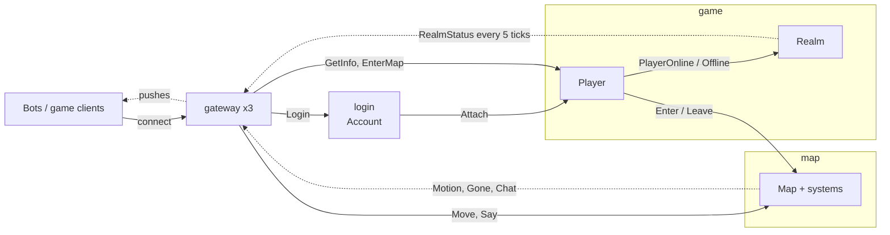

# Sample: a small MMO cluster

One project per server. A node hosts exactly the actors, services and systems compiled into its project (no roles,
no configuration); its startup log lists them, e.g.
`Node map-0 (...) up on ..., 4 shards; actors: Map; services: none; systems: DespawnSystem, MovementSystem, ...`.
Messages are routed by type: a sender never names a server, so moving `Map` into another project changes no caller.

| Project | Server (AppHost name) | Hosts | Handles | Sends |
|---|---|---|---|---|
| [Sample.LoginServer](Sample.LoginServer) | `login` | `Account` service (stateless) | `Login` (client) | `Attach` to the player |
| [Sample.GameServer](Sample.GameServer) | `game` | `Player` actor (id: `PlayerId`), `Realm` actor (one: `RealmId.The`), `RealmBroadcastSystem` | `Attach`; `GetInfo`, `EnterMap` (client); `PlayerOnline`, `PlayerOffline` | `Enter` / `Leave` to maps, `PlayerOnline` / `PlayerOffline` to the realm, `RealmStatus` to every client |
| [Sample.MapServer](Sample.MapServer) | `map` | `Map` actor (id: `MapId`), area-of-interest systems, `MovementSystem` (Sample.Shared) | `Enter`, `Leave`; `Move`, `Say` (client) | `Motion`, `Gone`, `Chat` to the clients that see the avatar |
| [Sample.GatewayServer](Sample.GatewayServer) | `gateway` x3 | nothing: client sockets, session bindings, client groups | | |
| [Sample.GameServer.Components](Sample.GameServer.Components), [Sample.MapServer.Components](Sample.MapServer.Components) | (libraries) | the servers' data: `PlayerProfile` (stored), `PlayerState`, `RealmState`; `MapState`, `MapGrid`, `Avatar` and the interest tags. Kept apart from the logic, which hot reload (planned, N9) will replace (DAS013, ADR-067) | | |
| [Sample.Contracts](Sample.Contracts/Contracts.cs) | (library) | every message, with `[FromClient]` / `[ToClient]` where clients send or receive it; the game's clock (`Timing`) | | |
| [Sample.Shared](Sample.Shared) | (library, `<DaServerShared>`) | rules both sides run: `MovementSystem`, `MapGeometry` (the interest grid); the map server simulates with them, clients predict with them | | |
| [Sample.Client](Sample.Client) | (library) | the game client's logic in an ECS world: a player entity, `Pushes` into components, prediction, input sent on change, the view kept to the 3x3; flows `Player.LogInAsync` / `EnterMapAsync` | `Motion`, `Gone`, `Chat`, `RealmStatus` | `Login`, `EnterMap`, `Move`, `Say` |
| [Sample.Bot](Sample.Bot) | `bots` | the client run as a swarm of simulated players (`DaServer.Simulation`, 10,000 in the AppHost) with a planner at the controls (`Behavior`) | | |
| [Sample.Tests](Sample.Tests) | (tests) | the shared rules, the client, pooled pushes, and the servers in an in-process cluster (DaServer.Testing) | | |

`Player` and `Map` also handle `SessionClosed` / `SessionResumed` when a bound session ends or resumes.



Solid arrows are messages to a handler (the gateway forwards a client message to the actor bound to its session);
dotted arrows are pushes to client sessions and groups, fanned out by the gateways.

## A player's first seconds

```mermaid
sequenceDiagram
    participant C as client
    participant G as gateway
    participant A as login: Account
    participant P as game: Player
    participant M as map: Map
    C->>G: Login("ann")
    G->>A: Login (with the client's session)
    A->>P: Ask(playerId, Attach(session))
    P->>G: BindSession: GetInfo / EnterMap from this session reach this player
    C->>G: EnterMap(7)
    G->>P: EnterMap
    P->>M: Ask(7, Enter(playerId, session))
    M->>G: BindSession: Move / Say from this session reach map 7
    C->>G: Move(1, 0)
    G->>M: Move (Velocity is written; the tick moves the avatar)
    M-->>G: Motion to the viewers of the avatar's cell
    G-->>C: Motion
```

## Bots

A bot is the real client (`Sample.Client`) whose hands are a planner. `Behavior.cs` is the whole behavior:

```csharp
var d = new DomainBuilder<BotFact>();
int wander = d.Primitive<Wandering>();                                  // a task is a component, done when removed
int chat = d.Primitive<Chatting>(requires: BotFact.ChatDue, clears: BotFact.ChatDue);
int travel = d.Primitive<Travelling>(requires: BotFact.TravelDue, clears: BotFact.TravelDue);
int play = d.Compound();
d.Method(play, BotFact.TravelDue, travel, wander)                       // first method that holds wins
    .Method(play, BotFact.ChatDue, chat, wander)
    .Method(play, BotFact.None, wander);
```

`SenseSystem` writes the facts (what is due), and one system carries out each task on the client's own data:
`WanderSystem` steers, `ChatSystem` adds the client's `Speaking`, `TravelSystem` runs the client's
`EnterMapAsync` as a `TaskFlow`. `Telemetry.cs` is a second subscriber of each bot's pushes (the client's own handler
writes the game state): realm broadcast latency and gaps, positions and chat lines. `Program.cs` is the scenario's
options (ConsoleAppFramework: `dotnet run --project samples/mmo/Sample.Bot -- --help`), how a bot starts, and its
verdict; the swarm reports each interval and judges the window: no gap, no disconnect, no failed map change, p99
under the limit.

## Run it

```bash
dotnet run --project samples/mmo/Sample.AppHost                 # dashboard, 3 gateways, 10,000 bots for 60 s
dotnet run --project samples/mmo/Sample.AppHost -- Bots=1000    # fewer bots
dotnet run --project samples/mmo/Sample.AppHost -- Maps=2 TravelEvery=5   # bots change maps every 5 s (the e2e test)
aspire publish --project samples/mmo/Sample.AppHost             # Docker Compose files for the same topology
aspire publish --project samples/mmo/Sample.AppHost -- Publish=k8s   # a Helm chart: plus a load balancer for the gateways,
                                                                 # disruption budgets and in-place VPAs for game and map (Platform.cs)
```

Replicas are one argument in [AppHost.cs](Sample.AppHost/AppHost.cs): `AddNodes<Projects.Sample_MapServer>("map",
replicas: 3)` spreads maps over three map servers by rendezvous hashing of the map id; a loaded map stays where it is
when a server joins (`[Sticky]`, ADR-079).
