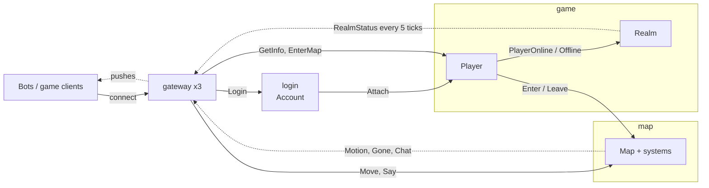

# Sample: a small MMO cluster

One project per server. A node hosts exactly the actors, services and systems compiled into its project (no roles,
no configuration); its startup log lists them, e.g.
`Node map-0 (...) up on ..., 4 shards; actors: Map; services: none; systems: DespawnSystem, MovementSystem, ...`.
Messages are routed by type: a sender never names a server, so moving `Map` into another project changes no caller.

| Project | Server (AppHost name) | Hosts | Handles | Sends |
|---|---|---|---|---|
| [Sample.LoginServer](Sample.LoginServer) | `login` | `Account` service (stateless) | `Login` (client) | `Attach` to the player |
| [Sample.GameServer](Sample.GameServer) | `game` | `Player` actor (id: `PlayerId`), `Realm` actor (one: `RealmId.The`), `RealmBroadcastSystem` | `Attach`; `GetInfo`, `EnterMap` (client); `PlayerOnline`, `PlayerOffline` | `Enter` / `Leave` to maps, `PlayerOnline` / `PlayerOffline` to the realm, `RealmStatus` to every client |
| [Sample.MapServer](Sample.MapServer) | `map` | `Map` actor (id: `MapId`), movement and area-of-interest systems | `Enter`, `Leave`; `Move`, `Say` (client) | `Motion`, `Gone`, `Chat` to the clients that see the avatar |
| [Sample.Gateway](Sample.Gateway) | `gateway` x3 | nothing: client sockets, session bindings, client groups, directing clients | | |
| [Sample.Contracts](Sample.Contracts/Contracts.cs) | (library) | every message, with its `Flow` | | |
| [Sample.Bot](Sample.Bot) | `bots` | game clients (10,000 by default) | `Motion`, `Gone`, `Chat`, `RealmStatus` | `Login`, `EnterMap`, `Move`, `Say` |

`Player` and `Map` also handle `SessionClosed` / `SessionResync` when a bound session ends or resumes.



Solid arrows are messages to a handler (the gateway forwards a client message to the actor bound to its session);
dotted arrows are pushes to client sessions and groups, fanned out by the gateways.

## A player's first seconds

```mermaid
sequenceDiagram
    participant C as client
    participant G as gateway
    participant A as login: Account
    participant P as game: Player
    participant M as map: Map
    C->>G: Login("ann")
    G->>A: Login (with the client's session)
    A->>P: Ask(playerId, Attach(session))
    P->>G: BindSession: GetInfo / EnterMap from this session reach this player
    C->>G: EnterMap(7)
    G->>P: EnterMap
    P->>M: Ask(7, Enter(playerId, session))
    M->>G: BindSession: Move / Say from this session reach map 7
    C->>G: Move(1, 0)
    G->>M: Move (Velocity is written; the tick moves the avatar)
    M-->>G: Motion to the viewers of the avatar's cell
    G-->>C: Motion
```

## Run it

```bash
dotnet run --project samples/mmo/Sample.AppHost                 # dashboard, 3 gateways, 10,000 bots for 60 s
dotnet run --project samples/mmo/Sample.AppHost -- Bots=1000    # fewer bots
aspire publish --project samples/mmo/Sample.AppHost             # Docker Compose files for the same topology
```

Replicas are one argument in [AppHost.cs](Sample.AppHost/AppHost.cs): `AddNodes<Projects.Sample_MapServer>("map",
replicas: 3)` spreads maps over three map servers by rendezvous hashing of the map id.
